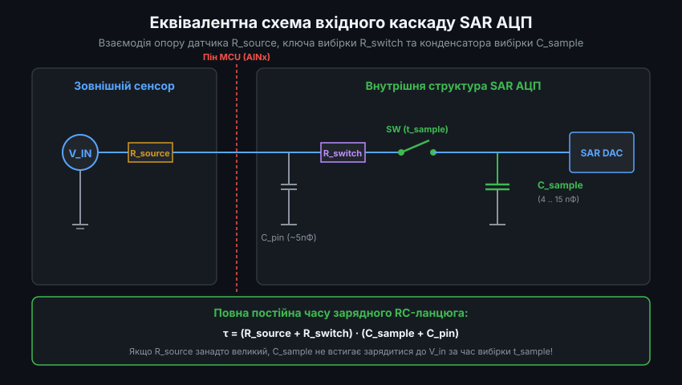
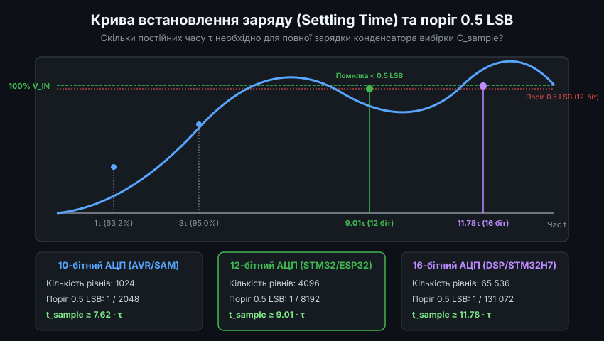
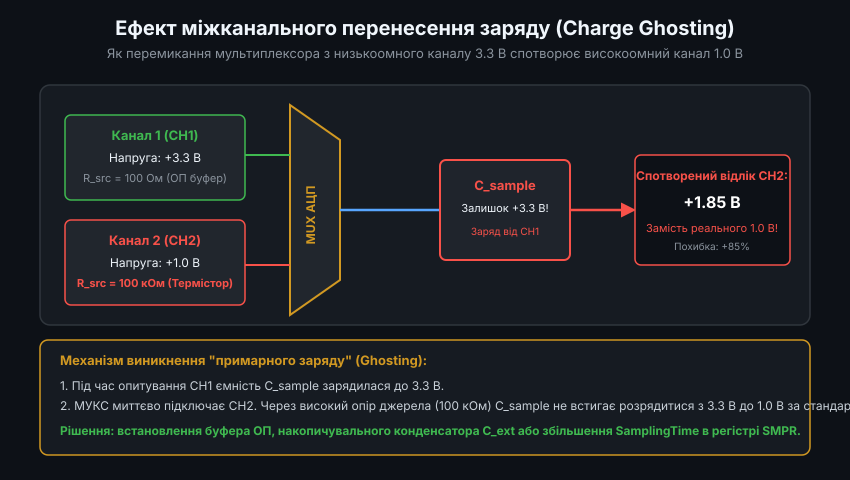
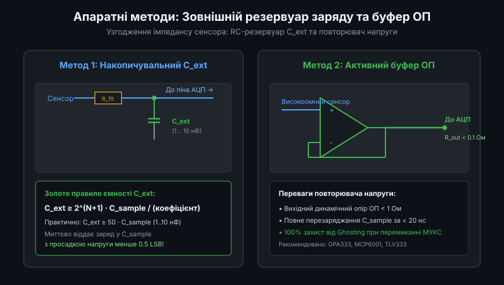
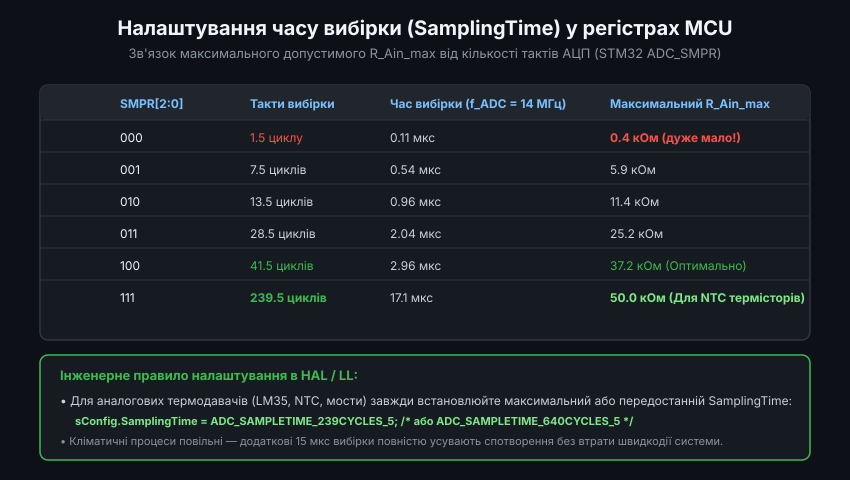

# Динаміка пристрою вибірки та зберігання SAR АЦП

Аналого-цифровий перетворювач послідовного наближення (Successive Approximation Register, SAR ADC) є основним типом АЦП, інтегрованим у сучасні мікроконтролери (STM32, ESP32, AVR, PIC, NXP LPC, SAM). Завдяки високій енергоефективності, середній швидкодії (від 100 кСемпл/с до 5 МСемпл/с) та роздільній здатності 10-16 біт, SAR АЦП широко застосовується для опитування різноманітних кліматичних, оптичних та механічних сенсорів. Проте при підключенні датчиків із високим вихідним опором інженери часто стикаються з незрозумілими похибками вимірювання та перехресними завадами між каналами. Причиною цих аномалій є динамічні процеси перезаряду конденсатора у вхідному пристрої вибірки та зберігання (Sample-and-Hold, S/H).

---

### 1. Архітектура вхідного каскаду SAR АЦП та фази роботи

Пристрій вибірки та зберігання (S/H) призначений для фіксації миттєвого значення неперервної аналогової напруги на час, необхідний для роботи цифрового компаратора та логіки послідовного наближення.

Вхідна еквівалентна схема аналогового каналу мікроконтролера складається з трьох ключових елементів:
- **Вхідна паразитна ємність піна та друкованої плати `C_pin`**: зазвичай становить 3-7 пФ.
- **Опір аналогового ключа мультиплексора `R_switch`**: опір відкритого каналу польового транзистора всередині чипа (типово від 500 Ом до 5 кОм залежно від напруги живлення VDD).
- **Конденсатор вибірки `C_sample`**: прецизійна внутрішня ємність величиною від 4 до 15 пФ.

Робота АЦП суворо розділена на дві послідовні фази:
1. **Фаза вибірки (Sampling / Tracking Phase)**: аналоговий ключ `SW` замикається на фіксований час `t_sample`. Конденсатор `C_sample` підключається до зовнішнього джерела сигналу і починає заряджатися або розряджатися до фактичної напруги сенсора `V_in`.
2. **Фаза перетворення (Hold / Conversion Phase)**: ключ `SW` розмикається, ізолюючи накопичений заряд на конденсаторі `C_sample`. Протягом наступних тактів внутрішній ЦАП та компаратор побітово (від старшого MSB до молодшого LSB) підбирають двійковий цифровий код, еквівалентний збереженій напрузі.

---

### 2. Математична модель встановлення заряду та критерій 0.5 LSB

Коли ключ вибірки замикається, утворюється класичний послідовний RC-ланцюг, у якому загальний опір заряду дорівнює сумі вихідного опору сенсора та ключа: `R_total = R_source + R_switch`.

Перехідний процес напруги на конденсаторі описується експоненційним законом:
`V_c(t) = V_in * (1 - exp(-t / tau))`

де постійна часу RC-ланцюга: `tau = (R_source + R_switch) * C_sample`.

Щоб перетворення АЦП було метрологічно точним, до моменту розмикання ключа (тобто за час `t_sample`) залишкова похибка недозаряду конденсатора не повинна перевищувати вагу половини молодшого розряду (0.5 LSB):
`exp(-t_sample / tau) < 1 / (2^(N + 1))`

Звідси випливає фундаментальний розрахунок мінімально необхідного часу вибірки залежно від розрядності АЦП:
- Для 10-бітного АЦП: `t_sample >= ln(2048) * tau = 7.62 * tau`
- Для 12-бітного АЦП: `t_sample >= ln(8192) * tau = 9.01 * tau`
- Для 16-бітного АЦП: `t_sample >= ln(131072) * tau = 11.78 * tau`

Якщо обраний час вибірки `t_sample` менший за `9.01 * tau`, конденсатор фізично не встигне зарядитися до істинного рівня, і АЦП зафіксує занижене або викривлене значення.

---

### 3. Проблема високого вихідного опору джерела та паразитного перенесення заряду (Ghosting)

Багато популярних кліматичних та вимірювальних сенсорів володіють високим внутрішнім вихідним опором `R_source`:
- Резистивні подільники на базі NTC/PTC термісторів (опір від 10 кОм до 100 кОм).
- Фоторезистори та оптичні сенсори освітленості.
- Виходи датчиків вологості на базі ємнісних мостів без буферних каскадів.

Високий опір джерела створює два критичні негативні ефекти:
1. **Збільшення постійної часу `tau`**: якщо при низькоомному джерелі (100 Ом) постійна часу становить `tau ≈ 1 кОм * 10 пФ = 10 нс`, то при датчику з опором 100 кОм вона зростає до `1 мкс`. Тоді для 12-бітного АЦП час вибірки має становити не менше 9 мікросекунд!
2. **Паразитне перенесення заряду (Charge Ghosting)**: більшість мікроконтролерів мають лише один внутрішній модуль АЦП, перед яким встановлений аналоговий мультиплексор (MUX). Якщо мікроконтролер опитує спочатку канал CH1 із напругою 3.3 В (низькоомне джерело), а одразу наступним кроком перемикається на канал CH2 з напругою 1.0 В (високоомний термістор 100 кОм), заряд 3.3 В залишається на конденсаторі `C_sample`. Через високий опір другого каналу конденсатор просто не встигає розрядитися з 3.3 В до 1.0 В за стандартний час вибірки (наприклад, 1.5 тактів). Як наслідок, показання каналу CH2 виявляються хибно завищеними (наприклад, 1.85 В замість 1.00 В).

---

### 4. Апаратні методи узгодження: накопичувальний конденсатор C_ext та буфер ОП

Для усунення похибок встановлення заряду без штучного уповільнення роботи АЦП застосовують два апаратні схемотехнічні підходи.

1. **Зовнішній накопичувальний конденсатор-резервуар `C_ext`**:
   - Безпосередньо біля виводу вхідного піна АЦП встановлюється якісний керамічний конденсатор (типу C0G/NP0 або X7R) ємністю від 1 до 10 нФ паралельно із сигналом на землю.
   - Оскільки ємність `C_ext` у 100-500 разів перевищує внутрішню ємність `C_sample` (10 пФ), під час замикання ключа вибірки відбувається швидкий перерозподіл заряду між конденсаторами. Просадка напруги на `C_ext` становить мізерну величину: `Delta_V = V_in * (C_sample / C_ext) < 0.5 LSB`.
   - Заряджання `C_sample` відбувається не через високоомний сенсор, а від резервуара `C_ext` з надзвичайно малим внутрішнім опором.
2. **Активний повторювач напруги на ОП (Voltage Follower / Unity-Gain Buffer)**:
   - Між високоомним сенсором та входом АЦП встановлюється операційний підсилювач Rail-to-Rail (наприклад, OPA333 або MCP6001).
   - ОП має гігантський вхідний опір (понад 10^12 Ом), що виключає навантаження на сенсор, і надзвичайно малий вихідний динамічний опір (менше 0.1 Ом), що гарантує миттєвий заряд ємності `C_sample` за лічені наносекунди та 100% придушення ефекту Ghosting.

---

### 5. Програмне налаштування та розрахунок регістрів часу вибірки MCU

Якщо введення додаткових апаратних компонентів (ОП або зовнішніх конденсаторів) обмежене вартістю або габаритами плати, проблему вирішують правильним програмним конфігуруванням внутрішніх таймінгів АЦП.

У популярних мікроконтролерах сімейства STM32 за тривалість фази вибірки для кожного аналогового каналу відповідають регістри `ADC_SMPR1` та `ADC_SMPR2`. Розробник може вибрати кількість тактових циклів вибірки `SamplingTime`: від мінімальних 1.5 циклів до максимальних 239.5 циклів (або 640.5 циклів у серіях STM32G4/L4/H7).

Інженерний регламент налаштування прошивки:
- При опитуванні швидких низькоомних сигналів (виходи ОП, джерела живлення): встановлюється мінімальний час (1.5 або 7.5 циклів).
- При опитуванні небуферизованих сенсорів (термістори NTC, фоторезистори, виходи LM35 з довгими кабелями): обов'язково обирається максимальний доступний час вибірки:
  `ADC_SAMPLETIME_239CYCLES_5` або `ADC_SAMPLETIME_640CYCLES_5`.

Оскільки кліматичні параметри (температура та вологість) змінюються повільно, збільшення часу вибірки з 0.1 мкс до 15-20 мкс абсолютно не впливає на загальну швидкодію мікроконтролера, але гарантує повне заспокоєння перехідного процесу і нульову похибку вимірювання.
