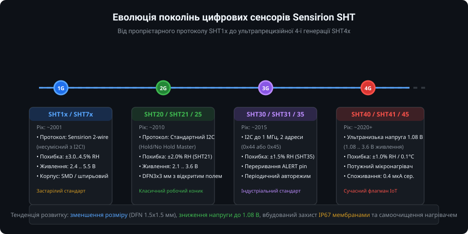
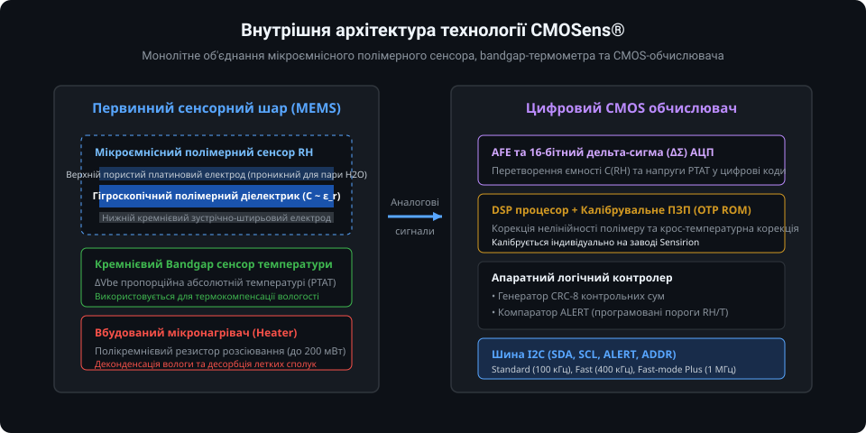
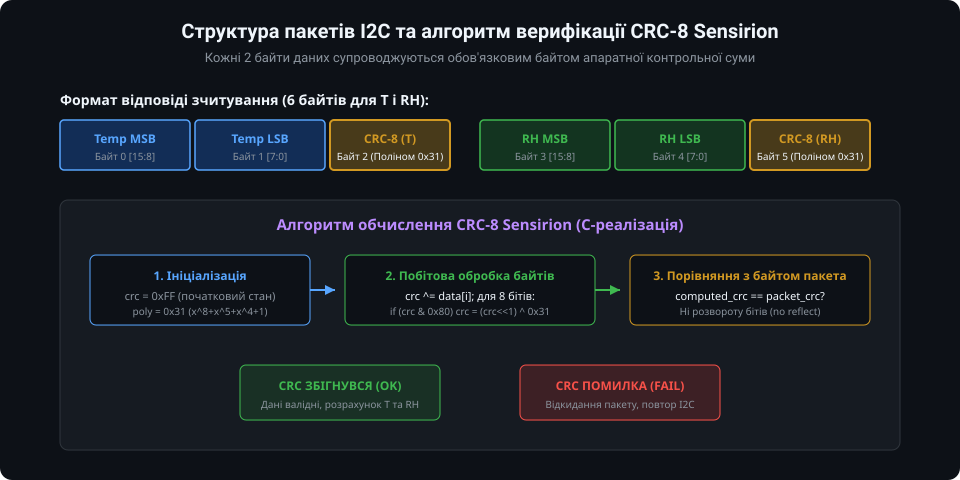
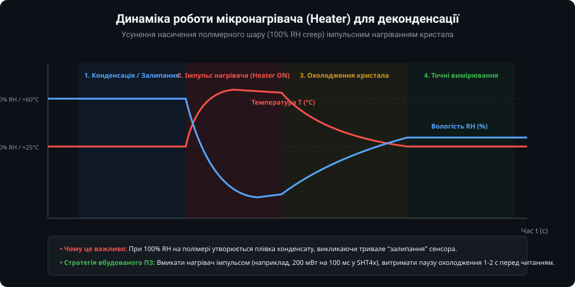

# Огляд родини цифрових давачів Sensirion SHT: поглиблений інженерний аналіз

Цифрові сенсори температури та відносної вологості серії Sensirion SHT представляють собою вершину розвитку мікроелектромеханічних систем (MEMS) у поєднанні з КМОН-схемотехнікою (CMOS). У цьому розділі розглядаються глибокі фізичні принципи сорбції, схемотехнічна реалізація інтерфейсів I2C, математичний аналіз алгоритмів контролю цілісності даних CRC-8, термодинамічні аспекти керування мікронагрівачем та повноцінна низькорівнева реалізація універсального драйвера для мікроконтролерів.

---

### 1. Порівняльний аналіз інтерфейсів та еволюція апаратної частини

Еволюція лінійки Sensirion SHT відображає перехід мікроелектроніки від пропрієтарних нестандартних протоколів початку 2000-х років до високошвидкісних енергоефективних відкритих стандартів:



#### Порівняльна таблиця апаратних інтерфейсів поколінь SHT

| Параметр | SHT1x / SHT7x (1G) | SHT2x (2G) | SHT3x (3G) | SHT4x (4G) |
| :--- | :--- | :--- | :--- | :--- |
| **Фізичний інтерфейс** | Пропрієтарний 2-wire | Стандартний I2C | Fast-mode Plus I2C | Fast-mode Plus I2C |
| **Максимальна частота шини** | ~1..5 МГц (ручний строб) | 400 кГц | До 1000 кГц (1 МГц) | До 1000 кГц (1 МГц) |
| **Адресація на шині I2C** | Відсутня (індивідуальний SCK) | 0x40 (фіксована) | 0x44 (ADDR=L) / 0x45 (ADDR=H) | 0x44 (стандарт) / 0x45 (опція) |
| **Режими синхронізації** | Повний ручний поллінг | Hold Master / No Hold Master | Single-shot / Periodic | Single-shot (висока/середня/низька точність) |
| **Діапазон живлення (VDD)** | 2.4 .. 5.5 В | 2.1 .. 3.6 В | 2.15 .. 5.5 В | **1.08 .. 3.6 В** |
| **Споживання струму в сні** | ~0.3 мкА | ~0.15 мкА | ~0.2 мкА | **~0.08 мкА (80 нА)** |
| **Апаратний пін ALERT** | Немає | Немає | Є (компаратор із гістерезисом) | Немає (оптимізація під ультракомпактний корпус) |
| **Корпус та габарити** | LCC / 4-pin SIP | DFN 3.0 x 3.0 x 1.1 мм | DFN 2.5 x 2.5 x 0.9 мм | **DFN 1.5 x 1.5 x 0.55 мм** |

У першому поколінні SHT1x запуск транзакції вимагав специфічної послідовності сигналів: утримання лінії DATA у високому стані при переході SCK у високий стан, потім спад DATA, наростання SCK і підйом DATA. Ця комбінація не відповідала стандарту START-умови шини I2C і призводила до зависання стандартних апаратних контролерів I2C при спробі розміщення сенсора на спільній шині з іншими периферійними пристроями.

Починаючи з покоління SHT2x, Sensirion перейшла на чистий стандарт I2C. У SHT2x використовувалося утримання лінії SCL сенсором (Clock Stretching, або режим Hold Master) під час перетворення АЦП, що створювало проблеми на деяких процесорах (наприклад, помилка I2C clock stretching bug у ранніх ревізіях Raspberry Pi SoC). 

У серіях SHT3x та SHT4x підтримка Clock Stretching є опціональною або повністю усунутою: мікроконтролер надсилає команду вимірювання, витримує необхідний час очікування (наприклад, 4..15 мс залежно від роздільної здатності) за допомогою апаратного таймера або RTOS-затримки, після чого зчитує готовий пакет даних.

---

### 2. Фізичні засади технології CMOSens та сорбційна модель

Основою високої стабільності та чутливості сенсорів Sensirion є монолітна інтеграція сенсорних елементів і КМОН-електроніки на одному кристалі:



#### Фізика ємнісного вимірювання відносної вологості
Чутливий елемент вологості є планарним мікроконденсатором, у якому діелектриком виступає спеціально модифікований термореактивний полімер. Ємність такої структури визначається рівнянням:

`C = epsilon_0 * epsilon_r * (A / d)`

де:
- `epsilon_0` — діелектрична проникність вакууму (8.854e-12 Ф/м);
- `epsilon_r` — ефективна діелектрична проникність полімерного шару;
- `A` та `d` — ефективна площа перекриття зустрічно-штирьових електродів та відстань між ними.

Сухий полімер має діелектричну проникність порядку `epsilon_poly = 2.5 .. 3.5`. При контакті з вологим повітрям молекули води (які мають дуже високу відносну проникність `epsilon_water = 78..80` через виражений дипольний момент молекули H2O) дифундують крізь верхній пористий платиновий шар у мікропори полімерної матриці.

Збільшення кількості абсорбованої води за ізотермою сорбції викликає лінійне зростання ефективної діелектричної проникності:

`epsilon_r(RH) = epsilon_poly * (1 - gamma) + epsilon_water * gamma`

де `gamma` — об'ємна частка вологи, пропорційна парціальному тиску водяної пари у повітрі (тобто відносній вологості RH). Базова ємність сенсора змінюється від декількох пікофарад (pF) при 0% RH до значень на 20..30% вищих при 100% RH.

#### Взаємна термокомпенсація (Cross-temperature compensation)
Оскільки об'ємна адсорбція води у полімер є термодинамічним процесом, чутливість діелектрика залежить від температури кристала. Для компенсації температурного коефіцієнта ємності безпосередньо поруч із полімерним елементом розташований транзисторний Bandgap-термометр на основі принципу PTAT (Proportional to Absolute Temperature). 

Різниця напруг емітер-база двох біполярних транзисторів, що працюють із різною густиною струму:

`Delta_V_be = (k * T / q) * ln(N)`

забезпечує лінійну залежність від температури у кельвінах (T) без дрейфу нуля. 16-бітний вбудований процесор цифрової обробки сигналів (DSP) за формулами з калібрувального ПЗП здійснює матричну корекцію:

`RH_compensated = a_0 + a_1 * S_RH + a_2 * (S_RH)^2 + (b_0 + b_1 * S_RH) * (T - 25.0)`

Усі коефіцієнти лінеаризації визначаються індивідуально на виробництві Sensirion за кількох точок контролю вологості (10%, 50%, 90% RH) та температури.

---

### 3. Математика контролю цілісності даних CRC-8

У промислових системах довжина шлейфу шини I2C може досягати від десятків сантиметрів до кількох метрів. Ємнісні наведення, комутаційні завади від електродвигунів та електромагнітні перешкоди (EMI) можуть спотворити передані байти даних. Перевірка контрольної суми CRC-8 гарантує виявлення поодиноких бітових помилок, подвійних помилок та пакетних спотворень довжиною до 8 біт.



#### Параметри полінома Sensirion CRC-8
- **Поліном:** `x^8 + x^5 + x^4 + 1` (двійковий вигляд: `1 0011 0001`, шістнадцятковий: `0x31`);
- **Ініціалізаційне значення (Seed):** `0xFF`;
- **Рефлексія вхідних даних (Reflect In):** False (старший біт MSB передається першим);
- **Рефлексія вихідних даних (Reflect Out):** False;
- **Фінальний XOR:** `0x00`.

#### Реалізація CRC-8: побітовий розрахунок проти табличного
Для систем із жорстким обмеженням flash-пам'яті (Cortex-M0, AVR) використовується побітовий алгоритм:

```c
#include <stdint.h>

/**
 * @brief Побітовий розрахунок контрольної суми CRC-8 для протоколу Sensirion
 * @param data Вказівник на буфер даних (зазвичай 2 байти)
 * @param len Кількість байтів (2)
 * @return Розрахований 8-бітний код контрольної суми
 */
uint8_t sensirion_crc8_bitwise(const uint8_t *data, uint8_t len) {
    uint8_t crc = 0xFF; // Початковий стан ініціалізації
    const uint8_t polynomial = 0x31; // x^8 + x^5 + x^4 + 1

    for (uint8_t i = 0; i < len; i++) {
        crc ^= data[i];
        for (uint8_t bit = 0; bit < 8; bit++) {
            if (crc & 0x80) {
                crc = (uint8_t)((crc << 1) ^ polynomial);
            } else {
                crc = (uint8_t)(crc << 1);
            }
        }
    }
    return crc;
}
```

Для високошвидкісних застосувань або систем з частим опитуванням шини формується таблиця підстановки на 256 елементів у ROM:

```c
static const uint8_t crc8_lut[256] = {
    0x00, 0x31, 0x62, 0x53, 0xC4, 0xF5, 0xA6, 0x97, 0xB9, 0x88, 0xDB, 0xEA, 0x7D, 0x4C, 0x1F, 0x2E,
    0x43, 0x72, 0x21, 0x10, 0x87, 0xB6, 0xE5, 0xD4, 0xFA, 0xCB, 0x98, 0xA9, 0x3E, 0x0F, 0x5C, 0x6D,
    // ... повна таблиця 256 байт
};

uint8_t sensirion_crc8_fast(const uint8_t *data, uint8_t len) {
    uint8_t crc = 0xFF;
    for (uint8_t i = 0; i < len; i++) {
        crc = crc8_lut[crc ^ data[i]];
    }
    return crc;
}
```

Табличний метод замінює 8 циклів зсуву та умовних XOR однією операцією вибірки з пам'яті, прискорюючи верифікацію пакета майже в 10 разів.

---

### 4. Термодинаміка та алгоритми мікронагрівача (Heater)

Інтегрований полікремнієвий нагрівальний елемент є критично важливим вузлом сенсорів Sensirion. Він дозволяє вирішити явище "залипання" або гігроскопічного гістерезису, що виникає внаслідок капілярної конденсації води у нанопорах полімеру:



#### Теплова потужність та часові константи
- У **SHT3x** потужність нагрівача фіксована або обмежена програмним перемикачем у регістрі конфігурації (розсіювана потужність складає близько 33 мВт при VDD = 3.3 В).
- У **SHT4x** впроваджено гнучкий імпульсний генератор потужності із трьома рівнями:
  1. `High Heater` (потужність ~200 мВт);
  2. `Medium Heater` (потужність ~110 мВт);
  3. `Low Heater` (потужність ~20 мВт).
  Тривалість імпульсу задається апаратно фіксованими командами: 1 секунда (long pulse) або 0.1 секунди (short pulse).

#### Алгоритм деконденсації та десорбції летких сполук (VOC)
Якщо пристрій працює в теплиці, погребі або автоклаві при 98..100% RH тривалий час, мікроконтролер повинен виконувати наступну послідовність дій:
1. Зафіксувати утримання показів вологості понад 99% протягом критичного проміжку часу (наприклад, понад 10 хвилин).
2. Надіслати команду активації нагрівача (для SHT4x: команда `0x39` — 200 мВт на 100 мс).
3. Після відпрацювання імпульсу локальна температура сенсора зростає на 15..40 °C, що знижує відносну вологість безпосередньо над полімером до значень нижче 20% і змушує рідку вологу інтенсивно випаровуватися.
4. Програмно заблокувати зняття робочих показів на час теплової релаксації (для DFN корпусу часова константа охолодження `tau_cool` складає близько 1.5..2 с).
5. Після повернення температури до температури навколишнього середовища відновити нормальне періодичне зчитування кліматичних параметрів.

---

### 5. Повнофункціональна реалізація драйвера на C (SHT3x / SHT4x)

Нижче наведено модульний виробничий драйвер мовою C, оптимізований для мікроконтролерів STM32 (HAL/LL), ESP32 або nRF52, з підтримкою розрахунку CRC-8, ініціалізації та декодування кліматичних величин.

#### Заголовний файл драйвера (`sensirion_sht.h`)

```c
#ifndef SENSIRION_SHT_H
#define SENSIRION_SHT_H

#include <stdint.h>
#include <stdbool.h>

#define SHT3X_I2C_ADDR_DEFAULT  0x44
#define SHT3X_I2C_ADDR_ALT      0x45

#define SHT4X_I2C_ADDR_DEFAULT  0x44

/* Команди для SHT3x */
#define SHT3X_CMD_MEAS_HIGHREP  0x2400  // High repeatability, no clock stretching
#define SHT3X_CMD_MEAS_MEDREP   0x240B  // Medium repeatability
#define SHT3X_CMD_MEAS_LOWREP   0x2416  // Low repeatability
#define SHT3X_CMD_HEATER_ENABLE 0x306D  // Включення нагрівача
#define SHT3X_CMD_HEATER_DISABLE 0x3066 // Вимкнення нагрівача
#define SHT3X_CMD_SOFT_RESET    0x30A2  // Програмний перезапуск

/* Команди для SHT4x */
#define SHT4X_CMD_MEAS_HIGHREP  0xFD    // High precision
#define SHT4X_CMD_MEAS_MEDREP   0xF6    // Medium precision
#define SHT4X_CMD_MEAS_LOWREP   0xE0    // Lowest precision
#define SHT4X_CMD_HEAT_HIGH_100MS 0x39  // 200 mW heater, 100 ms pulse
#define SHT4X_CMD_SOFT_RESET    0x94

typedef enum {
    SHT_MODEL_SHT3X = 0,
    SHT_MODEL_SHT4X
} sht_model_t;

typedef struct {
    float temperature_c;
    float humidity_rh;
} sht_reading_t;

typedef bool (*sht_i2c_write_fn)(uint8_t addr, const uint8_t *data, uint16_t len);
typedef bool (*sht_i2c_read_fn)(uint8_t addr, uint8_t *data, uint16_t len);
typedef void (*sht_delay_ms_fn)(uint32_t ms);

typedef struct {
    sht_model_t model;
    uint8_t i2c_addr;
    sht_i2c_write_fn i2c_write;
    sht_i2c_read_fn i2c_read;
    sht_delay_ms_fn delay_ms;
} sht_dev_t;

bool sht_init(sht_dev_t *dev, sht_model_t model, uint8_t addr,
              sht_i2c_write_fn w_fn, sht_i2c_read_fn r_fn, sht_delay_ms_fn d_fn);
bool sht_reset(sht_dev_t *dev);
bool sht_read_single_shot(sht_dev_t *dev, sht_reading_t *out_reading);
bool sht_trigger_heater(sht_dev_t *dev);

#endif /* SENSIRION_SHT_H */
```

#### Файл реалізації драйвера (`sensirion_sht.c`)

```c
#include "sensirion_sht.h"

static uint8_t sht_calc_crc8(const uint8_t *data, uint8_t len) {
    uint8_t crc = 0xFF;
    const uint8_t poly = 0x31;
    for (uint8_t i = 0; i < len; i++) {
        crc ^= data[i];
        for (uint8_t bit = 0; bit < 8; bit++) {
            if (crc & 0x80) {
                crc = (uint8_t)((crc << 1) ^ poly);
            } else {
                crc = (uint8_t)(crc << 1);
            }
        }
    }
    return crc;
}

bool sht_init(sht_dev_t *dev, sht_model_t model, uint8_t addr,
              sht_i2c_write_fn w_fn, sht_i2c_read_fn r_fn, sht_delay_ms_fn d_fn) {
    if (!dev || !w_fn || !r_fn || !d_fn) return false;
    dev->model = model;
    dev->i2c_addr = addr;
    dev->i2c_write = w_fn;
    dev->i2c_read = r_fn;
    dev->delay_ms = d_fn;
    return sht_reset(dev);
}

bool sht_reset(sht_dev_t *dev) {
    uint8_t cmd_buf[2];
    bool res = false;
    if (dev->model == SHT_MODEL_SHT3X) {
        cmd_buf[0] = (uint8_t)(SHT3X_CMD_SOFT_RESET >> 8);
        cmd_buf[1] = (uint8_t)(SHT3X_CMD_SOFT_RESET & 0xFF);
        res = dev->i2c_write(dev->i2c_addr, cmd_buf, 2);
    } else {
        cmd_buf[0] = SHT4X_CMD_SOFT_RESET;
        res = dev->i2c_write(dev->i2c_addr, cmd_buf, 1);
    }
    dev->delay_ms(2); // Час перезавантаження кристала
    return res;
}

bool sht_read_single_shot(sht_dev_t *dev, sht_reading_t *out_reading) {
    if (!dev || !out_reading) return false;
    uint8_t cmd_buf[2];
    uint8_t rx_buf[6];

    if (dev->model == SHT_MODEL_SHT3X) {
        cmd_buf[0] = (uint8_t)(SHT3X_CMD_MEAS_HIGHREP >> 8);
        cmd_buf[1] = (uint8_t)(SHT3X_CMD_MEAS_HIGHREP & 0xFF);
        if (!dev->i2c_write(dev->i2c_addr, cmd_buf, 2)) return false;
        dev->delay_ms(15); // Час конверсії високої повторюваності для SHT3x
    } else {
        cmd_buf[0] = SHT4X_CMD_MEAS_HIGHREP;
        if (!dev->i2c_write(dev->i2c_addr, cmd_buf, 1)) return false;
        dev->delay_ms(9);  // Час вимірювання високої точності для SHT4x
    }

    if (!dev->i2c_read(dev->i2c_addr, rx_buf, 6)) return false;

    // Перевірка CRC для температури (байти 0, 1 проти байта 2)
    if (sht_calc_crc8(&rx_buf[0], 2) != rx_buf[2]) return false;

    // Перевірка CRC для вологості (байти 3, 4 проти байта 5)
    if (sht_calc_crc8(&rx_buf[3], 2) != rx_buf[5]) return false;

    uint16_t raw_temp = ((uint16_t)rx_buf[0] << 8) | rx_buf[1];
    uint16_t raw_hum  = ((uint16_t)rx_buf[3] << 8) | rx_buf[4];

    if (dev->model == SHT_MODEL_SHT3X) {
        out_reading->temperature_c = -45.0f + 175.0f * ((float)raw_temp / 65535.0f);
        out_reading->humidity_rh   = 100.0f * ((float)raw_hum / 65535.0f);
    } else {
        out_reading->temperature_c = -45.0f + 175.0f * ((float)raw_temp / 65535.0f);
        out_reading->humidity_rh   = -6.0f + 125.0f * ((float)raw_hum / 65535.0f);
    }

    // Кліпування вологості до фізичного діапазону [0..100] % RH
    if (out_reading->humidity_rh < 0.0f)   out_reading->humidity_rh = 0.0f;
    if (out_reading->humidity_rh > 100.0f) out_reading->humidity_rh = 100.0f;

    return true;
}

bool sht_trigger_heater(sht_dev_t *dev) {
    if (!dev) return false;
    if (dev->model == SHT_MODEL_SHT4X) {
        uint8_t cmd = SHT4X_CMD_HEAT_HIGH_100MS;
        if (!dev->i2c_write(dev->i2c_addr, &cmd, 1)) return false;
        dev->delay_ms(110); // Вичікуємо імпульс нагрівача 100 мс + запас
        return true;
    } else {
        uint8_t cmd[2] = { (uint8_t)(SHT3X_CMD_HEATER_ENABLE >> 8), (uint8_t)(SHT3X_CMD_HEATER_ENABLE & 0xFF) };
        if (!dev->i2c_write(dev->i2c_addr, cmd, 2)) return false;
        dev->delay_ms(500); // 500 мс нагріву
        cmd[0] = (uint8_t)(SHT3X_CMD_HEATER_DISABLE >> 8);
        cmd[1] = (uint8_t)(SHT3X_CMD_HEATER_DISABLE & 0xFF);
        return dev->i2c_write(dev->i2c_addr, cmd, 2);
    }
}
```

---

### Підсумки та інженерні рекомендації

1. **Цілісність шини I2C:** Завжди використовуйте підтягувальні резистори R_pullup номіналом 2.2..4.7 кОм для лінії зв'язку понад 20 см і обов'язково верифікуйте обидва байти CRC-8 у кожній транзакції.
2. **Топологія друкованої плати:** Розміщуйте сенсор на ізольованому тепловому острівці друкованої плати (фрезерування пазів навколо сенсора) для мінімізації паразитного нагрівання від процесора живлення чи мікроконтролера.
3. **Хімічна сумісність:** Не допускайте прямого контакту активної полімерної зони з парами летких кремнійорганічних сполук (герметики, силіконові мастила) та концентрованими розчинниками, оскільки вони призводять до незворотного отруєння діелектрика.
