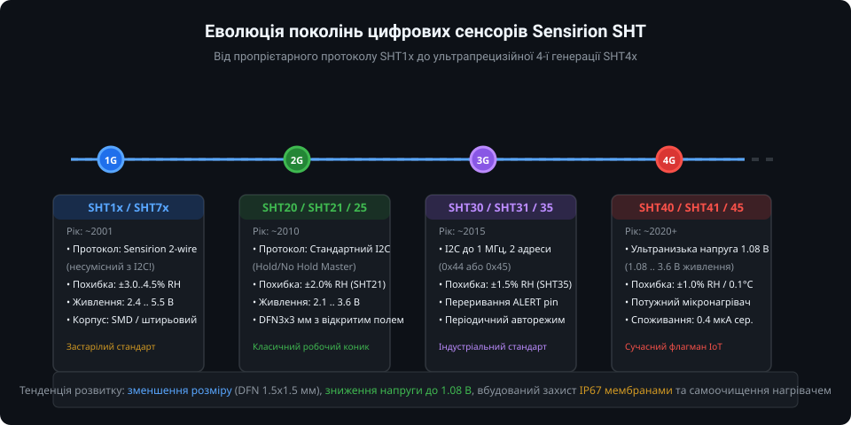
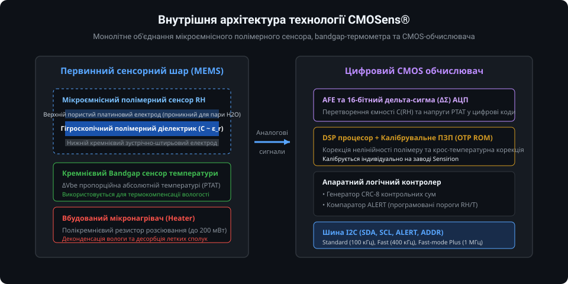
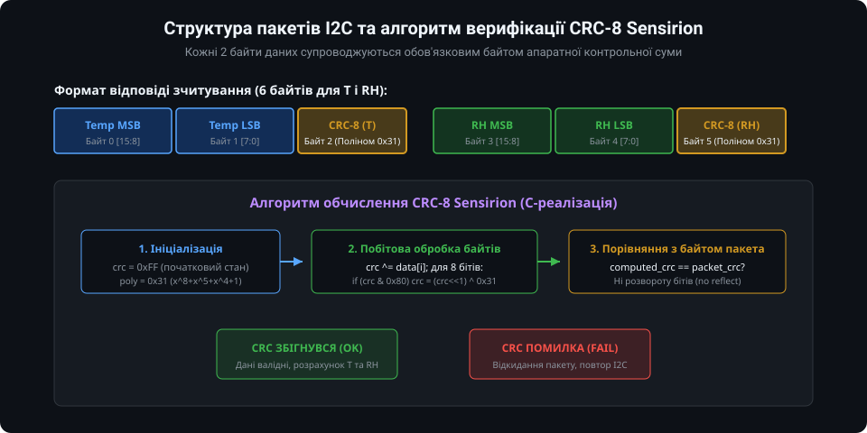
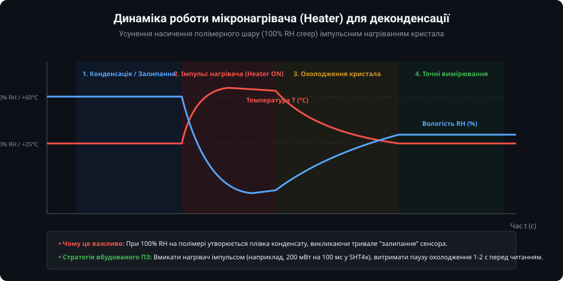
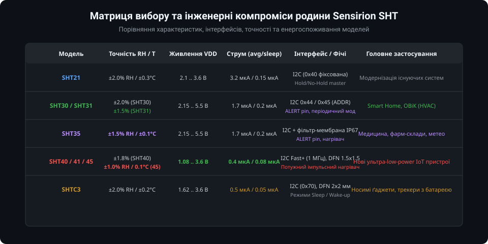

# Огляд родини цифрових давачів Sensirion SHT

Родина комбінованих цифрових сенсорів температури та відносної вологості серії SHT від швейцарської компанії Sensirion є де-факто глобальним промисловим стандартом у сфері кліматичного моніторингу, медичного обладнання, автоматизації будівель (HVAC) та енергоефективного Інтернету речей (IoT). Успіх цієї серії базується на поєднанні високої повторюваності, заводського калібрування, високої стійкості до зовнішніх впливів та фірмової технології CMOSens.

---

### 1. Еволюція поколінь Sensirion SHT: від SHT1x до SHT4x

Розвиток лінійки SHT демонструє послідовну оптимізацію енергоефективності, зменшення геометричних розмірів, підвищення точності та стандартизацію інтерфейсів зв'язку:

- **1-ше покоління (SHT10, SHT11, SHT15, SHT71, SHT75):** Перші масові цифрові давачі Sensirion. Використовували нестандартний 2-провідний інтерфейс Sensirion (зовні схожий на I2C, але несумісний за стартовою послідовністю і таймінгами). Сенсори вимагали напруги 2.4..5.5 В і постачалися у поверхневому LCC або штирьовому корпусі.
- **2-ге покоління (SHT20, SHT21, SHT25):** Впровадження стандартного інтерфейсу I2C (з фіксованою адресою 0x40), режимів Hold Master / No Hold Master, а також ультракомпактного корпусу DFN 3x3 мм з відкритим сенсорним вікном. SHT21 забезпечував точність ±2.0% RH та ±0.3 °C.
- **3-тє покоління (SHT30, SHT31, SHT35):** Індустріальний бестселер. Підтримка двох адрес I2C (0x44 або 0x45 через пін ADDR), робота на частоті шини до 1 МГц, вбудований апаратний компаратор з виводом ALERT для пробудження мікроконтролера, захисна мембрана IP67 та підвищена точність до ±1.5% RH (SHT35).
- **4-те покоління (SHT40, SHT41, SHT45):** Сучасний флагман. Мініатюрний корпус DFN 1.5x1.5x0.55 мм, наднадійна робота при низькій напрузі від 1.08 В до 3.6 В, середнє струмоспоживання від 0.4 мкА, точність до ±1.0% RH (SHT45) та багатоступеневий потужний мікронагрівач.

---

### 2. Архітектура та фізичні засади технології CMOSens

Головною інновацією Sensirion є об'єднання сенсорних структур і цифрової обчислювальної системи на єдиному кристалі кремнію (технологія CMOSens):

Сенсорний елемент містить:
1. **Ємнісний датчик вологості:** Представляє собою конденсатор із зустрічно-штирьовими електродами, покритими спеціальним гігроскопічним полімером. При поглинанні молекул водяної пари з повітря діелектрична проникність полімеру змінюється пропорційно відносній вологості середовища, викликаючи пропорційну зміну ємності (порядку декількох пікофарад). Верхній пористий електрод пропускає вологу, але блокує механічний пил та рідинні краплі.
2. **Bandgap-сенсор температури:** Створений на основі кремнієвих транзисторних структур, що генерують напругу, пропорційну абсолютній температурі (PTAT). Оскільки діелектричні властивості полімеру залежать від температури, дані з термометра використовуються для внутрішньої апаратної термокомпенсації каналу вологості.
3. **Аналоговий інтерфейс (AFE) та АЦП:** 16-бітний дельта-сигма перетворювач перетворює надмалі зміни ємності та напруги у вихідний двійковий код з мінімальним рівнем шумів.
4. **Калібрувальне ПЗП (OTP ROM):** Під час фабричного виготовлення кожен екземпляр калібрується в прецизійних кліматичних камерах, а індивідуальні коефіцієнти лінеаризації зашиваються у внутрішню енергонезалежну пам'ять.

---

### 3. Цифровий обмін за шиною I2C та верифікація CRC-8

На відміну від застарілих сенсорів із простим протоколом без підтвердження цілісності, родина SHT використовує надійну схему передачі з обов'язковою перевіркою контрольних сум:

Формат типового кадру зчитування температури та вологості складається з 6 байтів:
- Байти 0..1: 16-бітний сирий код температури (MSB, LSB).
- Байт 2: 8-бітний контрольний код CRC-8 температури.
- Байти 3..4: 16-бітний сирий код вологості (MSB, LSB).
- Байт 5: 8-бітний контрольний код CRC-8 вологості.

Алгоритм генерації контрольної суми Sensirion базується на стандартному поліномі:
`P(x) = x^8 + x^5 + x^4 + 1` (поліноміальне число `0x31`) з початковим значенням `0xFF`. Якщо розрахована мікроконтролером контрольна сума не збігається з отриманим байтом, транзакція відкидається як пошкоджена завадами на шині.

Формули перерахунку сирих 16-бітних значень у фізичні одиниці для серій SHT3x та SHT4x:
- Температура (°C): `T = -45 + 175 * (S_T / 65535)`
- Відносна вологість (% RH): `RH = 100 * (S_RH / 65535)` (з програмним обмеженням діапазону 0..100%).

---

### 4. Робота вбудованого мікронагрівача (Heater)

В умовах тривалої експлуатації при високій вологості (95..100% RH) або різкому перепаді температури на поверхні полімеру може виникати пряма конденсація води (точка роси). Це призводить до насичення полімерного шару і тривалого дрейфу показів (сенсор "залипає" на 100% RH навіть після нормалізації умов).

Для вирішення цієї проблеми кристали SHT оснащені інтегрованим мікронагрівачем:
- **Функція деконденсації:** Короткочасна активація нагрівача піднімає локальну температуру кристала на кілька десятків градусів вище точки роси середовища, викликаючи швидке випаровування водяної плівки з пор полімеру.
- **Десорбція органічних забрудників:** Нагрівання сприяє видаленню з полімеру летких органічних речовин (VOC, спирти, розчинники), відновлюючи чутливість після впливу хімічних випарів.
- **Термодинамічний алгоритм:** Вмикати нагрівач слід імпульсно (від десятків мілісекунд до 1 секунди). Під час роботи нагрівача покази температури завищені, а відносної вологості — занижені. Після вимкнення нагрівача керуюча програма витримує паузу релаксації (1..3 с) для охолодження кристала перед взяттям валідних кліматичних вимірювань.

---

### 5. Інженерна матриця вибору сенсорів родини SHT

Вибір оптимального сенсора для проекту залежить від вимог до автономності, робочої напруги живлення та необхідної точності:

1. **SHT30:** Бюджетне, але високоякісне рішення для побутових метеостанцій, термостатів та розумного дому. Підтримує широкий діапазон живлення (2.15..5.5 В), що робить його зручним для 3.3 В та 5 В систем.
2. **SHT31:** Оптимальний вибір для HVAC, лабораторних приладів та систем моніторингу серверних кімнат завдяки підвищеній точності (±2.0% RH, ±0.2 °C).
3. **SHT35:** Прецизійний еталон для медичних інкубаторів, фармацевтичних складів та метеорологічних зондів (точність ±1.5% RH та ±0.1 °C). Часто постачається з захисною дихаючою мембраною IP67.
4. **SHT40 / SHT41 / SHT45:** Безальтернативні лідери для сучасних батарейних бездротових вузлів (BLE, Zigbee, LoRaWAN, NB-IoT). Завдяки живленню від 1.08 В сенсор може живитися напряму від літієвої батареї до повного її розряду, а наднадійний корпус DFN 1.5x1.5 мм заощаджує площу друкованої плати.
5. **SHTC3:** Спеціалізований бюджетний сенсор для масових портативних ґаджетів із вбудованими режимами глибокого сну та швидкого пробудження.

---

### Підсумки та висновки

Родина Sensirion SHT поєднує передову мікроелектромеханічну технологію CMOSens із надійною цифровою обробкою. Вбудована перевірка цілісності CRC-8 виключає спотворення даних у промислових лініях зв'язку, а мікронагрівач забезпечує стабільну роботу в екстремальних умовах підвищеної вологості. При проектуванні нових енергоефективних пристроїв рекомендовано обирати сенсори 4-го покоління (SHT4x), тоді як для промислових 5 В систем із потребою апаратного виводу переривання ALERT залишається актуальною серія SHT3x.
