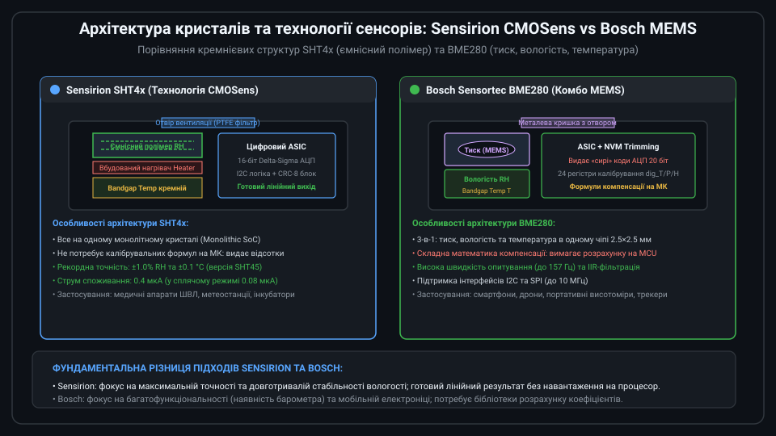
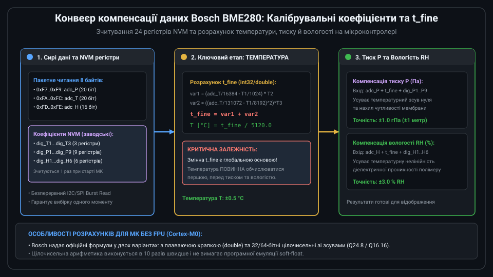
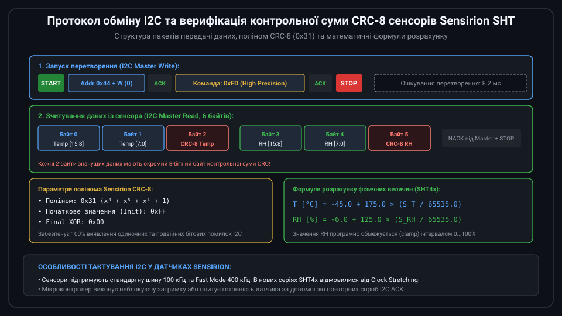

# Поглиблений інженерний аналіз та драйвери сенсорів Sensirion SHT та Bosch BME

Сенсори сімейств Sensirion SHT (SHT3x, SHT4x) та Bosch Sensortec BME (BME280, BME680) представляють дві провідні архітектурні школи сучасної цифрової метеорології. Розробка надійної апаратури на їхній основі вимагає розуміння фізики сорбції вологи в полімерних діелектриках, математичних методів компенсації перехресної чутливості, правил трасування друкованих плат із тепловою розв'язкою та захисту від хімічного отруєння кристалів.



---

## 1. Фізика ємнісного вимірювання вологості та перехресна температурна чутливість

Ємнісний метод вимірювання відносної вологості (Relative Humidity, RH) базується на винятковій різниці між діелектричною проникністю рідкої/сорбованої води та полімерної матриці:
* Відносна діелектрична проникність сухого полііміду або ацетобутирату целюлози становить: `epsilon_polymer ≈ 3.0...4.0`;
* Відносна діелектрична проникність молекул води становить: `epsilon_water ≈ 80.0`.

Коли водяна пара з повітря дифундує крізь пористий верхній електрод у мікропори полімерного шару, ефективна діелектрична проникність структури різко зростає:

```text
C(RH) = epsilon_0 × [ epsilon_polymer + k_sorp × RH ] × (A / d)
```

де A — активна площа гребінчастих електродів, d — міжелектродна відстань, k_sorp — коефіцієнт ізотерми сорбції Генрі/БЕТ.

### Термодинамічна перехресна залежність
Сорбційна здатність будь-якого полімеру експоненційно залежить від абсолютної температури за рівнянням Арреніуса. При постійній абсолютній вологості повітря зі зростанням температури кількість утримуваних молекул води зменшується. Саме тому інтеграція точного кремнієвого сенсора температури (Bandgap) на відстані кількох мікрометрів від полімерної структури є обов'язковою умовою точного вимірювання RH.

---

## 2. Математичний апарат компенсації Bosch BME280

У той час як Sensirion SHT виконує лінеаризацію апаратно на кристалі, мікроконтролер для BME280 зобов'язаний реалізувати точні формули специфікації Bosch. Для процесорів ARM Cortex-M0/M3/M4 без апаратного модуля подвійної точності Bosch рекомендує 32-бітну та 64-бітну цілочисельну арифметику:



```c
// Глобальна або статична змінна t_fine, що пов'язує всі 3 канали вимірювання
static int32_t t_fine;

// Цілочисельна компенсація температури (повертає температуру в сотих частках °C, напр. 2542 = 25.42 °C)
int32_t bme280_compensate_temperature(int32_t adc_T, const bme280_calib_t *cal) {
    int32_t var1, var2, T;
    var1 = ((((adc_T >> 3) - ((int32_t)cal->dig_T1 << 1))) * ((int32_t)cal->dig_T2)) >> 11;
    var2 = (((((adc_T >> 4) - ((int32_t)cal->dig_T1)) * ((adc_T >> 4) - ((int32_t)cal->dig_T1))) >> 12) * 
            ((int32_t)cal->dig_T3)) >> 14;
    t_fine = var1 + var2;
    T = (t_fine * 5 + 128) >> 8;
    return T;
}

// 64-бітна цілочисельна компенсація тиску (повертає тиск у Паскалях у форматі Q24.8)
uint32_t bme280_compensate_pressure(int32_t adc_P, const bme280_calib_t *cal) {
    int64_t var1, var2, p;
    var1 = ((int64_t)t_fine) - 128000;
    var2 = var1 * var1 * (int64_t)cal->dig_P6;
    var2 = var2 + ((var1 * (int64_t)cal->dig_P5) << 17);
    var2 = var2 + (((int64_t)cal->dig_P4) << 35);
    var1 = ((var1 * var1 * (int64_t)cal->dig_P3) >> 8) + ((var1 * (int64_t)cal->dig_P2) << 12);
    var1 = (((((int64_t)1) << 47) + var1)) * ((int64_t)cal->dig_P1) >> 33;
    if (var1 == 0) return 0; // Захист від ділення на нуль
    p = 1048576 - adc_P;
    p = (((p << 31) - var2) * 3125) / var1;
    var1 = (((int64_t)cal->dig_P9) * (p >> 13) * (p >> 13)) >> 25;
    var2 = (((int64_t)cal->dig_P8) * p) >> 19;
    p = ((p + var1 + var2) >> 8) + (((int64_t)cal->dig_P7) << 4);
    return (uint32_t)p; // Тиск у Па, формат 256 = 1 Па
}
```

---

## 3. Програмний розрахунок CRC-8 та взаємодія з Sensirion SHT4x

Для сенсорів Sensirion обчислення контрольної суми CRC-8 є обов'язковим етапом валідації кожного прийнятого 16-бітного слова даних:



```c
// Алгоритм розрахунку CRC-8 Sensirion (поліном 0x31: x^8 + x^5 + x^4 + 1)
uint8_t sensirion_calculate_crc(const uint8_t *data, uint16_t length) {
    uint8_t crc = 0xFF; // Ініціалізація
    for (uint16_t i = 0; i < length; i++) {
        crc ^= data[i];
        for (uint8_t bit = 8; bit > 0; --bit) {
            if (crc & 0x80) {
                crc = (crc << 1) ^ 0x31;
            } else {
                crc = (crc << 1);
            }
        }
    }
    return crc;
}
```

Якщо розрахований байт `crc` не збігається з байтом, переданим сенсором, драйвер зобов'язаний відкинути вибірку та повторити опитування по шині I2C.

---

## 4. Конструктивні правила трасування друкованої плати та захист сенсора

Поширена інженерна помилка — розміщення цифрового сенсора температури поруч із процесором або стабілізатором напруги, що призводить до завищення температури на 2–5 °C та штучного заниження відносної вологості:

1. **Теплова ізоляція (Thermal Isolation Slots)**:
   Датчик SHT або BME розміщують на окремому виступі плати (island) або оточують U-подібними наскрізними прорізами у текстоліті. Ширина земляних доріжок до сенсора мінімізується для зменшення теплового потоку від гарячої зони плати.
2. **Захист від хімічного забруднення та лакування**:
   Вентиляційний отвір на кришці сенсора веде безпосередньо до відкритої кремнієвої мембрани. Попадання рідкого захисного лаку (Conformal Coating), флюсу або миючих розчинників призводить до незворотного виходу датчика з ладу. При лакуванні плат використовують заводські версії з попередньо наклеєною захисною плівкою Kapton або версії із захисною мембраною IP67 (наприклад, SHT40-AD1B з мембраною з ePTFE).
3. **Ефект самопрогріву від шини I2C**:
   При безперервному опитуванні сенсора з високою частотою (>10 Гц) внутрішній струм логіки I2C нагріває кристал. Для високоточного моніторингу інтервал вимірювання встановлюють не менше 1–2 секунд або використовують режим однократного вимірювання за запитом (One-Shot / Forced Mode).

---

## 5. Повнофункціональний драйвер Sensirion SHT4x мовою C

Наведений драйвер реалізує повний цикл роботи з сенсором SHT4x: ініціалізацію, зчитування даних високої точності, перевірку контрольної суми CRC-8 та імпульсне керування нагрівачем де-конденсації.

```c
#include <stdint.h>
#include <stdbool.h>

// Команди сенсора Sensirion SHT4x
#define SHT4X_CMD_MEASURE_HIGH_PRECISION   0xFD
#define SHT4X_CMD_MEASURE_MED_PRECISION    0xF6
#define SHT4X_CMD_MEASURE_LOW_PRECISION    0xE0
#define SHT4X_CMD_READ_SERIAL              0x89
#define SHT4X_CMD_SOFT_RESET               0x94
#define SHT4X_CMD_HEATER_200MW_1S          0x39
#define SHT4X_CMD_HEATER_20MW_0_1S         0x15

#define SHT4X_I2C_ADDR                     0x44

// Апаратні абстракції I2C (надаються платформою STM32/ESP-IDF/Arduino)
extern bool i2c_master_write(uint8_t addr, const uint8_t *data, uint16_t len);
extern bool i2c_master_read(uint8_t addr, uint8_t *data, uint16_t len);
extern void delay_ms(uint32_t ms);

// Прототип розрахунку CRC
static uint8_t sht4x_crc8(const uint8_t *data, uint16_t len);

// Зчитування температури та відносної вологості
bool sht4x_read_measurement(float *out_temperature_c, float *out_humidity_rh) {
    uint8_t cmd = SHT4X_CMD_MEASURE_HIGH_PRECISION;
    uint8_t rx_buf[6];

    // 1. Відправка команди вимірювання
    if (!i2c_master_write(SHT4X_I2C_ADDR, &cmd, 1)) {
        return false;
    }

    // 2. Час очікування завершення аналогового перетворення (макс. 8.2 мс)
    delay_ms(10);

    // 3. Зчитування 6 байтів: [T_MSB, T_LSB, T_CRC, RH_MSB, RH_LSB, RH_CRC]
    if (!i2c_master_read(SHT4X_I2C_ADDR, rx_buf, 6)) {
        return false;
    }

    // 4. Валідація контрольних сум CRC-8
    if (sht4x_crc8(&rx_buf[0], 2) != rx_buf[2]) {
        return false; // Помилка CRC температури
    }
    if (sht4x_crc8(&rx_buf[3], 2) != rx_buf[5]) {
        return false; // Помилка CRC вологості
    }

    // 5. Перетворення «сирих» слів у фізичні одиниці
    uint16_t raw_t = ((uint16_t)rx_buf[0] << 8) | rx_buf[1];
    uint16_t raw_rh = ((uint16_t)rx_buf[3] << 8) | rx_buf[4];

    // T = -45 + 175 * (raw_t / 65535)
    *out_temperature_c = -45.0f + 175.0f * ((float)raw_t / 65535.0f);

    // RH = -6 + 125 * (raw_rh / 65535)
    float rh = -6.0f + 125.0f * ((float)raw_rh / 65535.0f);
    
    // Обмеження допустимих меж вологості 0..100%
    if (rh < 0.0f) rh = 0.0f;
    if (rh > 100.0f) rh = 100.0f;
    *out_humidity_rh = rh;

    return true;
}

// Запуск вбудованого нагрівача для усунення конденсату
bool sht4x_activate_heater(void) {
    uint8_t cmd = SHT4X_CMD_HEATER_200MW_1S;
    if (!i2c_master_write(SHT4X_I2C_ADDR, &cmd, 1)) {
        return false;
    }
    // Нагрівач працює 1 секунду, після чого автоматично вимикається
    delay_ms(1100);
    return true;
}

static uint8_t sht4x_crc8(const uint8_t *data, uint16_t len) {
    uint8_t crc = 0xFF;
    for (uint16_t i = 0; i < len; i++) {
        crc ^= data[i];
        for (uint8_t b = 0; b < 8; b++) {
            if (crc & 0x80) {
                crc = (crc << 1) ^ 0x31;
            } else {
                crc = (crc << 1);
            }
        }
    }
    return crc;
}
```

Завдяки надійності перевірки CRC та апаратній оптимізації драйвер забезпечує безперебійну роботу сенсора у виробах інтернету речей та медичній техніці.
