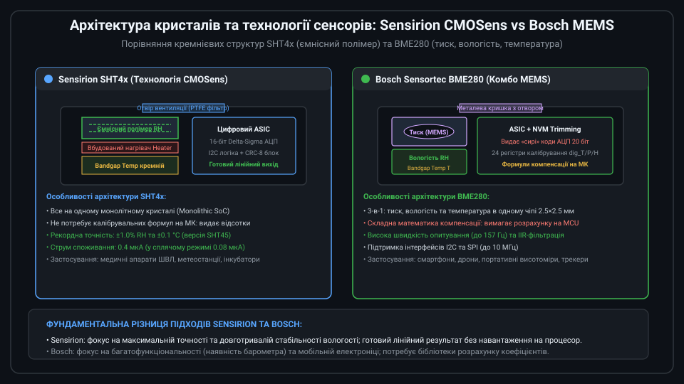
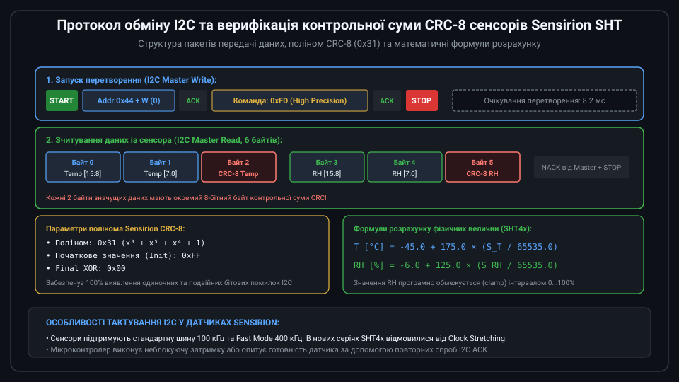
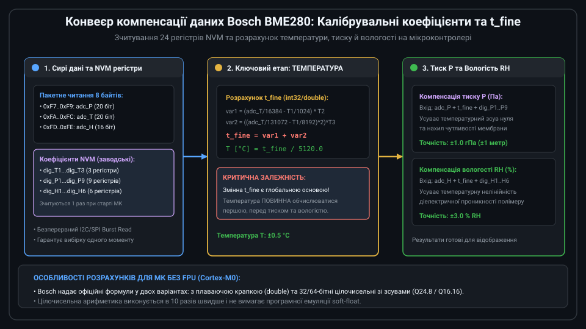
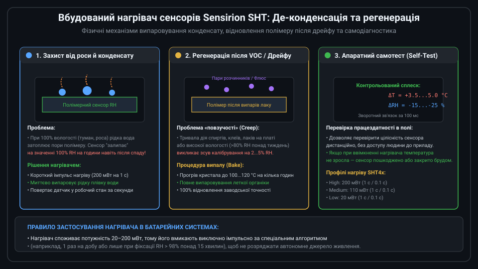
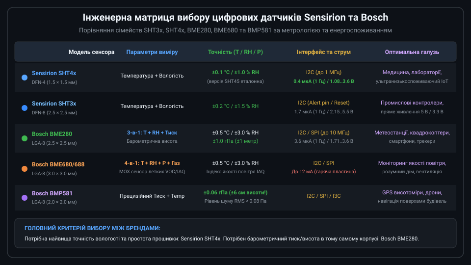

# Цифрові комбіновані давачі температури й вологості Sensirion та Bosch

Цифрові комбіновані мікроелектромеханічні сенсори (MEMS) компаній Sensirion (Швейцарія) та Bosch Sensortec (Німеччина) є світовими лідерами в галузі моніторингу параметрів навколишнього середовища. Вони поєднують на одному кремнієвому кристалі первинні сенсори температури, вологості (а в чіпах Bosch — ще й атмосферного тиску та якості повітря), прецизійний аналоговий тракт (AFE), 16–24 бітні АЦП та цифровий інтерфейс I2C/SPI з апаратною корекцією та фільтрацією.



---

## 1. Архітектура та технології кристалів: CMOSens проти MEMS

Підходи Sensirion та Bosch базуються на принципово відмінних інженерних концепціях:

* **Sensirion (Серії SHT3x, SHT4x)**: Застосовує запатентовану технологію **CMOSens**. На єдиній монолітній кремнієвій підкладці сформовано прецизійний ємнісний сенсор відносної вологості (гігроскопічний полімерний діелектрик між зустрічно-гребінчастими електродами), кремнієвий температурний bandgap-діод, мікронагрівач та цифровий сигнальний процесор (DSP). На заводі кожен сенсор індивідуально калібрується, а калібрувальні коефіцієнти прошиваються в кристал, тому сенсор видає безпосередньо лінеаризований 16-бітний цифровий код.
* **Bosch Sensortec (Серії BME280, BME680)**: Використовує комбіновану технологію інтеграції сенсорів. У герметичному металевому корпусі LGA-8 розміщено п'єзорезистивну кремнієву мембрану абсолютного тиску з вакуумною камерою еталону, ємнісний сенсор вологості та термодіод. Чіп Bosch видає «сирі» нескомпенсовані 20-бітні коди АЦП, а розрахунок температури, тиску та вологості покладається на мікроконтролер хоста за допомогою 24 коефіцієнтів, зчитаних з енергонезалежної пам'яті (NVM).

---

## 2. Протокол Sensirion I2C та верифікація контрольної суми CRC-8

Сенсори Sensirion SHT вирізняються граничною простотою протоколу обміну та високою стійкістю до збоїв на шині I2C:



Алгоритм взаємодії:
1. Мікроконтролер відправляє 1 байт команди (наприклад, `0xFD` для запуску високоточного вимірювання в SHT4x) за адресою `0x44`.
2. Сенсор виконує аналого-цифрове перетворення протягом 8.2 мс.
3. Мікроконтролер ініціює читання 6 байтів:
   * Байти 0 і 1: 16-бітне слово температури S_T;
   * Байт 2: 8-бітна контрольна сума CRC-8 температури;
   * Байти 3 і 4: 16-бітне слово вологості S_RH;
   * Байт 5: 8-бітна контрольна сума CRC-8 вологості.

Контрольна сума генерується апаратним блоком CRC за стандартизованим поліномом `0x31 (x^8 + x^5 + x^4 + 1)` з ініціалізацією `0xFF`. Перевірка CRC гарантує 100% захист від спотворення даних під дією електромагнітних завад.

Фізичні величини розраховуються за прямими лінійними формулами:
```text
T [°C] = -45.0 + 175.0 × (S_T / 65535.0)
RH [%] = -6.0 + 125.0 × (S_RH / 65535.0)
```

---

## 3. Конвеєр компенсації Bosch BME280 та проміжна змінна t_fine

У датчиках Bosch BME280 обчислення результатів вимагає багатостадійного конвеєра:



Через взаємний температурний вплив сенсорних елементів обчислення виконуються в суворо регламентованій послідовності:
1. **Зчитування пакету даних**: Пакетним читанням (Burst Read) з регістрів `0xF7..0xFE` зчитуються 8 байтів сирих даних тиску, температури та вологості.
2. **Розрахунок температури та змінної `t_fine`**: За допомогою калібрувальних коефіцієнтів `dig_T1...dig_T3` обчислюється істинна температура та внутрішня змінна високої точності `t_fine`.
3. **Компенсація тиску та вологості**:
   * Змінна `t_fine` передається у формулу розрахунку тиску для компенсації температурного дрейфу нуля п'єзорезистивної мембрани (коефіцієнти `dig_P1...dig_P9`).
   * Змінна `t_fine` передається у формулу розрахунку вологості для компенсації температурної зміни діелектричної проникності полімеру (коефіцієнти `dig_H1...dig_H6`).

Якщо порушити послідовність або не оновити `t_fine`, дані барометричного тиску та вологості будуть повністю спотворені.

---

## 4. Вбудований нагрівач Sensirion: де-конденсація та регенерація

Сенсори SHT містять інтегрований резистивний мікронагрівач, керований програмними командами:



Нагрівач виконує три критичні функції:
1. **Де-конденсація (усунення «залипання» на 100% RH)**: При тривалому перебуванні в тумані на полімері конденсується рідка водяна плівка, через що сенсор показує 100% RH навіть після виходу на сухе повітря. Короткий імпульс нагрівача (200 мВт на 1 с) випаровує воду, відновлюючи працездатність.
2. **Регенерація після хімічного дрейфу (Creep Recovery)**: Пари розчинників, флюсу або спиртів з часом поглинаються полімером, викликаючи зсув калібрування. Термічний відпал (Bake) при 100–120 °C повертає сенсор до заводської точності.
3. **Апаратна самодіагностика (Built-in Self Test)**: Ввімкнення нагрівача на 100 мс має викликати миттєве зростання температури на 3–5 °C і падіння відносної вологості, що підтверджує фізичну справність вузла без участі людини.

---

## 5. Порівняльний аналіз та критерії вибору компонента

Вибір між рішеннями Sensirion та Bosch залежить від функціональних вимог системи:



* **Sensirion SHT40 / SHT45 є беззаперечним лідером, якщо:**
  * Необхідна найвища метрологічна точність клімату (до ±0.1 °C та ±1.0% RH).
  * Прилад живиться від батареї (рекордно низький струм 0.4 мкА).
  * Потрібен мініатюрний монтаж (корпус 1.5×1.5 мм) та швидка інтеграція без громіздких бібліотек компенсації.
* **Bosch BME280 / BME680 є найкращим вибором, якщо:**
  * Крім вологості та температури необхідний барометричний тиск або висотомір (альтиметр).
  * Потрібен контроль летких органічних речовин (VOC) та індексу якості повітря (IAQ) в одному корпусі (BME680/BME688).
  * Необхідна швидкісна шина SPI з частотою до 10 МГц.
