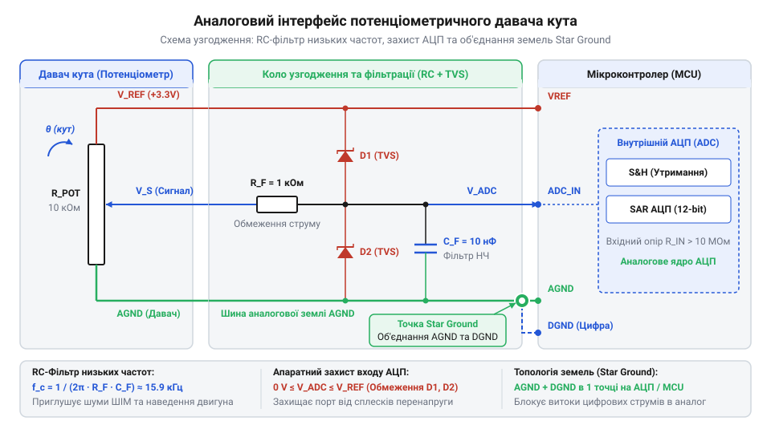
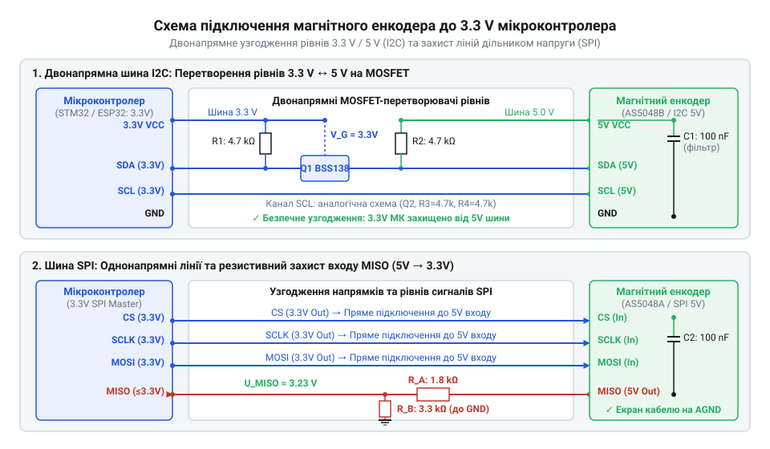

# Апаратний інтерфейс підключення потенціометричних і магнітних давачів кута: розводка, живлення, рівні та схема підтяжок

<preknowlist>
- [Енкодери кутового та лінійного переміщення](root:cat-hw-sensors/optical-and-magnetic-encoders) — базові принципи вимірювання кутового переміщення, відмінності між абсолютними та інкрементальними давачами та типи вихідних сигналів
- [Магнітний енкодер кута AS5048](root:cat-hw-sensors/as5048-magnetic-encoder) — архітектура інтегрованих магнітних давачів кута Холла, принципи зчитування даних через цикли опитування та формат вихідного сигналу PWM
</preknowlist>

## Спонтанні збої та шуми сервосистем

Уявіть ситуацію: сервопривід виконавчого механізму працює під динамічним навантаженням, і раптово кутове положення в системі зворотного зв'язку хаотично стрибає на 10–15 градусів, хоча фізичний вал мотора залишається нерухомим. У гіршому разі мікроконтролер замкненого контуру спонтанно перезавантажується під час пуску мотора або один із його вхідних портів взагалі виходить з ладу. Причина таких збоїв криється не в алгоритмах обробки даних, а в нехтуванні законами електротехніки під час проектування апаратного інтерфейсу підключення давачів.

Головним джерелом апаратних нестабільностей є високовольтні та високострумові завади, які ґенеруються силовими колами ключових транзисторів приводу. У момент увімкнення мотора через спільний провід заземлення протікають струми в десятки ампер. Якщо аналогова та силова землі розведені некоректно, на опірному провіднику друкованої плати виникає динамічне просідання потенціалу — зсув потенціалу землі (англ. @@en|ground potential offset@@, від *ground* — земля та *offset* — зсув). Мікроконтролер сприймає цей зсув як зміну вхідної напруги, що призводить до хибних обчислень кута повороту.

Другим чинником є електромагнітні завади (англ. @@en|electromagnetic interference@@, скорочено @@en|EMI@@). Швидкі перемикання струму в обмотках двигуна з частотою широтно-імпульсної модуляції (англ. @@en|PWM@@) створюють високочастотні наведення на вимірювальних провідниках із високим імпедансом (англ. @@en|impedance@@, від латинського *impedio* — перешкоджати). Сигнальна лінія працює як антена, яка вловлює імпульсний шум і спотворює як аналоговий рівень напруги, так і цифрові фронти послідовних шин даних.

Третя поширена пастка — це неузгодженість логічних рівнів та фантомне живлення (англ. @@en|phantom powering@@). Коли давач із живленням `5 V` підключають безпосередньо до портів введення-виведення (англ. @@en|GPIO@@) мікроконтролера з робочою напругою `3.3 V`, струм починає протікати через внутрішні захисні діоди виводу. Це спричиняє паразитне вмикання структур напівпровідника — защіпання (англ. @@en|latch-up@@) — і призводить до термічного деградування або повного вигорання вхідного каскаду мікроконтролера.

Для побудови надійної сервосистеми недостатньо просто з'єднати виводи давача з ніжками мікроконтролера. Апаратний інтерфейс має виконувати чотири базові функції: узгоджувати напруги живлення та сигналів, фільтрувати високочастотні завади, ізолювати силові контури заземлення й захищати чутливі напівпровідники від імпульсних сплесків.

## Аналогові потенціометричні давачі та фільтрація

Потенціометричний давач кута являє собою змінний резистор, включений за схемою дільника напруги. Напруга на його рухомому контакті (повзунку) лінійно або за певним законом залежить від кутового положення вала. На відміну від безконтактних давачів, потенціометри вимагають прямого підключення до аналого-цифрового перетворювача (англ. @@en|ADC@@, далі — АЦП) мікроконтролера. Проте прямому зчитуванню заважають два фактори: протиріччя між напругою живлення давача та опорною напругою АЦП, а також шум контакту повзунка.

Більшість промислових і робототехнічних потенціометрів розраховані на живлення `5 V`, що забезпечує кращу завадостійкість і ширший динамічний діапазон. Якщо опорна напруга АЦП мікроконтролера становить `3.3 V`, пряма подача сигналу `5 V` призведе до обмеження сигналу (англ. @@en|clipping@@) та ризику пошкодження кристала. Для зниження амплітуди застосовують прецизійний дільник напруги на резисторах `R_1` та `R_2`.

Для розрахунку вихідної напруги дільника використовують базове електричне співвідношення:

```
V_out = V_sensor * (R_2 / (R_1 + R_2))
= 5.0 * (6.6 / (3.3 + 6.6))          [підстановка R_1=3.3 кОм, R_2=6.6 кОм]
= 3.33 V                             [приведення максимального сигналу до діапазону 3.3 V]
```

Опір дільника обирають виходячи з компромісу: надто низький опір перевантажує вихід потенціометра, а надто високий — збільшує вихідний імпеданс дільника, що погіршує точність вибірки внутрішнього конденсатора АЦП (англ. @@en|sample-and-hold capacitor@@).

Для захисту від наведень та брязкоту контакту (англ. @@en|wiper noise@@) у коло сигналу інтегрують аналоговий протиаліасинговий фільтр (англ. @@en|anti-aliasing filter@@, від *alias* — інакше). Це низькочастотне `RC`-коло, утворене еквівалентним опором дільника `R_eq = (R_1 * R_2) / (R_1 + R_2)` та конденсатором `C_f`, підключеним паралельно аналоговій землі.

Частоту зрізу фільтра `f_c` обчислюють за формулою:

```
f_c = 1 / (2 * π * R_eq * C_f)
= 1 / (2 * 3.14159 * 2200 * 100 * 10⁻⁹) [підстановка R_eq=2.2 кОм, C_f=100 нФ]
= 723.4 Hz                           [розрахована гранична частота пропускання]
```

Частоту зрізу обирають у 3–5 разів вищою за максимальну частоту обертання вала сервоприводу, але суттєво нижчою за частоту перемикання силових транзисторів @@en|PWM@@, щоб запобігти накладанню спектрів завад у спектр корисного сигналу.


*Схема підключення потенціометричного давача до АЦП мікроконтролера з розділенням аналогової та цифрової земель, напруговим дільником і протиаліасинговим RC-фільтром.*

Критичним правилом розводки друкованої плати є суворе розділення аналогової землі (англ. @@en|AGND@@) та цифрової землі (англ. @@en|DGND@@). Струми зворотного шляху від мікроконтролера та силових драйверів не повинні протікати через провідник, до якого підключено опорний конденсатор АЦП та нижнє плече дільника. Розділення реалізують за топологією «зірка» (англ. @@en|star ground@@): `AGND` та `DGND` з'єднують лише в одній точці — безпосередньо біля виводу заземлення АЦП або джерела опорної напруги через 0-омний резистор або феритовий фільтр (англ. @@en|ferrite bead@@). Відмінно від пристроїв, де застосовуються [трансформаторні кутоміри](root:cat-hw-sensors/synchro-and-resolver-transducers), потенціометричні системи вимагають гальванічно спільної прямої точки відліку напруги.

## Цифрові магнітні енкодери та підтяжки

Цифрові магнітні давачі кута передають дані про положення вала у вигляді цифрового коду, що позбавляє систему від помилок, пов'язаних із шумами АЦП. Проте для їхньої стабільної роботи потрібне правильне апаратне узгодження цифрових інтерфейсів: @@en|SPI@@, @@en|I2C@@, @@en|PWM@@ або промислового @@en|SSI@@.

Шина @@en|SPI@@ забезпечує високу швидкість передачі (до 10–20 МГц) завдяки двотактним вихідним каскадам (англ. @@en|push-pull output@@). Для ліній `CS`, `CLK` та `MOSI` підтягувальні резистори не є обов'язковими, проте на довгих лініях зв'язку (понад 15–20 см) виникають відбиття сигналів та крайові викривлення (англ. @@en|ringing@@). Для приглушення паразитного резонансу послідовно в лінію `CLK` поблизу мікроконтролера встановлюють демпфувальний резистор (англ. @@en|damping resistor@@) номіналом `22–33 Ом`.

На відміну від @@en|SPI@@, шина @@en|I2C@@ використовує лінії з відкритим стоком (англ. @@en|open-drain@@), які вимагають обов'язкового встановлення підтягувальних резисторів (англ. @@en|pull-up resistor@@) до лінії живлення `V_DD`. Вибір номіналу `R_pullup` визначається компромісом між тривалістю наростання фронту сигналу `t_r` та споживанням струму. Мінімальний опір обмежений максимально припустимим струмом виводу `I_OL` (зазвичай `3 mA` при `V_OL = 0.4 V`):

```
R_min = (V_DD - V_OL) / I_OL
= (3.3 - 0.4) / 0.003                [підстановка V_DD=3.3 V, V_OL=0.4 V, I_OL=3 mA]
= 966.7 Ом                           [мінімально припустимий опір підтяжки]
```

Максимальний опір `R_max` обчислюють виходячи з паразитної ємності шини `C_bus` (сума ємностей провідників плати та входів мікросхем) та вимог стандарту до тривалості фронту (`t_r ≤ 300 нс` для режиму @@en|Fast Mode@@ 400 кГц):

```
R_max = t_r / (0.8473 * C_bus)
= 300 * 10⁻⁹ / (0.8473 * 150 * 10⁻¹²)   [підстановка t_r=300 нс, C_bus=150 пФ]
= 2360 Ом                            [гранично допустимий верхній опір підтяжки]
```

Якщо напруга живлення магнітного давача становить `5 V`, а мікроконтролер працює від `3.3 V`, підключення ліній @@en|I2C@@ або @@en|SPI@@ потребує узгоджувачів рівнів (англ. @@en|level shifter@@). Для однонапрямних ліній (наприклад, @@en|SPI CLK@@ чи @@en|PWM@@) достатньо резистивного дільника або буферної мікросхеми серії `74LVC125`. Для двонапрямної лінії `SDA` шини @@en|I2C@@ застосовують транзисторні схеми на N-канальних польових транзисторах (англ. @@en|MOSFET@@, наприклад BSS138) з підтяжками до `3.3 V` з боку мікроконтролера та до `5 V` з боку давача. Для детального вивчення розрахунку резистивних дільників та схемотехніки активних транзисторних буферів читайте статтю про [схеми та дільники узгодження логічних рівнів у мікроконтролерних системах](root:hw-digital/level-shifter).


*Схема апаратного узгодження сигнальних ліній цифрових давачів кута для шин SPI, I2C та PWM при підключенні до 3.3 V мікроконтролера.*

Шина @@en|SSI@@ (англ. @@en|Synchronous Serial Interface@@) та її дифпарові реалізації на базі `RS-422` застосовуються в умовах екстремальних завад. Передача дифсигналами `CLK+/CLK-` та `DATA+/DATA-` вимагає встановлення термінуючого резистора (англ. @@en|termination resistor@@) номіналом `120 Ом` між диференційними провідниками на приймальному кінці лінії для запобігання відбиттю хвиль. За своїми характеристиками такі схеми перевершують звичайні [оптичні та магнітні енкодери](root:cat-hw-sensors/optical-and-magnetic-encoders) без диференціальних драйверів. Коли в проекті використовується конкретний пристрій, наприклад [магнітний енкодер кута AS5048](root:cat-hw-sensors/as5048-magnetic-encoder), важливо точно дотримуватися специфікацій виробника щодо вибору режимів @@en|SPI@@ або інтерфейсу @@en|PWM@@.

## Живлення, екранування та захист ліній

Стабільність роботи як аналогових, так і цифрових давачів кута безпосередньо залежить від чистоти напруги живлення та захисту сигнальних кабелів від імпульсних перенапруг. Довгі з'єднувальні шлейфи в сервоприводах діють як антени, піддаючись впливу високовольтних викидів від силових мостів.

Для приглушення високочастотних завад по шині живлення безпосередньо біля виводів живлення давача (`V_DD` і `GND`) встановлюють розв'язувальні конденсатори (англ. @@en|decoupling capacitors@@). Схема розв'язки має містити два паралельних компоненти:

1. Керамічний конденсатор ємністю `100 нФ` з низьким еквівалентним послідовним опором (англ. @@en|ESR@@) типу X7R, розташований на відстані не більше 3–5 мм від корпусу давача. Він поглинає високочастотні імпульсні шуми. 2. Танталовий або електролітичний конденсатор ємністю `10–47 мкФ`, який компенсує локальні просідання напруги під час стрибків струму споживання.

Захист сигнальних ліній від статичної електрики (англ. @@en|ESD@@) та індуктивних викидів забезпечують захисними діодами-супресорами (англ. @@en|TVS@@, від *Transient Voltage Suppressor*). Діоди @@en|TVS@@ підключають паралельно сигнальним лініям відносно землі. Вони мають малу власну ємність (менше `10–20 пФ`), щоб не спотворювати високочастотний цифровий фронт шини @@en|SPI@@. Додатково застосовують здвоєні діоди Шотткі (наприклад, BAT54S), які зрізають викиди напруги за межі `GND - 0.3 V` та `V_DD + 0.3 V`.

При винесенні давача на окремий кабель завдовжки понад 20 см виникає потреба в екрануванні. Екран кабелю (металева оплітка або фольга) поглинає зовнішні електромагнітні поля. Головне правило екранування: екран підключають до корпусу пристрою або силової землі (`DGND`) лише з одного боку — з боку плати мікроконтролера. Якщо заземлити екран з двох боків, різниця потенціалів між давачем та контролером створить струм у самому екрані, утворюючи паразитну земляну петлю (англ. @@en|ground loop@@), яка працюватиме як джерело додаткових завад.

Для диференціальних ліній та сигналів з високим імпедансом застосовують виту пару (англ. @@en|twisted pair@@). Провідники сигналу та зворотного струму, перевиті між собою, піддаються однаковому впливу зовнішнього магнітного поля, завдяки чому наведена завада взаємно компенсується на диференційному вході приймача. На відміну від ситуації, коли використовуються [лінійні диференціальні трансформатори](root:cat-hw-sensors/lvdt-linear-variable-differential-transformers) з їхніми низькоімпедансними обмотками, первинний аналоговий сигнал потенціометра є суттєво більш вразливим до наведень і вимагає обов'язкового екранування.

## Діагностика електричних збоїв інтерфейсу

Пошук несправностей в апаратному інтерфейсі давачів кута вимагає системного підходу із застосуванням двоканального осцилографа та цифрового мультиметра. Більшість помилок показують характерні осцилограми, за якими можна швидко визначити джерело проблеми.

Основні апаратні симптоми та методи їх усунення:

1. **Просідання та пульсації живлення (англ. @@en|brownout / ripple@@)**. *Симптом:* Періодичне перезавантаження цифрового давача або втрата зв'язку по шині @@en|SPI@@ під час прискорення мотора. *Діагностика:* Осцилограф у режимі закритого входу (@@en|AC coupling@@) показує просідання лінії `V_DD` нижче мінімального порогу роботи мікросхеми (наприклад, нижче `3.0 V`). *Усунення:* Збільшення ємності локальних конденсаторів живлення, встановлення окремого лінійного стабілізатора (англ. @@en|LDO@@) для давачів або ізоляція лінії живлення через дросель.

2. **Обмеження амплітуди аналогового сигналу (англ. @@en|clipping@@)**. *Симптом:* При повертанні потенціометра значення АЦП досягає максимуму (`4095` для 12-бітного АЦП) ще до досягнення валом крайнього положення. *Діагностика:* Мультиметр показує напругу на вході АЦП понад `3.3 V`. *Усунення:* Коригування коефіцієнта ділення резистивного дільника `R_1 / R_2`.

3. **Завалений фронт цифрових сигналів (англ. @@en|slew rate limiting@@)**. *Симптом:* Помилки контрольної суми (@@en|CRC@@) або відсутність відповіді по шині @@en|I2C@@. *Діагностика:* На осцилограмі прямокутні імпульси `SDA` / `SCL` перетворюються на пилоподібні через надто велику сталу часу `R * C`. *Усунення:* Зменшення опору підтягувальних резисторів `R_pullup` або зменшення довжини кабелю для зниження ємності шини.

4. **Дзвоніння та перерегулювання (англ. @@en|ringing & overshoot@@)**. *Симптом:* Хибні спрацьовування або збої тактування шини @@en|SPI@@. *Діагностика:* На фронтах імпульсів `CLK` спостерігаються високочастотні коливання, що виходять за межі рівнів `V_IL` та `V_IH`. *Усунення:* Встановлення послідовних демпфувальних резисторів `22–33 Ом` безпосередньо біля виходу передавача.

5. **Фантомне живлення через захисні діоди (англ. @@en|phantom powering@@)**. *Симптом:* Індикатор давача слабо світиться або на його лінії живлення є напруга `2.0–2.5 V` при вимкненому основному джерелі живлення. *Діагностика:* Струм витікає з сигнальної лінії мікроконтролера через внутрішні захисні діоди давача. *Усунення:* Додавання послідовних струмообмежувальних резисторів або використання активних буферних узгоджувачів рівнів із функцією високого імпедансу при знеструмленні (англ. @@en|partial power-down protection@@).

Покроковий алгоритм діагностики починається з перевірки постійної напруги та пульсацій на виводах живлення давача під максимальним навантаженням двигунів. На другому кроці вимірюють різницю потенціалів між силовою та аналоговою землями. На третьому кроці за допомогою осцилографа оцінюють форму та крутизну фронтів сигнальних ліній, після чого перевіряють відсутність зворотних струмів через захисні кола.