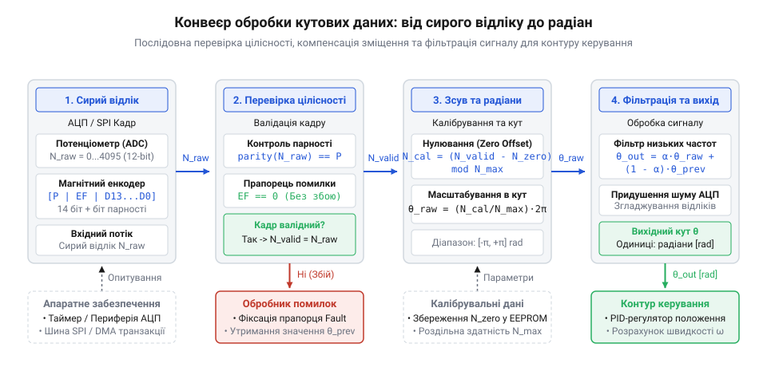
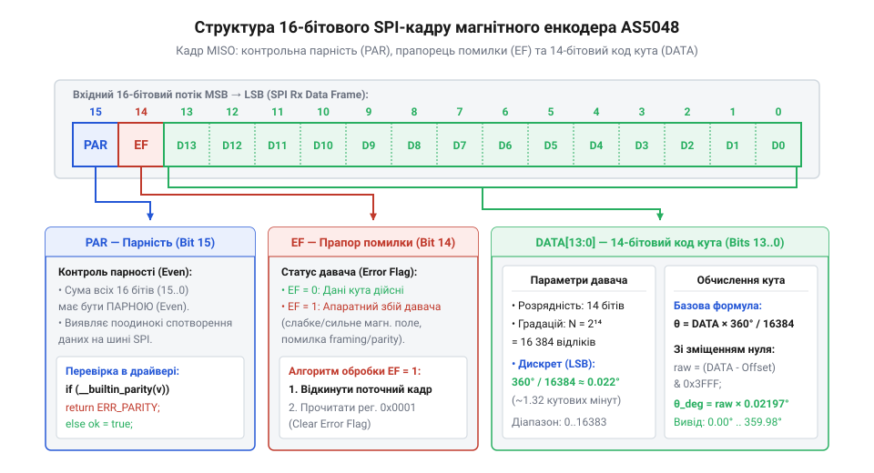

# Програмний інтерфейс опрацювання давачів кута: регістри магнітних енкодерів, протоколи зчитування та функції калібрування

<preknowlist>
- [Енкодери кутового та лінійного переміщення](root:cat-hw-sensors/optical-and-magnetic-encoders) — фізичні принципи роботи кутових енкодерів, поняття дискретизації та роздільної здатності
- [Магнітний енкодер кута AS5048](root:cat-hw-sensors/as5048-magnetic-encoder) — апаратне влаштування мікросхеми AS5048, фізичний принцип розміщення магніту та призначення виводів шини
</preknowlist>

## Наслідки прямого використання сирих відліків

Подання сирих даних з первинного давача кута безпосередньо у контур керування @@en|servo drive@@ (сервоприводу, від лат. servus — слуга, раб та нім. Antrieb — привід) здатне миттєво вивести механічну систему з ладу або спричинити аварійну зупинку. Коли мікроконтролер обчислює керуючий вплив на основі некоригованих відліків @@en|ADC@@ чи двійкових кадрів послідовного інтерфейсу, будь-який імпульсний шум на лінії живлення або збій шини даних сприймається обчислювачем як реальне фізичне переміщення вала. Якщо система керування намагається відпрацювати уявне відхилення на повній потужності, виникає жорсткий механічний удар, дрижання (від англ. @@en|jitter@@ — коливання, дрижання) та перевантаження силових транзисторів.

Головна небезпека прямої передачі відліків полягає в тому, що первинний давач видає інформацію в електричних одиницях, які не збігаються з фізичною геометрією механізму. Фізичний нуль робочого органу майже ніколи не збігається з електричним нулем давача через технологічні допуски під час монтажу. Без програмної корекції зміщення (від англ. @@en|zero offset@@ — нульове зміщення) регулятор вважає нормальним положенням довільну точку, викликаючи постійний статичний похибковий момент.

Окремим критичним ризиком є перехід через межу розрядності лічильника або давача — так званий ефект переповнення (від англ. @@en|rollover@@ — перехід через нуль, переповнення). Коли вал сервоприводу повертається на частку градуса від `359.9°` до `0.0°`, сирий код енкодера раптово стрибає від максимального значення (наприклад, 16383 для 14-бітового давача) до нуля. Якщо алгоритм зчитування не обробляє циклічність кута, пропорційно-інтегрально-диференціальний регулятор обчислює похибку положення як величину у майже `360°` замість відліку в пару десятих градуса. У результаті контур керування формує зворотний стрибок струму максимальної амплітуди.

Не менш загрозливими є некоректні двійкові кадри, що виникають через електромагнітні завади від комутації обмоток двигуна. На відміну від випадків, коли вимірюють параметри за допомогою [диференціальних трансформаторів LVDT](root:cat-hw-sensors/lvdt-linear-variable-differential-transformers), де сигнал є аналоговим і безперервним, цифрові енкодери передають дані дискретними пакетами. Помилковий біт у слові кута перетворює значення 2048 на 10240, що призводить до хибної реакції драйвера.


*Послідовний конвеєр опрацювання сигналів кутового давача: перевірка цілісності, компенсація зміщення, фільтрація шумів та нормалізація у фізичні одиниці.*

Щоб відсікти помилкові дані й відновити достовірність вимірювань, між апаратним забезпеченням та математичним контуром регулятора створюють програмний інтерфейс. Програмний @@en|driver@@ (драйвер, від англ. driver — той, хто керує) виконує функцію захисного фільтра та перетворювача: він перевіряє цілісність кожного отриманого кадру, коригує монтажне зміщення, відслідковує перехід через нуль та нормалізує сирі коди у фізичні кутові одиниці. Тільки після проходження всіх етапів перевірки та обробки дані потрапляють у регулятор руху. На відміну від випадків, де традиційні [оптичні та магнітні енкодери](root:cat-hw-sensors/optical-and-magnetic-encoders) формують відносні імпульси, абсолютні давачі вимагають суворого контролю кожного цифрового слова.

## Зчитування аналогових відліків і ШІМ-сигналів

Найпростішим способом зчитування кутового положення є вимірювання напруги з кутового потенціометра. Кутовий @@en|potentiometer@@ (потенціометр, від лат. potentia — сила, можливість та грец. μέтроν — міра) працює як дільник напруги, де вихідний потенціал лінійно залежить від кута повороту ковзного контакту. Для опрацювання цього сигналу мікроконтролер використовує аналого-цифровий перетворювач (від англ. @@en|ADC@@ — аналого-цифровий перетворювач). Проте безпосередній переклад коду @@en|ADC@@ у кут ускладнюється наявністю мертвих зон (від англ. @@en|deadband@@ — мертва зона, нечутливість) біля крайніх точок резистивної доріжки та нестабільністю напруги живлення.

Мертві зони виникають на краях резистора, де рухомий контакт виходить на струмопідвідні площадки або втрачає з ними надійний зв'язок. У цих областях напруга не змінюється або містить високий рівень шумів, тому програмний інтерфейс повинен обмежувати робочий діапазон відліків. Обчислення сирого кута за відліком @@en|ADC@@ з урахуванням мертвих зон виконується за формулою:

```
adc_bounded = clamp(adc_raw, adc_min, adc_max)
angle_raw = (adc_bounded - adc_min) * resolution / (adc_max - adc_min)
```

Де `adc_raw` — поточний відлік АЦП, `adc_min` та `adc_max` — межі валідного діапазону напруги, `resolution` — максимальне дискретне значення кутового діапазону.

Альтернативним аналогово-часовим методом є зчитування сигналу широтно-імпульсної модуляції (від англ. @@en|PWM@@ — широтно-імпульсна модуляція). Чимало інтегральних давачів видають кутове положення у вигляді прямокутних імпульсів постійної частоти, де кут пропорційний коефіцієнту заповнення (від англ. @@en|duty cycle@@ — коефіцієнт заповнення). Вимірювання тривалості високого рівня `T_high` та повного періоду `T_period` здійснюється за допомогою таймера мікроконтролера в режимі захоплення вхідних сигналів.

Перевага @@en|PWM@@ полягає у стійкості до амплітудних завад: амплітуда сигналу не впливає на часовий інтервал. Обчислення заповнення та відповідного кута проводиться за формулою:

```
duty_cycle = T_high / T_period
angle_raw = (duty_cycle - duty_min) / (duty_max - duty_min) * resolution
```

Якщо тривалість імпульсу виходить за допустимі часові межі (наприклад, `T_period` відхиляється від номіналу понад 5%), @@en|driver@@ фіксує помилку апаратної лінії.

Нижче наведено приклад реалізації зчитування кутового потенціометра та @@en|PWM@@-сигналу з валідацією меж і перевіркою апаратних помилок.

:::tabs
:::code api-servo-feedback-software-interface/c/esp-idf/read-potentiometer-angle.c

:::code api-servo-feedback-software-interface/cpp/arduino/analoganglesensor.cpp
:::

Зчитування аналогових і ШІМ-сигналів є надійним рішенням для простих систем, проте підвищення вимог до точності змушує переходити на цифрові послідовні протоколи, де відсутні похибки квантування та наведення на аналогових лініях.

## Розбір регістрів і контроль кадрів SPI

Інтегральні магнітні енкодери, зокрема серії AS5048 та AS5047, надають високу роздільну здатність (14 бітів, тобто 16384 відліки на оберт) та передають дані через цифровий послідовний інтерфейс (від англ. @@en|SPI@@ — послідовний периферійний інтерфейс) або @@en|I2C@@. Передача кута через @@en|SPI@@ здійснюється 16-бітовими кадрами, де кожна транзакція містить не лише інформацію про кут, але й біт перевірки цілісності та прапорці діагностики стану магнітного поля.


*Структура 16-бітового SPI-кадру енкодера AS5048: розподіл бітів парності, прапорця помилки та 14-бітового значення кута.*

Структура кадру @@en|SPI@@ для серії AS5048 має чітко визначений розподіл бітів:
- **Біт 15 (PAR):** Біт парності (від англ. @@en|parity bit@@ — біт парності), який забезпечує парну кількість одиниць у всьому 16-бітовому слові. - **Біт 14 (EF / RW):** Прапорець помилки (EF — Error Flag) під час читання відповіді або біт запису/читання в командному кадрі. - **Біти 13–0:** 14-бітове поле даних, яке містить значення кута `ANGLECOM` (або вміст внутрішнього регістру чи коди помилок, якщо `EF = 1`).

Подібно до того, як [обертові трансформаторні кутоміри](root:cat-hw-sensors/synchro-and-resolver-transducers) вимагають демодуляції фази для виявлення похибок, цифровий магнітний енкодер вимагає програмного перевірочного обчислення парності перед обробкою даних. Перевірка парної парності полягає в тому, що загальна кількість одиничних бітів у 16-бітовому слові має бути парною. Якщо результатом побітового оператора XOR для всіх 16 бітів є `1`, кадр вважається викривленим завадою і повинен бути відкинутий драйвером.

Окрім перевірки парності, @@en|driver@@ зобов'язаний декодувати карту регістрів (від англ. @@en|register map@@ — карта регістрів) енкодера. Спеціалізована мікросхема [магнітного енкодера AS5048](root:cat-hw-sensors/as5048-magnetic-encoder) містить внутрішній регістр діагностики `DIAAGC` та регістр очищення помилок.

Основні прапорці діагностики включають:
- **OCF (Offset Compensation Finished):** Прапорець завершення внутрішньої компенсації зміщення підсилювачів Холла. - **COF (CORDIC Overflow):** Свідчить про помилку обчислення арктангенса у внутрішньому обчислювальному блоці. - **COMP Low / COMP High:** Індикатори напруженості магнітного поля. Якщо магніт віддалений від мікросхеми, спрацьовує `COMP Low`; якщо магніт надто близько або занадто сильний — `COMP High`. Детальніше про принцип роботи тригонометричного перетворювача та виявлення його помилок ви можете дізнатися у статті про [обчислювальний алгоритм CORDIC у цифрових енкодерах кута](root:hw-sensing/cordic-algorithm-in-rotary-encoders).

Нижче наведено функцію формування командного кадру @@en|SPI@@, обчислення парності та декодування даних для енкодера AS5048.

:::tabs
:::code api-servo-feedback-software-interface/c/esp-idf/check-even-parity.c

:::code api-servo-feedback-software-interface/cpp/arduino/as5048parser.cpp
:::

Якщо виявлено прапорець помилки `EF = 1`, @@en|driver@@ не повинен передавати значення кута у контур керування. Замість цього надсилається повторний запит до регістра помилок для визначення причини (відсутність магніту або нестабільність живлення) та очищення стану помилки.

## Програмне калібрування та програмне нулювання

Після отримання цілісного та підтвердженого 14-бітового значення кута виникає задача узгодження електричних відліків енкодера з механічною геометрією сервоприводу. Ручне виставлення магніту або вала енкодера у точний фізичний нуль із точністю до часток градуса є надзвичайно складним і затратним технологічним процесом. Замість механічного юстування застосовують програмне нулювання та встановлення початкового зміщення @@en|zero offset@@.

Програмне нулювання полягає у фіксації сирого відліку енкодера `N_offset` у момент, коли механізм перебуває у своєму базовому (калібрувальному) положенні. Це значення зберігається у неенергонезалежній пам'яті контролера або у внутрішніх регістрах енкодера. При подальшій роботі @@en|driver@@ віднімає `N_offset` від кожного поточного значення `N_raw` з урахуванням кільцевого переповнення розрядності:

```
N_aligned = (N_raw - N_offset + N_max) % N_max
```

Де `N_max = 16384` для 14-бітового давача.

Окрім нульового зміщення, реальні механічні вузли мають нелінійність вимірювальної характеристики через ексцентриситет монтажу магніту відносно осі обертання мікросхеми. Для компенсації цієї похибки застосовують метод табличної корекції (від англ. @@en|look-up table@@ — таблиця пошуку) або поліноміальну інтерполяцію. Калібрувальна таблиця містить поправки `Δθ` для фіксованих точок оберту, визначені за допомогою еталонного вимірювача.

Нижче наведено алгоритм програмного нулювання та застосування початкового зміщення з обробкою кільцевого модуля.

:::tabs
:::code api-servo-feedback-software-interface/c/esp-idf/set-zero-position.c

:::code api-servo-feedback-software-interface/cpp/arduino/zerocalibration.cpp
:::

Використання програмного калібрування дозволяє повністю компенсувати механічні похибки монтажу без потреби у високоточних механічних юстувальних пристроях.

## Фільтрація шумів і масштабування кута

Відкалібровані відліки кута, очищені від помилок передачі та зміщені у фізичний нуль, усе ще містять високочастотні шуми та дрижання @@en|jitter@@. Вони виникають внаслідок теплового шуму давачів Холла, пульсацій живлення та мікровібрацій механіки. Безпосереднє введення таких даних у диференціальну ланку регулятора призводить до виникнення сплесків струму в двигуні. Для згладжування даних застосовують цифрову фільтрацію.

Найпростішим методом є фільтр ковзного середнього (від англ. @@en|moving average filter@@ — фільтр ковзного середнього) або експоненціальне ковзне середнє (від англ. @@en|exponential moving average@@ — експоненціальне ковзне середнє). Проте при фільтрації кутових величин виникає пастка: пряме усереднення значень поблизу межі `360°` і `0°` дає катастрофічну похибку. Наприклад, середнє арифметичне між `359°` та `1°` дорівнює `180°`, що є абсолютно хибним положенням.

Для коректної фільтрації циклічних кутових даних обчислюють різницю між поточним та попереднім значеннями з урахуванням кільцевого переходу:

```
delta = raw_angle - prev_angle
if delta > max_res / 2:
    delta -= max_res
else if delta < -max_res / 2:
    delta += max_res
```

Після цього фільтрують саме дельту приросту або застосовують експоненціальне згладжування до розгорнутого кута:

```
filtered_angle = filtered_angle + alpha * delta
```

Завершальним етапом роботи програмного інтерфейсу є масштабування сирих розрядів давача у фізичні кутові одиниці — радіани або градуси. Оскільки більшість алгоритмів векторного керування та кінематики роботів працюють у радіанах, перетворення 14-бітового відліку виконується за формулою:

```
angle_rad = (filtered_angle * 2.0 * M_PI) / 16384.0
```

Нижче наведено повний модуль обробки кута, який включає корекцію переходу через нуль, експоненціальну фільтрацію та конвертацію у радіани.

:::tabs
:::code api-servo-feedback-software-interface/c/esp-idf/update-angle-filter.c

:::code api-servo-feedback-software-interface/cpp/arduino/angleprocessor.cpp
:::

Такий комплексний підхід дає змогу отримати гладке, достовірне та відкаліброване значення кута у фізичних одиницях, повністю готове для використання у швидких цифрових контурах керування сервоприводами.