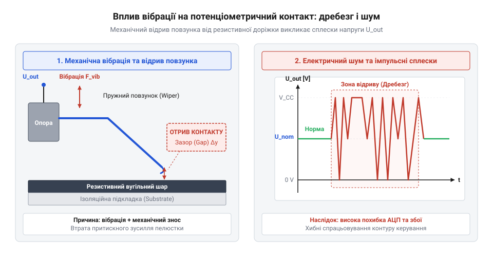
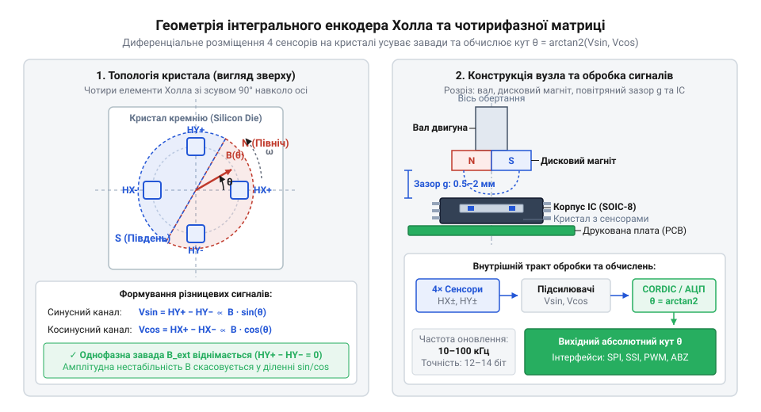

# Еволюція давачів зворотного зв'язку сервоприводів: від вугільних потенціометрів до безконтактних магнітних енкодерів

<preknowlist>
- [Сельсини та резольвери: обертові трансформаторні кутоміри](root:cat-hw-sensors/synchro-and-resolver-transducers) — Принцип трансформаторного вимірювання кутового положення вала та відмінність від резистивного дільника.
- [Енкодери кутового та лінійного переміщення](root:cat-hw-sensors/optical-and-magnetic-encoders) — Базові поняття про інкрементні й абсолютні енкодери та відмінності оптичного й магнітного дисків.
- [Магнітний енкодер кута AS5048](root:cat-hw-sensors/as5048-magnetic-encoder) — Приклад практичної конструктивної топології мікросхеми енкодера відносно магніту на торці вала.
</preknowlist>

## Тертя і шум вугільних потенціометрів

Початок масового застосування компактних сервоприводів у 1950–1970-х роках у радіокерованих моделях, авіаційній автоматиці та перших промислових маніпуляторах поставив перед інженерами задачу постійного вимірювання кутового положення вихідного вала. Найпростішим і найдешевшим розв'язком став потенціометр (@@en|potentiometer@@, від лат. @@la|potentia@@ — сила та грецьк. @@el|метрон@@ — міра), жорстко з'єднаний із редуктором мотора. У цьому вузлі потенціометр (@@en|potentiometer@@) працює як резистивний дільник (@@en|resistive divider@@) напруги: опорна напруга подається на крайні виводи доріжки, а з рухомого контакту знімається аналоговий сигнал, пропорційний куту повороту вала.

Перші сервоприводи спиралися на вугільну доріжку (@@en|carbon track@@), по якій ковзав пружний металевий повзунок (@@en|wiper@@). Згодом вугілля частково замінив струмопровідний пластик (@@en|conductive plastic@@), який зменшив початкове тертя, проте не усунув головної проблеми — прямим механічним контактом зумовлено неминуче абразивне зношування. Під час роботи пружний повзунок (@@en|wiper@@) безперервно стирає мікроскопічний шар струмопровідного матеріалу. Утворений пил накопичується на поверхні, змінюючи місцевий опір доріжки та утворюючи ділянки з нестабільним електричним контактом.

Ситуація критично ускладнюється в умовах механічних вібрацій, характерних для двигунів внутрішнього згоряння, польоту безпілотних апаратів чи роботи технологічного обладнання. Вібрація змушує металевий повзунок (@@en|wiper@@) коливатися та періодично відриватися від доріжки.


*Деградація контактної пари потенціометра та поява сплесків шуму внаслідок відриву повзунка під час вібрації.*

Явище, відоме як підстрибування контакту (@@en|contact bounce@@), спричиняє миттєві розриви кола. Аналогово-цифровий перетворювач (@@en|ADC@@) або аналоговий компаратор сервопідсилювача сприймає ці сплески як раптову зміну кутового положення вала на десятки градусів. Спроба електронного блоку керування миттєво відпрацювати помилковий зсув викликає дрижання (@@en|jitter@@) вала, підвищений нагрів обмоток мотора, прискорене викришення зубчастої передачі та вільне проскакування повзунка (@@en|wiper@@) у місцях повного зносу. Обмежений ресурс у кілька сотень тисяч циклів змусив інженерів шукати принципово інші шляхи вимірювання кута.

## Оптичні та трансформаторні альтернативи

У 1970–1980-х роках розвиток важкої промислової робототехніки, верстатів із числовим програмним керуванням та аерокосмічних систем унеможливив використання контактних потенціометрів (@@en|potentiometer@@). Відмова зворотного зв'язку в промисловому маніпуляторі призводила до аварійних зупинок ліній, тому розробники звернулися до безконтактних фізичних явищ.

Першим зрілим промисловим розв'язком стали обертові трансформатори. Для високонавантажених вузлів застосовували [обертові трансформаторні кутоміри](root:cat-hw-sensors/synchro-and-resolver-transducers), відомі як сельсини (@@en|synchro@@) та резольвери (@@en|resolver@@, від англ. @@en|resolve@@ — розкладати на складові). Резольвер (@@en|resolver@@) не має ковзних електричних контактів у колі вимірювання: первинна обмотка ротора збуджується змінною напругою високої частоти, а дві перпендикулярні обмотки статора генерують амплітудно-модульовані сигнали синуса та косинуса. Аналогічно для вимірювання лінійних переміщень розробники застосовували [лінійні диференціальні трансформатори](root:cat-hw-sensors/lvdt-linear-variable-differential-transformers) (@@en|LVDT@@).

Резольвери (@@en|resolver@@) володіли колосальною надійністю, не боялися пилу, мастила, високих температур і вібрацій, однак їхнє впровадження у компактні сервоприводи наразилося на конструктивний глухий кут. Для роботи резольвера (@@en|resolver@@) потрібен був зовнішній генератор опорної частоти, масивні мідні обмотки, шихтовані залізні осердя та складні плати перетворення «резольвер-цифра». Вага та габарити такого давача часто перевищували розміри самого електродвигуна, а вартість робила його недоступним для масового сегмента.

Паралельно у 1980-х роках розробники активно впроваджували [оптичні енкодери кутового](root:cat-hw-sensors/optical-and-magnetic-encoders) переміщення. Оптичний енкодер (@@en|optical encoder@@) використовував скляний або пластиковий диск із мікроскопічними прозорими й непрозорими штрихами, розміщений між світлодіодом та фотодіодом (@@en|photodiode@@). Ця топологія забезпечувала високу точність вимірювання та повну відсутність механічного тертя.

Проте для мініатюрних сервоприводів оптичні енкодери (@@en|optical encoder@@) виявилися занадто крихкими та вимогливими. Скляний диск розбивався від ударних навантажень, юстування світлодіодної пари вимагало мікронної точності при збиранні, а найменше попадання пилу чи мастила у герметичний корпус повністю блокувало зчитування світлового променя. Промисловості був потрібен давач, який поєднував би абсолютну безконтактність резольвера (@@en|resolver@@) з мініатюрністю та низькою ціною потенціометра (@@en|potentiometer@@).

## Інтеграція ефекту Холла в мікросхеми

Вирішальний технологічний прорив відбувся наприкінці 1990-х та на початку 2000-х років завдяки розвитку напівпровідникових технологій @@en|CMOS@@. В основу нового покоління давачів покладено ефект Холла (@@en|Hall effect@@, названий на честь американського фізика Едвіна Холла, @@en|Edwin Hall@@, який відкрив його у 1879 році). Понад століття цей ефект застосовувався переважно у дискретних сенсорах для виявлення присутності магнітного поля, які не могли виміряти точний кут через високу чутливість до зміни відстані та температурного дрейфу.

Інженерна ідея, реалізована компаніями Austria Mikro Systeme (@@en|AMS AG@@, серія мікросхем @@en|AS5040@@) та Melexis (@@en|Melexis@@), полягала у створенні цілісної системи на кристалі. На єдиній кремнієвій пластині розмістили кругову чотирифазну матрицю елементів Холла, аналогові підсилювачі, аналогово-цифровий перетворювач (@@en|ADC@@) та цифровий сигнальний процесор.


*Геометрія взаємного розміщення кристала енкодера з чотирма елементами Холла та постійного магніту на валу сервоприводу.*

На торець вала сервоприводу кріпиться невеликий і дешевий діаметрично намагнічений магніт (@@en|diametrically magnetized magnet@@). Під час обертання вала магнітне поле в площині мікросхеми створює вектор, який обертається паралельно поверхні кристала. Ортогональні пари елементів Холла реєструють проекції магнітної індукції `Bx` та `By`.

Вбудований математичний обчислювач за допомогою алгоритму CORDIC (@@en|CORDIC@@) розраховує точний кут повороту вала `θ` як арктангенс співвідношення ортогональних компонент:

```
θ = arctan(By / Bx)
```

Така математична обробка має вирішальне значення: оскільки ділення `By` на `Bx` нівелює спільний множник амплітуди магнітного поля, результат вимірювання кута перестає залежати від точного повітряного проміжку між магнітом і мікросхемою, температурного дрейфу магніту чи його природного старіння.

Створений за цією топологією сучасний [магнітний енкодер кута](root:cat-hw-sensors/as5048-magnetic-encoder) забезпечує роздільну здатність від 10 до 14 біт у корпусі розміром у кілька міліметрів. Магнітні енкодери (@@en|magnetic encoder@@) повністю витіснили контактні потенціометри (@@en|potentiometer@@) із сервоприводів робототехніки, безпілотних апаратів та автомобільної автоматики, забезпечивши нескінченний механічний ресурс зворотного зв'язку при нульовому тертї.

## Перехід до AMR, GMR та TMR

Інтеграція елементів Холла в стандартні кремнієві мікросхеми розв'язала проблему механічного зносу, однак створила нові фізичні виклики. Класичний сенсор Холла реагує лише на вектор магнітної індукції, перпендикулярний до поверхні кристала. Це вимагало застосування відносно сильних магнітів із полем у десятки мілітесл, суворих допусків на механічний зазор і викликало помітний температурний дрейф рухливості носіїв заряду в кремнії. Пошук технологій із вищою чутливістю та меншою залежністю від робочого проміжку привів інженерів до використання фізичних явищ @@en|магнітоопору@@ (від лат. @@la|magnetis@@ — магніт та @@la|resisto@@ — чинити опір).

Ефект @@en|анізотропного магнітоопору@@ (від грец. @@el|anisos@@ — нерівний та @@el|tropos@@ — напрямок, @@en|AMR@@) відкрив Вільям Томсон (@@en|лорд Кельвін@@) у 1857 році, проте його комерційна адаптація для датчиків кута відбулася наприкінці 1990-х років завдяки розвитку технологій тонкоплівкового напилення плівок @@en|пермаллою@@ (від англ. @@en|permeability@@ — проникність та @@en|alloy@@ — сплав). У сенсорах @@en|AMR@@ електричний опір плівки змінюється залежно від кута між напрямком струму та вектором магнітної індукції. Зміна опору становить 2–3 %, а сам сенсор вимірює напрямок магнітного поля в площині кристала, а не його амплітуду. При насиченні плівки зовнішнім полем результат розрахунку кута перестає залежати від коливань відстані між магнітом та мікросхемою.

Наступним кроком стала технологія гігантського магнітоопору (@@en|GMR@@), яку незалежно відкрили Альбер Ферт та Петер Ґрюнберґ у 1988 році (Нобелівська премія з фізики 2007 року). Багатошарові наноструктури з чергуванням феромагнітних та немагнітних провідних шарів забезпечують зміну опору на 10–20 % завдяки спін-залежному розсіюванню електронів. Високий коефіцієнт магнітоопору дав змогу створювати датчики з високим співвідношенням сигнал/шум та стійкістю до слабких зовнішніх полів.

У 2000-х роках у промислові приводи увійшов тунельний @@en|магнітоопір@@ (@@en|TMR@@), відкритий у середині 1990-х років Терунобу Міядзакі та Джагадешем Мудерою і вдосконалений застосуванням бар'єрів з оксиду магнію. Фізика @@en|TMR@@ базується на квантовому @@en|тунелюванні@@ (від англ. @@en|tunnel@@ — тунель) електронів крізь надтонкий діелектричний шар між двома феромагнетиками. Зміна опору в @@en|TMR@@-структурах досягає 100–200 % за кімнатної температури. Для вирахування кута повороту вала `theta` мікросхема вимірює ортогональні напруги мостових схем `Vx` та `Vy`, з яких алгоритми виключають амплітуду поля `V0`:

tan(theta)
= Vy / Vx                      [визначення тангенса кута]
= (V0 × sin(theta)) / (V0 × cos(theta))  [підстановка напруг мостових схем]
= sin(theta) / cos(theta)      [скорочення амплітуди V0]

Завдяки великому вихідному сигналу @@en|TMR@@-сенсори забезпечують розпізнавання кута з точністю до 14–16 біт, споживають мікроамперні струми й не потребують складного аналогового підсилення, що остаточно закріпило безконтактний магнітний зворотний зв'язок у сучасних сервоприводах. Детальніше про принцип дії, фізику спінового розсіювання та порівняльні характеристики тонкоплівкових сенсорів читайте у статті про [магніторезистивні сенсори кута AMR, GMR та TMR](root:cat-hw-sensors/amr-gmr-tmr-magnetic-sensors).

## Історичні міфи та реальні затримки

Масове впровадження цифрових енкодерів супроводжувалося дискусіями серед інженерів щодо втрати швидкодії та точності порівняно з традиційними аналоговими елементами. Головним аргументом прибічників класичних схем була нібито миттєва реакція потенціометра на поворот вала та нульова затримка аналогового сигналу.

Аналіз реальних електричних кіл спростовує міф про абсолютну беззатримковість потенціометричного зворотного зв'язку. Через підстрибування повзунка на вібраціях та електричні завади колекторного двигуна аналоговий сигнал з потенціометра неможливо подавати на регулятор без фільтрації. Для пригнічення шумів у коло зворотного зв'язку встановлюють аналогові фільтри низьких частот. Фільтр першого порядку з частотою зрізу 100 Гц уносить фазовий зсув і групову затримку близько 1.5–3 мілісекунд. У той самий час сучасний [магнітний енкодер AS5048](root:cat-hw-sensors/as5048-magnetic-encoder) виконує знімання даних, обробку в матриці Холла та обчислення кута через алгоритм @@en|CORDIC@@ за 10–50 мікросекунд. Затримка цифрової дискретизації виявилася на два порядки меншою за часову константу аналогового фільтра й значно нижчою за механічну інерцію самого ротора.

Другий поширений міф стверджує, що безконтактні магнітні давачі з'явилися лише із розвитком цифрової робототехніки у XXI столітті. Насправді магнітні принципи вимірювання позиції застосовували в авіації та важкій промисловості з 1970-х років. Однак для вимірювання кута тоді використовували масивні [трансформаторні резольвери](root:cat-hw-sensors/synchro-and-resolver-transducers) та лінійні вимірювачі з [трансформаторами LVDT](root:cat-hw-sensors/lvdt-linear-variable-differential-transformers), які вимагали зовнішніх генераторів змінного струму. Революцією 2000-х років став не сам принцип магнітного вимірювання, а створення монолітних CMOS-мікросхем, де сенсорний елемент, підсилювач, аналого-цифровий перетворювач та цифровий обчислювач розміщено на єдиній кремнієвій пластині площею у кілька квадратних міліметрів.

Третім хибним уявленням була ідея про нескінченну роздільну здатність аналогових потенціометрів на противагу квантованому сигналу енкодерів. Фізична роздільна здатність потенціометра обмежена тепловим шумом опору, зернистістю вугільного або пластикового треку, площею контакту повзунка та шумом квантування аналого-цифрового перетворювача мікроконтролера. У реальних умовах експлуатації 14-бітний магнітний енкодер забезпечує еквівалентне співвідношення сигнал/шум, що суттєво перевищує завадозахищеність потенціометричного лінійно-аналогового тракту.

## Вибір топології та компенсація завад

Вибір оптимального давача зворотного зв'язку для сервоприводу вимагає врахування механічних умов експлуатації, рівня вібрацій та електромагнітного оточення. При модернізації чи діагностиці існуючих приводів першим кроком є визначення стану контактних вузлів.

Діагностика зношеного потенціометра на осцилографі показує характерні сплески напруги до ліній живлення або землі під час обертання вала. Ці випадіння сигналу виникають через мікротріщини в доріжці та втрату контакту повзунка при вібрації. У замкненому контурі керування це призводить до дрижання вала, високочастотного «полювання» ПІД-регулятора та струмових перевантажень у силових транзисторах драйвера.

Для вибору оптимальної топології слід керуватися критеріями ресурсу та середовища:
- Аналогові потенціометри виправдані лише в бюджетних пристроях з низьким робочим циклом та відсутністю сильних вібрацій (наприклад, у простих іграшкових сервоприводах). - Інтегральні магнітні енкодери на ефекті Холла, @@en|AMR@@ або @@en|TMR@@ є оптимальним вибором для робототехніки, безпілотних апаратів та промислових приводів. Вони мають необмежений механічний ресурс, компактні габарити й не чутливі до пилу чи мастила. - При вимогах до екстремальної роздільної здатності застосовують [оптичні та магнітні енкодери](root:cat-hw-sensors/optical-and-magnetic-encoders) високого класу, а для екстремальних температур і радіації зберігають позиції класичні трансформаторні рішення.

Під час монтажу магнітних енкодерів критично важливо компенсувати зовнішні завади та геометричні похибки. Напруженість паразитного магнітного поля від обмоток двигуна компенсують застосуванням дифренційних матрицій сенсорів, що вимірюють градієнт поля й відсікають однорідний зовнішній шум, а також екрануванням корпусу матеріалами типу @@en|мю-метал@@.

Температурний дрейф залишкової індукції неодимових магнітів (близько -0.12 %/°C) автоматично скасовується при обчисленні арктангенса відношення напруг `Vy / Vx`. Для усунення механічних похибок, викликаних @@en|ексцентриситетом@@ (від лат. @@la|ex@@ — з, поза та @@la|centrum@@ — центр) монтажу магніту відносно осі мікросхеми, використовують калібрувальні регістри. Сучасні інтегральні давачі, як-от [магнітний енкодер AS5048](root:cat-hw-sensors/as5048-magnetic-encoder), дають змогу програмувати амплітудну балансировку та фазовий зсув у внутрішній пам'яті, повністю компенсуючи монтажні перекоси.