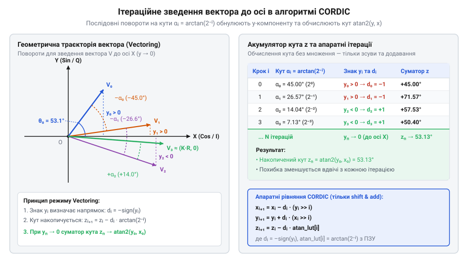
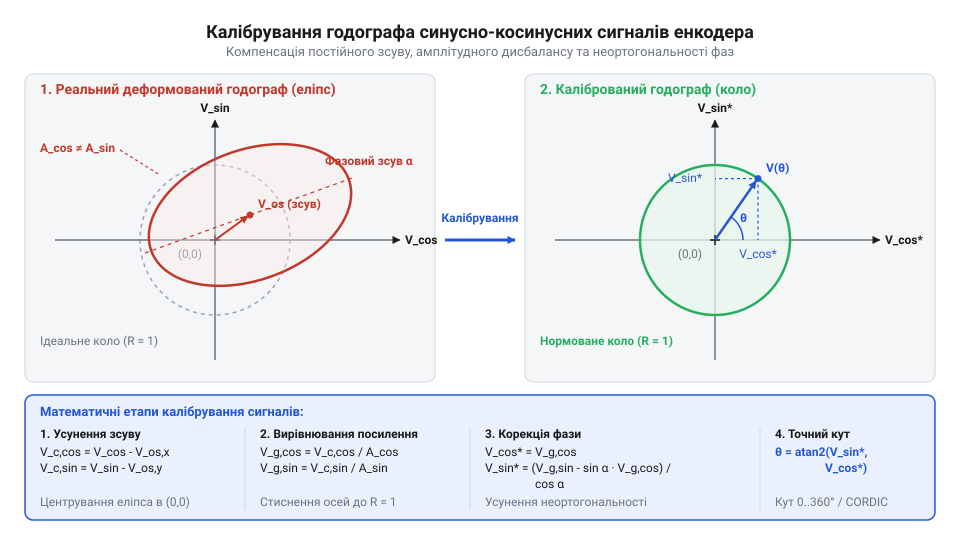
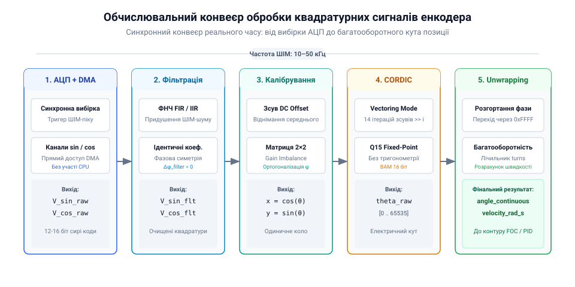

# Математичні алгоритми обчислення кута в магнітних енкодерах: від синусно-косинусних сигналів до CORDIC та atan2

<preknowlist>
- [Енкодери кутового та лінійного переміщення](root:cat-hw-sensors/optical-and-magnetic-encoders) — загальні принципи роботи магнітних кутових енкодерів та формування ними аналогових квадратурних сигналів синуса й косинуса при обертанні ротора.
- [Магнітний енкодер кута AS5048](root:cat-hw-sensors/as5048-magnetic-encoder) — практична реалізація інтегральних магнітних сенсорів із розташуванням давачів Холла над намагніченим ротором.
</preknowlist>

## Проблема відновлення кута з двох сигналів

У [сучасних магнітних енкодерах](root:cat-hw-sensors/optical-and-magnetic-encoders) первинним джерелом інформації про кутове положення вала є вимірювання двох компонентів векторного магнітного поля. Коли постійний магніт обертається над масивом чутливих елементів (наприклад, у [інтегральних давачах AS5048](root:cat-hw-sensors/as5048-magnetic-encoder)), за рахунок просторового зсуву вимірювальних структур на 90 електричних градусів формуються два аналогові квадратурні (від лат. *quadratura* — надання квадратної форми, у значенні розділення кола на чотири чверті) сигнали @@en|quadrature signals@@.

Один із сигналів пропорційний синусу кута повороту `θ`, а інший — косинусу того ж кута:

```
V_sin(θ) = V_m · sin(θ)
V_cos(θ) = V_m · cos(θ)
```

Тут `V_m` позначає пікову амплітудну напругу аналогових каналів. Отримавши такі напруги на входах аналогово-цифрового перетворювача мікроконтролера, інженер стикається з первинним завданням: відновити кут `θ` у діапазоні від 0° до 360° (або від 0 до `2π` радіан).

Першою інтуїтивною спробою позбутися невідомої амплітуди `V_m` є обчислення відношення синусної напруги до косинусної. За тригонометричним визначенням ділення двох компонентів дає тангенс кута:

```
tan(θ) = V_sin(θ) ÷ V_cos(θ)      [визначення тангенса кута]
```

Здавалося б, для вилучення кута `θ` достатньо застосувати обернену тригонометричну функцію — скалярний арктангенс (від грец. *arktos* — дуга та лат. *tangens* — той, що дотикається) @@en|arctangent@@:

```
θ_calc = arctan(V_sin ÷ V_cos)    [застосування скалярного арктангенса]
```

Однак таке математичне спрощення приховує фатальну помилку, яка унеможливлює точне визначення кута положення ротора. Проблема полягає в алгебраїчній природі ділення: при формуванні частки `V_sin ÷ V_cos` знаки окремих чисельника та знаменника втрачаються, зливаючись у єдиний знак результату.

Функція тангенса є періодичною з періодом `π` (180°), на відміну від повного кола обертання `2π` (360°). Це означає, що однакове значення тангенса відповідає двом діаметрально протилежним напрямкам вектора на фазовій площині:

```
tan(θ + π) = sin(θ + π) ÷ cos(θ + π)
= (-sin(θ)) ÷ (-cos(θ))            [формули зведення тригонометрії]
= sin(θ) ÷ cos(θ)                  [скорочення від'ємних знаків]
= tan(θ)                           [періодичність тангенса]
```

Розглянемо це на координатах чотирьох квадрантів фазової площини:

1. У першому квадранті (`0° < θ < 90°`) обидва сигнали додатні: `V_sin > 0`, `V_cos > 0`. Частка `(+)/(+)` дає додатний тангенс, і скалярний @@en|arctangent@@ повертає значення в межах від `0` до `π/2`. 2. У третьому квадранті (`180° < θ < 270°`) обидва сигнали від'ємні: `V_sin < 0`, `V_cos < 0`. Проте частка `(-)/(-)` знову дає додатний результат `(+)`! Скалярний @@en|arctangent@@ обчислить той самий кут у межах від `0` до `π/2`, помиляючись рівно на 180°. 3. Аналогічно у другому квадранті (`V_sin > 0`, `V_cos < 0`) частка `(+)/(-)` від'ємна, і у четвертому квадранті (`V_sin < 0`, `V_cos > 0`) частка `(-)/(+)` також від'ємна. Алгоритм не здатний відрізнити кут 135° від 315°.

Окрім втрати квадранта, ділення на косинус створює числову нестабільність. Коли вал енкодера проходить точки 90° та 270°, косинус дорівнює нулю (`V_cos = 0`), і спроба виконати ділення на нуль викликає апаратне виключення процесора або повертає нескінченність (`±∞`). Поблизу цих точок, де значення косинуса прямує до нуля, навіть мікроскопічний аналоговий шум @@en|noise@@ чи найменші коливання амплітуди спричиняють катастрофічне спотворення тангенса: частка `V_sin ÷ V_cos` значно розгойдується від мізерних завад, породжуючи колосальну похибку визначення кута. До того ж таке скалярне ділення повністю ігнорує фізичний стан давача і може видавати «правдоподібні» значення тангенса навіть при виході сигналів за припустимі межі. Для перевірки цілісності сигналів @@en|signal integrity@@ та виявлення завад чи апаратних збоїв обов'язково аналізують модуль (від лат. *modulus* — міра) вектора @@en|vector magnitude@@ `R = √(V_sin² + V_cos²)`. Для ідеальних квадратурних сигналів модуль `R` за тригонометричною тотожністю `sin²(θ) + cos²(θ) = 1` є строго сталим і дорівнює амплітуді `V_m` при будь-якому куті повороту, тож просідання або вихід `R` за допустимі допуски дозволяє миттєво виявити деградацію магнітного поля чи обрив ліній вимірювання.

Отже, скалярне ділення сигналів руйнує двовимірну структуру інформації. Щоб відновлювати повний кут від 0° до 360° без невизначеностей та ділення на нуль, математичний алгоритм повинен аналізувати знаки та величини обох @@en|quadrature signals@@ одночасно, оперуючи ними як вектором на площині.

## Обчислення кута в чотирьох квадрантах

Двовимірний вектор магнітної індукції з координатами `(x, y) = (V_cos, V_sin)` містить повну інформацію про орієнтацію ротора. Для однозначного вилучення кута у всьому діапазоні `(-π, π]` у математиці використовують розширену функцію двох аргументів — @@en|atan2@@`(y, x)`.

На відміну від звичайного арктангенса, функція @@en|atan2@@ приймає чисельник `y` та знаменник `x` окремими параметрами. Це дозволяє алгоритму спершу перевірити знаки обох координат, визначити поточний квадрант вектора і додати відповідний компенсаційний кутовий зсув:

```
atan2(y, x) = arctan(y ÷ x)          [якщо x > 0 (I та IV квадранти)]
= arctan(y ÷ x) + π                  [якщо x < 0 та y ≥ 0 (II квадрант)]
= arctan(y ÷ x) - π                  [якщо x < 0 та y < 0 (III квадрант)]
= +π ÷ 2                             [якщо x = 0 та y > 0 (вісь +Y)]
= -π ÷ 2                             [якщо x = 0 та y < 0 (вісь -Y)]
= 0                                  [якщо x = 0 та y = 0 (невизначеність)]
```

Завдяки додаванню `+π` або `-π` розриви тригонометричного тангенса на межах квадрантів взаємно компенсуються, утворюючи гладку, безперервну функцію кута. Якщо потрібний діапазон обертання від 0° до 360° (`[0, 2π)`), будь-яке від'ємне значення результату функцій додатково зміщується додаванням `2π`.

На обчислювальних ядрах мікроконтролерів без апаратного блоку обчислення плаваючої крапки виконання стандартної бібліотечної функції `atan2()` через розклад у ряди Тейлора потребує сотень тактів процесора. Для прискорення обчислень у реальному часі застосовують [ітераційний алгоритм CORDIC](root:math-geometry/cordic-algorithm) @@en|CORDIC@@ (від англ. *COordinate Rotation DIgital Computer* — цифровий обчислювач повороту координат).

Принцип роботи @@en|CORDIC@@ у векторному режимі полягає у послідовному повертанні початкового вектора `(x₀, y₀) = (V_cos, V_sin)` на фіксовані кути `αᵢ = arctan(2⁻ⁱ)` у бік осі абсцис `X`, поки координата `y` не наблизиться до нуля.


*Послідовні ітеративні повороти вектора на кути arctan(2⁻ⁱ) зменшують синусну координату до нуля, накопичуючи повний кут у суматорі.*

Кожен крок повороту описується математичною ітерацією:

```
xᵢ₊₁ = xᵢ - dᵢ · yᵢ · 2⁻ⁱ
yᵢ₊₁ = yᵢ + dᵢ · xᵢ · 2⁻ⁱ            [поворот вектора на кут αᵢ]
zᵢ₊₁ = zᵢ - dᵢ · arctan(2⁻ⁱ)          [накопичення кута в суматорі z]
```

Тут `dᵢ = +1`, якщо `yᵢ < 0`, і `dᵢ = -1`, якщо `yᵢ ≥ 0`. Множення на `2⁻ⁱ` в цілочисельній арифметиці мікроконтролера виконується за один такт за допомогою побітового зсуву вправо (`>>`), а значення `arctan(2⁻ⁱ)` заздалегідь зберігаються у таблиці констант.

Після `N` ітерацій (зазвичай від 12 до 16) координата `y_N` прямує до 0, а змінна-акумулятор `z_N` містить точний кут `θ`.

Нижче наведено практичну реалізацію квадрантної корекції та ітераційного обчислення кута методом @@en|CORDIC@@ для мікроконтролерів:

:::tabs
@tab C (ESP-IDF)
:::code math-magnetic-encoder-vector-angle-cordic/c/esp-idf/compute-vector-angle-cordic.c
@tab C++ (Arduino)
:::code math-magnetic-encoder-vector-angle-cordic/cpp/arduino/magneticanglesolver.cpp
:::

Алгоритм @@en|atan2@@ та його цілочисельний аналог @@en|CORDIC@@ гарантують безперервність обчислення кута, проте їх точність повністю залежить від ідеальності колового годографа вхідних сигналів.

## Геометричні спотворення та їхнє калібрування

Ідеальні формули тригонометрії припускають, що @@en|quadrature signals@@ аналогових давачів є строго синусоїдальними, мають однакову амплітуду, нульовий постійний зсув та зміщені за фазою рівно на 90°. На практиці фізичні вимірювальні елементи, будь то магніторезистивні мости чи Hall-елементи, завжди демонструють апаратні недоліки.

Вихідний сигнал реального магнітного енкодера описується математичною моделлю з трьома основними спотвореннями:

```
V_sin_raw(θ) = V_off_sin + A_sin · sin(θ + φ)
V_cos_raw(θ) = V_off_cos + A_cos · cos(θ)
```

Ці апаратні відхилення утворюють три геометричні ефекти:

1. Постійний зсув напруги @@en|DC offset@@ (`V_off_sin`, `V_off_cos`) — виникає через несиметрію вимірювальних мостів, зміщення нуля підсилювачів або напруги зсуву АЦП. Він зміщує центр траєкторії з точки `(0, 0)` в точку `(V_off_cos, V_off_sin)`. 2. Амплітудний дисбаланс @@en|gain imbalance@@ (`A_sin ≠ A_cos`) — зумовлений відмінністю коефіцієнтів підсилення аналогових трактів або різною чутливістю давачів по осях `X` та `Y`. Дисбаланс підсилення деформує коловий годограф (від грец. *hodos* — шлях та *grapho* — пишу) @@en|hodograph@@ в еліпс, витягнутий вздовж однієї з осей. 3. Фазове відхилення або неортогональність @@en|phase non-orthogonality@@ (`φ ≠ 0`) — виникає через неточність механічного розташування чутливих елементів під кутом, відмінним від 90°. Це повертає головні осі еліпса під кутом до координатних осей.

Сукупний вплив цих чинників перетворює ідеальний @@en|hodograph@@ з кола на деформований та зміщений еліпс.


*Зміщений і стиснутий еліпс реальних апаратних сигналів перетворюється на центроване коло одиничного радіуса після усунення DC-зсуву, нормалізації амплітуд та фазової корекції.*

Якщо подати такі спотворені сигнали безпосередньо у функцію @@en|atan2@@ або @@en|CORDIC@@, обчислений кут міститиме циклічну гармонічну похибку з періодами 180° та 360°, яка спотворює регулювання швидкістю та положенням електропривода.

Щоб відновити правильну геометричну форму @@en|hodograph@@, застосовують [калібрування квадратурних сигналів](root:hw-sensing/quadrature-signal-calibration). Процес відновлення складається з трьох послідовних лінійних перетворень.

На першому кроці виконують центрування сигналів шляхом віднімання @@en|DC offset@@, виміряного при повному оберті ротора як середнє арифметичне між мінімальним та максимальним значеннями:

```
V_1_sin = V_sin_raw - V_off_sin
V_1_cos = V_cos_raw - V_off_cos      [віднімання постійної складової]
```

На другому кроці проводиться нормування амплітуд для усунення @@en|gain imbalance@@. Для цього центровані сигнали діляться на свої пікові амплітуди:

```
V_2_sin = V_1_sin ÷ A_sin
V_2_cos = V_1_cos ÷ A_cos            [масштабування амплітуд до одиниці]
```

Після другого кроку траєкторія стає симетричним еліпсом із центром у початку координат, але його осі повернуті через @@en|phase non-orthogonality@@ `φ`.

Оскільки `V_2_sin = sin(θ + φ) = sin(θ)·cos(φ) + cos(θ)·sin(φ)`, а `V_2_cos = cos(θ)`, для вилучення чистого ортогонального синуса застосовують метод ортогоналізації Ґрама — Шмідта:

```
V_corr_sin = (V_2_sin - V_2_cos · sin(φ)) ÷ cos(φ)
V_corr_cos = V_2_cos                               [ортогоналізація за кутом φ]
```

В результаті лінійного калібрування вихідні аналогові сигнали перетворюються на нормовану ортогональну пару `(V_corr_cos, V_corr_sin) = (cos(θ), sin(θ))`. Згадуваний @@en|hodograph@@ відновлює форму ідеального кола одиничного радіуса з центром у початку координат.

Подальше передання скоригованих сигналів у математичні алгоритми @@en|atan2@@ чи @@en|CORDIC@@ забезпечує прецизійне обчислення кута з мінімальною залишковою похибкою, аналогічно до того, як це реалізовано в [аналогових резольверах](root:cat-hw-sensors/synchro-and-resolver-transducers) та [трансформаторних датчиках LVDT](root:cat-hw-sensors/lvdt-linear-variable-differential-transformers).

## Обчислення кута ітераційним алгоритмом CORDIC

У контурах керування рухом високої динаміки обчислення кутового положення ротора відбувається всередині переривання з частотою від 10 до 50 кГц. Коли застосовують [магнітні кутові енкодери](root:cat-hw-sensors/optical-and-magnetic-encoders), система отримує два аналогові квадратурні сигнали `x = cos(θ)` та `y = sin(θ)`. Отримання кута `θ` вимагає розрахунку функції `@@en|atan2@@`. Використання обчислювально містких степеневих рядів Тейлора чи розкладу в плаваючій комі на мікроконтролерах без апаратного модуля `@@en|FPU@@ (від @@en|Floating-Point Unit@@ — блок обчислень з плаваючою комою)` створює неприпустиме завантаження процесора та варіацію часу виконання.

Розв'язком цієї проблеми є алгоритм `@@en|CORDIC@@ (від @@en|COordinate Rotation DIgital Computer@@ — цифровий обчислювач повороту координат)`. Його суть полягає у заміні обчислення тригонометричних функцій послідовністю цілочисельних зсувів `@@en|bitwise shift@@` та додавань у форматі `@@en|fixed-point@@`. Для детального вивчення принципів масштабування числових форматів, запобігання переповненню та оптимізації обчислень у цілочисельних регістрах читайте статтю про [арифметику з фіксованою комою в мікроконтролерах](root:sf-devices/integer-scaling-fixed-point).

Векторний режим `@@en|vectoring mode@@` алгоритму `@@en|CORDIC@@` працює за принципом зведення початкового вектора `V₀ = (x₀, y₀)` до додатної осі абсцис `X`. Якщо повертати вектор step-by-step на певні кути так, щоб його вертикальна компонента `y` наближалася до нуля, то сума всіх кутів повороту дорівнюватиме початковому куту `θ`.

Математично повернутий вектор `(x', y')` на кут `γ` описують через матрицю повороту:

x' = cos(γ) · (x - y · tan(γ))
y' = cos(γ) · (y + x · tan(γ))

Якщо обрати послідовність кутів повороту `γᵢ` так, щоб їхній тангенс дорівнював ступеню двійки `tan(γᵢ) = 2⁻ⁱ` (де `i = 0, 1, 2, ...`), то множення на `tan(γᵢ)` перетворюється на звичайний бітовий зсув праворуч на `i` розрядів `>> i`.

Множник `cos(γᵢ)` визначає коефіцієнт масштабування довжини вектора `Kᵢ = cos(atan(2⁻ⁱ))`. Під час ітерацій вектор розтягується на постійний коефіцієнт `K = ∏ Kᵢ ≈ 0.6072529`. Для обчислення кута в `@@en|vectoring mode@@` деформація довжини вектора не має жодного значення, адже напрямок zero-crossing компоненти `y` не змінюється від масштабування модуля. Звідси випливає, що множник `K` можна повністю виключити з обчислень.


*Послідовне зменшення координати y до нуля та накопичення кута повороту z у векторному режимі CORDIC.*

Сума всіх базових кутів `∑ atan(2⁻ⁱ)` прямує до межі `≈ 1.7433 rad` (`≈ 99.88°`). Для забезпечення роботи в усіх чотирьох квадрантах `[-180°, +180°]` перед початком ітерацій виконують попередній поворот вектора. Якщо `x₀ < 0`, вектор лежить у II або III квадрантах. Повертаючи його на `±90°`, ми переносимо вектор у правий півпростір, а початковий кутовий регістр `z₀` ініціалізуємо значенням `+π/2` або `-π/2`.

Після попереднього повороту запускають ітераційний процес для `i = 0` до `N-1`:

dᵢ = +1   [якщо yᵢ < 0, повертаємо проти годинникової стрілки]
dᵢ = -1   [якщо yᵢ ≥ 0, повертаємо за годинниковою стрілкою]

xᵢ₊₁ = xᵢ + dᵢ · (yᵢ >> i)
yᵢ₊₁ = yᵢ - dᵢ · (xᵢ >> i)
zᵢ₊₁ = zᵢ + dᵢ · γᵢ            [накопичення кута з таблиці LUT]

Константи кутів `γᵢ = atan(2⁻ⁱ)` заздалегідь зберігають у таблиці `@@en|look-up table@@ (@@en|LUT@@)`.

У мікроконтролерах кут `z` зручно представляти у 16-бітному форматі `@@en|BAM@@ (від @@en|Binary Angle Measure@@ — двійкова міра кута)`, де діапазон `[0, 65535]` відповідає куту `[0, 2π)`. Головна перевага `@@en|BAM@@` полягає в тому, що природне переповнення 16-бітного цілого числа автоматично реалізує періодичність кута без додаткових перевірок у коді. Як і в [системах з резольверами](root:cat-hw-sensors/synchro-and-resolver-transducers), алгоритм `@@en|CORDIC@@` забезпечує строго детермінований час виконання за фіксовану кількість ітерацій.

## Побудова алгоритму визначення кута реального часу

Знання окремих математичних перетворень недостатньо для побудови стабільного електроприводу. Якщо дискретизація сигналів, їхнє калібрування та математичний розрахунок виконуються неузгоджено, в системі виникає затримка фази та джитер позиції, що руйнує контур керування струмом. Для усунення цих завад будують жорсткий обчислювальний конвеєр `@@en|pipeline@@ (від @@en|pipeline@@ — конвеєр обробки)`.

Кожен крок конвеєра виконується послідовно у строго визначені моменти часу:

1. Синхронне апаратне зчитування. Перетворювач `@@en|ADC@@ (від @@en|Analog-to-Digital Converter@@ — аналого-цифровий перетворювач)` здійснює одночасну вибірку аналогових сигналів синуса й косинуса. Запуск `@@en|ADC@@` прив'язують до вершин шим-сигналу инвертора, щоб мінімізувати вплив комутаційних завад транзисторів. Передача даних у пам'ять відбувається через модуль `@@en|DMA@@ (від @@en|Direct Memory Access@@ — прямий доступ до пам'яті)` без залучення ядра процесора. 2. Цифрова фільтрація квадратур. Сигнали проходять через однакові цифрові фільтри низьких частот `@@en|FIR@@` або `@@en|IIR@@`. Ідентичність коефіцієнтів для обох каналів є критичною: будь-яка асиметрія фільтрів вносить фазовий зсув і деформує колове коло в еліпс. 3. Еліптична матрична корекція. Від фільтрованих значень віднімають `@@en|DC offset@@`, після чого здійснюють множення на матрицю 2×2 для усунення `@@en|gain imbalance@@` та фазової неортогональності. Результатом є ортонормований вектор `(V_cos, V_sin)`. 4. Векторне обчислення CORDIC. Скалібровані 16-бітні цілі числа подаються на вхід алгоритму `@@en|CORDIC@@`, який за 14 ітерацій видає поточний кут у форматі `@@en|BAM@@`. 5. Розгортання фази та накопичення позиції. Модуль розгортання фази `@@en|phase unwrapping@@` відстежує різницю між поточним та попереднім кутом. При переході через межу `0xFFFF` додається або віднімається повний оберт `65536`, що дає безперервну багатооборотну координату.


*Послідовність проходження аналогових сигналів від АЦП через фільтрацію, калібрування та CORDIC до виходу позиції.*

Коли сучасний [інтегральний магнітний енкодер AS5048](root:cat-hw-sensors/as5048-magnetic-encoder) або аналогічні давачі видають квадратурні сигнали, наведений нижче алгоритм забезпечує високу точність та стійкість до завад. На відміну від [лінійних трансформаторів LVDT](root:cat-hw-sensors/lvdt-linear-variable-differential-transformers), обробка сигналів кутових магнітних давачів вимагає безупинного оновлення стану в кожному циклі ШІМ.

Нижче наведено практичну реалізацію цілісного конвеєра обробки на мовах C та C++ з використанням 16-бітної арифметики `@@en|fixed-point@@`.

:::tabs
:::code math-magnetic-encoder-vector-angle-cordic/c/generic/cordic-atan2-q15.c
:::code math-magnetic-encoder-vector-angle-cordic/cpp/generic/encoderpipeline.cpp
:::