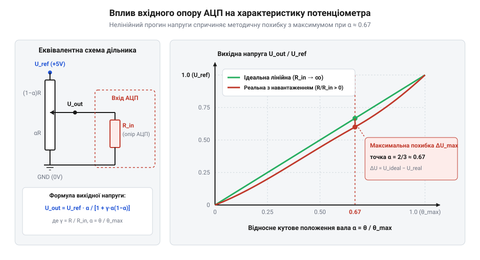

# Математика перетворення напруги потенціометра в кут та розрахунок нелінійності й мертвих зон

## Нелінійність наївного перетворення відліків АЦП

У розробці систем автоматичного керування та сервоприводів вимірювання кутового положення вала найчастіше реалізують за допомогою потенціометричного зворотного зв'язку. Потенціометр (від лат. @@la|potentia@@ — сила та грец. @@el|μέτρον@@ — міра) працює як регульований резистивний дільник напруги, перетворюючи механічний кут повороту ротора в аналоговий електричний сигнал.

На перший погляд, обчислення кута здається тривіальною задачею лінійної пропорції: якщо аналогово-цифровий перетворювач (@@en|АЦП@@) повертає відлік від `0` до максимального значення `Dₘₐₓ`, то поточний кут можна отримати множенням відліку на постійний коефіцієнт. Проте таке наївне пропорційне масштабування в реальних механізмах викликає системні похибки позиціонування, виникнення автоколивань навколо цільової точки та навіть механічне заклинювання сервоприводу.

Причина полягає у фізичній природі резистивної доріжки та принципі її зчитування:

1. **Конструктивна нерівномірність резистивного шару**: вуглецеве, металоплівкове або провідне пластикове покриття доріжки має технологічний допуск товщини й ширини по всій довжині. У результаті опір одиниці довжини варіюється, викликаючи відхилення від ідеально прямолінійної залежності. 2. **Наявність електричних мертвих зон**: біля країв механічного ходу рухомий контакт (ковзач) виходить на суцільні металеві площадки контактних виводів. У цих зонах зміна кута повороту вала не викликає жодної зміни вихідної напруги. Наївне масштабування передбачає, що вся шкала @@en|АЦП@@ відповідає повному механічному куту. Через це алгоритм керування намагається довернути вал у зоні насичення, що призводить до постійного подавання максимального струму на двигун, перегріву та заклинювання в крайніх положеннях. 3. **Вихідний опір дільника та електричний імпеданс**: потенціометр має вихідний імпеданс (від лат. @@la|impedio@@ — перешкоджаю), який не є нульовим. Він змінюється залежно від кута повороту вала і досягає максимуму посередині робочого ходу. Коли вихід потенціометра підключають до входу @@en|АЦП@@ мікроконтролера, вхідна ємність та резистивний дільник вимірювального кола формують паралельне навантаження, яке викривляє прямолінійну характеристику напруги в S-подібну криву.

Для створення надійної системи вимірювання кута необхідно відмовитися від наївного пропорційного перетворення та сформулювати математичну модель сенсора. Ця модель повинна враховувати три ключові фактори: електричний кут ходу `θₑ`, вихідний опір дільника під навантаженням вхідного кола @@en|АЦП@@ та межі мертвих зон. У випадках, коли вимоги до точності перевищують фізичні можливості резистивного контакту, застосовують безконтактні вимірювачі, як-от [магнітний енкодер AS5048](root:cat-hw-sensors/as5048-magnetic-encoder) або інші [оптичні та магнітні енкодери](root:cat-hw-sensors/optical-and-magnetic-encoders).

## Модель резистивного дільника під навантаженням

Розглянемо електричну схему потенціометричного дільника напруги з повним опором `Rₚₒₜ`, підключеного до джерела опорної напруги `Uᵣₑ𝜑` та загального проводу `0`. Вал потенціометра повернуто на кут `θ` в межах робочого електричного кута `θₑ`.

Введемо нормовану координату кутового положення вала `x`:

```
x = θ ÷ θₑ
```
де `x ∈ [0, 1]`.

За ідеальних умов (без навантаження) опір нижнього плеча дільника дорівнює `R₁ = x · Rₚₒₜ`, а верхнього — `R₂ = (1 - x) · Rₚₒₜ`. Вихідна напруга ідеального дільника `Uₒᵤₜ_ideal` прямо пропорційна кутові `x`:

```
Uₒᵤₜ_ideal = Uᵣₑ𝜑 · x
```

Проте вихідний вузол дільника підключено до вхідного кола @@en|АЦП@@ мікроконтролера, яке має скінченний вхідний опір `Rᵢₙ`. Вхідний опір `Rᵢₙ` виявляється підключеним паралельно до нижнього плеча потенціометра `R₁`.

Обчислимо еквівалентний опір нижнього плеча `R₁ₑᵩ`:

```
R₁ₑᵩ = (R₁ × Rᵢₙ) ÷ (R₁ + Rᵢₙ)
     = (x · Rₚₒₜ · Rᵢₙ) ÷ (x · Rₚₒₜ + Rᵢₙ)      [підстановка R₁ = x · Rₚₒₜ]
```

Поділимо чисельник і знаменник на `Rᵢₙ` та введемо безрозмірний коефіціент навантаження `γ = Rₚₒₜ ÷ Rᵢₙ`:

```
R₁ₑᵩ = (x · Rₚₒₜ) ÷ (1 + x · γ)
```

Повний еквівалентний опір дільника `Rₑᵩ` дорівнює сумі опорів верхнього плеча `R₂` та паралельного з'єднання `R₁ₑᵩ`:

```
Rₑᵩ = R₂ + R₁ₑᵩ
    = (1 - x) · Rₚₒₜ + (x · Rₚₒₜ) ÷ (1 + x · γ)                                 [підстановка R₂ та R₁ₑᵩ]
    = Rₚₒₜ · [(1 - x) · (1 + x · γ) + x] ÷ (1 + x · γ)                         [зведення до спільного знаменника]
    = Rₚₒₜ · [1 + x · γ - x - x² · γ + x] ÷ (1 + x · γ)                         [розкриття дужок]
    = Rₚₒₜ · [1 + γ · x · (1 - x)] ÷ (1 + x · γ)                                [зведення подібних доданків]
```

Тепер знайдемо фактичний передавальний коефіцієнт напруги `K(x) = Uₒᵤₜ ÷ Uᵣₑ𝜑`:

```
K(x) = R₁ₑᵩ ÷ Rₑᵩ
     = [(x · Rₚₒₜ) ÷ (1 + x · γ)] ÷ [Rₚₒₜ · (1 + γ · x · (1 - x)) ÷ (1 + x · γ)] [підстановка R₁ₑᵩ та Rₑᵩ]
     = x ÷ [1 + γ · x · (1 - x)]                                                [скорочення Rₚₒₜ та (1 + x · γ)]
```

Аналіз отриманого рівняння показує: коли коефіцієнт навантаження `γ = 0` (вхідний опір @@en|АЦП@@ прямує до нескінченності), передавальний коефіцієнт `K(x) = x`, що відповідає ідеально лінійній характеристиці. Якщо ж `γ > 0`, реальний передавальний коефіцієнт стає меншим за ідеальний для всіх внутрішніх точок діапазону `x ∈ (0, 1)`.


*Залежність нормованої вихідної напруги від кута повороту вала: ідеальна лінійна характеристика та прогин характеристики через навантаження вхідним опором АЦП.*

Обчислимо абсолютну методичну похибку передавального коефіцієнта `ΔK(x) = K(x) - x`:

```
ΔK(x) = x ÷ [1 + γ · x · (1 - x)] - x
      = x · [1 - (1 + γ · x · (1 - x))] ÷ [1 + γ · x · (1 - x)]                 [зведення до спільного знаменника]
      = - γ · x² · (1 - x) ÷ [1 + γ · x · (1 - x)]                              [спрощення чисельника]
```

Для малих значень `γ` (`γ ≪ 1`) знаменником можна знехтувати, прийнявши `1 + γ · x · (1 - x) ≈ 1`. Тоді методична похибка перетворення кута `Δx(x)` наближено дорівнює:

```
Δx(x) ≈ - γ · x² · (1 - x)
```

Щоб знайти точку максимального відхилення характеристики, знайдемо екстремум функції `f(x) = x² · (1 - x) = x² - x³`. Взявши першу похідну по `x` і прирівнявши її до нуля, отримуємо:

```
f'(x) = 2 · x - 3 · x² = 0
```

Звідси екстремум досягається у точці `x = 2 ÷ 3 ≈ 0.667` (тобто на 66.7% кутового ходу вала).

Підставимо `x = 2 ÷ 3` у вираз для похибки:

```
f(2/3) = (2/3)² · (1 - 2/3)
       = (4/9) · (1/3)
       = 4 ÷ 27 ≈ 0.1481
```

Таким чином, максимальна абсолютна методична похибка кута `|Δθ|ₘₐₓ` становить:

```
|Δθ|ₘₐₓ ≈ 0.1481 · γ · θₑ
        = 0.1481 · (Rₚₒₜ ÷ Rᵢₙ) · θₑ
```

**Обчислення допустимого номіналу потенціометра:**
**Умова:** Необхідно вибрати номінал потенціометра `Rₚₒₜ` для вимірювання кута з електричним діапазоном `θₑ = 300°`. Вхідний опір @@en|АЦП@@ мікроконтролера `Rᵢₙ = 100 кОм`. Допустима методична похибка позиціонування не повинна перевищувати `ε_θ = 0.5°`.

```
γ_max = (ε_θ ÷ θₑ) ÷ 0.1481
      = (0.5 ÷ 300) ÷ 0.1481                                                    [розрахунок допустимого γ]
      = 0.001667 ÷ 0.1481
      ≈ 0.01125

Rₚₒₜ_max = γ_max × Rᵢₙ
         = 0.01125 × 100 000                                                    [підстановка Rᵢₙ]
         = 1125 Ом = 1.125 кОм
```
**Висновок:** Для забезпечення похибки від навантаження менше ніж `0.5°` за вхідного опору @@en|АЦП@@ `100 кОм` слід обирати @@la|потенціометр@@ з опором не більше `1.125 кОм` (стандартний номінал `1 кОм`). Використання поширених потенціометрів на `10 кОм` призвело б до методичної похибки кута понад `4.4°`, що недопустимо для точного сервоприводу.

Якщо ж зниження номіналу потенціометра обмежене вимогами щодо енергоспоживання, перед @@en|АЦП@@ необхідно ставити активний повторитель напруги на операційному підсилювачі або застосовувати альтернативні трансформаторні кутоміри, як-от [сельсини та резольвери](root:cat-hw-sensors/synchro-and-resolver-transducers) чи [диференціальні трансформатори LVDT](root:cat-hw-sensors/lvdt-linear-variable-differential-transformers).

## Масштабування відліків та розрахунок дискретності

Після того як напруга з виходу потенціометра подається на вхід аналогово-цифрового перетворювача, відбувається її дискретизація (від лат. @@la|discretus@@ — розділений) у часі та квантування (від лат. @@la|quantum@@ — скільки) за рівнем.

@@en|АЦП@@ мікроконтролера перетворює аналогову напругу `Uₒᵤₜ` у цілочисловий відлік `D` (від англ. @@en|digital value@@), який визначається розрядністю @@en|АЦП@@ `N` біт та джерелом опорної напруги `Uᵣₑ𝜑`:

```
D = floor( (Uₒᵤₜ ÷ Uᵣₑ𝜑) · (2ᴺ - 1) )
```

Напруга одного молодшого значущого розряду (від англ. @@en|Least Significant Bit, LSB@@) визначає крок квантування за напругою `q_V`:

```
q_V = Uᵣₑ𝜑 ÷ 2ᴺ
```

Кутова роздільна здатність `q_θ` (найменша зміна кута вала, яку здатна зафіксувати система) залежить від розрядності @@en|АЦП@@ `N` та електричного кута ходу `θₑ`:

```
q_θ = θₑ ÷ 2ᴺ
```

Розглянемо теоретичну кутову дискретність для різних розрядностей @@en|АЦП@@ при робочому куті `θₑ = 300°`:
- Для 10-бітного @@en|АЦП@@ (`2¹⁰ = 1024` відліки): `q_θ = 300° ÷ 1024 ≈ 0.293°` (або `17.58'` мінут). - Для 12-бітного @@en|АЦП@@ (`2¹² = 4096` відліків): `q_θ = 300° ÷ 4096 ≈ 0.0732°` (або `4.39'` мінут). - Для 16-бітного @@en|АЦП@@ (`2¹⁶ = 65536` відліків): `q_θ = 300° ÷ 65536 ≈ 0.00458°` (або `0.275'` мінут).

Проте реальна кутова дискретність обмежена рівнем власних шумок @@en|АЦП@@ та завадами в лінії живлення. Якщо ефективна кількість розрядів (від англ. @@en|Effective Number of Bits, ENOB@@) через шуми зменшується з 12 до 10.5 біт, то реальна кутова роздільність погіршується відповідно.

Для перетворення виміряних відліків `D` у значення кута `θ` будують калібрувальне (від араб. @@ar|قَﺎﻟِﺐ@@ — форма, через фр. @@fr|calibre@@) лінійне рівняння. У реальному пристрої через монтажні допуски відлік `D₀`, що відповідає `0°`, не дорівнює нулю, а відлік `Dₘₐₓ`, що відповідає `θₑ`, не дорівнює `2ᴺ - 1`.

Формула лінійного масштабування з урахуванням опорних відліків має вигляд:

```
θ(D) = (D - D₀) · θₑ ÷ (Dₘₐₓ - D₀)
```

Ввівши масштабувальний коефіцієнт передачі `K_θ = θₑ ÷ (Dₘₐₓ - D₀)`, рівняння спрощується до:

```
θ(D) = (D - D₀) · K_θ
```

У мікроконтролерах без апаратного блоку обчислень із плаваючою крапкою (від англ. @@en|Floating Point Unit, FPU@@) виконання ділення з плаваючою комою в робочому циклі є ресурсомістким. Тому застосовують цілочислове масштабування зі зсувом із використанням фіксованої крапки (від англ. @@en|fixed-point arithmetic@@).

Ділення заміняють множенням на цілочисловий масштабувальний коефіцієнт `M_θ` із подальшим побітовим зсувом праворуч на `B` біт:

```
M_θ = round( (θₑ × 2superscript{B}) ÷ (Dₘₐₓ - D₀) )
θ(D) = ((D - D₀) × M_θ) ≫ B
```

Це дозволяє обчислювати кут у мікроконтролері за кілька тактів процесора без втрати точності.

## Компенсація мертвих зон та нелінійності

На краях резистивної доріжки потенціометра завжди присутні конструктивні мертві зони, де напруга виходу залишається незмінною. Крім того, сама доріжка має власне нелінійне відхилення від ідеальної прямої лінії (нелінійність резистивного елемента).

Для захисту алгоритмів керування від помилкових дій у мертвих зонах застосовують алгоритм відсікання насичених ділянок — клемпінг (від англ. @@en|clamping@@).

Верхня та нижня межі дійсного робочого діапазону визначаються під час калібрування: `Dₘᵢₙ_valid` та `Dₘₐₓ_valid`. Усі відліки @@en|АЦП@@ `D`, що виходять за ці межі, обмежуються:

```
D_clamped = min( max(D, Dₘᵢₙ_valid), Dₘₐₓ_valid )
```

Якщо відлік `D` лежить за межами аварійного допуску (наприклад, `D < Dₘᵢₙ_valid - D_margin`), це свідчить про фізичний обрив лінії сигнального проводу або коротке замикання.

Для компенсації власної нелінійності резистивної доріжки та прогину характеристики під навантаженням використовують шматочно-лінійну апроксимацію (від лат. @@la|approximo@@ — наближаюсь).

Робочий діапазон відліків розбивають на `M - 1` інтервалів опорними точками `{(D₀, θ₀), (D₁, θ₁), ..., (Dₘ₋₁, θₘ₋₁)}`. Для будь-якого поточного відліку `D_clamped`, який потрапляє в інтервал `[Dₖ, Dₖ₊₁]`, кут обчислюється методом лінійної інтерполяції (від лат. @@la|interpolatio@@ — оновлення):

```
θ(D) = θₖ + (D_clamped - Dₖ) · (θₖ₊₁ - θₖ) ÷ (Dₖ₊₁ - Dₖ)
```

Нижче наведено практичну реалізацію алгоритму первинної обробки відліків потенціометра з обмеженням мертвих зон та шматочно-лінійною інтерполяцією для мікроконтролерних систем.

:::tabs
@tab C | esp-idf
:::code math-potentiometer-scaling-and-dead-zones/c/esp-idf/pot-process-adc-to-angle.c

@tab C++ | arduino
:::code math-potentiometer-scaling-and-dead-zones/cpp/arduino/potentiometersensor.cpp
:::

Алгоритм шматочно-лінійної апроксимації дозволяє усунути методичну похибку від навантаження вхідним опором @@en|АЦП@@, забезпечити компенсацію нерівномірності виготовлення доріжки та точне позиціонування вала в межах усього робочого електричного кута.