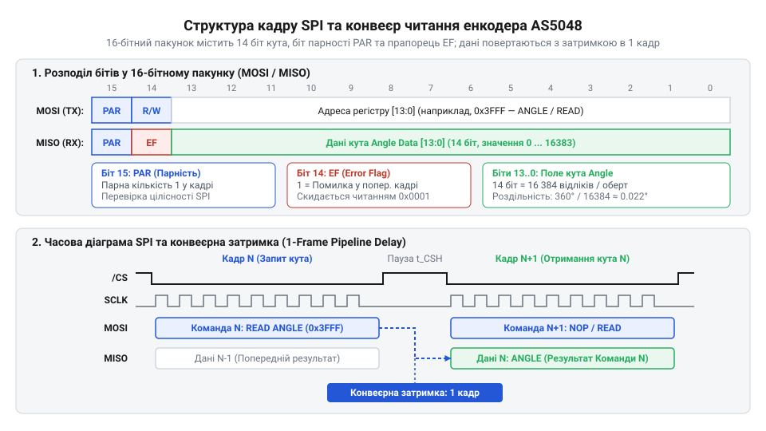
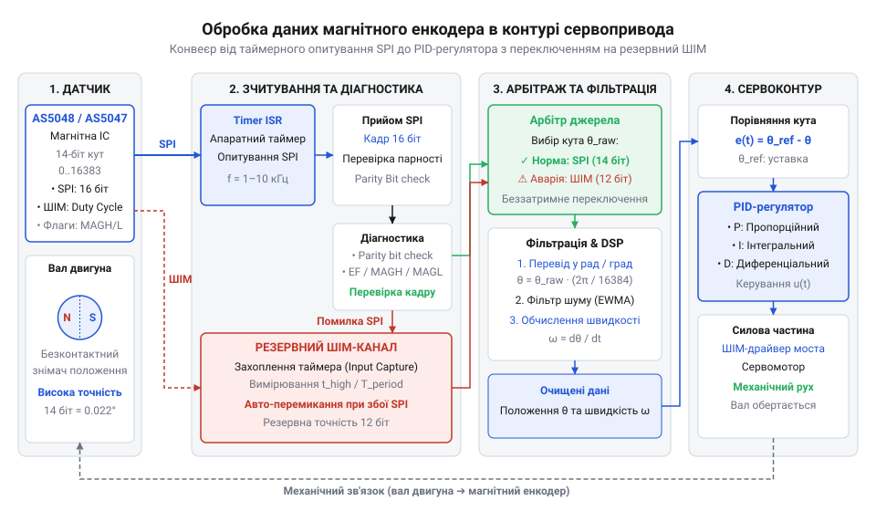

# Зчитування кутового положення з магнітного енкодера через цифровий інтерфейс (SPI/PWM)

<preknowlist>
- [Енкодери кутового та лінійного переміщення](root:cat-hw-sensors/optical-and-magnetic-encoders) — Поняття абсолютного кута та відмінності між імпульсними й цифровими інтерфейсами зворотного зв'язку.
- [Магнітний енкодер кута AS5048](root:cat-hw-sensors/as5048-magnetic-encoder) — Фізичний принцип ефекту Холла, розміщення магніту та призначення внутрішніх регістрів кута й діагностики.
</preknowlist>

## Втрата точності аналогового зворотного зв'язку

У швидкісних контурах керування електродвигуном традиційні аналогові потенціометри та імпульсні енкодери втрачають точність через електричні наводки від силових ключів інвертора та накопичення помилок при пропуску імпульсів. Коли на обмотки мотора подаються потужні імпульси живлення з високою крутістю фронтів, навколо силових кабелів та самої плати виникають потужні електромагнітні поля. Аналогові сигнали, що передаються по довгим дротах від датчиків положення, діють як антени, вбираючи ці гармонійні перешкоди. У результаті значення кута, яке бачить мікроконтролер, спотворюється шумами, що призводить до зриву синхронізації ротора, вібрацій та втрати ефективності крутного моменту.

Звичайні інкрементальні датчики стикаються з іншою фундаментальною проблемою: втратою початкового положення при будь-якому збої живлення чи короткочасному пропуску імпульсу через перешкоду. Оскільки шлях ротора обчислюється наростаючим підрахунком кроків від старту, будь-яка одинична помилка на лінії зв'язку назавжди зсуває відлік до перезапуску системи. Для систем точного позиціонування та швидкого реверсу цього замало, оскільки вони вимагають знати абсолютне положення валу в будь-який момент часу без необхідності повернення в початкову точку, як розкрито в матеріалі про [енкодери кутового та лінійного переміщення](root:cat-hw-sensors/optical-and-magnetic-encoders).

Виходом із цієї ситуації стає перехід до безконтактних магнітних систем, які вимірюють справжній абсолютний кут за допомогою апаратного перетворення магнітного поля на чипі, детально описаному в розділі про [магнітний енкодер кута AS5048](root:cat-hw-sensors/as5048-magnetic-encoder). Проте передача цих даних через довгі кабелі до мікроконтролера в умовах промислових цехів усе ще залишається вразливою для синфазних та диференціальних завад. Тому замість аналогових напруг чи простих імпульсів використовують захищені цифрові послідовні інтерфейси, такі як [цифрові послідовні інтерфейси енкодерів SSI та BiSS-C](root:cat-hw-sensors/ssi-bissc-digital-interfaces), здатні передавати 14-бітні слова з апаратною перевіркою цілісності кожного кадру.

Коли на обмотки мотора подаються потужні імпульси живлення з високою крутістю фронтів від інверторів на силових транзисторах, навколо кабелів та самої плати виникають потужні імпульсні електромагнітні поля. Оскільки перемикання струмів відбувається за лічені наносекунди, швидкість зміни магнітного потоку породжує значні індукційні викиди у будь-яких провідниках поблизу. Аналогові сигнали, що передаються по довгим дротах від датчиків положення до блоку керування, діють як приймальні антени, вбираючи ці високочастотні гармонійні перешкоди та синфазні шуми. У результаті значення кута, яке зчитує мікроконтролер, зазнає спотворень і стрибків, що неминуче призводить до зривів синхронізації ротора, появи механічних вібрацій та значної втрати ефективності крутного моменту. Для точного вимірювання таких імпульсів на практиці використовується модуль захоплення таймера (Input Capture), який дозволяє фіксувати часові інтервали без програмних затримок, задіюючи ШІМ-канал зворотного зв'язку як незалежну резервну лінію передачі кута.

## Структура кадрів SPI та перевірка парності

Отримавши вимоги до цифрового зв'язку, розглянемо структуру 16-бітового протоколу SPI мікросхеми AS5048. Стандартний обмін даними між мікроконтролером та датчиком базується на синхронному послідовному інтерфейсі @@en|SPI@@, де кожен запит і відповідь укладаються в суворо структуроване 16-бітове слово. Замість довільного читання пам'яті, транзакція побудована за принципом «наступний запит отримує відповідь на попередній», що вимагає чіткого розуміння послідовності команд.


*Структура 16-бітного кадру обміну даними через інтерфейс SPI містить старший біт контролю парності, прапорець помилки та 14-бітне корисне навантаження.*

У цьому кадрі старший біт `D15` є бітом парності, який гарантує виявлення одиночних помилок спотворення даних на лінії зв'язку. Якщо кількість одиниць у попередніх 15 бітах непарна (для парності типу @@en|even parity@@), біт `D15` встановлюється в одиницю, щоб загальна сума одиниць у всьому 16-бітному слові завжди була парною. Наступний за ним біт `D14` виконує роль прапорця помилки @@en|EF@@ (Error Flag), сигналізуючи про внутрішні збої датчика або вихід магнітного поля за допустимі межі. Решта 14 бітів від `D13` до `D0` містять або адресу регістра разом із бітом читання/запису у запиті, або безпосередньо 14-бітне значення кута у відповіді датчика.

Для програмної реалізації перевірки цілісності кадру мікроконтролер повинен перед відправкою або одразу після прийому обчислити контрольну суму. Розрахунок біта парності виконується шляхом підрахунку встановлених бітів у 15-бітному слові даних:

```
bits_sum = count_ones(D14 .. D0)    [підрахунок одиниць у кадрі]
parity_bit = (bits_sum % 2) != 0    [правило even parity: доповнення до парного]
```

Якщо розрахована парність не збігається з бітом `D15`, кадр вважається пошкодженим і відкидається без оновлення контуру керування. Це дозволяє повністю уникнути ситуацій, коли випадковий імпульс завади сприймається системою як стрибок положення валу двигуна.

## Програмний драйвер зчитування та обробка діагностики

Маючи алгоритм перевірки цілісності кадру SPI, переходимо до створення повноцінного драйвера для мікроконтролера. Оскільки датчик видає не лише положення, але й інформацію про стан магнітного кола, надійний драйвер зобов'язаний регулярно опитувати не лише регістр кута, а й спеціальні регістри діагностики.


*Ланцюжок обробки даних показує шлях сигналу від апаратного переривання таймера до розрахунку керуючого впливу на силову частину привода.*

Основними регістрами для перевірки стану є @@en|AGC@@ (Automatic Gain Control) та @@en|DIAGNOSTICS@@, які показують інтенсивність магнітного поля та відхилення магніту вздовж осі обертання, як пояснено у розділі про [програмування та випалювання OTP-пам'яті в енкодерах AS504x](root:cat-hw-sensors/as5048-otp-programming-guide). Якщо амплітуда поля падає нижче критичного рівня через механічне зношення чи зміщення корпусу, значення @@en|AGC@@ виходить за межі штатного діапазону. Драйвер повинен перехоплювати ці стани та генерувати апаратну аварію до того, як двигун втратить контроль.

Отриманий із регістра @@en|ANGLE@@ 14-бітний сирий код безпосередньо переводять у фізичні одиниці за допомогою простого масштабування. Оскільки 14 бітів дають рівно 16384 кроки на один повний оберт, як описано в матеріалі про [код Ґрея в енкодерах та цифрових кутомірах](root:cat-hw-sensors/gray-code), поточний кут у градусах обчислюється множенням сирого значення на коефіцієнт `360.0 / 16384.0`.

:::tabs
@tab C (ESP-IDF)
:::code proj-magnetic-encoder-spi-i2c-reader/c/esp-idf/calculate-parity.c
@tab C++ (Arduino)
:::code proj-magnetic-encoder-spi-i2c-reader/cpp/arduino/read-encoder-angle.cpp
:::

Цей код реалізує побітовий контроль парності за допомогою швидких бітових операцій без повільних циклів, що важливо для виконання в обробниках переривань таймерів реального часу. Перевіривши біти `D15` та `D14`, драйвер повертає чистий 14-бітний кут або сигналізує про помилку зв'язку.

## Резервний інтерфейс ШІМ та таймерне захоплення

Коли швидкісний цифровий інтерфейс зв'язку з датчиком зазнає збоїв через сильну електромагнітну перешкоду від інвертора або пошкодження лінії, контур керування втрачає інформацію про поточне положення. Щоб уникнути аварійної зупинки привода в умовах жорстких промислових перешкод, у системі передбачають апаратне дублювання на базі лінії імпульсно-модульованого сигналу. 

Замість пакетного опитування регістра через синхронні шини, магнітний енкодер може безперервно генерувати на окремому виводі прямокутний імпульс, чия тривалість лінійно пропорційна виміряному абсолютному куту. Для цього внутрішній логічний блок датчика перетворює 14-бітне значення кута у часовий інтервал, де нульовому куту відповідає мінімальний фіксований час, а максимальному — повний період імпульсу. 

Для розпізнавання такого сигналу мікроконтролер використовує апаратний блок таймера, налаштований у режим @@en|input capture@@. Таймер неперервно працює від тактового генератора з високою роздільною здатністю, фіксуючи значення свого лічильника в момент настання фронту та спаду вхідного імпульсу. Програмний драйвер обробляє переривання від блоку захоплення, вираховує різницю між значеннями таймера для активного стану та періоду загалом.

Отримане співвідношення тіків таймера перетворюється на значення кута без залучення складних протоколів обміну. Оскільки ШІМ-сигнал є асинхронним і оновлюється кожні кілька сотень мікросекунд, такий канал забезпечує безперервний резервний контроль положення, хоча й має нижчу частоту оновлення порівняно з високошвидкісним синхронним інтерфейсом.

## Інтеграція драйвера у контур сервопривода

Наявність двох незалежних каналів зчитування кута — основного синхронного та резервного асинхронного — створює передумови для об'єднання їх у єдину систему зворотного зв'язку реального часу. Окремі функції читання регістрів та обробки таймерів самі по собі не утворюють замкненого контуру, доки їхня робота не буде синхронізована з періодом роботи силового контролера та ШІМ-модулятора інвертора.

Для цього налаштовують базовий таймер мікроконтролера на генерацію періодичних переривань із частотою, яка відповідає частоті тактування контуру регулювання струму та швидкості сервопривода. Послуговуючись апаратним інтерфейсом, обробник переривання ініціює запит до датчика або зчитує останнє кешоване значення, перевіряючи прапорець помилки та біт парності для запобігання використанню зіпсованих даних.

Оскільки сирі значення кута піддаються впливу високочастотних вібрацій та залишкових шумів квантування, у контур інтегрують програмний фільтр низьких частот або компактний спостерігач стану, який згладжує траєкторію без внесення критичної транспортної затримки. Очищене значення положення та розрахована на його основі швидкість передаються безпосередньо в алгоритми керування положенням та швидкістю.

У результаті збору всіх компонентів формується завершений вузол цифрового зворотного зв'язку, який забезпечує стабільну роботу сервопривода навіть за умов інтенсивних електромагнітних збурень у силовому колі.