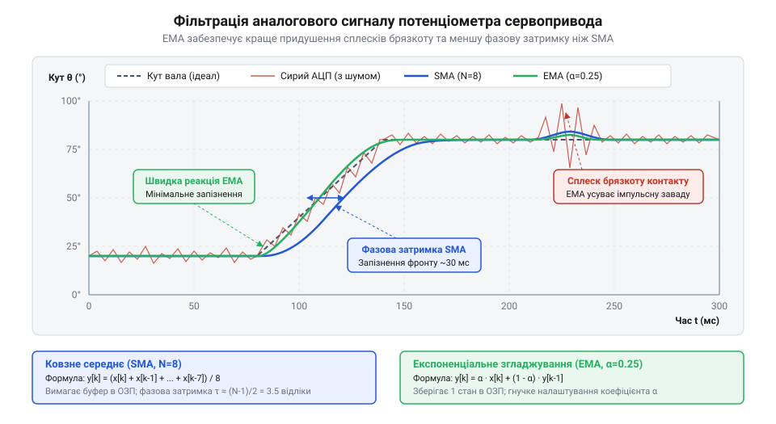
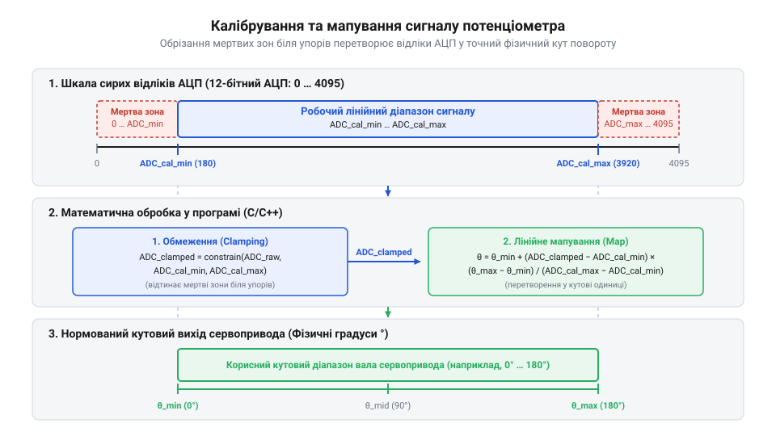

# Практична реалізація зчитування потенціометричного зворотного зв'язку з фільтрацією та калібруванням

<preknowlist>
- [Енкодери кутового та лінійного переміщення](root:cat-hw-sensors/optical-and-magnetic-encoders) — принципи цифрового вимірювання кута та порівняння дискретного зворотного зв'язку з аналоговим
- [Магнітний енкодер кута AS5048](root:cat-hw-sensors/as5048-magnetic-encoder) — поняття абсолютного позиціонування вала та вимоги до точності аналогових і цифрових датчиків
</preknowlist>

## Чому сервопривод тремтить від потенціометра

Потенціометричний зворотний зв'язок є основою для багатьох сервоприводів. Проте під час роботи часто виникає проблема: мотор починає тремтіти. Це явище зумовлене фізичним зносом резистивного матеріалу та ковзного контакту, що призводить до мікроіскріння. У процесі експлуатації струмознімач протирає провідний шар доріжки, залишаючи мікроскопічні борозни та пил від зносу. Коли повзунок проходить над цими дефектами, відбувається миттєве погіршення або розрив електричного контакту, що призводить до утворення мікроіскор. На електричному рівні це перетворюється на різкі високочастотні стрибки напруги (викиди), які АЦП фіксує як хибні зміни положення. Крім того, на межах механічного ходу виникають "мертві зони", де зміна опору не відбувається. Тому пряме зчитування сигналу АЦП передає всі ці флуктуації на мікроконтролер, викликаючи тремтіння сервомотора й перегрів приводу, що вимагає апаратно-програмного оброблення.

## Узгодження опорної напруги та імпедансу

Щоб усунути систематичні похибки, важливо правильно узгодити опорну напругу (Vref) та вхідний імпеданс АЦП. Логометричне зчитування дозволяє компенсувати просідання напруги живлення. Водночас високий вихідний опір потенціометра в поєднанні з ємністю вибірки АЦП може призводити до нелінійності вимірювань, якщо час вибірки недостатній. Тому схемотехніка підключення має враховувати вихідний опір доріжки та ємність вибірки АЦП.

## Придушення завад цифровою фільтрацією сигналів

Для програмного придушення шуму застосовують алгоритми цифрової фільтрації, такі як ковзне середнє та експоненціальне згладжування (@@en|Exponential Moving Average@@, EMA). Сигнал із ковзного контакту потенціометра завжди містить високочастотні завади. Це стається через мікроскопічні нерівності резистивного шару, вібрації механізму та наведення від роботи самого двигуна сервопривода. Якщо подати такий сирий сигнал прямо в контур керування, сервопривод почне неперервно тремтіти, намагаючись відпрацювати кожен випадковий викид напруги. Цифрова фільтрація дозволяє згладити ці флуктуації, відокремивши корисний сигнал про реальне положення вала від випадкового шуму.

Найпростішим способом згладити сигнал є ковзне середнє. Цей алгоритм накопичує задану кількість останніх вимірювань у вікні фіксованого розміру і щоразу обчислює їхнє середнє арифметичне. Коли надходить новий відлік, найстаріший вилучається з вікна, а новий додається на його місце. Математично це виглядає так:

    y_n
    = (x_n + x_{n-1} + ... + x_{n-k+1}) / k      [середнє арифметичне за вікном k]

де `y_n` — поточне відфільтроване значення, `x_n` — найновіший сирий відлік АЦП, а `k` — розмір вікна фільтра.

Ковзне середнє добре пригнічує рівномірний шум, але має серйозну ваду для систем реального часу. Чим більше вікно `k`, тим сильніше згладжування, але водночас зростає фазова затримка — відфільтрований сигнал починає помітно відставати від реального фізичного положення. Крім того, для реалізації такого фільтра мікроконтролер мусить тримати в пам'яті весь масив із `k` останніх відліків, найчастіше у вигляді кільцевого буфера.

Щоб уникнути збереження масиву даних і зменшити обчислювальне навантаження, застосовують експоненціальне згладжування (EMA). Цей фільтр не зберігає історію вимірювань, а використовує лише попереднє відфільтроване значення та поточний вхідний відлік. Рівняння фільтра EMA виглядає так:

    y_n
    = α · x_n + (1 - α) · y_{n-1}      [експоненціальне згладжування]

де `y_n` — нове відфільтроване значення, `x_n` — поточний сирий відлік АЦП, `y_{n-1}` — відфільтроване значення з попереднього кроку, а `α` — коефіцієнт згладжування в межах від `0` до `1`.

Коефіцієнт `α` визначає, наскільки фільтр довіряє новому вимірюванню порівняно з накопиченою історією. Якщо `α` близький до `1` (наприклад, `0.9`), фільтр пропускає сигнал майже без змін, миттєво реагуючи на рух, але й пропускаючи шум. Якщо `α` близький до `0` (наприклад, `0.1`), фільтр сильно згладжує завади, адже нове значення вносить лише 10% у результат, а 90% береться з історії. Це дає плавний сигнал, але вносить затримку. Добір коефіцієнта `α` — це завжди компроміс між швидкістю реакції сервопривода та стабільністю його утримання в точці. 

У практичних задачах ці два підходи часто поєднують, створюючи двокаскадний фільтр. Спочатку швидке ковзне середнє з невеликим вікном відтинає гострі одиничні викиди (брязкіт контакту), а потім фільтр EMA плавно згладжує залишковий шум без надмірної фазової затримки.


*На графіку показано часову діаграму зашумленого сигналу АЦП із флуктуаціями контакту та результати його оброблення ковзним середнім і фільтром EMA.*


*Схема зображує співвідношення між шкалою відліків АЦП, зрізаними мертвими зонами біля механічних упорів та фізичним кутовим діапазоном.*

Нижче наведено програмну реалізацію модуля зчитування та двокаскадної фільтрації:

:::tabs
:::code proj-potentiometer-servo-feedback-adc/c/include/adc_hal.h
:::code proj-potentiometer-servo-feedback-adc/c/include/servo_sensor.h
:::code proj-potentiometer-servo-feedback-adc/c/src/adc_hal.c
:::code proj-potentiometer-servo-feedback-adc/c/src/servo_sensor.c
:::code proj-potentiometer-servo-feedback-adc/c/src/main.c
:::code proj-potentiometer-servo-feedback-adc/cpp/ema_filter.hpp
:::code proj-potentiometer-servo-feedback-adc/cpp/servo_feedback.hpp
:::code proj-potentiometer-servo-feedback-adc/cpp/servo_feedback.cpp
:::code proj-potentiometer-servo-feedback-adc/cpp/main.cpp
:::

## Калібрування крайніх точок і мапування

Коли ми отримали відфільтрований цифровий відлік АЦП, наступним кроком є його перетворення у фізичні кутові одиниці. Датчики мають похибки встановлення та знос резистивного шару, тому безпосереднє множення на константу дає хибні результати. Для точного перетворення застосовують дворівневе калібрування. 

Суть полягає у визначенні двох граничних точок: мінімального кута та максимального кута. Ми фіксуємо вал у крайньому положенні й запам'ятовуємо відфільтроване значення АЦП. Повторюємо це для іншого краю. На краях механічного ходу також виникають мертві зони, коли вал ще рухається, але електричний контакт уже вийшов за межі лінійного резистивного шару. Для коректної роботи контуру керування ми вводимо програмну відсічку мертвих зон: усі відліки поза відкаліброваним діапазоном жорстко обмежуються. 

Тепер для перетворення сирих значень у фізичні координати використовується лінійне мапування: 

        кут = кут_мін + (відлік_АЦП - АЦП_мін) / (АЦП_макс - АЦП_мін) * (кут_макс - кут_мін)      [лінійна інтерполяція]

Це дозволяє завжди отримувати точні нормовані координати.

## Інтеграція C/C++ модуля зворотного зв'язку

Надійний контур керування сервоприводом вимагає стабільного отримання кутових даних. Усі розглянуті алгоритми фільтрації та мапування зручно об'єднати у структурований модуль із чітким API.

Важливою вимогою до модуля є його неблокувальна природа. Він повинен працювати в циклічному опитуванні мікроконтролера, не затримуючи виконання інших задач. 

:::tabs
```c|generic
// Фрагмент інтеграції модуля
#include "servo_sensor.h"
// ...
```
```cpp|generic
// Фрагмент інтеграції класу
#include "servo_feedback.hpp"
// ...
```
:::

У такий спосіб контур керування на кожному кроці швидко опитує датчик і отримує актуальний кут без затримок.