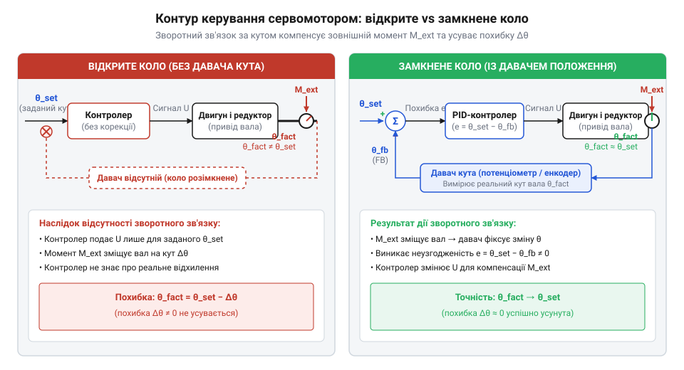
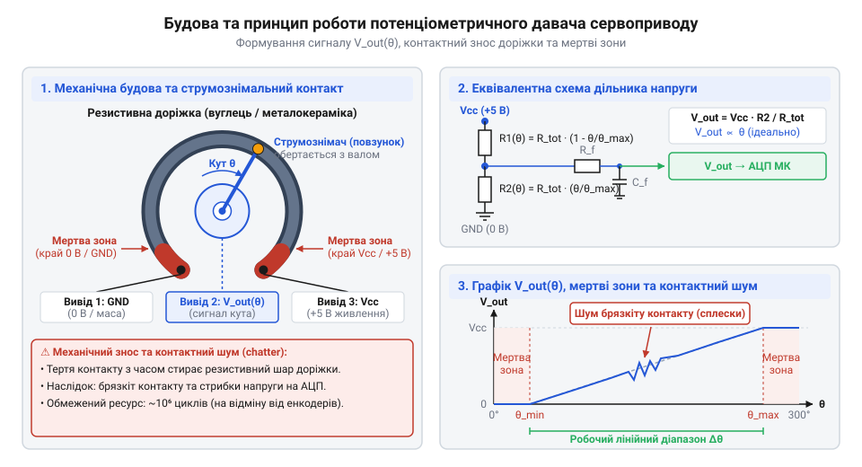
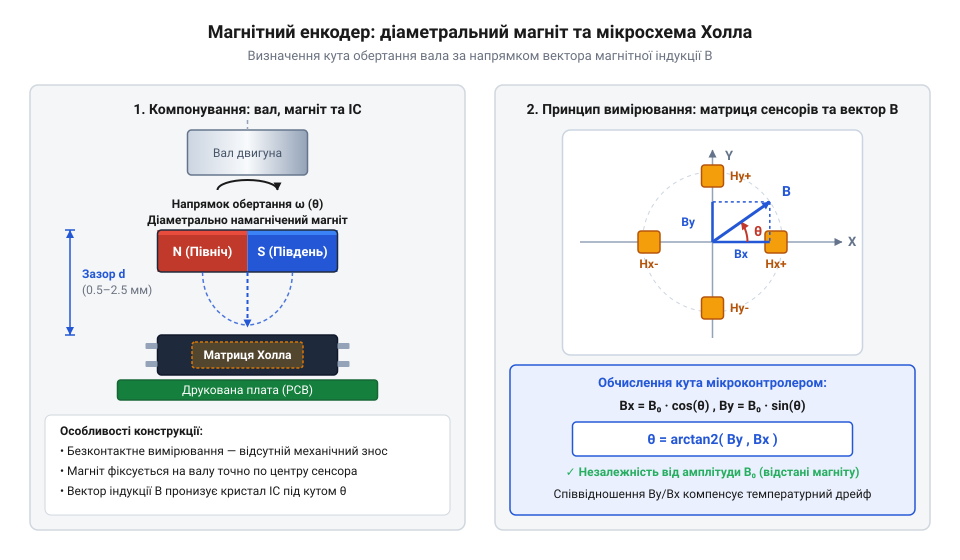
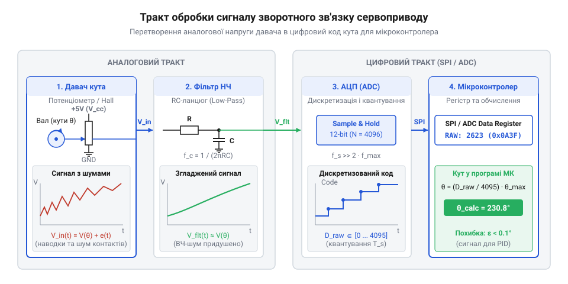
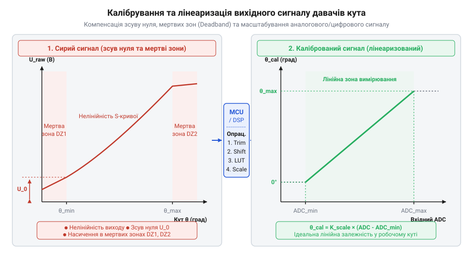

# Датчики кутового положення сервоприводів: потенціометри та магнітні енкодери

<preknowlist>
- [Енкодери кутового та лінійного переміщення](root:cat-hw-sensors/optical-and-magnetic-encoders) — базові поняття роздільної здатності, дискретності та відмінність між інкрементальними й абсолютними вимірювачами кута
- [Магнітний енкодер кута AS5048](root:cat-hw-sensors/as5048-magnetic-encoder) — загальні принципи роботи інтегральних магнітних давачів кута та використання цифрових шин даних
</preknowlist>

## Проблема відсутності зворотного зв'язку вала

Уявіть роботу звичайного постійнострумового електродвигуна (@@en|DC motor@@): ви подаєте напругу на його обмотки, ротор починає обертатися, а механічна передача приводить у рух робочий орган — наприклад, маніпулятор або робототехнічний суглоб. Якщо подача живлення припиняється, двигун продовжує обертатися за інерцією, а при зміні зовнішнього механічного навантаження швидкість його обертання падає або зростає. Спроба встановити вал у чітко задане кутове положення виключно шляхом подачі електричного імпульсу розрахованої тривалості у розімкненій системі керування (@@en|open-loop control@@) неминуче зазнає поразки. Найменша зміна тертя в підшипниках, коливання напруги живлення чи поява зовнішнього опору призводять до накопичення кутової помилки. Робочий орган або не доходить до цілі, або проскочує її, викликаючи механічне розхитування та зрив позиціонування.

Головна причина цієї проблеми полягає у відсутності інформації про поточний фактичний стан вихідного вала. Звичайний електродвигун виконує роботу на основі прикладеної енергії, але не має внутрішнього механізму самоконтролю. Щоб перетворити силовий привід на прецизійний сервопривід (від лат. *servus* — слуга, раб, що вказує на беззастережне виконання команд, та англ. @@en|servo@@), систему необхідно доповнити замкненим контуром керування (@@en|closed-loop control@@). Сервосистема повинна в режимі реального часу знати точний кут повороту вала `θ_act` (від англ. @@en|actual angle@@) і порівнювати його із заданим цільовим кутом `θ_ref` (від англ. @@en|reference angle@@).

Різниця між заданим та фактичним кутом утворює неузгодженість або сигнал похибки позиціонування `e(t)` (від англ. @@en|error signal@@):

```
e(t) = θ_ref(t) - θ_act(t)    [обчислення похибки позиціонування]
```

Отриманий сигнал похибки `e(t)` надходить до обчислювального блоку — регулятора, який формує управляючий вплив на силовий каскад (H-міст, @@en|H-bridge@@). Якщо похибка велика, на двигун подається максимальна напруга або високий коефіцієнт заповнення ШІМ (@@en|duty cycle@@) для швидкого повороту вала. У міру наближення вала до заданого кута значення `e(t)` прямує до нуля, зменшуючи подавану потужність, а при перерегулюванні (@@en|overshoot@@) миттєво змінюється полярність живлення, примусово гальмуючи та повертаючи вал назад. Динаміка цього процесу регламентується алгоритмами, детальніше розкритими у матеріалі про [контури зворотного зв'язку](root:hw-motion/servo-feedback-potentiometers-and-control-loops).

Взаємодію блоків сервосистеми та відмінність між відкритим та замкненим контурами проілюстровано на схемі.


*Принципова відмінність між розімкненим керуванням двигуном та замкненим контуром сервоприводу: наявність давача кута забезпечує безперервне формування сигналу похибки.*

Без безперервного вимірювання кутового положення замкнений контур принципово не здатен протидіяти зовнішнім збуренням. Якщо на вал зафіксованого серводвигуна діє зовнішній механічний момент — наприклад, вага утримуваного вантажу, — розімкнена система навіть не виявить зміщення. У замкненому ж контурі будь-яке відхилення вала від заданої позиції негайно породжує неузгодженість `e(t) ≠ 0`, змушуючи контур керування збільшувати струм в обмотках двигуна пропорційно прикладеному навантаженню. Зміщення вала на мікроскопічний кут призводить до зростання відновлювального моменту, що й створює високу механічну жорсткість позиціонування (@@en|holding torque@@).

На відміну від крокових двигунів, де позиціонування базується на дискретному підрахунку кроків і де пропуск кроку під навантаженням призводить до накопичення незворотної похибки, сервопривід із замкненим контуром постійно виправляє похибку. Для реалізації такого контуру першочергове значення має первинний давач кутового переміщення (@@en|rotary position sensor@@). Залежно від вимог до точності, ресурсу, вартості та умов експлуатації в сервоприводах застосовуються різні фізичні принципи зчитування кута. Історично першим і найпростішим рішенням став аналоговий потенціометр, проте розвиток мікроелектроніки відкрив шлях до безконтактних магнітних та [оптичних енкодерів кута](root:cat-hw-sensors/optical-and-magnetic-encoders). Як відбувалася ця технологічна трансформація, описує [нарис з еволюції зворотного зв'язку](root:cat-hw-sensors/servo-feedback-potentiometers-and-magnetic-encoders/hist-servo-feedback-evolution.md).

Отже, безперервний сигнал зворотного зв'язку (@@en|feedback@@) є фундаментальною передумовою існування серводвигуна: він перетворює некероване обертання ротора на детерміноване кутове переміщення. Фізичні властивості та точність самого давача кута безпосередньо визначають межеву точність, плавність ходу, надійність та стійкість до завад всієї сервосистеми.

## Резистивне вимірювання кута потенціометричними давачами

Зрозумівши потребу у безперервному зворотному зв'язку за кутом, розглянемо найпростіший та найбільш масовий пристрій для його отримання — потенціометр (від лат. *potentia* — сила, потенціал, та грец. *μετρέω* — вимірюю; @@en|potentiometer@@). Його робота базується на перетворенні механічного кута повороту вала на аналоговий сигнал напруги за допомогою резистивного дільника напруги.

Внутрішній устрій аналогового потенціометра сервоприводу складається з трьох ключових елементів: нерухомої дугоподібної резистивної доріжки (@@en|resistive track@@), рухомого металевого струмознімача (@@en|wiper@@) та трьох вивідних контактів. Резистивна доріжка виготовляється шляхом нанесення струмопровідного шару — вуглецевої композиції (@@en|carbon track@@), метал-кераміки (@@en|cermet@@) або провідного пластику (@@en|conductive plastic@@) — на ізолюючу підкладку з текстоліту чи кераміки. Струмознімач закріплюється безпосередньо на вихідному валу серводвигуна (або на проміжному валу редуктора) і виготовляється із пружного благородного металевого сплаву (золото, срібло, берилієва бронза) для мінімізації контактного опору (@@en|contact resistance@@).

Будову потенціометричного давача та схему його підключення зображено на малюнку.


*Внутрішня конструкція потенціометричного давача положення: рухомий металевий струмознімач ковзає резистивною доріжкою, утворюючи регульований дільник напруги.*

Принцип формування вихідного сигналу пояснюється законами електричних кіл. Два крайні контакти потенціометра підключаються до джерела постійної напруги живлення `V_CC` та спільного проводу `GND`, створюючи між ними повний опір доріжки `R_total`. Рухомий струмознімач ділить резистивну доріжку на два послідовно з'єднані плечі з опорами `R_1` та `R_2`. За умови рівномірної питомої провідності доріжки опір першого плеча `R_1` пропорційний куту повороту вала `θ` від початкового положення, а опір другого плеча `R_2` — залишковому куту до максимального значення `θ_max`:

```
R_1 = R_total × (θ ÷ θ_max)              [опір нижнього плеча дільника]
R_2 = R_total × (1 - (θ ÷ θ_max))        [опір верхнього плеча дільника]
```

Вихідна напруга `V_out`, яка знімається зі струмознімача, визначається за формулою класичного дільника напруги:

```
V_out = V_CC × (R_1 ÷ (R_1 + R_2))
      = V_CC × ((R_total × (θ ÷ θ_max)) ÷ R_total)    [підстановка виразу для опору плеча]
      = V_CC × (θ ÷ θ_max)                            [скорочення повного опору доріжки]
```

Отриманий аналоговий сигнал напруги `V_out` лінійно залежить від кута повороту `θ`. Для опрацювання мікроконтролером цей сигнал надходить на аналогово-цифровий перетворювач (від лат. *analogus* — відповідний, та *digitus* — палець, число; @@en|analog-to-digital converter@@, @@en|ADC@@). Дискретний код `N_ADC` на виході `n`-бітного АЦП із опорною напругою `V_REF` розраховується за формулою:

```
N_ADC = N_max × (V_out ÷ V_REF)
      = (2ⁿ - 1) × (V_CC ÷ V_REF) × (θ ÷ θ_max)        [залежність відліку АЦП від кута повороту]
```

Критично важливою інженерною перевагою резистивної схеми є раціометричний принцип вимірювання (@@en|ratiometric measurement@@). Якщо живлення потенціометра `V_CC` та опорна напруга АЦП `V_REF` взяті від однієї й тієї ж шини (тобто `V_CC = V_REF`), співвідношення `(V_CC ÷ V_REF) = 1`. У цьому випадку вихідний код `N_ADC = (2ⁿ - 1) × (θ ÷ θ_max)` взагалі не залежить від нестабільності чи пульсацій напруги живлення. Дрейф джерела однаково впливає і на напругу на струмознімачі, і на шкалу АЦП, повністю компенсуючи похибку.

Однак реальний потенціометричний давач має суттєві фізичні та механічні обмеження, які погіршують точність позиціонування:

1. **Мертві зони на краях доріжки (@@en|dead zone@@).** Конструктивно резистивна доріжка не може утворювати замкнене коло 360°, оскільки крайні виводи `V_CC` та `GND` потребують фізичного розділення для запобігання короткому замиканню. Крім того, на кінцях доріжки розміщуються металізовані майданчики для припаювання виводів. Коли струмознімач заходить на металізований майданчик (зазвичай у діапазонах 0°..10° та 170°..180° для сервоприводів із робочим ходом 180°), напруга перестає змінюватися й дорівнює точно `0 В` або `V_CC`. У цих зонах похідна `dV_out ÷ dθ = 0`, що робить вимірювання кута неможливим. Для запобігання виходу контуру керування з ладу мертві зони програмно обрізаються.

2. **Нелінійність резистивної доріжки (@@en|non-linearity@@).** Через нерівномірність товщини струмопровідного шару при нанесенні та крайові ефекти залежність опору від кута відхиляється від ідеальної прямої лінії. Додаткова нелінійність виникає через шунтуючий вплив вхідного опору АЦП `R_ADC` (@@en|input impedance@@). Якщо вхідний опір АЦП порівнюваний із опором потенціометра (`R_ADC < 100 × R_total`), струм, що відгалужується у вимірювальне коло, спотворює лінійний розподіл напруги дільника. Детальний математичний аналіз цього ефекту наведено у матеріалі про [математичний розрахунок нелінійності](root:cat-hw-sensors/servo-feedback-potentiometers-and-magnetic-encoders/math-potentiometer-scaling-and-dead-zones.md).

3. **Механічний знос та електричні шуми (@@en|mechanical wear@@).** Під час роботи сервоприводу металевий струмознімач здійснює мільйони циклів ковзання по резистивному шару. Сухе тертя призводить до абразивного стирання матеріалу доріжки, утворення мікротріщин та вуглецевого пилу. У місцях зносу виникає нестабільний контакт — так званий брязкіт струмознімача (@@en|wiper jitter / contact chatter@@). Вихідний сигнал збагачується високочастотними сплесками напруги. Контур керування сервоприводу сприймає ці сплески як раптову зміну кута й намагається їх компенсувати, викликаючи високочастотне тремтіння вала (@@en|servo jitter@@), підвищене енергоспоживання та перегрів мотора.

4. **Обмежений механічний ресурс та температурний дрейф.** Ресурс вуглецевих потенціометрів зазвичай не перевищує 10⁵–10⁶ циклів обертання. Використання доріжок із провідного пластику (@@en|conductive plastic@@) збільшує ресурс до 10⁷ циклів, але суттєво підвищує вартість пристрою. Крім того, температурний коефіцієнт опору призводить до зміщення нульової точки при нагріванні двигуна.

Для придушення високочастотних шумів струмознімача аналоговий сигнал піддається фільтрації. На апаратному рівні між виводом струмознімача та `GND` встановлюється керамічний конденсатор, утворюючи ФНЧ (фільтр низьких частот), як показано в [описі апаратного інтерфейсу](root:cat-hw-sensors/servo-feedback-potentiometers-and-magnetic-encoders/api-servo-feedback-hardware-interface.md). На програмному рівні застосовують алгоритми цифрової фільтрації, такі як експоненціальне згладжування (@@en|exponential smoothing filter@@) або [аналогову фільтрацію сигналів](root:hw-sensing/sensor-input-matching).

Розглянемо практичну реалізацію зчитування потенціометричного давача з програмним обрізанням мертвих зон та експоненціальною фільтрацією сигналів. Повний приклад калібрування доступний у [практичній реалізації зчитування](root:cat-hw-sensors/servo-feedback-potentiometers-and-magnetic-encoders/proj-potentiometer-servo-feedback-adc.md).

:::tabs
:::code servo-feedback-potentiometers-and-magnetic-encoders-d/c/esp-idf/read-potentiometer-angle.c
:::code servo-feedback-potentiometers-and-magnetic-encoders-d/cpp/arduino/servopotentiometer.cpp
:::

Потенціометричні давачі залишаються стандартом для бюджетних сервоприводів завдяки своїй крайній простоті, низькій вартості та відсутності потреби в складній цифровій обробці. Проте фізичний знос контакту та електричні шуми обмежують їх застосування у відповідальних високоресурсних системах. Для розв'язання цих проблем розробники переходять до безконтактних давачів, зокрема магнітних та [оптичних роторних енкодерів](root:hw-sensing/optical-incremental-encoder), а також [резольверів і індуктосинів](root:hw-sensing/resolver-and-inductosyn-position-sensors).

## Безконтактне вимірювання кута магнітними енкодерами

Взаємодія струмознімача з резистивною доріжкою аналогового @@en|potentiometer@@ неминуче призводить до механічного зносу, брязкоту контактів та виникнення електричного шуму. У сервоприводах (@@en|servo@@), що працюють у режимі безперервного реверсу, високочастотних коливань чи важких промислових умов, ресурс потенціометра вичерпується за декілька місяців. Прагнення позбутися механічного тертя та зберегти стабільність зворотного зв'язку впродовж мільйонів циклів обертання привело до створення безконтактних давачів положення. Серед них найширшого поширення набули магнітні енкодери (від англ. @@en|magnetic encoder@@).

Основою безконтактного магнітного вимірювача є поділ пристрою на дві ізольовані частини: рухому магнітну систему та нерухомий напівпровідниковий сенсор, розділені повітряним зазором (від англ. @@en|air gap@@). На торці вихідного вала серводвигуна співвісно закріплюється невеликий постійний магніт, а безпосередньо під ним — на друкованій платі керування — монтується спеціалізована мікросхема енкодера.

Для вимірювання кута повороту 360° використовується діаметрально намагнічений магніт (від англ. @@en|diametrically magnetized magnet@@). На відміну від звичайних дискових магнітів із осьовою намагніченістю (де полюси N та S розташовані на протилежних пласких гранях), у діаметрально намагніченому циліндрі північний та південний полюси розміщені на бічних півсферах. Під час обертання вала такий магніт створює в площині мікросхеми вектор магнітної індукції `B`, який обертається в просторі на той самий кут `θ`, що й сам вал.

Всередині інтегральної мікросхеми енкодера розташована матриця напівпровідникових елементів (від лат. *elementum* — першоелемент, та англ. @@en|Hall element array@@), що працюють на основі ефекту Холла (названо на честь американського фізика Едвіна Холла; @@en|Hall effect@@), або магніторезистивних структур (від лат. *resisto* — опираюся; @@en|magnetoresistance@@, зокрема anisotropic magnetoresistance, @@en|AMR@@, giant magnetoresistance, @@en|GMR@@, або tunnel magnetoresistance, @@en|TMR@@).

Ефект Холла полягає у виникненні поперечної різниці потенціалів (напруги Холла) у провіднику зі струмом при його поміщенні у перпендикулярне магнітне поле. Елементи Холла на кристалі розміщуються симетрично у формі хреста або кільця навколо центральної осі обертання. Це дозволяє розділити обертовий вектор магнітної індукції на дві взаємно ортогональні складові — горизонтальну `B_x` та вертикальну `B_y`.

За умови рівномірного магнітного поля амплітудою `B_0` значення двох ортогональних компонент описуються тригонометричними функціями кута повороту вала `θ`:

```
B_x = B_0 × cos(θ)    [горизонтальна складова вектора магнітної індукції]
B_y = B_0 × sin(θ)    [вертикальна складова вектора магнітної індукції]
```

Шляхом ділення вертикальної складової `B_y` на горизонтальну `B_x` взаємно скорочується амплітудне значення магнітної індукції `B_0`:

```
B_y ÷ B_x = (B_0 × sin(θ)) ÷ (B_0 × cos(θ))
          = sin(θ) ÷ cos(θ)    [скорочення амплітуди B_0]
          = tan(θ)              [тригонометрична тотожність]
```

Для знаходження абсолютного кута `θ` в повному діапазоні 0°..360° застосовується функція арктангенса двох аргументів `atan2(B_y, B_x)` (від англ. @@en|atan2@@):

```
θ = atan2(B_y, B_x)    [обчислення кута вектора магнітного поля]
```

Ця математична властивість забезпечує фундаментальну перевагу, яку надає @@en|magnetic encoder@@: раціометричну незалежність вимірювання від абсолютного значення магнітного поля `B_0`. Якщо магніт із часом слабшає через температурне нагрівання або змінюється товщина @@en|air gap@@, амплітуди `B_x` та `B_y` зменшуються в однакове число разів, але їхнє співвідношення та обчислений кут `θ` залишаються суворо незмінними.

Докладніший математичний апарат обчислення вектора кута та розгортання арктангенса розкрито у матеріалі про [математичні алгоритми обчислення кута](root:cat-hw-sensors/servo-feedback-potentiometers-and-magnetic-encoders/math-magnetic-encoder-vector-angle-cordic.md).

Конструктивну взаємодію магніту та напівпровідникового кристала зображено на фігурі.


*Принцип безконтактного вимірювання кута: діаметрально намагнічений магніт створює обертове магнітне поле, вектор якого фіксується матрицею елементів Холла.*

Незважаючи на відсутність механічного зносу, магнітні енкодери мають власні джерела похибок та граничні обмеження, які важливо враховувати при проектуванні сервосистем:

1. **Зміщення осі та ексцентриситет (@@en|axis misalignment@@, @@en|eccentricity@@).** Ідеальна робота давача передбачає, що геометричний центр магніту розміщений суворо над центром напівпровідникової матриці @@en|Hall element array@@. За наявності радіального зсуву (відхилення осі) ортогональні складові `B_x` та `B_y` спотворюються гармоніками, викликаючи нелінійну кутову похибку позиціонування. Осьове зміщення (зміна товщини @@en|air gap@@) впливає на коефіцієнт сигнал/шум: надто великий зазор послаблює сигнал нижче порогу чутливості, а надто малий може призвести до насичення магніточутливих елементів. 2. **Зовнішні магнітні завади (@@en|stray magnetic field@@).** Потужні струми, що протікають обмотками сервомотора, або близькість силових трансформаторів і реле створюють паразитна магнітні поля. Якщо ці поля накладаються на поле вимірювального магніту, обчислений вектор `B` відхиляється від істинного кута вала. Для захисту застосовують диференціальні матриці елементів Холла, які віднімають однорідний зовнішній фон, або магнітні екрани з пермалою. 3. **Роздільна здатність та температурна стабільність.** Роздільна здатність (від лат. *resolutio* — розкладання; @@en|resolution@@) сучасних магнітних енкодерів досягає 12–14 біт (від 4096 до 16384 відліків на оберт), що значно перевищує можливості стандартних потенціометрів. Детальніше про порівняння магнітних вимірювачів з іншими типами давачів можна дізнатися в загальному огляді про [енкодери кутового переміщення](root:cat-hw-sensors/optical-and-magnetic-encoders) та описі конкретної мікросхеми [магнітного енкодера AS5048](root:cat-hw-sensors/as5048-magnetic-encoder). Електричні схеми підключення та живлення подано в довіднику про [апаратний інтерфейс підключення](root:cat-hw-sensors/servo-feedback-potentiometers-and-magnetic-encoders/api-servo-feedback-hardware-interface.md). Історичний контекст переходу від контактних до безконтактних систем висвітлено в нарисі про [еволюцію давачів зворотного зв'язку](root:cat-hw-sensors/servo-feedback-potentiometers-and-magnetic-encoders/hist-servo-feedback-evolution.md).

## Обробка сигналу та формування цифрового кута

Отримання первинного аналогового сигналу — чи то напруги зі струмознімача @@en|potentiometer@@, чи то напруг Холла від ортогональних компонент магнітного поля — є лише першим кроком у системі зворотного зв'язку сервоприводу. Щоб цифровий мікроконтролер міг обчислити сигнал неузгодженості `e(t)` та сформувати управляючий ШІМ-сигнал для H-моста, первинні фізичні величини повинні пройти крізь послідовний тракт аналогової та цифрової обробки сигналів.

Структурну послідовність етапів перетворення сигналу від фізичного первинного давача до цифрового регістру мікроконтролера показано на малюнку.


*Структурна схема тракту обробки сигналу від фізичного давача кута до вхідного регістру мікроконтролера.*

Тракт обробки сигналу складається з чотирьох послідовних етапів:

1. **Аналоговий вхідний каскад (від англ. @@en|analog front-end@@, @@en|AFE@@).** Первинні напруги з елементів Холла або магніторезисторів мають низьку амплітуду (одиниці мілівольт) і вразливі до синфазних завад. Малошумні диференціальні підсилювачі підсилюють ці сигнали до робочого діапазону @@en|ADC@@ та забезпечують первинне аналогове фільтрування завад ФНЧ. Методи побудови таких кіл наведено у матеріалі про [узгодження та аналогову фільтрацію](root:hw-sensing/sensor-input-matching). 2. **Оцифрування (@@en|analog-to-digital converter@@, @@en|ADC@@).** Підсилені аналогові сигнали `B_x` та `B_y` одночасно оцифровуються двоканальним високошвидкісним АЦП (зазвичай сигма-дельта або послідовного наближення). Синхронне оцифрування обох каналів є критичним: найменша часова затримка між вимірюванням `B_x` та `B_y` під час швидкого обертання вала призведе до викривлення обчисленого вектора й виникнення динамічної похибки кута. 3. **Цифрова обробка вектора та алгоритм CORDIC.** Оцифровані значення компонент надходять до внутрішнього цифрового обчислювального ядра мікросхеми енкодера. Оскільки обчислення класичного арктангенса `atan2` через розклад у степеневі ряди вимагає значних ресурсів процесора, апаратні мікросхеми магнітних енкодерів використовують алгоритм CORDIC (від англ. @@en|CORDIC@@ — @@en|COordinate Rotation DIgital Computer@@). Цей алгоритм обчислює кут вектора шляхом послідовних ітераційних поворотів на фіксовані кути за допомогою лише простих операцій зсуву та додавання. Детальніше розкриває цей процес [алгоритм CORDIC](root:hw-arch/cordic-algorithm-hardware-and-software-implementation). На цьому ж етапі цифрове ядро виконує автоматичне регулювання підсилення (від англ. @@en|automatic gain control@@, @@en|AGC@@), компенсуючи зміну амплітуди магнітного поля. 4. **Цифрова фільтрація та формування інтерфейсу.** Згенероване цифрове значення кута піддається внутрішній цифровій фільтрації (наприклад, ковзним середнім або IIR-фільтром) для зменшення високочастотного квантувального шуму. Згладжене значення записується у вихідний регістр кута і готується до передачі за допомогою цифрового або імпульсного протоколу. Часова затримка поширення сигналу (від англ. @@en|propagation delay@@) від моменту фізичного повороту вала до появи даних у регістрі зазвичай становить від одиниць до десятків мікросекунд.

Для передачі обчисленого кута з мікросхеми енкодера до головного мікроконтролера використовуються наступні інтерфейси:

- **Послідовний периферійний інтерфейс (від англ. @@en|Serial Peripheral Interface@@, @@en|SPI@@).** Високошвидкісна синхронна шина, яка дозволяє зчитувати 14-бітний кут на частотах до 10–20 МГц за декілька мікросекунд. Кожен SPI-кадр зазвичай містить біт парності (від англ. @@en|parity bit@@) або контрольну суму (від англ. @@en|cyclic redundancy check@@, @@en|CRC@@) для перевірки цілісності даних, а також статусні біти помилок (виявлення відсутності магніту чи магнітного насичення). - **Широтно-імпульсна модуляція (від англ. @@en|Pulse-Width Modulation@@, @@en|PWM@@).** Однопровідний аналогово-цифровий інтерфейс, у якому тривалість високого рівня імпульсу пропорційна куту від 0° до 360°. ШІМ зручний для простих мікроконтролерів без вільних шин @@en|SPI@@, проте має більшу часову затримку (обмежену періодом ШІМ-сигналу, наприклад, 1 мс при частоті 1 кГц). - **Інтерфейс I2C (від англ. @@en|Inter-Integrated Circuit@@, @@en|I2C@@).** Двопровідна шина, зручна для конфігурування та читання даних у менш критичних до швидкодії системах.

Детальний опис карти регістрів та SPI-кадрів міститься у [програмному інтерфейсі опрацювання](root:cat-hw-sensors/servo-feedback-potentiometers-and-magnetic-encoders/api-servo-feedback-software-interface.md).

Розглянемо практичний приклад реалізації програмного зчитування 14-бітного значення кута з магнітного енкодера за допомогою шини @@en|SPI@@ з перевіркою біта парності. Повний опис проекту наведено у [практичному проєкті зчитування](root:cat-hw-sensors/servo-feedback-potentiometers-and-magnetic-encoders/proj-magnetic-encoder-spi-i2c-reader.md).

:::tabs
:::code servo-feedback-potentiometers-and-magnetic-encoders-d/c/esp-idf/calculate-parity.c
:::code servo-feedback-potentiometers-and-magnetic-encoders-d/cpp/arduino/check-parity-cpp.cpp
:::

На завершення підсумуємо відмінності двох родин давачів кута. Потенціометри залишаються привабливими за ціною для простих сервоприводів із обмеженими вимогами до ресурсу та кута повороту (до 180°). Натомість магнітні енкодери забезпечують безконтактну роботу з необмеженим ресурсом, високу роздільну здатність 14 біт, повний діапазон 360° та безпосередній цифровий вихід.

Для сервосистем критичного призначення, які працюють у зонах випромінювання або сильних зовнішніх магнітних полів, де магнітні вимірювачі можуть давати збої, застосовують [оптичні енкодери кута](root:hw-sensing/optical-incremental-encoder) або електромагнітні [резольвери та індуктосини](root:hw-sensing/resolver-and-inductosyn-position-sensors). Докладніше особливості класичних обертових трансформаторів розкриті в статті про [сельсини та резольвери](root:cat-hw-sensors/synchro-and-resolver-transducers).

## Критерії вибору та калібрування давача

Процес розробки або вибору сервоприводу (від англ. @@en|servo@@) неминуче висуває вимогу компромісу між ціною, довговічністю, точністю позиціонування та стійкістю до зовнішніх чинників. Вибір невірного типу зворотного зв'язку (від англ. @@en|feedback@@) здатний знівелювати переваги найпотужнішого двигуна та найточнішого редуктора: якщо у шарнірі робототехнічного маніпулятора з мільйонним циклом спрацювань встановити звичайний потенціометр (від англ. @@en|potentiometer@@), через знос струмознімача контур керування втратить стабільність вже за кілька місяців. І навпаки, застосування безконтактного магнітного енкодера (від англ. @@en|magnetic encoder@@) поблизу силових кабелів живлення без належного екранування призведе до викривлення виміряного кута паразитною магнітною індукцією.

Головним розмежувальним критерієм між двома технологіями є механічний ресурс та фізика контакту. Потенціометричний давач базується на ковзанні металевого струмознімача по резистивній доріжці. Постійне сухе або змащене тертя призводить до абразивного зносу шару, виникнення мікротріщин та ерозії контактів. Типовий робочий ресурс якісного потенціометра з провідного пластику становить від 1 до 10 мільйонів обертів. Натомість @@en|magnetic encoder@@ є повністю безконтактним пристроєм: вимірювальний магніт та напівпровідниковий сенсор розділені повітряним зазором. Механічний ресурс такого давача визначається виключно терміном служби підшипників вала сервомотора і є практично необмеженим (десятки й сотні мільйонів обертів).

Другим важливим параметром є швидкодія та затримка поширення сигналу (від англ. @@en|propagation delay@@). Аналоговий @@en|potentiometer@@ видає безперервний сигнал напруги, смуга пропускання якого обмежена лише паразитною ємністю доріжки та параметрами зовнішнього аналогового ФНЧ. Реальна затримка аналогового сигналу не перевищує часток мікросекунди, що робить потенціометр ідеальним для надшвидкісних аналогових контурів керування. Магнітний енкодер вимагає часу на обробку: первинні напруги елементів Холла оцифровуються, обробляються DSP-ядром за допомогою алгоритму CORDIC та фільтруються. Сумарний @@en|propagation delay@@ цифрового енкодера становить від 10 до 100 мікросекунд, що створює фазовий зсув у високочастотних [контурах ПІД-регулювання](root:hw-motion/servo-feedback-potentiometers-and-control-loops).

Роздільна здатність (від лат. *resolutio* — розкладання; @@en|resolution@@) та точність позиціонування фундаментально відрізняються за природою обмежень. У потенціометричному давачі роздільна здатність обмежена шумом аналогово-цифрового перетворювача (від англ. @@en|analog-to-digital converter@@, @@en|ADC@@) мікроконтролера (зазвичай 10–12 біт, тобто 1024–4096 відліків) та брязкотом струмознімача. Знос доріжки викликає флуктуації опору й нелінійність. У магнітних енкодерах дискретність задається внутрішньою архітектурою мікросхеми та досягає 12–14 біт (4096–16384 відліків на оберт) з високою повторюваністю. Проте магнітний давач чутливий до радіального зсуву осі магніту та зовнішніх паразитних магнітних полів (від англ. @@en|stray magnetic field@@), що спричиняє циклічну кутову похибку.

Температурний дрейф (від англ. @@en|thermal drift@@) та умови довкілля висувають різні вимоги до захисту. Резистивний шар потенціометра змінює свій опір при нагріванні, проте в раціометричній схемі включення зміна загального опору компенсується дільником напруги, а дрейфує лише коефіцієнт розширення матеріалу підкладки. Водночас потенціометри вразливі до пилу, вологи та бруду, які потрапляють під струмознімач і викликають зникнення контакту. Магнітні енкодери легко герметизуються від вологи й пилу, адже сенсор можна сховати за суцільною немагнітною стінкою корпусу. Проте залишкова індукція постійного магніту зменшується при підвищенні температури (температурний коефіціент `B_r`), що вимагає використання системи автоматичного регулювання підсилення в мікросхемі енкодера.

Узагальнюючи критерії вибору, можна сформулювати практичне правило. Потенціометричний зворотний зв'язок виправданий у бюджетних сервоприводах моделізму, поворотних механізмах із обмеженим кутом повороту (до 180°–300°) та низькою інтенсивністю циклів, а також там, де потрібне гранично просте електричне підключення без використання цифрових шин. Магнітний енкодер є єдино правильним вибором для робототехніки, промислової автоматики, систем із кутом повороту 360° та пристроїв із високими вимогами до надійності. Для екстремальних умов експлуатації з сильнішим випромінюванням замість магнітних енкодерів вибирають електромагнітні [резольвери та індуктосини](root:hw-sensing/resolver-and-inductosyn-position-sensors), а для максимальної точності — прецизійні [оптичні енкодери кута](root:hw-sensing/optical-incremental-encoder).

Незалежно від обраного типу давача, після механічного складання сервоприводу кутове положення вала давача майже ніколи не збігається з фізичним нулем вихідного вала редуктора. Для усунення цієї похибки проводиться калібрування нульової точки (від фр. *calibre*, з араб. *qālib* — форма, шаблон; @@en|zero position calibration@@). Визначення фізичного нуля виконується механічним встановленням вала в опорне положення (наприклад, до упору або за допомогою зовнішнього індикатора) із наступною фіксацією поточного значення давача як зсуву нуля `θ_zero`.

Обчислення скоригованого кута `θ_actual` виконується шляхом віднімання зсуву нуля від сирого виміряного значення `θ_raw`:

```
θ_actual = θ_raw - θ_zero    [компенсація зсуву нульової точки]
```

У магнітних енкодерах зсув нуля можна записати безпосередньо у внутрішній енергонезалежний регістр зсуву (від англ. @@en|offset register@@) мікросхеми, після чого енкодер автоматично віднімає його апаратно. Детальний опис карти регістрів подано в [програмному інтерфейсі опрацювання](root:cat-hw-sensors/servo-feedback-potentiometers-and-magnetic-encoders/api-servo-feedback-software-interface.md). При програмній обробці в мікроконтролері важливо враховувати кільцевий перехід через 360° (від 0 до `N_max - 1`), додаючи модуль роздільної здатності при отриманні від'ємного результату.

Другим етапом калібрування є масштабування вихідного сигналу (від англ. @@en|scale factor@@) та лінійна інтерполяція (від лат. *linearis* — лінійний, та *interpolatio* — поновлення; @@en|linear interpolation@@). Для потенціометричного давача крайні механічні положення вала відповідають цифровим значенням АЦП `ADC_min` та `ADC_max`, а крайні кути — `θ_min` та `θ_max`. Зважаючи на наявність мертвих зон (від англ. @@en|dead zone@@) поблизу шин живлення, реальний діапазон вимірюваної напруги вужчий за повну шкалу АЦП.

Покроковий математичний розрахунок кута повороту `θ` за виміряним значенням `ADC` здійснюється за наступними рівняннями:

```
K_scale = (θ_max - θ_min) ÷ (ADC_max - ADC_min)    [обчислення коефіцієнта масштабування]
θ = θ_min + (ADC - ADC_min) × K_scale              [лінійна інтерполяція кута]
```

Детальні математичні моделі врахування нелінійності та крайових обмежень розкрито у матеріалі про [розрахунок мертвих зон](root:cat-hw-sensors/servo-feedback-potentiometers-and-magnetic-encoders/math-potentiometer-scaling-and-dead-zones.md).

Графічне представлення процесу калібрування та перетворення вихідного сигналу подано на фігурі.


*Характеристика перетворення первинних відліків давача у фізичний кут повороту: віднімання нульового зсуву та лінійна інтерполяція у робочому діапазоні.*

Для забезпечення надійної роботи сервоприводу первинні вимірювання піддаються цифровому фільтруванню (наприклад, ковзним середнім; @@en|moving average@@) із подальшим застосуванням калібрувальних коефіцієнтів. Методи аналогової обробки сигналів детальніше розглядаються у статті про [аналогову фільтрацію сигналів](root:hw-sensing/sensor-input-matching).

Нижче наведено практичну реалізацію універсальної функції калібрування та обчислення кута для потенціометричного та цифрового давачів двома мовами. Практичний проект підключення потенціометра деталізовано у матеріалі про [зчитування потенціометричного зворотного зв'язку](root:cat-hw-sensors/servo-feedback-potentiometers-and-magnetic-encoders/proj-potentiometer-servo-feedback-adc.md), а для магнітного енкодера — у проекті про [зчитування магнітного енкодера](root:cat-hw-sensors/servo-feedback-potentiometers-and-magnetic-encoders/proj-magnetic-encoder-spi-i2c-reader.md).

:::tabs
:::code servo-feedback-potentiometers-and-magnetic-encoders-d/c/esp-idf/calculate-potentiometer-angle.c
:::code servo-feedback-potentiometers-and-magnetic-encoders-d/cpp/arduino/potcalibration.cpp
:::