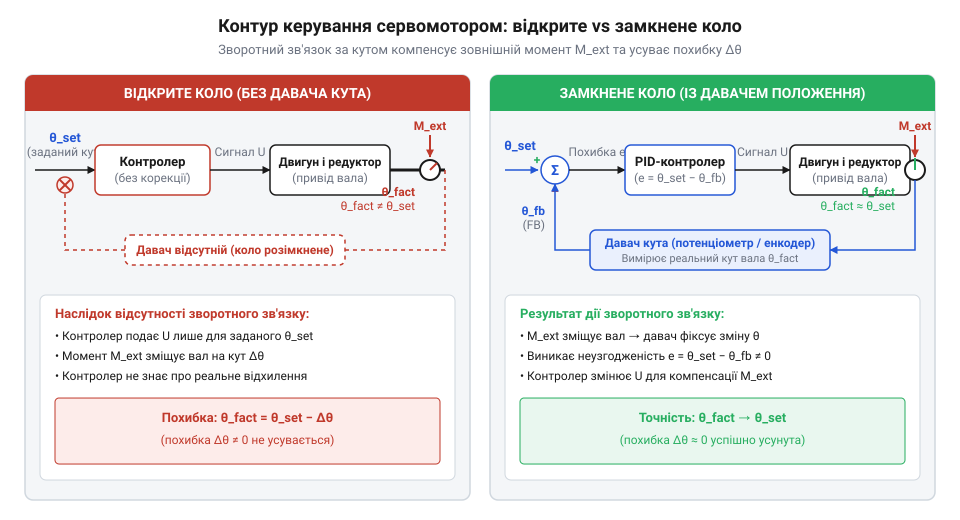
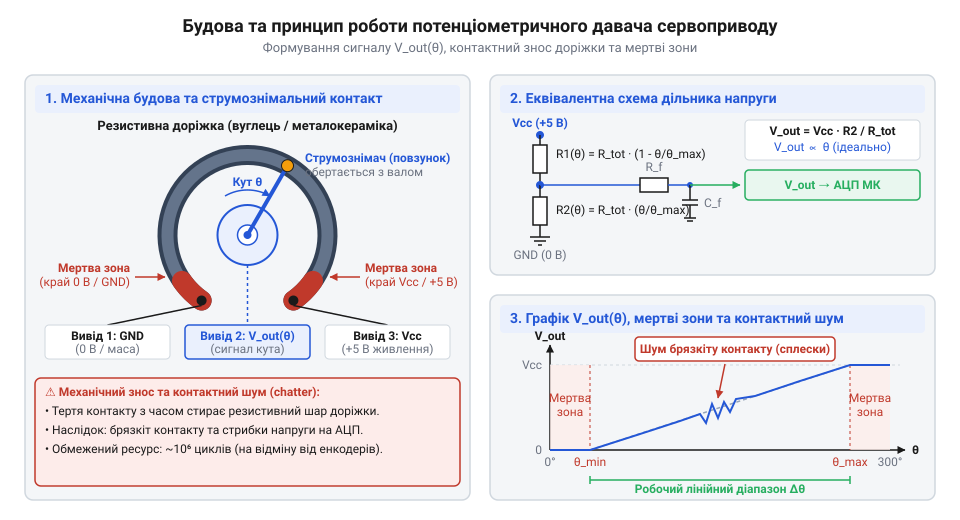
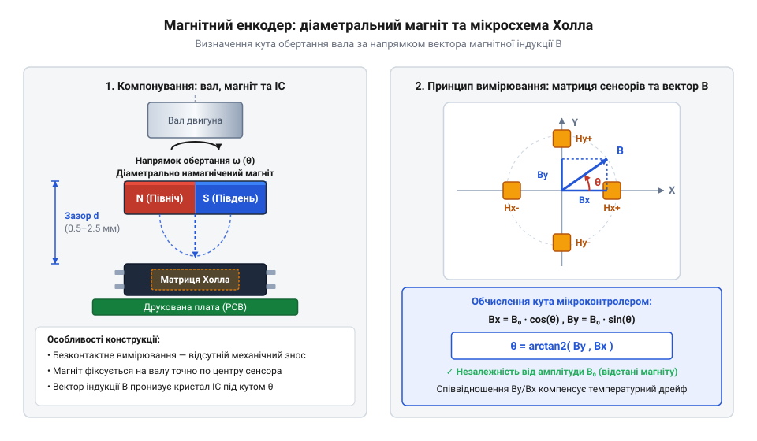
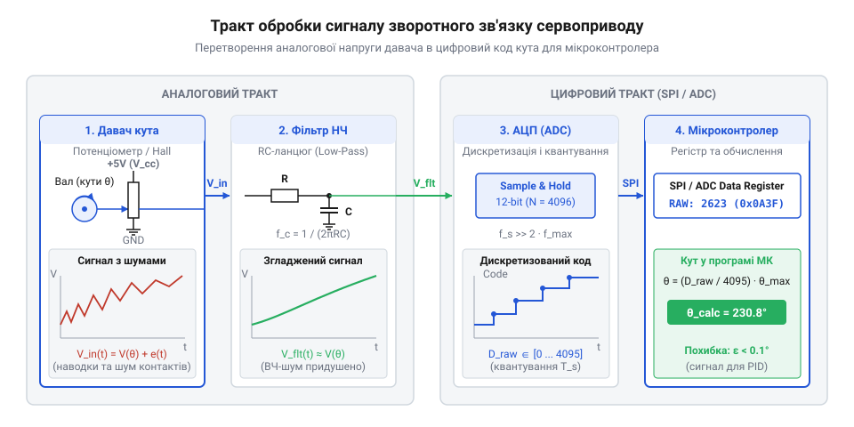
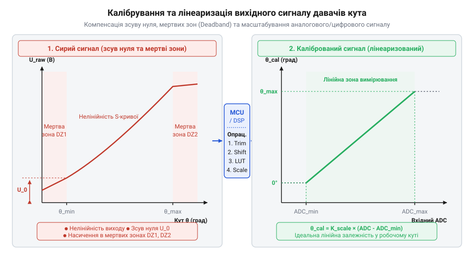

# Датчики кутового положення сервоприводів: потенціометри та магнітні енкодери

<preknowlist>
- [Енкодери кутового та лінійного переміщення](root:cat-hw-sensors/optical-and-magnetic-encoders) — базові поняття роздільної здатності, дискретності та відмінність між інкрементальними й абсолютними вимірювачами кута
- [Магнітний енкодер кута AS5048](root:cat-hw-sensors/as5048-magnetic-encoder) — загальні принципи роботи інтегральних магнітних давачів кута та використання цифрових шин даних
</preknowlist>

## Проблема відсутності зворотного зв'язку вала

У розімкненій системі двигун обертається без контролю фактичного кута: тертя й інерція ротора накопичують похибку положення. @@la|Сервопривід@@ (від лат. *servus* — слуга) усуває цю проблему за допомогою @@en|контуру керування@@ зі @@en|зворотним зв'язком@@, який порівнює заданий кут із реальним станом вала.


*Порівняння роботи двигуна без давача та із замкненим контуром зворотного зв'язку за наявності зовнішнього моменту опору.*

Контролер підраховує похибку неузгодження `e` як різницю між заданим кутом `θ_set` та фактичним кутом вала `θ_real`:

```
e = θ_set - θ_real      [обчислення похибки положення]
```

Значення `e` визначає напругу на обмотках двигуна. Коли `e` прямує до нуля, вал зупиняється. Зовнішнє зміщення вала збільшує `e`, змушуючи схему генерувати протидіючий момент. Для обчислення похибки потрібен первинний давач, про що розповідають [оптичні та магнітні енкодери](root:cat-hw-sensors/optical-and-magnetic-encoders).

## Резистивне вимірювання кута потенціометричними давачами

Найпростіший давач кута — @@la|потенціометр@@ (від лат. *potentia* — сила та грец. *μετρέω* — вимірювати). Він містить резистивну доріжку та рухомий @@en|струмознімач@@ (англ. *wiper*), з'єднаний із валом сервоприводу.


*Будова аналогового потенціометра сервоприводу.*

Обертання вала переміщує @@en|струмознімач@@, змінюючи опори плечей резистивного дільника. Вихідну напругу `V_out` через живлення `V_cc`, кут `θ` та його максимум `θ_max` визначає @@la|раціометричне вимірювання@@ (від лат. *ratio* — співвідношення):

```
V_out = V_cc × (R_wiper / R_total)      [закон Ома для резистивного дільника]
      = V_cc × (θ / θ_max)               [лінійна залежність опору від кута]
```

Співвідношення `V_out / V_cc` залежить лише від `θ / θ_max`, що компенсує нестабільність живлення. Однак на краях доріжки існує @@en|мертва зона@@, а знос @@en|струмознімача@@ викликає @@en|брязкіт контактів@@ і шум у @@en|контурі керування@@, спричиняючи тремтіння вала.

## Безконтактне вимірювання кута магнітними енкодерами

Для усунення механічного зносу застосовують безконтактне зчитування: на торці вала закріплюють діаметрально намагнічений магніт, а під ним на нерухомій платі — @@en|магнітний енкодер@@ (від англ. *encoder* — кодувальник). Усередині мікросхеми інтегровано масив чутливих елементів, якими є @@en|елементи Холла@@.


*Схема розташування постійного магніту на валу над мікросхемою з ортогональними давачами магнітного поля.*

Під час обертання вала чутливі елементи реєструють ортогональні складові індукції `B_x` та `B_y`. Кут `θ` обчислюють через двокомпонентний арктангенс:

```
B_x = B_0 × cos(θ)      [горизонтальна складова магнітного поля]
B_y = B_0 × sin(θ)      [вертикальна складова магнітного поля]
θ   = atan2(B_y, B_x)   [обчислення кута повороту вала]
```

Оскільки `B_y / B_x = tan(θ)`, амплітуда `B_0` скорочується. Це @@la|раціометричне обчислення@@ робить результат незалежним від ослаблення магніту та зміни зазору. На відміну від масивних [трансформаторних кутовимірювачів](root:cat-hw-sensors/synchro-and-resolver-transducers), енкодери мають мінімальні габарити; приклад реалізації — [спеціалізований магнітний давач](root:cat-hw-sensors/as5048-magnetic-encoder).

## Обробка сигналу та формування цифрового кута

Аналогові напруги `B_x` та `B_y` підсилюються й оцифровуються.


*Обробка сигналів індукції всередині енкодера.*

Для обчислення `atan2` без ділення кристал застосовує @@en|алгоритм CORDIC@@ (від англ. *Coordinate Rotation Digital Computer*), який визначає кут бітовими зсувами й додаванням. Отриманий кут виводиться через @@en|інтерфейс SPI@@ або @@en|сигнал ШІМ@@. Докладніше про принципи обчислення векторних поворотів та тригонометрії без ділення читайте у матеріалі про [алгоритм CORDIC для тригонометричних обчислень](root:sf-devices/cordic-algorithm).

Зчитування 14-бітового кута через @@en|інтерфейс SPI@@ із перевіркою парності:

:::tabs
@tab ESP-IDF (C)
:::code servo-feedback-potentiometers-and-magnetic-encoders/c/esp-idf/read-encoder-angle-spi.c

@tab Arduino (C++)
:::code servo-feedback-potentiometers-and-magnetic-encoders/cpp/arduino/magneticencoder.cpp
:::

## Критерії вибору та калібрування давача

Потенціометри забезпечують низьку вартість і нульову затримку, але обмежені ресурсом 10⁵–10⁶ циклів. Безконтактний @@en|магнітний енкодер@@ має необмежений ресурс, роздільну здатність до 14 біт і стійкість до пилу, проте вимагає екранування й додає затримку 10–100 мкс. Для лінійного переміщення застосовують [диференціальні трансформатори LVDT](root:cat-hw-sensors/lvdt-linear-variable-differential-transformers).


*Графік перетворення сирих значень давача в калібрований кут у градусах із врахуванням мертвих зон.*

Перетворення сирого відліку `N_raw` у кут `θ_deg` з урахуванням зсуву нульової точки `N_zero` та масштабного коефіцієнта `K_scale` виконують лінійною інтерполяцією:

```
N_zero = N_raw(0°)                            [фіксація відліку нульового кута]
K_scale = (θ_max - θ_min) / (N_max - N_min)  [обчислення масштабного коефіцієнта]
θ_deg = (N_raw - N_zero) × K_scale           [перетворення відліку у кутові градуси]
```