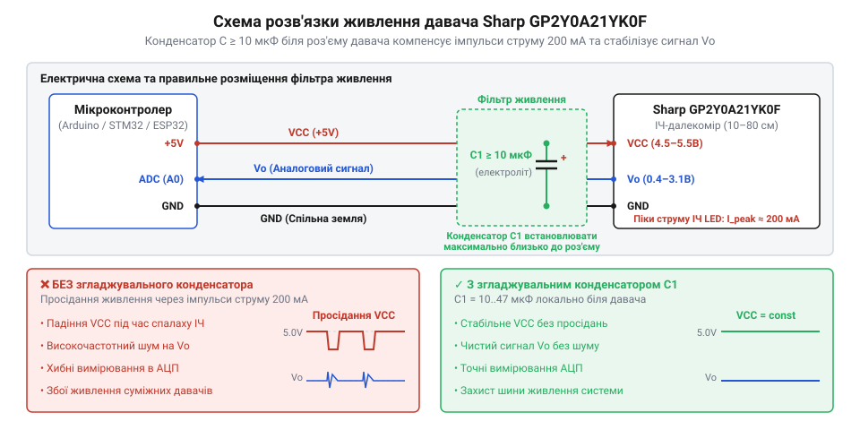
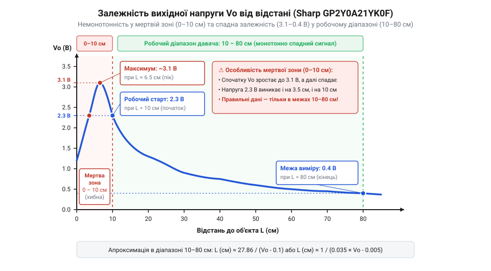

# Електричні параметри, розводка ніжок та характеристика сигналу Sharp GP2Y0A21YK0F

## Наслідки нестабільного живлення та завад

Пряме підключення оптичного аналогового далекоміра @@en|Sharp GP2Y0A21YK0F@@ до мікроконтролера без попереднього проектування кола живлення часто призводить до хаотичних перезавантажень керувальної плати та виникнення завад у виміряному сигналі. Головна причина такої поведінки полягає у фізичному механізмі роботи пристрою: для визначення відстані модуль використовує внутрішній інфрачервоний випромінювач @@en|IR LED@@ (англ. *Infrared Light Emitting Diode* — інфрачервоний світлодіод), який працює в короткоімпульсному режимі. 

У момент спалаху випромінювача споживання струму датчиком стрибкоподібно зростає від базового рівня близько 30 мА до короткочасних пікових значень порядку 200 мА. Якщо напруга живлення подається через тонкі з'єднувальні провідники з відчутним паразитичним опором та індуктивністю, цей імпульсний набрик струму викликає локальне просідання напруги — @@en|brownout@@ (англ. *brownout* — просідання живлення). Коли амплітуда просідання виходить за межі допустимого порогу стабільності мікроконтролера, внутрішня схема скидання за просіданням живлення або супервізор мікроконтролера сприймає це як аварійне вимкнення та перезапускає процесор.

Окрім загрози перезавантаження, короткі імпульси споживання породжують високочастотні завади безпосередньо на шині живлення. Ці завади проникають у внутрішній підсилювач далекоміра та накладаються на вихідну аналогову напругу @@en|Vo@@ (англ. *Voltage Output* — вихідна напруга). У результаті на вихідному сигналі з'являються високоамплітудні шумові піки, які виражаються в хаотичних стрибках відцифрованих значень. 

Якщо аналогово-цифровий перетворювач @@en|ADC@@ (англ. *Analog-to-Digital Converter* — аналогово-цифровий перетворювач) мікроконтролера використовує ту саму нестабільну шину живлення 5 В як опорну напругу, помилка вимірювання подвоюється: коливається як вихідний сигнал датчика, так і шкала порівняння самого перетворювача. На відміну від пристроїв із цифровим зв'язком, таких як [ультразвуковий модуль вимірювання](root:cat-hw-sensors/hc-sr04) або [компактний лазерний далекомір](root:cat-hw-sensors/vl53l0x), аналоговий далекомір передає інформацію безпосередньо рівнем напруги, тому будь-яка завада на шині живлення прямим чином спотворює результат вимірювання відстані. Розуміння цих електричних обмежень вимагає детального аналізу параметрів живлення та розводки контактів пристрою, щоб уникнути [просідання живлення мікроконтролера](root:hw-arch/brownout).

## Призначення виводів та режими живлення

Фізичне підключення далекоміра @@en|Sharp GP2Y0A21YK0F@@ здійснюється через триконтактний роз'єм стандарту @@en|JST PH@@ (англ. *Japan Solderless Terminal* — тип малогабаритного з'єднувача). Призначення контактів роз'єму визначено функціональним поділом на живлення та сигнал:

1. @@en|Vo@@ — вивід аналогового вихідного сигналу, на якому формується напруга, пропорційна зворотній відстані до об'єкта. 2. @@en|GND@@ (англ. *Ground* — заземлення, спільний провід) — спільний мінус живлення та відліковий потенціал аналогового сигналу. 3. @@en|VCC@@ (англ. *Voltage Common Collector* — напруга спільного колектора) — позитивний вивід живлення модуля.

Електричний режим живлення датчика регламентується чіткими межами: допустима напруга живлення на виводах @@en|VCC@@ та @@en|GND@@ становить від 4.5 В до 5.5 В при номінальному значенні 5.0 В. Падіння напруги нижче 4.5 В призводить до порушення режиму роботи внутрішнього світлодіода та зміщення опорних рівнів світлочутливої матриці @@en|PSD@@ (англ. *Position Sensitive Detector* — позиційно-чутливий детектор). У результаті вихідна напруга стає недоствірною. Перевищення порогу 5.5 В є критичним, оскільки викликає перегрів та незворотний прибій внутрішньої мікросхеми обробки сигналу.

Динамічний профіль споживання струму пристроєм має виражений двофазний характер. Середній струм споживання під час безперервної роботи становить близько 30 мА. Однак під час генерування інфрачервоного спалаху внутрішня схема короткочасно споживає імпульсний струм із піковим значенням до 200 мА. Тривалість цих імпульсів становить декілька мікросекунд, але їхня частота відповідає внутрішньому тактовому генератору оптичної триангуляції.

Джерело живлення, що живить далекомір, повинно розраховуватися не на середнє споживання 30 мА, а на здатність віддавати піковий струм 200 мА без виходу напруги за межі нижньої межі 4.5 В. Для побудови стійкої системи необхідно враховувати загальний струмовий бюджет і забезпечувати мінімальний о опору з'єднувальних ліній. Розуміння імпульсного профілю навантаження дозволяє перейти до розрахунку апаратних засобів фільтрації на шинах живлення, опираючись на знання про [фізичні принципи оптичної триангуляції](root:hw-sensing/triangulation).

## Схеми фільтрації та згладжування живлення

Для усунення просідань напруги та високочастотного шуму, викликаних імпульсним споживанням струму інфрачервоним випромінювачем, безпосередньо біля виводів роз'єму далекоміра монтується згладжувальне коло. Оскільки паразитична індуктивність длінних з'єднувальних дротів перешкоджає швидкій віддачі струму з основного джерела живлення, функцію локального джерела енергії під час піків 200 мА виконує накопичувальний конденсатор.

Схема фільтрації будується на базі комбінованого C-фільтра або розширеного RC-фільтра. Базовий C-фільтр складається з двох паралельно увімкнених конденсаторів різних типів та ємностей, розташованих якомога ближче до виводів @@en|VCC@@ та @@en|GND@@ датчика:

1. Електролітичний або танталовий конденсатор C1 ємністю від 10 мкФ до 47 мкФ з робочою напругою не менше 10 В. Він компенсує низькочастотні просідання напруги, віддаючи накопичений заряд під час мікросекундних спалахів випромінювача. 2. Керамічний конденсатор C2 ємністю 0.1 мкФ (100 нФ) з низьким еквівалентним послідовним опором (@@en|ESR@@, англ. *Equivalent Series Resistance* — еквівалентний послідовний опір). Він шунтує на спільну шину @@en|GND@@ високочастотні завади та імпульсні перехідні процеси, з якими великий електролітичний конденсатор не здатний впоратися через власну індуктивність обкладок.

*Принципова схема кола живлення з електролітичним конденсатором для згладжування імпульсів струму та керамічним конденсатором для фільтрації високочастотних завад.*

У системах із високим рівнем електромагнітних завад або при живленні далекоміра від спільної шини з потужними цифровими мікросхемами застосовують пасивний RC-фільтр. Для цього послідовно в лінію живлення @@en|VCC@@ перед конденсаторами C1 та C2 вмикають обмежувальний резистор R_power номіналом від 10 Ом до 22 Ом.

Під час розрахунку RC-фільтра необхідно враховувати спад напруги на резисторі від середнього струму споживання. При середньому струмі I_avg = 30 мА та опорі R_power = 10 Ом падіння напруги становить:

V_drop = I_avg × R_power
       = 0.030 × 10             [I_avg = 30 мА, R_power = 10 Ом]
       = 0.3 В                  [обчислення падіння напруги]

За напруги джерела V_supply = 5.0 В на вивід @@en|VCC@@ далекоміра надходить напруга:

VCC_sensor = V_supply - V_drop
           = 5.0 - 0.3          [підстановка V_supply та V_drop]
           = 4.7 В              [фактична напруга на виводі VCC]

Отримане значення 4.7 В повністю вкладається у визначений робочий діапазон 4.5–5.5 В. Частота зрізу f_c такого RC-фільтра з конденсатором C1 = 10 мкФ обчислюється наступним чином:

f_c = 1 ÷ (2 · π · R_power · C1)
    = 1 ÷ (2 · 3.14159 · 10 · 10⁻⁵)   [R_power = 10 Ом, C1 = 10 мкФ]
    ≈ 159.15 Гц                       [обчислення частоти зрізу]

Такий фільтр ефективно пригнічує пусації живлення на частотах вище 160 Гц. Забезпечивши стабільну напругу живлення без просідань та завад, можна переходити до аналізу характеристик аналогового вихідного сигналу пристрою.

## Характеристики аналогового сигналу та часові параметри

Вихідний аналоговий сигнал @@en|Vo@@ далекоміра @@en|Sharp GP2Y0A21YK0F@@ є постійною напругою, величина якої визначається кутом відбиття інфрачервоного променя від об'єкта на світлочутливу матрицю @@en|PSD@@. 

Робочий діапазон вимірювання відстані для цієї моделі становить від 10 см до 80 см. У межах цього діапазону вихідна напруга змінюється від 3.1 В на близькій відстані 10 см до 0.4 В на максимальній відстані 80 см. Залежність напруги від відстані є виражено нелінійною: вона описується зворотньопропорційною залежністю Vo ≈ k / (d + c), де d — відстань до об'єкта, а k і c — конструктивні константи оптичної системи.

*Залежність вихідної напруги від відстані показує нелінійний характер сигналу у робочій зоні 10–80 см та небезпечне падіння напруги на відстанях менше 10 см.*

Особливу увагу при проектуванні системи слід приділити зоні нечутливості або мертвій зоні на відстанях менше 10 см. Коли об'єкт наближається до датчика ближче ніж на 10 см, відбитий інфрачервоний промінь виходить за фізичні межі матриці @@en|PSD@@. У результаті вихідна напруга заморожується і починає стрімко падати від 3.1 В до рівнів порядку 0.4–1.5 В. Це створює критичну неоднозначність: напруга 1.3 В відповідає як реальній відстані близько 35 см, так і небезпечно близькому об'єкту на відстані 3 см. Для запобігання хибним спрацьовуванням конструкція пристрою повинна гарантувати фізичне унеможливлення потрапляння об'єктів ближче 10 см до оптичного вікна далекоміра.

Оновлення аналогового сигналу відбуваються не безперервно, а дискретними кроками відповідно до внутрішнього циклу вимірювання. Тривалість одного циклу вимірювання становить T_refresh = 38.3 ± 9.6 мс, що відповідає частоті оновлення даних близько 26 Гц. Після подачі живлення або раптової зміни відстані до об'єкта перше стабільне значення напруги на виході @@en|Vo@@ встановлюється через час від 38 мс до 50 мс. Розуміння нелінійності сигналу та часової затримки дозволяє коректно узгодити аналоговий вихід далекоміра з входом аналогово-цифрового перетворювача мікроконтролера за допомогою відповідного [програмного інтерфейсу лінеаризації](root:cat-hw-sensors/gp2y0a21-sw-api).

## Підключення до АЦП мікроконтролера

Зчитування аналогового сигналу @@en|Vo@@ мікроконтролером вимагає узгодження динамічного діапазону напруги, захисту входу АЦП від високочастотних завад та вибору оптимальної частоти дискретизації.

Для захисту аналогового входу АЦП від наводок на сигнальний дріт безпосередньо біля ніжки мікроконтролера встановлюють пасивний фільтр нижчих частот із резистора R_sig = 1 кОм та керамічного конденсатора C_sig = 10 нФ. Частота зрізу такого сигнального фільтра становить:

f_sig = 1 ÷ (2 · π · R_sig · C_sig)
      = 1 ÷ (2 · 3.14159 · 1000 · 10⁻⁸)   [R_sig = 1 кОм, C_sig = 10 нФ]
      ≈ 15.92 кГц                          [обчислення частоти зрізу сигнального фільтра]

Значення частоти зрізу 15.92 кГц ефективно фільтрує наведені високочастотні завади та імпульси, не створюючи при цьому фазового запізнення для вихідного сигналу далекоміра з періодом оновлення 38.3 мс.

Під час вибору опорної напруги VREF перетворювача враховують рівні вихідного сигналу далекоміра 0.4–3.1 В:

- У мікроконтролерах із живленням 5 В (наприклад, архітектури AVR) діапазон 0.4–3.1 В повністю вкладається в шкалу АЦП 0–5 В. При 10-бітному розрядженні АЦП коду відповідає діапазон від ~82 (при 0.4 В) до ~635 (при 3.1 В), що забезпечує використання понад 50% шкали перетворювача. - У мікроконтролерах із живленням 3.3 В (наприклад, архітектур ESP32 або ARM Cortex-M) максимальна напруга далекоміра 3.1 В перебуває в межах допустимого вхідного діапазону 0–3.3 В. Однак для захисту входів від можливих сплесків напруги живлення послідовне увімкнення резистора R_sig = 1 кОм є обов'язковим.

Оскільки далекомір поновлює напругу кожні 38.3 ± 9.6 мс, зчитувати дані за допомогою АЦП частіше ніж раз на 35–40 мс недоцільно, оскільки це призводить до обробки дубльованих значень. 

У наступних прикладах наведено реалізацію періодичного опитування аналогового каналу АЦП із первинним згладжуванням значень.

:::tabs
:::code api-gp2y0a21-hardware-spec/c/esp-idf/sensor-reader-task.c
:::code api-gp2y0a21-hardware-spec/cpp/arduino/setup.cpp
:::

Для детальнішого ознайомлення з принципами конфігурування внутрішніх аналогових периферійних модулів рекомендується звернутися до матеріалу про [налаштування аналогових входів](root:hw-arch/adc-microcontroller).