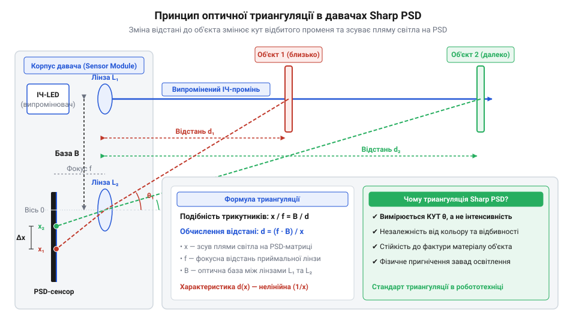
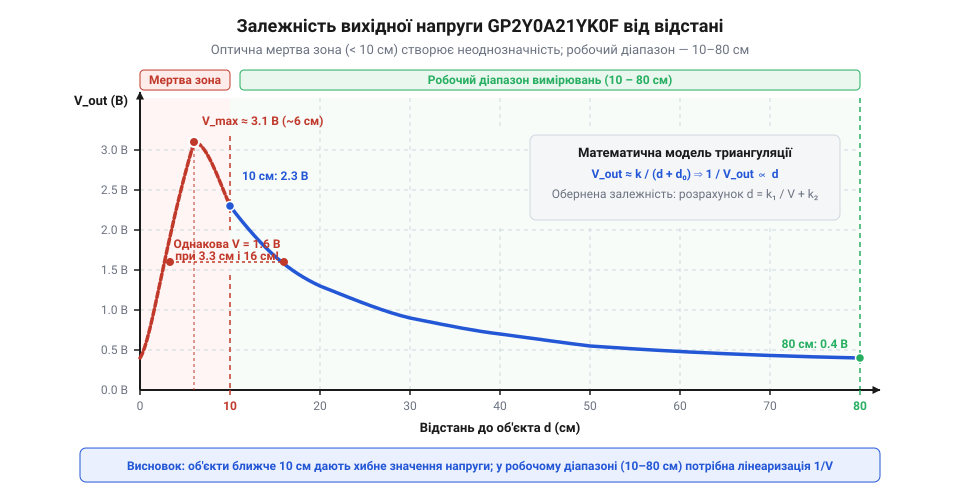

# Від інтенсивності до триангуляції: еволюція оптичних далекомірів Sharp

<preknowlist>
- [VL53L0X — лазерний ToF-далекомір (940 нм)](root:cat-hw-sensors/vl53l0x) — принципи прямого вимірювання часу польоту фотонів (Time-of-Flight) для розмежування з триангуляційним методом Sharp
</preknowlist>

## Проблема амплітуди та кольору поверхонь

Перші оптичні системи вимірювання відстані в мобільній робототехніці будувалися на інтуїтивно зрозумілій ідеї: що ближче об'єкт, то яскравіше відбите від нього світло. Наприкінці 1980-х років розробники намагалися вирішити задачу виявлення перешкод за допомогою найпростіших оптичних пар. Схема складалася з випромінювача інфрачервоного світла @@en|IRED@@ (від англ. *Infrared Emitting Diode*) та приймача, у ролі якого виступав @@el|фотодіод@@ (від грецьк. *phos* — світло). *phos* — світло та *diode*). Випромінювач посилав інфрачервоний промінь у бік перешкоди, світло відбивалося від поверхні, а приймач фіксував інтенсивність відбитого світлового потоку. Проте на практиці цей амплітудний метод зіштовхнувся з фізичним тупиком, який зробив його непридатним для точної навігації.

Фізична причина провалу амплітудного підходу полягає в тому, що величина відбитого світлового потоку залежить не лише від відстані до перешкоди, а й від оптичних властивостей самого матеріалу. Потужність світла `P_rx`, що повертається на @@el|фотодіод@@, описується законами дифракції та дифузного відбиття:

    P_rx = (P_tx · ρ · A · cos(θ)) ÷ (π · d²)

де `P_tx` — потужність випромінювання @@en|IRED@@, `ρ` — коефіцієнт відбиття (альбедо) поверхні, `A` — площа оптичної аппертури приймача, `θ` — кут падіння променя відносно нормалі, а `d` — фізична відстань до об'єкта.

Із цієї формули видно фундаментальну амплітудну пастку: вихідна @@la|амплітуда@@ (від лат. *amplitudo* — широта, величина) фотоструму наймасштабніше визначається добутком коефіцієнта відбиття `ρ` та оберненого квадрата відстані `1/d²`. Чорний оксамит або темний матовий пластик має коефіцієнт відбиття `ρ ≈ 0.05`, тоді як білий глянцевий папір або біла пофарбована стіна відбиває `ρ ≈ 0.90`. Це означає різницю в інтенсивності майже у 18 разів для тієї самої дистанції.

У результаті @@el|фотодіод@@ створює абсолютно однаковий електричний струм у двох принципово різних ситуаціях: коли біла стіна розташована на великій відстані 80 см і коли чорна ніжка крісла перебуває впритул — на відстані 15 см. Мобільний робот, орієнтуючись лише на @@la|амплітуду@@ відбитого сигналу, сприймає темну перешкоду поблизу як віддалений світлий об'єкт і виявляє її лише в момент фізичного зіткнення. Додатково покази спотворювалися шорсткістю поверхні, кутом нахилу стіни та запиленістю оптичного скла.

Спроби вдосконалити амплітудний метод за допомогою імпульсної модуляції світлового потоку (наприклад, на частоті 38 кГц) дозволили відсіяти постійну засвітку від сонячного світла та ламп розжарювання, але не вирішили головної проблеми. Програмна калібровка під конкретну поверхню втрачала сенс у реальному середовищі, де колір і текстура перешкод заздалегідь невідомі. Також інженери застосовували [ультразвукові далекоміри HC-SR04](root:cat-hw-sensors/hc-sr04), які не залежали від кольору, проте вони мали широкий конус випромінювання й не могли точково сканувати вузькі щілини. Оптичній робототехніці потрібен був новий вимірювальний параметр — величина, математично незалежна від потужності відбитого світла `P_rx` та коефіцієнта `ρ`.

## Фізика триангуляції на елементах PSD

Вихід із фізичного тупика знайшли інженери японської корпорації Sharp наприкінці 1990-х років. Вони запропонували відмовитися від вимірювання інтенсивності світлового потоку й перейти до вимірювання кута відбитого променя. Цей принцип отримав назву @@la|оптична триангуляція@@ (від лат. *triangulum* — трикутник). Усередині єдиного компактного корпусу розробники розмістили світлодіод @@en|IRED@@ з випромінювальною лінзою та приймальну оптичну систему, зміщену на фіксовану @@el|базисну відстань@@ (від грецьк. *basis* — основа). *basis* — основа) `L`.

Коли вузький інфрачервоний промінь падає на поверхню об'єкта, на ній утворюється світлова пляма. Приймальна лінза з фокусною відстанню `f` проектує зображення цієї плями на чутливий детектувальний елемент. Якщо об'єкт наближається або віддаляється, кут повернення променя змінюється, що змушує світлову пляму фізично зміщуватися вздовж поверхні детектора.


*Геометрія оптичної триангуляції: зміщення світлової плями на поверхні PSD залежить виключно від відстані до об'єкта та геометричних параметрів сенсора.*

Геометричний зв'язок між відстанню до об'єкта `d` та зміщенням плями `x` на приймачі визначається з подібності трикутників, утворених оптичними осіми випромінювача та приймача:

    x ÷ f = L ÷ d
    = x = (L · f) ÷ d             [вираження зміщення плями через геометрію]
    = d = (L · f) ÷ x             [розрахунок відстані до об'єкта]

Знайдена формула показує головну перевагу геометрії: координата плями `x` прямо пропорційна конструктивним константам `L` та `f` і обернено пропорційна відстані `d`. У цьому рівнянні взагалі відсутні параметри коефіцієнта відбиття `ρ` та початкової потужності світла.

Проте для реалізації цього принципу звичайний @@el|фотодіод@@ не підходив, оскільки він інтегрує світловий потік по всій площі й втрачає інформацію про координату плями. Використання дискретних матриць ПЗЗ (CCD) наприкінці 1990-х робило давач занадто дорогим і повільним. Рішенням Sharp стало застосування напівпровідникового компонента — це @@en|позиційно-чутливий детектор@@ (від англ. *Position Sensitive Detector*, де *position* — позиція, *sensitive* — чутливий, *detector* — детектор), скорочено @@en|PSD@@. Докладніше про будову латеральних фотодіодів та принципи розділення фотоструму читайте у статті про [позиційно-чутливі напівпровідникові детектори (PSD)](root:hw-sensing/position-sensitive-detector).

Компонент @@en|PSD@@ є монолітним фотодіодом із суцільним опоровим шаром та двома електродами `I_1` і `I_2` на протилежних кінцях робочої зони довжиною `W`. Коли згенерована приймальною лінзою світлова пляма падає на точку з координатою `x`, у напівпровіднику виникає загальний фотострум `I_total`. Цей струм розділяється між двома крайніми електродами обернено пропорційно електричному опору ділянок напівпровідника від точки падіння до кожного з електродів:

    I_1 = I_total · (1 - x ÷ W)   [струм першого електрода]
    I_2 = I_total · (x ÷ W)       [струм другого електрода]

Вбудована аналогова мікросхема обробки сигналу давача Sharp обчислює нормоване відношення різниці струмів до їхньої суми:

    (I_2 - I_1) ÷ (I_1 + I_2)
    = ((I_total · (x ÷ W)) - (I_total · (1 - x ÷ W))) ÷ I_total
    = (2 · x ÷ W) - 1             [скорочення загального фотоструму I_total]

Отримане рівняння розкриває фізичну сутність прориву Sharp: загальний фотострум `I_total`, який містить у собі весь вплив кольору, фактури, яскравості та альбедо поверхні, повністю скорочується при діленні! Незалежно від того, відбиває поверхня 90% чи 5% світла, пропорція розділення струмів між електродами @@en|PSD@@ залишається незмінною й описує виключно координату плями `x`.

У серійному давачі @@en|GP2Y0A21YK0F@@ (який став еволюційним розвитком перших модулів серії @@en|GP2D12@@) ця математика реалізована на рівні вбудованого мікрочипа. Вбудована аналогова схема формує вихідну напругу `V_out`, пропорційну координаті `x`.


*Характеристика напруги GP2Y0A21YK0F: нелінійна залежність із мертвою зоною до 10 см, де напруга падає і створює неоднозначність показів.*

Оскільки зміщення `x` обернено пропорційне відстані `d`, вихідна аналогова характеристика давача @@en|GP2Y0A21YK0F@@ є підкреслено нелінійною:

    V_out ≈ a ÷ (d + b)

де `a` і `b` — калібрувальні коефіціенти оптичної системи. З графіка видно важливе обмеження — наявність оптичної мертвої зони на відстанях менше 10 см. У цій зоні відбитий промінь зміщується настільки сильно, що світлова пляма виходить за край робочої поверхні @@en|PSD@@ або за межі фокусу приймальної лінзи. У результаті вихідна напруга стрімко падає, через що об'єкт на відстані 3 см дає таку ж вихідну напругу (близько 1.3 В), як і об'єкт на відстані 30 см. Розробники вимірювальних систем мусять фізично розташовувати давач углиб корпусу робота, щоб уникнути попадання перешкод у мертву зону.

Розробка Sharp на базі @@en|PSD@@ тривалий час залишалася стандартом для робототехніки. Серед початківців і досі існує міф, ніби ці пристрої вимірюють час польоту світла. Насправді класичні далекоміри Sharp працюють на чистій триангуляції та розподілі фотоструму. Сучасні пристрої на кшталт [лазерного далекоміра VL53L0X](root:cat-hw-sensors/vl53l0x), а також модулів [TOF10120](root:cat-hw-sensors/tof10120) чи [TOF250](root:cat-hw-sensors/tof250) реалізують принципово іншу технологію @@en|Time-of-Flight@@, прямо вимірюючи пікосекундні інтервали часу польоту фотонів. Проте саме триангуляційні давачі Sharp довели, що геометричний підхід здатний повністю усунути залежність від кольору та фактури поверхонь за мінімальної вартості компонента.

## Еволюція модулів серії GP2D12 та GP2Y0A21

Наприкінці 1990-х років розробники мобільних роботів зіштовхнулися з серйозним бар'єром: традиційні оптичні давачі інтенсивності хибно реагували на зміну кольору чи фактури поверхні. Одне й те саме фізичне віддалення до білої та чорної перешкоди давало принципово різні покази через різний коефіцієнт відбиття (альбедо). Інженерам японської корпорації @@ja|Sharp Corporation@@ вдалося подолати цю проблему, об'єднавши оптичну триангуляцію та напівпровідникові позиційні детектори в єдиному комерційному модулі. Так з'явився перший масовий пристрій серії @@en|GP2D12@@.

Головне завдання, яке постало перед інженерами при створенні @@en|GP2D12@@, полягало в жорсткому компонуванні різнорідних оптичних та електронних елементів у єдиний завадозахищений модуль. Усередині компактного штампованого пластикового корпусу розмістили інфрачервоний випромінювальний діод (з англ. @@en|Infrared Emitting Diode@@, @@en|IRED@@), фокусувальну та приймальну лінзи, позиційно-чутливий детектор (з англ. @@en|Position Sensitive Detector@@, @@en|PSD@@) та спеціалізовану мікросхему сигнальної обробки (з англ. @@en|Application-Specific Integrated Circuit@@, @@en|ASIC@@). Завдяки монолітному корпусу фабричне калібрування відстані між оптичними осями — базисної відстані — залишалося незмінним під час вібрацій та механічних навантажень.

Критичним викликом для оптичного вимірювання у реальних умовах стало фонове сонячне світло та випромінювання побутових ламп. Фонове освітлення засліплювало крихітну фоточутливу площадку @@en|PSD@@, створюючи потужну постійну складову фотоструму. Щоб відокремити корисний сигнал від завад, інженери застосували імпульсну модуляцію випромінювання. Спеціалізований драйвер усередині @@en|ASIC@@ подавав на @@en|IRED@@ струмові імпульси з частотою близько 1 кГц. Приймальний тракт мікросхеми виділяв лише змінну складову фотоструму на цій частоті за допомогою вбудованого смугового фільтра, повністю відсікаючи постійне фонове засвічення довкілля.

Проте модуль @@en|GP2D12@@ першого покоління мав кілька суттєвих недоліків. Його внутрішній аналоговий тракт виявляв чутливість до просідань живлення, а перші версії оптичних лінз допускали паразитне внутрішнє перевідбиття інфрачервоних променів від внутрішніх стінок пластикового корпусу. Крім того, вихідний сигнал мав відносно високий рівень високочастотних шумів через імпульсне живлення випромінювача, яке створювало струмові піки амплітудою до 200 мА.

На початку 2000-х років корпорація випустила вдосконалений модуль @@en|GP2Y0A21YK0F@@ (та загальну лінійку @@en|GP2Y0A21@@), який усунув ці дитячі хвороби й став світовим стандартом у мобільній робототехніці. В ітерації @@en|GP2Y0A21YK0F@@ оптичну систему суттєво переробили: застосували прецизійні литі акрилові лінзи з оптимізованим профілем та підвищеною прозорістю в ІЧ-діапазоні, а також додали внутрішні світлопоглинальні бленди, що усунули паразитне розсіювання світла усередині відсіків.

Внутрішню кристальну схему @@en|ASIC@@ також повністю оновили. У неї інтегрували вузол вибірки та зберігання напруги (з англ. @@en|Sample and Hold@@), підсилювач з оптимізованим придушенням синфазних завад та стабілізований вихідний буфер. Це дозволило модулю @@en|GP2Y0A21YK0F@@ формувати гладку аналогову напругу, яку можна подавати безпосередньо на аналогово-цифровий перетворювач (з англ. @@en|Analog-to-Digital Converter@@, @@en|ADC@@) будь-якого мікроконтролера без зовнішніх аналогових фільтрів. Поєднання низької вартості, високої завадостійкості та стандартизованого трьохконтактного роз'єму JST зробило @@en|GP2Y0A21YK0F@@ базовим давачем для системи виявлення перешкод у робототехніці.

## Міфи про ToF та геометричні обмеження

У середовищі розробників довго існував поширений міф про те, що давачі @@ja|Sharp@@ серії @@en|GP2Y0A21YK0F@@ працюють за принципом вимірювання часу польоту світла (з англ. @@en|Time-of-Flight@@, @@en|ToF@@) або вимірюють звичайну інтенсивність відбитого світлового потоку. Цей міф виник через використання інфрачервоного випромінювача та імпульсного режиму його роботи. Однак імпульси випромінювача потрібні виключно для частотної фільтрації завад, а не для вимірювання затримки сигналу.

Для вимірювання прямого часу польоту фотонів світло має подолати відстань у 10 см лише за 0,67 наносекунди (оскільки промінь проходить шлях туди й назад). Наприкінці 1990-х років пряме вимірювання пікосекундних інтервалів вимагало складних і дорогих однофотонних лавинних діодів (з англ. @@en|Single-Photon Avalanche Diode@@, @@en|SPAD@@) та швидкісних таймерів. Такі рішення з'явилися в дешевому комерційному сегменті лише через два десятиліття — прикладом є сучасний [лазерний ToF-далекомір VL53L0X](root:cat-hw-sensors/vl53l0x), [компактний давач TOF10120](root:cat-hw-sensors/tof10120) або промисловий [лазерний модуль TOF250](root:cat-hw-sensors/tof250). Натомість давачі @@ja|Sharp@@ вимірюють суто геометричний кут відбиття, як і акустичний [ультразвуковий далекомір HC-SR04](root:cat-hw-sensors/hc-sr04) вимірює геометрію відбиття звуку, але на відмінній фізичній основі.

Геометричний принцип триангуляції визначає математичну форму вихідного сигналу давача. З подібності трикутників, утворених випромінювальним променем, відбитим променем та базисною лінією між оптичними осями, зміщення плями світла `x` на поверхні @@en|PSD@@ обернено пропорційне відстані `d` до об'єкта:

```
x = (f · L) / d
```

Тут `f` — фокусна відстань приймальної лінзи, `L` — базисна відстань між осями випромінювача та приймача, а `d` — фізична відстань до перешкоди. Оскільки вихідна аналогова напруга `V_out` з фотодіода @@en|PSD@@ прямо пропорційна зміщенню світлової плями `x`, залежність вихідної напруги від відстані описується нелінійною гіперболічною функцією з врахуванням конструктивних зміщень `c₁`, `c₂` та початкового зсуву напруги `V₀`:

```
V_out = c₁ / (d + c₂) + V₀
```


*Характеристика вихідної напруги давача Sharp: на відстанях менше 10 см напруга падає, створюючи оптичну мертву зону.*

З цієї формули видно, чому вихідна напруга стрімко спадає із збільшенням відстані. Для перетворення виміряного значення аналогово-цифрового перетворювача `V_out` у фізичні сантиметри розробники застосовують алгоритм лінеаризації, обчислюючи обернену величину:

```
d = c₁ / (V_out - V₀) - c₂
```

Ця нелінійність породжує ще одне критичне геометричне обмеження — оптичну мертву зону (ближню зону неоднозначності). Для модуля @@en|GP2Y0A21YK0F@@ робочий діапазон становить від 10 до 80 см. Якщо об'єкт наближається до лінзи ближче ніж на 10 см, відбитий промінь потрапляє на приймальну лінзу під надто гострим кутом. Світлова пляма виходить за фізичні межі робочої чутливої площадки кристала @@en|PSD@@ або зміщується на його крайній край, де розподіл фотоструму спотворюється.

У результаті при наближенні об'єкта від 10 см до 0 см вихідна напруга давача не зростає, а навпаки, починає стрімко падати. Наприклад, об'єкт на відстані 4 см і об'єкт на відстані 35 см можуть формувати абсолютно однакову вихідну напругу близько 1.5 В. У мобільній робототехніці ця двозначність може призвести до аварійного зіткнення: робот вважатиме, що перешкода ще далеко, коли вона вже перебуває впритул до корпусу. Щоб усунути цю геометричну пастку, конструктори фізично заглиблюють корпус давача всередину шасі робота щонайменше на 10 см, унеможливлюючи потрапляння об'єктів у оптичну мертву зону.