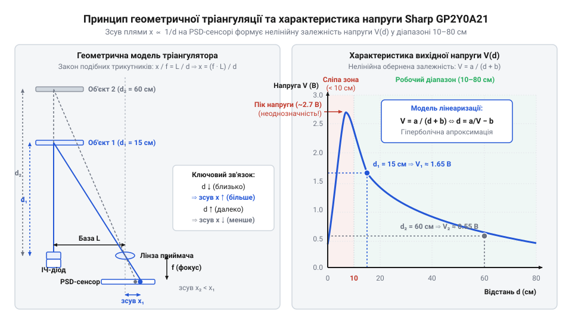
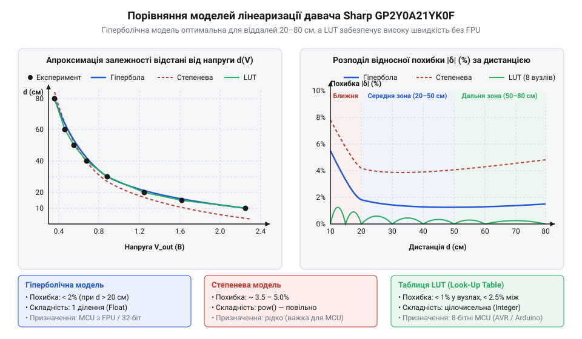

# Математичні моделі лінеаризації вихідного аналогового сигналу

## Чому напруга далекоміра спотворює відстань

Уявіть мобільний робот, який рухається коридором і визначає відстань до перешкод за допомогою аналогового оптичного сенсора @@en|Sharp GP2Y0A21YK0F@@. Розробник підключає вихід далекоміра до аналогово-цифрового перетворювача (@@en|АЦП@@, від англ. @@en|ADC@@ — Analog-to-Digital Converter) мікроконтролера й бачить, що зі зближенням із перешкодою напруга зростає. Виникає природна спокуса застосувати найпростішу формулу прямо пропорційного перетворення, де відстань визначається як лінійна функція виміряної напруги. Проте така спрощена логіка в реальних робототехнічних системах призводить до катастрофічних помилок орієнтування та зіткнень.

На відміну від таких пристроїв, як [ультразвуковий далекомір HC-SR04](root:cat-hw-sensors/hc-sr04) або [лазерний ToF-сенсор VL53L0X](root:cat-hw-sensors/vl53l0x), де час прольоту сигналу прямо пропорційний дистанції, аналоговий тріангуляційний сенсор базується на вимірюванні геометрії кута відбивання світлового променя. Внаслідок цього залежність між відстані та вихідною напругою є принципово нелінійною.

На близьких дистанціях від 10 до 15 см зміна відстані всього на 5 см спричиняє потужний стрибок напруги — наприклад, від 1.65 В до 2.30 В, тобто на 0.65 В. Натомість на далеких межах від 70 до 80 см зміна дистанції на цілих 10 см змінює вихідний сигнал лише на 0.05 В (з 0.45 В до 0.40 В). Якщо розробник запрограмує лінійну залежність між крайовими точками, то на дистанції 20 см математичний розрахунок видасть значення 60 см. Робот припустить, що шлях вільний, і на повній швидкості вріжеться в стіну.

Додатково ситуацію ускладнює зона немонотонності. На надблизьких відстанях (менше ніж 10 см) відбита світлова пляма виходить за межі фотоприймальної матриці, через що напруга на виході сенсора стрімко падає. У цій мертвій зоні напруга 0.4 В може відповідати як віддаленій перешкоді на відстані 80 см, так і перешкоді впритул на 3 см.

Отже, для коректної роботи далекоміра недостатньо зчитати значення напруги. Необхідно побудувати передавальну математичну функцію, яка виконує процес, що зветься @@la|лінеаризація@@ (від лат. @@la|linearis@@ — лінійний) вихідного сигналу, компенсуючи фізичне спотворення оптичної системи.

## Фізика тріангуляції та гіперболічна модель

Фізична причина нелінійності полягає в геометрії, яку використовує [оптична тріангуляція](root:hw-sensing/triangulation) (від лат. @@la|triangulum@@ — трикутник). Випромінювач сенсора надсилає вузький інфрачервоний промінь, який відбивається від об'єкта та потрапляє через фокусувальну лінзу на світлочутливий детектор положення (@@en|PSD@@, від англ. @@en|Position Sensitive Detector@@). Фокусувальна лінза приймача розташована на фіксованій оптичній базі `L` від випромінювача, а її фокусна відстань дорівнює `f`.

Зі зміною відстані `d` до об'єкта кут повернення променя змінюється, що зміщує світлову пляму на поверхні @@en|PSD@@-чипа на величину `x` відносно оптичної осі. З подібності прямокутних трикутників, утворених оптичною базою та ходом променів усередині приймача, випливає співвідношення:

x / f = L / d
= x = (f · L) / d            [множення обох частин на фокусну відстань f]

Внутрішня електронна схема сенсора перетворює фізичне зміщення плями `x` у вихідну аналогову напругу `V`. Оскільки струм елемента @@en|PSD@@ пропорційний позиції світлової плями, зв'язок між напругою `V` та зміщенням `x` є лінійним з урахуванням початкового зсуву напруги `V₀`:

V = k · x + V₀

Підставивши вираз для зміщення `x` у рівняння напруги, отримуємо залежність напруги АЦП від реальної відстані:

V = (k · f · L) / d + V₀

Щоб виразити відстань `d` як функцію від виміряної напруги `V`, виконаємо покрокові алгебраїчні перетворення:

V - V₀ = (k · f · L) / d     [віднімання початкового зсуву V₀]
d · (V - V₀) = k · f · L     [множення обох частин на відстань d]
d = (k · f · L) / (V - V₀)   [ділення на різницю напруг V - V₀]

Оскільки конструктивні параметри сенсора — фокусна відстань `f`, база `L` та коефіцієнт підсилення `k` — є постійними величинами, об'єднаємо їх у єдиний оптичний коефіцієнт `a = k · f · L`. Зсув напруги позначимо як емпіричний коефіцієнт `b = -V₀`. У результаті отримуємо класичну гіперболічну модель (від грец. @@gr|hyperbole@@ — перебільшення, підйом):

d = a / (V + b)

*Геометрія оптичної тріангуляції пояснює обернено пропорційну залежність між відстані та напругою АЦП.*

Для практичного обчислення коефіцієнтів `a` та `b` достатньо зробити два контрольні вимірювання на відомих дистанціях `d₁` та `d₂`, зчитавши відповідні напруги `V₁` та `V₂`. Склавши систему двох рівнянь:

d₁ · (V₁ + b) = a
d₂ · (V₂ + b) = a

Шляхом прирівнювання та вираження зміщення `b` отримуємо формулу розрахунку коефіцієнтів:

b = (d₂ · V₂ - d₁ · V₁) / (d₁ - d₂)
a = d₁ · (V₁ + b)

Гіперболічна модель чудово працює у робочому діапазоні від 10 до 80 см. Проте за межами 80 см чутливість `ΔV / Δd` падає нижче рівня шумів АЦП, тому для вимірювання більших дистанцій використовують [компактний далекомір TOF10120](root:cat-hw-sensors/tof10120) або [промисловий модуль TOF250](root:cat-hw-sensors/tof250).

## Степенева апроксимація та таблична інтерполяція

Реальні оптичні системи далекомірів мають незначні відхилення від ідеальної геометричної моделі через аберації лінзи, нерівномірність фоточутливого шару @@en|PSD@@ та нелінійність вбудованого підсилювача. Через це гіперболічна модель із фіксованим показником степеня `-1` іноді дає похибку до 5–8% на краях робочого діапазону.

Першим альтернативним підходом є степенева @@la|апроксимація@@ (від лат. @@la|approximo@@ — наближаю), яка дозволяє показникові степеня відхилятися від одиниці для кращого узгодження з експериментальними даними:

d = a · Vᵇ

У цій формулі показник `b` зазвичай лежить у межах від `-0.9` до `-1.2`. Для знаходження коефіцієнтів `a` та `b` математичну модель логарифмують, зводячи її до лінійного вигляду:

ln(d) = ln(a) + b · ln(V)

За допомогою методу найменших квадратів на логарифмічній сітці даних можна отримати високу точність апроксимації. Однак обчислення степеня `Vᵇ` на мікроконтролері вимагає використання математичної бібліотеки та обчислень із плаваючою крапкою, що створює значне навантаження на обчислювач без апаратного модуля @@en|FPU@@ (від англ. @@en|Floating Point Unit@@ — блок обчислень із плаваючою крапкою).

Другим ефективним підходом є шматочно-лінійна @@la|інтерполяція@@ (від лат. @@la|interpolatio@@ — оновлення, переробка) через [таблиці відповідності LUT](root:sf-devices/lookup-tables-mcu) (від англ. @@en|Look-Up Table@@ — таблиця пошуку). У цьому випадку крива залежності розбивається на `N` відрізків між експериментально виміряними опорними вузлами `(V₀, d₀), (V₁, d₁), ..., (Vₙ, dₙ)`.

Якщо поточна виміряна напруга `V` потрапляє у проміжок між вузлами `Vᵢ` та `Vᵢ₊₁`, то дистанція `d` обчислюється за формулою лінійного пропорційного відрізка:

d = dᵢ + (V - Vᵢ) · (dᵢ₊₁ - dᵢ) / (Vᵢ₊₁ - Vᵢ)

*Порівняння математичних моделей показує баланс між точністю апроксимації та ресурсоємністю обчислень.*

Головна перевага LUT-інтерполяції полягає в тому, що її можна повністю реалізувати в цілочисельній арифметиці без використання плаваючої крапки. Це робить метод ідеальним для 8-бітових платформ із обмеженим обсягом @@en|Flash-пам'яті@@ та @@en|RAM@@.

:::tabs
:::code math-gp2y0a21-linearization-models/cpp/arduino/lutpoint.cpp
:::code math-gp2y0a21-linearization-models/c/esp-idf/sensor-lut-get-distance.c
:::

Вибір між гіперболічною моделью, степенем та LUT залежить від архітектури мікроконтролера: якщо є апаратний @@en|FPU@@, гіпербола `d = a / (V + b)` забезпечує компактний код і високу гладкість кривої; для 8-бітових МК без @@en|FPU@@ оптимальним рішенням стає таблична інтерполяція.

## Обчислення коефіцієнтів та оцінка похибки

Для використання гіперболічної або степеневої математичної моделі у реальному пристрої необхідно визначити їхні числові параметри. Заводський розкид характеристик оптичного випромінювача та світлочутливої матриці сенсора @@en|Sharp GP2Y0A21YK0F@@ призводить до того, що два екземпляри далекоміра видають різну напругу на однаковій відстані. Процес індивідуального визначення параметрів пристрою зветься @@en|калібрування@@ (від фр. *calibre* — калібр). Для розрахунку коефіцієнтів знімають серію експериментальних вимірювань, де зіставляють повернені @@en|АЦП@@ значення напруги `Vᵢ` із реальними дистанціями `dᵢ`.

Найбільш обґрунтованим математичним способом знаходження коефіцієнтів `a` та `b` для гіперболічної залежності є @@en|метод найменших квадратів@@ (англ. *least squares method*, від *least* — найменший, *square* — квадрат). Початкова гіперболічна формула лінеаризується шляхом перетворення координат, що дає змогу застосувати стандартну лінійну регресію. Докладніше про математичний апарат та алгоритм регресійного аналізу читайте у матеріалі про [метод найменших квадратів у вимірюваннях](root:math-numeric/least-squares-method).

Зведемо гіперболічне рівняння до лінійного вигляду за допомогою послідовних алгебраїчних перетворень:

d = a / (V + b)
1 / d = (V + b) / a             [перевертання обох частин рівняння]
1 / d = (1 / a) · V + (b / a)   [розкриття дробу на суму двох доданків]

Введемо заміну змінних `y = 1 / d` та `x = V`, а також позначимо шукані коефіцієнти прямої як `m = 1 / a` та `c = b / a`. У результаті отримуємо класичне рівняння прямої лінії:

y = m · x + c

Маючи `N` виміряних пар `(xᵢ, yᵢ) = (Vᵢ, 1 / dᵢ)`, обчислимо коефіцієнти регресії `m` та `c`:

m = (N · ∑(xᵢ · yᵢ) - ∑xᵢ · ∑yᵢ) / (N · ∑(xᵢ²) - (∑xᵢ)²)    [коефіцієнт кутового нахилу]
c = (∑yᵢ - m · ∑xᵢ) / N                                   [вільний член прямої]

Після обчислення `m` та `c` повертаємося до початкових коефіцієнтів гіперболічної моделі:

a = 1 / m                       [значення масштабованого оптичного коефіцієнта]
b = c / m                       [значення експериментального зсуву напруги]

**Обчислення на прикладі п'яти опорних точок**

Припустимо, під час калібрування далекоміра отримано такі п'ять експериментальних точок `(d, V)`: (10 см, 2.30 В), (20 см, 1.30 В), (30 см, 0.90 В), (50 см, 0.55 В), (80 см, 0.40 В).

Перетворимо відстані в обернену величину `y = 1 / d`: `y₁ = 0.100`, `y₂ = 0.050`, `y₃ = 0.033`, `y₄ = 0.020`, `y₅ = 0.0125`.

Обчислимо необхідні суми для методу найменших квадратів:

∑xᵢ = 2.30 + 1.30 + 0.90 + 0.55 + 0.40 = 5.45
∑yᵢ = 0.100 + 0.050 + 0.033 + 0.020 + 0.0125 = 0.2155
∑(xᵢ²) = 5.29 + 1.69 + 0.81 + 0.3025 + 0.16 = 8.2525
∑(xᵢ · yᵢ) = 0.230 + 0.065 + 0.0297 + 0.0110 + 0.0050 = 0.3407

Підставивши знайдені суми в формули лінійної регресії при `N = 5`, отримуємо:

m = (5 · 0.3407 - 5.45 · 0.2155) / (5 · 8.2525 - 5.45²)
= (1.7035 - 1.1745) / (41.2625 - 29.7025)                [обчислення чисельника та знаменника]
= 0.5290 / 11.5600 ≈ 0.04576                            [значення коефіцієнта m]

c = (0.2155 - 0.04576 · 5.45) / 5
= (0.2155 - 0.2494) / 5 ≈ -0.00678                      [значення вільне члена c]

Звідси шукані емпіричні коефіцієнти дорівнюють `a = 1 / 0.04576 ≈ 21.85` та `b = -0.00678 / 0.04576 ≈ -0.148`. Гіперболічна модель набуває остаточного вигляду `d = 21.85 / (V - 0.148)`.

Для порівняння якості апроксимації обчислюють дві величини: @@la|абсолютна похибка@@ (від лат. @@la|absolutus@@ — безумовний) `Δd = |d_calc - d_real|` та @@la|відносна похибка@@ (від лат. @@la|relativus@@ — відносний) `ε = (Δd / d_real) · 100%`.

Гіперболічна модель забезпечує високу точність у середній зоні вимірювання (від 15 до 60 см), де відносна похибка не перевищує 2–3%. Проте на краях діапазону (поблизу 10 см та після 70 см) відносна похибка може зростати до 6–8% через нелінійне спотворення оптичної плями та шуми @@en|АЦП@@. Степенева модель `d = a · Vᵇ` дозволяє згладити похибку на далеких дистанціях, але вимагає складніших обчислень.

Шматочно-лінійна інтерполяція через [таблиці відповідності LUT](root:sf-devices/lookup-tables-mcu) показує похибку, яка прямо залежить від кількості та щільності опорних вузлів. Оскільки лінійний відрізок апроксимує вгнуту криву гіперболи, похибка @@en|LUT@@-інтерполяції між вузлами завжди є випуклою вгору. Щоб мінімізувати максимальне відхилення, опорні точки розміщують нерівномірно: на крутій ділянці (10–30 см) вузли ставлять із кроком 5 см, а на плоскій ділянці (40–80 см) крок збільшують до 10–15 см.

Якщо задача вимагає високої точності без складного калібрування, замість аналогових трикутникових далекомірів застосовують [лазерний далекомір TOF250](root:cat-hw-sensors/tof250) або [лазерний ToF-сенсор VL53L0X](root:cat-hw-sensors/vl53l0x), які видають готову дистанцію в міліметрах цифровою шиною.

## Цілочисельна оптимізація та реалізація коду

Застосування математичних моделей на практиці часто впирається в обмежені ресурси hardware-платформи. Більшість 8-бітових мікроконтролерів (наприклад, @@en|AVR ATmega328P@@) не мають апаратного блоку обчислень із плаваючою крапкою (@@en|FPU@@, від англ. @@en|Floating Point Unit@@ — блок обчислень із плаваючою крапкою). Будь-яка операція з типом `float` або `double` виконується через програмну емуляцію, що вимагає підключення важких бібліотечних функцій, витрачає дорогоцінний обсяг @@en|Flash-пам'яті@@ і займає сотні тактів процесора. У робототехнічних системах, де опитування сенсора відбувається в швидкому циклі керування, такі обчислювальні затримки є неприпустимими.

Для усунення цієї проблеми застосовується @@en|фіксована кома@@ (англ. *fixed-point arithmetic*, від *fixed* — зафіксований, *point* — крапка). Замість дійсних чисел із дробовою частиною всі величини масштабують і зберігають у вигляді цілих чисел (типи `int32_t` або `uint32_t`). Наприклад, напругу вимірюють у мілівольтах (`mV`), а відстань — у міліметрах (`mm`). Докладніше про методики масштабування та виконання швидких обчислень із дробовими числами читайте у статті про [арифметику з фіксованою комою для мікроконтролерів](root:sf-devices/integer-scaling-fixed-point).

Розглянемо цілочисельну оптимізацію гіперболічної функції `d = a / (V + b)`. Збережемо коефіцієнт `a` у масштабі `10⁶`, а коефіцієнт `b` — у мілівольтах. Тоді обчислення відстані в міліметрах виконується за один крок цілочисельного ділення 32-бітного значення на 16-бітне:

d_mm = (uint32_t)A_SCALE / (voltage_mv + B_OFFSET_MV)

Таке ділення на 8-бітовому мікроконтролері виконується в десятки разів швидше за емуляцію плаваючої крапки і не потребує залучення математичних бібліотек.

Другим обчислювальним вузлом є оптимізація шматочно-лінійної інтерполяції за таблицею @@en|LUT@@. Простий лінійний перебір елементів таблиці має обчислювальну складність `O(N)`. Якщо таблиця містить 16 або 32 вузли, послідовне порівняння напруги в кожному циклі витрачає зайвий час.

Для прискорення пошуку інтервалу використовують @@la|бінарний пошук@@ (від лат. @@la|binarius@@ — подвійний), який зменшує складність до `O(log₂ N)`. Таблиця впорядковується за спаданням напруги. Алгоритм порівнює виміряну напругу з середнім елементом масиву і за кілька кроків звужує діапазон до двох сусідніх опорних точок.

:::tabs
:::code math-gp2y0a21-linearization-models/cpp/arduino/lutnode.cpp
:::code math-gp2y0a21-linearization-models/c/esp-idf/sensor-hyperbola-get-distance-fast.c
:::

Завдяки поєднанню цілочисельної арифметики та бінарного пошуку обчислення лінеаризації виконується за фіксований короткий час, що дозволяє опитувати сенсор із максимальною частотою без перевантаження мікроконтролера.