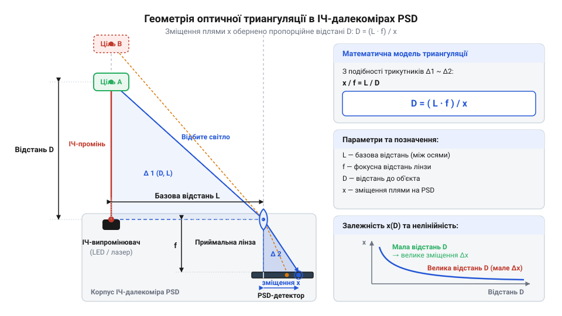

# Геометрія оптичної триангуляції на позиційно-чутливому детекторі

## Проблема вимірювання коротких оптичних відстаней

У робототехніці та системах автоматизації вимірювання відстані до перешкоди на дистанціях від кількох міліметрів до одного метра є однією з найчастіших задач. Перша думка, яка виникає при спробі оптичного вимірювання, — використати прямий часовий метод @@en|Time-of-Flight@@ (від англійського @@en|Time-of-Flight@@ — час польоту). Проте світло долає відстань надзвичайно швидко: швидкість світла у повітрі становить приблизно `3 × 10⁸` м/с, тобто промінь проходить `30` см усього за `1` наносекунду (`10⁻⁹` с). Щоб розрізнити зміну відстані в `1` мм, вимірювальна система повинна мати часову роздільну здатність порядку `6.7` пікосекунди. Хоча сучасні [лазерні ToF-далекоміри](root:cat-hw-sensors/vl53l0x) або [модулі вимірювання часу польоту](root:cat-hw-sensors/tof10120) застосовують для цього складні однофотонні лавинні фотодіоди та високочастотні лічильники, побудова таких систем для простих сенсорів вимагає надто дорогих компонентів та висуває жорсткі вимоги до високочастотної електроніки.

Другий інтуїтивний підхід — вимірювати інтенсивність відбитого світла: що ближче об'єкт, то яскравіша пляма на фотоприймачі. Однак ця ідея ламається при зіткненні з реальним середовищем. Фотометрична яскравість відбитого сигналу залежить не лише від відстані, а й від коефіцієнта відбиття поверхні цілі (біла матова поверхня відбиває значно більше світла, ніж темна гума), кута нахилу об'єкта та фонового освітлення приміщення. Темна поверхня на відстані `5` см віддасть приймачу менший світловий потік, ніж білий аркуш паперу на відстані `30` см. Отже, амплітуда сигналу не може бути надійним показником дистанції.

Щоб обійти залежність від часу польоту світла та яскравості відбиття, виникає потреба в принципово іншому вимірювальному механізмі. Якщо змістити джерело випромінювання та оптичний приймач один відносно одного на фіксовану базову відстань, напрямок повернення відбитого світлового променя змінюватиметься залежно від дистанції до об'єкта. Замість вимірювання часу чи інтенсивності задача зводиться до вимірювання кута відбиття та просторового зміщення світлової плями на приймальній площині. Саме геометричний підхід лежить в основі оптичної триангуляції (від латинського @@la|triangulum@@ — трикутник).

## Геометрична модель триангуляції та детектор

Оптична система триангуляційного далекоміра складається з трьох ключових елементів: випромінювача світла (вузькоспрямованого світлодіода або лазерного діода), приймальної збиральної лінзи та просторового фотодетектора. Випромінювач посилає тонкий промінь уздовж власної оптичної осі до об'єкта. Відбите від поверхні світло розсіюється в усіх напрямках, і частина цього потоку потрапляє на приймальну лінзу, розташовану на паралельній оптичній осі на віддалі `L` від випромінювача. Відстань `L` називається базовою відстанню (або базісом системи).

Лінза з фокусною відстанню `f` фокусує відбите світло у вигляді малої світлової плями на поверхні фотодетектора, розташованого у фокальній площині лінзи. Якщо об'єкт наближається або віддаляється, кут, під яким промінь потрапляє до лінзи, змінюється, що призводить до зсуву плями уздовж поверхні детектора на величину `x` відносно оптичної осі лінзи.


*Геометрія оптичної триангуляції: подібні трикутники пов'язують шукану відстань D з базовою відстанню L, фокусною відстанню лінзи f та зміщенням плями x на детекторі PSD.*

Для математичного розрахунку відстані розглянемо два геометричні трикутники, що утворюються в цій оптичній системі. Зовнішній трикутник сформовано базовим відрізком `L` між випромінювачем і лінзою та променями, що йдуть до точки відбиття на об'єкті на відстані `D`. Внутрішній трикутник сформовано всередині сенсора оптичною віссю лінзи, фокусною відстанню `f` та зсувом плями `x` на детекторі. Оскільки оптичні осі випромінювача та лінзи паралельні, а кути падіння та заломлення головного променя через оптичний центр лінзи рівні, ці два трикутники є подібними за двома кутами.

З подібності трикутників випливає пропорція відношення катетів. Відношення зсуву плями `x` до фокусної відстані `f` дорівнює відношенню базової відстані `L` до шуканої відстані `D`:

```
x / f = L / D
```

Виразимо з цієї пропорції шукану відстань `D` до об'єкта:

```
D = (L · f) / x
```

де:
`D` — відстань від оптичного центра приймальної лінзи до об'єкта вимірювання (у міліметрах);
`L` — базова відстань між оптичними осями випромінювача та приймальної лінзи (у міліметрах);
`f` — фокусна відстань приймальної збиральної лінзи (у міліметрах);
`x` — просторове зміщення світлової плями на детекторі відносно оптичної осі лінзи (у міліметрах).

З отриманого виразу видно, що для обчислення відстані `D` необхідно точно виміряти координату `x` світлової плями. У класичних аналогових далекомірах для цього застосовують PSD-детектор (від англійського @@en|Position Sensitive Detector@@ — позиційно-чутливий детектор). На відміну від звичайного фотодіода, @@en|PSD@@ являє собою безперервну напівпровідникову фотопластину з двома крайовими електродами. Коли світлова пляма потрапляє на поверхню @@en|PSD@@, згенерований фотострум ділиться між двома виходами зворотно пропорційно опору (відстані) від плями до кожного з електродів. Вимірювання відношення струмів з обох кінців дає змогу визначити центр ваги світлової плями `x` з високою точністю, незалежно від загальної інтенсивності світла. Докладніше про принцип роботи струмового підсилювача та схемотехніку аналогового обчислення координати плями читайте у матеріалі про [обробку сигналу аналогового PSD-детектора](root:hw-sensing/psd-sensor-signal-processing).

Розглянемо практичний приклад розрахунку відстані за геометричними параметрами.

**Обчислення відстані за координатою плями на детекторі**
Оптична система має базову відстань `L = 20` мм, фокусну відстань лінзи `f = 12` мм. Детектор @@en|PSD@@ зафіксував зміщення світлової плями `x = 1.5` мм відносно оптичної осі.

```
D = (L · f) / x
  = (20 · 12) / 1.5      [підстановка параметрів L = 20 мм, f = 12 мм, x = 1.5 мм]
  = 240 / 1.5            [обчислення добутку оптичного фактора L · f]
  = 160 мм               [ділення на зміщення плями]
```

Отже, відстань від сенсора до об'єкта становить `160` мм (`16` см).

## Нелінійність залежності та втрата роздільності

Отримана фундаментальна формула триангуляції `D = (L · f) / x` показує, що відстань до об'єкта `D` перебуває в обернено пропорційній залежності від зміщення плями `x`. Якщо виразити зміщення плями як функцію від відстані:

```
x = (L · f) / D
```

стає очевидним гіперболічний характер відгуку сенсора. На малих відстанях незначне переміщення об'єкта викликає великий зсув плями на детекторі. Проте зі збільшенням відстані `D` величина зміщення `x` стрімко прямує до нуля.

Щоб оцінити чутливість системи на різних ділянках робочого діапазону, обчислимо першу похідну зміщення `x` за відстанню `D` (диференціальну чутливість):

```
dx / dD = d/dD ((L · f) · D⁻¹)
        = - (L · f) / D²          [правило диференціювання статевої функції]
```

Модуль диференціальної чутливості `|dx / dD| = (L · f) / D²` показує, на скільки міліметрів зміщується пляма на детекторі при зміні відстані до об'єкта на одиницю довжини. Знак мінус указує на те, що зі зростанням відстані `D` координата `x` зменшується.

Квадратична залежність у знаменнику означає, що чутливість сенсора падає пропорційно квадрату відстані. Це фундаментальна фізико-геометрична особливість усіх оптичних триангуляційних систем.

Будь-який реальний детектор @@en|PSD@@ або аналогово-цифровий перетворювач (АЦП), що зчитує з нього сигнал, має межу просторової роздільної здатності `Δx_min` — найменший зсув плями, який система ще може достовірно зафіксувати на тлі шумів. Щоб визначити найменшу розрізнювану зміну відстані `ΔD_min` (мінімальний крок відстані), скористаємося диференціальним співвідношенням:

```
ΔD_min ≈ Δx_min / |dx / dD|
       = Δx_min / ((L · f) / D²)       [підстановка модуля диференціальної чутливості]
       = (D² / (L · f)) · Δx_min        [перенесення знаменника в чисельник]
```

Отримана формула описує втрату просторової роздільної здатності далекоміра. Похибка вимірювання `ΔD_min` зростає пропорційно квадрату відстані `D²`. Розглянемо числовий розрахунок, щоб відчути масштаб цієї нелінійності.

**Обчислення роздільної здатності на ближній та дальній межі діапазону**
Нехай триангуляційний далекомір має оптичні параметри `L = 20` мм, `f = 12` мм (добуток `L · f = 240` мм²), а шумова межа детектора становить `Δx_min = 0.002` мм (`2` мкм). Обчислимо мінімально розрізнювану зміну відстані для двох дистанцій: `D₁ = 100` мм та `D₂ = 800` мм.

Для ближньої межі `D₁ = 100` мм:

```
ΔD_min1 = (D₁² / (L · f)) · Δx_min
        = (100² / 240) · 0.002    [підстановка D₁ = 100 мм]
        = (10000 / 240) · 0.002   [піднесення відстані до квадрата]
        = 41.67 · 0.002           [обчислення геометричного коефіцієнта]
        = 0.083 мм                [підсумкова похибка на відстані 10 см]
```

Для дальньої межі `D₂ = 800` мм:

```
ΔD_min2 = (D₂² / (L · f)) · Δx_min
        = (800² / 240) · 0.002    [підстановка D₂ = 800 мм]
        = (640000 / 240) · 0.002  [піднесення відстані до квадрата]
        = 2666.67 · 0.002         [обчислення геометричного коефіцієнта]
        = 5.33 мм                 [підсумкова похибка на відстані 80 см]
```

Порівняння результатів показує: при збільшенні відстані у `8` разів (від `10` см до `80` см) невизначеність вимірювання відстані зростає у `8² = 64` рази — з `0.083` мм до `5.33` мм. Саме тому триангуляційні давачі забезпечують прецизійну точність на коротких дистанціях, але швидко втрачають роздільну здатність на віддаленні.

## Фізичні обмеження та сліпі зони

Математична модель передбачає можливість вимірювання будь-яких відстаней, проте фізична конструкція реальних триангуляційних далекомірів накладає жорсткі геометричні й оптичні обмеження.

Найважливішим геометричним обмеженням є наявність мертвої або сліпої зони (від англійського @@en|blind zone@@) безпосередньо поблизу сенсора. Розмір детектора @@en|PSD@@ є скінченним і обмеженим робочою довжиною кристала (зазвичай від кількох міліметрів до сантиметра). Коли об'єкт наближається до далекоміра ближче за деяку мінімальну відстань `D_min`, кут повернення променя стає настільки гострим, що сфокусована пляма виходить за фізичні межі фоточутливої поверхні @@en|PSD@@.

У багатьох інтегрованих триангуляційних датчиках при надто близькому розташуванні об'єкта виникає явище інверсії вихідного сигналу. Якщо об'єкт знаходиться у сліпій зоні, частина розсіяного світла починає потрапляти на протилежний край детектора або зрізається внутрішніми апертурними перегородками оптичного корпусу. У результаті зміщення плями `x` починає хибно зменшуватися, а вихідна напруга сенсора падає, створюючи ілюзію того, що об'єкт знаходиться на значній відстані. Наприклад, для давача з робочим діапазоном `10–80` см наближення перешкоди на відстань `4` см може дати такий самий вихідний сигнал, як і об'єкт на відстані `40` см. Це створює небезпечну нелінійну двозначність, яку робототехнічна система має враховувати фізичним обмеженням мінімальної дистанції монтажу.

На дальній межі `D_max` виникають інші фізичні обмеження. Крім квадратичного падіння роздільної здатності, зменшується енергетична щільність світлового потоку. Лазерний або світлодіодний промінь має природну кутову розбіжність, тому із віддаленням розмір плями на об'єкті та її зображення на детекторі збільшується. Пляма розмивається, її контраст відносно фонового освітлення падає, а співвідношення сигнал/шум у фотострумах @@en|PSD@@ погіршується.

На точність триангуляції також впливають оптичні властивості поверхні об'єкта та навколишнє середовище:
1. **Кут нахилу та дзеркальне відбиття:** Якщо поверхня є гладкою (дзеркальною) і нахиленою під кутом до випромінювача, промінь відбивається за законом "кут падіння дорівнює куту відбиття" й повністю минає приймальну лінзу. Триангуляція працює лише на дифузно розсіюючих поверхнях. 2. **Фонове освітлення:** Яскраве сонячне світло або лампи розжарювання створюють потужний постійний фотострум на @@en|PSD@@, який може загнати підсилювачі в насичення. Для захисту від фону в далекомірах використовують вузькосмугові оптичні світлофільтри (що пропускають лише інфрачервоне світло випромінювача) та амплітудну модуляцію світлового променя високою частотою з подальшою синхронною фільтрацією.

При проектуванні оптичної геометрії давача інженери вирішують компромісну задачу: збільшення базису `L` або фокуса `f` покращує роздільну здатність на великих відстанях (оскільки збільшується добуток `L · f`), але одночасно збільшує габарити пристрою та відсуває ближню межу сліпої зони далі від сенсора. Зрозуміти різницю між геометричною триангуляцією та часовими методами допомагають інші класи оптичних датчиків, зокрема компактні [лазерні давачі дальньої дії](root:cat-hw-sensors/tof250) та традиційні [ультразвукові далекоміри](root:cat-hw-sensors/hc-sr04).