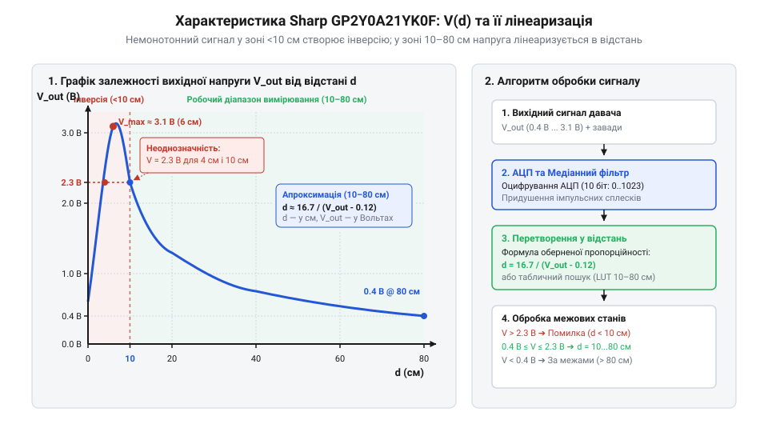
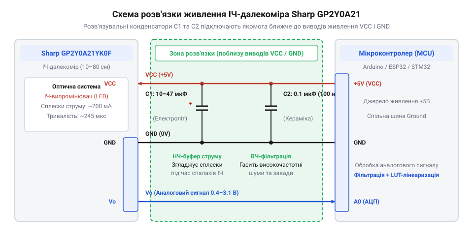

# Розробка стабілізованого далекоміра з апаратним живленням та програмною лінеаризацією

<preknowlist>
- [HC-SR04 — ультразвуковий далекомір](root:cat-hw-sensors/hc-sr04) — Концепції логіки опитування давачів відстані та інтервалів оновлення даних.
</preknowlist>

## Проблема нестабільних та нелінійних вимірювань

Оптичний [триангуляційний далекомір](root:cat-hw-sensors/optical-distance-sensors-overview) Sharp GP2Y0A21YK0F вимірює відстань, випромінюючи інфрачервоний імпульс і визначаючи кут, під яким відбите світло повертається на лінійний масив приймачів. Без додаткового фільтрування його аналоговий вихід видає сильно зашумлені покази, які різко стрибають і суттєво відхиляються від реальної відстані.

Справа в тому, що під час коротких спалахів випромінювача давач споживає значний імпульсний струм. Ці раптові навантаження на лінію живлення спричиняють просідання напруги, які миттєво позначаються на аналоговому виході у вигляді високоамплітудних шумів та «випльовувань».

Крім того, вихідна напруга давача не є пропорційною до відстані. Залежність має гіперболічний характер: на малих дистанціях напруга падає стрімко, а на великих — її зміна ледь помітна.


*Характеристика сенсора має крутий спад у робочій зоні 10–80 см, а при наближенні об'єкта ближче 10 см напруга знову падає, створюючи небезпечну інверсну зону з неоднозначними показами.*

Через цю нелінійність неможливо перетворити виміряну напругу у відстань простим множенням на коефіцієнт. Причина такої гіперболічної залежності криється в геометричній природі триангуляції. Коли відбитий промінь повертається через лінзу на лінійний позиційно-чутливий фотоприймач (PSD), зміщення світлової плями на ньому, відповідно до законів оптики та подібності трикутників, виявляється обернено пропорційним відстані до об'єкта. Оскільки вихідна напруга давача лінійно залежить саме від позиції цієї плями на приймачі, її зміна відносно дистанції набуває яскраво вираженого гіперболічного характеру. До того ж, якщо об'єкт опиниться в інверсній зоні (ближче 10 см), кут відбиття стає настільки великим, що відбите світло виходить за межі нормального зчитування. Напруга на виході впаде, і мікроконтролер помилково розпізнає це як об'єкт на відстані 40 см чи більше, що може призвести до аварії в рухомих системах.

## Апаратне придушення завад лінії живлення

Щоб зупинити просідання напруги, які викликають імпульсні струми випромінювача, живлення давача необхідно стабілізувати ще до перетворення сигналу. Сама лише програмна фільтрація не впорається з великими стрибками, якщо живлення мікросхеми нестабільне.

Для компенсації короткочасних навантажень безпосередньо біля виводів живлення далекоміра встановлюють розв'язувальні конденсатори. Вони віддають накопичений заряд у момент спалаху інфрачервоного світлодіода, підтримуючи стабільний рівень напруги на лінії.


*Паралельно живленню VCC і GND підключають електролітичний конденсатор для компенсації великих імпульсних струмів та керамічний для придушення високочастотних завад.*

Ємний електролітичний конденсатор (наприклад, 10 мкФ або більше) бере на себе основне навантаження під час потужних спалахів. Малий керамічний конденсатор на 0.1 мкФ ефективно гасить високочастотний шум. Їх потрібно розміщувати якнайближче до конектора давача: якщо конденсатори будуть на іншому кінці довгого дроту, індуктивність проводу зведе їхню користь нанівець, і стрибки напруги залишаться на аналоговому виході.

## Налаштування АЦП та медіанне фільтрування

Аналоговий вихід давача формує напругу, що відповідає виміряній відстані, але для мікроконтролера це лише сирий сигнал, який потрібно правильно оцифрувати. Перша пастка ховається у фізиці самого виходу Sharp GP2Y0A21: він має високий вихідний опір. Коли аналогово-цифровий перетворювач (АЦП) мікроконтролера підключається до піна, щоб виміряти напругу, він заряджає свій внутрішній конденсатор. Якщо час накопичення заряду (@@en|sampling time@@) замалий, конденсатор АЦП не встигає зарядитися до дійсного рівня напруги давача. У результаті мікроконтролер бачить занижені значення. Тому під час ініціалізації периферії АЦП для цього давача завжди слід обирати максимальний доступний час вибірки, щоб виміри були достовірними.

Навіть якщо АЦП налаштовано правильно, а лінія живлення стабілізована розв'язувальними конденсаторами, на виході давача залишається його власний внутрішній шум. Оптичні перешкоди, відбиття від нерівних поверхонь та електричні наведення створюють поодинокі гострі сплески напруги. Якщо програма просто зчитує одне значення і відразу перетворює його на відстань, вона ризикує натрапити на такий імпульс і видати абсурдний результат — наприклад, показати перешкоду впритул, коли її там немає.

Щоб позбутися впливу імпульсних завад, потрібно зчитувати не одне значення, а серію відліків. Найпростішою ідеєю здається знайти їхнє середнє арифметичне, проте цей підхід хибний. Одне аномально велике значення (наприклад, імпульс у 1023 для 10-бітного АЦП) сильно змістить середнє вгору, і результат усе одно буде спотвореним. 

Правильним рішенням для такого типу шумів є програмний медіанний фільтр. Алгоритм збирає невеликий буфер вибірок — зазвичай достатньо п'яти або семи. Далі ці значення сортуються за зростанням. Після сортування алгоритм просто бере те значення, що опинилося рівно посередині масиву. Усі аномальні піки — як провали, так і сплески — природним чином витісняються на краї відсортованого списку і відкидаються. Для сортування таких малих масивів чудово підходить алгоритм сортування вставками: він працює швидко і не потребує складної логіки.

Отримане очищене значення АЦП вже можна перетворювати у сантиметри. Оскільки залежність напруги від відстані нелінійна, для обчислень застосовують або обернено-пропорційну формулу з емпіричними коефіцієнтами, або таблицю пошуку (@@en|Look-up table, LUT@@). У випадку з LUT програма зберігає кілька опорних точок напруги для відомих відстаней, а значення між ними знаходить через кусково-лінійну інтерполяцію. Після обчислення відстані обов'язково треба перевірити, чи не вийшов результат за межі паспортного робочого діапазону (10–80 см), щоб відсіяти недійсні виміри.

:::tabs
@tab C (HAL)
:::code proj-gp2y0a21-linearized-distance-meter/c/src/main.c
@tab C++ (ООП)
:::code proj-gp2y0a21-linearized-distance-meter/cpp/src/main.cpp
:::

## Математична лінеаризація та обчислення відстані

Залежність вихідної напруги давача Sharp GP2Y0A21 від відстані є суттєво нелінійною: напруга стрімко падає при віддаленні об'єкта. Це означає, що проста лінійна масштабована формула тут не працює. Щоб отримати значення відстані у зрозумілих одиницях, таких як сантиметри, сирі дані аналогово-цифрового перетворювача необхідно математично лінеаризувати.

Найпоширеніший спосіб перетворення — використання обернено-пропорційної апроксимації. Криву відгуку можна наблизити формулою виду:

```
d = A ÷ (ADC - B)      [обернено-пропорційна залежність]
```

де `d` — шукана відстань, `ADC` — сире значення АЦП, а `A` і `B` — емпірично підібрані коефіцієнти. Коефіцієнт `A` визначає масштаб кривої, а `B` — зсув по осі значень АЦП. Якщо `ADC` наближається до `B`, знаменник стає нульовим або від'ємним, що сигналізує про вихід об'єкта за межі вимірюваного діапазону.

Для прискорення обчислень на малопотужних мікроконтролерах без апаратного модуля арифметики з рухомою комою застосовують таблицю пошуку. Таблиця зберігає попередньо обчислені пари значень «код АЦП — відстань». Коли мікроконтролер зчитує нове значення, він шукає найближчі точки в таблиці та виконує кусково-лінійну інтерполяцію між ними. Це дозволяє переводити напругу у фізичні сантиметри з мінімальною обчислювальною похибкою.

:::tabs
:::code proj-gp2y0a21-linearized-distance-meter/c/src/gp2y0a21.c 103-128
:::code proj-gp2y0a21-linearized-distance-meter/cpp/src/gp2y0a21.cpp 54-80
:::

Як видно з реалізації, C-код використовує обернено-пропорційну формулу для обчислення відстані, тоді як C++ версія застосовує швидку інтерполяцію за таблицею.

## Калібрування та обробка межових станів

У реальних умовах кожен екземпляр давача має індивідуальні технологічні відхилення оптичної та електронної систем. Щоб забезпечити високу точність вимірювань, пристрій потребує калібрування. Калібрування полягає в експериментальному знятті вихідної напруги на кількох еталонних відстанях та подальшому коригуванні коефіцієнтів лінеаризації або оновленні значень у таблиці пошуку.

Окрім точності в межах робочої зони, критично важливо безпечно обробляти межові стани. Робочий діапазон Sharp GP2Y0A21 складає від 10 до 80 см. За межами цього діапазону показання стають недостовірними. Зокрема, на відстанях менше 10 см напруга починає падати, що мікроконтролер може помилково інтерпретувати як збільшення відстані. Це явище відоме як інверсна зона. 

Алгоритм програмної валідації повинен перевіряти розраховану відстань і відхиляти виміри, що виходять за встановлені межі. Отримавши очищені від завад та лінеаризовані дані, закончений модуль вимірювання класифікує їх статус, попереджаючи систему про наближення об'єкта до сліпої зони або його вихід за максимальну дальність.

:::tabs
:::code proj-gp2y0a21-linearized-distance-meter/c/src/gp2y0a21.c 130-145
:::code proj-gp2y0a21-linearized-distance-meter/cpp/src/gp2y0a21.cpp 82-98
:::