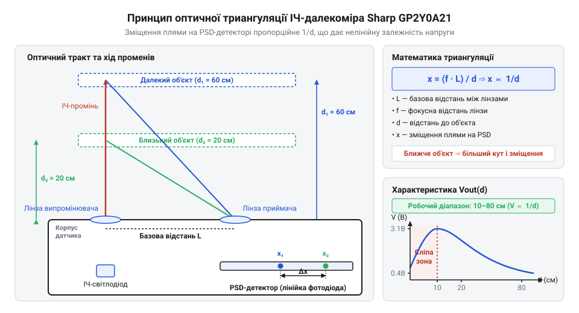
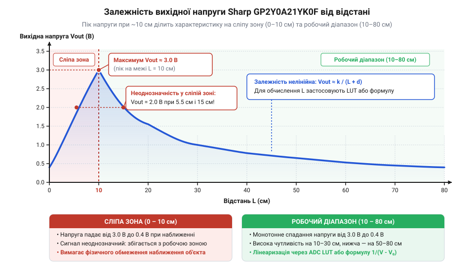
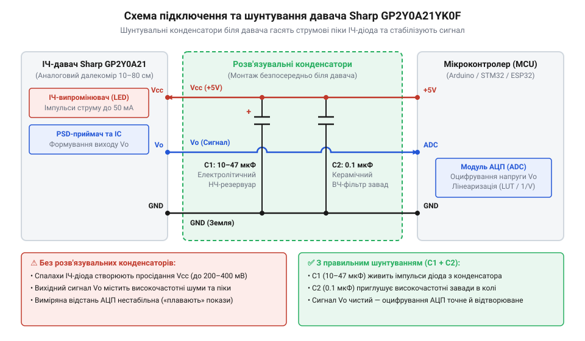

# Sharp GP2Y0A21YK0F — ІЧ-далекомір (10–80 см)

<preknowlist>
- [HC-SR04 — ультразвуковий далекомір](root:cat-hw-sensors/hc-sr04) — розрізнення геометричних та часових принципів вимірювання відстані й розуміння базових обмежень давачів прямої видимості
</preknowlist>

## Неоднозначність показів аналогового ІЧ-датчика

Під час побудови мобільного робота чи автономної системи навігації розробники часто обирають аналогові інфрачервоні давачі відстані за їхню простоту та доступність. Здається, що схема роботи є гранично простою: з'єднати вихідний сигнал датчика @@en|Sharp GP2Y0A21YK0F@@ з аналоговим входом мікроконтролера, зчитати напругу через @@en|АЦП@@ (від @@en|англійської@@ @@en|Analog-to-Digital Converter@@ — аналогово-цифровий перетворювач) і за допомогою лінійного співвідношення обчислити відстань у сантиметрах. Проте під час перших же польових випробувань інженер стикається з парадоксальною поведінкою: коли робот наближається до стіни ближче ніж на 10 сантиметрів, показання напруги раптом починають швидко падати. Програма інтерпретує це падіння напруги як збільшення відстані, і робот на повній швидкості врізається в перешкоду, вважаючи, що шлях попереду вільний.

Інша поширена проблема виникає при зміні оптичних властивостей поверхонь. Якщо робот рухається вздовж білої глянцевої стіни й раптом повертає до темної матової шторки, зчитана напруга аналогового сигналу скаче в кілька разів, хоча фізична дистанція до перешкоди не змінилася жодним чином. Прямолінійна інтерпретація напруги аналогового давача призводить до катастрофічних помилок орієнтування робота у зоні прямої видимості.

Щоб зрозуміти причину таких помилок, варто звернутися до історії розробки оптичних датчиків. Перші покоління інфрачервоних сенсорів базувалися на амплітудному принципі: вони випромінювали пучок світла й вимірювали інтенсивність відбитого потоку за допомогою фотодіода. Оскільки чорна поверхня поглинає до 95% інфрачервоного випромінювання, а біла відбиває його майже повністю, амплітудний давач принципово не міг відрізнити близький чорний об'єкт від далекого білого.

Для вирішення цієї фундаментальної проблеми наприкінці 1990-х років компанія @@en|Sharp@@ розробила принципово новий тип оптичних вимірювачів. Докладну історію того, як [еволюціонували оптичні далекоміри](root:cat-hw-sensors/sharp-gp2y0a21/hist-sharp-ir-sensors.md) @@en|Sharp@@ від простих амплітудних схем до триангуляційних систем, винесено в окремий матеріал. Замість вимірювання кількості відбитого світла інженери застосували геометрію кута відбивання.

В основі сучасного модуля @@en|Sharp GP2Y0A21YK0F@@ лежить оптична триангуляція на позиційно-чутливому детекторі. Проте перехід на кутові вимірювання створив новий тип залежності: вихідна аналогова напруга сенсора стала жорстко нелінійною щодо відстані та набула купоподібної форми із критичною «сліпою зоною». Для побудови надійної системи навігації недостатньо просто викликати функцію зчитування @@en|АЦП@@. Розробник мусить досконало зрозуміти фізику фокусування променя на напівпровідниковій пластині @@en|PSD@@ (від @@en|англійської@@ @@en|Position-Sensitive Detector@@ — позиційно-чутливий детектор), геометричну природу нелінійності вихідного сигналу та жорсткі вимоги до апаратного живлення оптичного випромінювача. Порівняно з іншими сенсорами, такими як [ультразвукові вимірювачі відстані](root:cat-hw-sensors/hc-sr04), оптичні далекоміри вимагають значно глибшого аналізу сигналу на рівні прошивки. Загальний [огляд оптичних датчиків](root:cat-hw-sensors/optical-distance-sensors-overview) показує різницю між кутовими та часовими методами вимірювання.

## Оптична триангуляція на детекторі PSD

Для усунення залежності від кольору та текстури поверхні у далекомірі @@en|Sharp GP2Y0A21YK0F@@ використано метод геометричної триангуляції. Конструктивно модуль складається з двох оптичних вікон, розміщених у єдиному пластиковому корпусі на фіксованій базі `L` (близько `1.8` см).

У першому вікні встановлено інфрачервоний світлодіод (@@en|IR@@ @@en|LED@@, від @@en|англійської@@ @@en|Infrared@@ @@en|Light-Emitting Diode@@ — інфрачервоний світлодіод) із випромінювальною лінзою. Лінійка випромінює імпульси світла з довжиною хвилі біля `870` нм, які формуються у вузький пучок і спрямовуються на об'єкт. У другому вікні розташовано приймальну лінзу та напівпровідниковий [позиційно-чутливий фотодетектор](root:ph-condensed/psd-position-sensitive-detector) @@en|PSD@@.

Коли випромінений промінь досягає перешкоди, світло розсіюється у різних напрямках. Частина цього відбитого випромінювання потрапляє через приймальну лінзу на поверхню @@en|PSD@@-детектора. Приймальна лінза з фокусною відстанню `f` фокусує світловий пучок у чітку світлову пляму на чутливій смужці сенсора.

Зміна відстані `d` від давача до об'єкта змінює кут, під яким відбитий промінь повертається до приймального вікна. Зміна кута вступу променя безпосередньо призводить до фізичного зміщення світлової плями уздовж поверхні @@en|PSD@@-детектора на величину `x`.


*Оптичний тракт далекоміра з лінзами, ІЧ-світлодіодом та PSD-детектором, де геометрія відбивання променя визначає фізичну координату світлової плями.*

Математичний зв'язок між фізичною відстанню до об'єкта `d`, базовою відстанню між лінзами `L`, фокусною відстанню приймальної лінзи `f` та зміщенням плями `x` визначається з подібності прямокутних трикутників, утворених оптичними осями випромінювача та приймача.

Перед формуванням геометричного рівняння визначимо кожну величину: `d` — відстань від бази давача до вимірюваної поверхні у сантиметрах; `L` — базова відстань між оптичними осями випромінювальної та приймальної лінз; `f` — фокусна відстань приймальної лінзи; `x` — лінійне зміщення світлової плями відносно центральної оптичної осі приймача.

```
x = (f · L) / d            [геометричне зміщення плями на PSD-детекторі]
```

З виведеної формули чітко видно, що зміщення плями `x` є обернено пропорційним до відстані `d`. Чим ближче розміщено об'єкт, тим більший кут відбивання і тим далі світлова пляма зміщується від центру @@en|PSD@@. Натомість при віддаленні об'єкта зміщення `x` прямує до нуля. Повне математичне [виведення геометрії триангуляції](root:cat-hw-sensors/sharp-gp2y0a21/math-psd-triangulation-geometry.md) з урахуванням оптичних аберацій лінз наведено у відповідній вставці.

Сенсор @@en|PSD@@ являє собою суцільну фотодіодну пластину з двома крайовими електродами. Коли світлова пляма падає на точку з координатою `x`, фотострум розділяється між двома виводами пропорційно електричному опору напівпровідникового шару від точки падіння до кожного з країв. Внутрішня аналогова схема давача @@en|Sharp@@ обчислює відношення струмів `I_1` та `I_2`:

```
I_ratio = I_1 / (I_1 + I_2) [відношення струмів PSD-детектора]
```

Оскільки це відношення залежить виключно від позиції плями `x` і не залежить від загальної інтенсивності відбитого світла `(I_1 + I_2)`, підсумкова вихідна напруга `V_out` залишається практично незмінною як для білого паперу, так і для сірого картону. Зміна кольору змінює лише загальну амплітуду струмів, але не їхнє пропорційне співвідношення.

## Нелінійність характеристики та сліпа зона

Перетворення координати світлової плями `x` на вихідну напругу за допомогою внутрішнього обчислювача @@en|Sharp GP2Y0A21YK0F@@ формує аналоговий сигнал у діапазоні від `0.4` В до `3.1` В (при номінальному живленні `Vcc = 5` В). Проте отримана вихідна характеристика суттєво відрізняється від лінійної.


*Графік залежності вихідної напруги давача від відстані до об'єкта, що наочно демонструє нелінійну робочу ділянку 10–80 см та небезпечний інверсійний спад напруги в сліпій зоні 0–10 см.*

Нормальний робочий діапазон давача @@en|Sharp GP2Y0A21YK0F@@ становить від `10` до `80` сантиметрів. У цій зоні вихідна напруга монотонно спадає зі збільшенням відстані. Оскільки зміщення плями `x` пропорційне `1 / d`, залежність вихідної напруги `V_out` від відстані `d` апроксимується оберненою пропорційною функцією.

Перед розрахунком визначимо параметри: `V_out` — аналогова напруга на виході датчика у вольтах; `d` — фізична відстань до перешкоди у сантиметрах; `k` — масштабувальний коефіцієнт характеристики; `d_0` — геометрична константа зміщення оптичних осей.

```
V_out = k / (d + d_0)      [апроксимація робочої ділянки 10–80 см]
```

Обернено пропорційний характер залежності створює суттєву нерівномірність роздільної здатності вимірювання:
- На малих відстанях (`10`–`30` см) характеристика має крутий нахил. Зміна відстані на `1` см викликає помітне зміщення напруги (до `0.07` В/см), що дає високу точність зчитування через @@en|АЦП@@ мікроконтролера. - На великих відстанях (`60`–`80` см) крива сильно пологішає. Зміна відстані на `10` см змінює напругу лише на кілька десятків мілівольт (біля `0.02` В/см). На цій межі власні шуми @@en|АЦП@@ та завади живлення можуть маскувати реальне переміщення об'єкта.

Найбільшу небезпеку для роботи робота становить сліпа зона на відстанях від `0` до `10` см. Коли об'єкт наближається ближче ніж `10` см, кут відбитого променя стає надто гострим. Світлова пляма виходить за фізичну крайню межу чутливої пластини @@en|PSD@@-детектора. Крім того, приймальна лінза починає віньєтувати світловий потік, і частина випромінювання взагалі не потрапляє на детектор.

Внаслідок цього внутрішній підсилювач втрачає пропорційний баланс струмів. Вихідна напруга `V_out` досягає пікового значення біля `10` см (близько `2.3`–`3.1` В залежності від модифікації), а потім стрімко падає до `0.4` В при нульовій відстані.

Це створює небезпечну двозначність (неоднозначність) показів: одна й та сама вихідна напруга, наприклад `1.5` В, відповідає двом абсолютно різним відстаням — приблизно `18` см у робочому діапазоні та `3` см у сліпій зоні. Якщо робот увійде у сліпу зону, мікроконтролер зчитає спад напруги й хибно вирішить, що перешкода віддаляється, викликавши зіткнення.

Окрім геометричних обмежень, на точність показів впливають оптичні властивості середовища. Хоча триангуляція стійка до кольору, дзеркальні поверхні відбивають промінь під кутом, який оминає приймальну лінзу, через що давач раптово показує максимальну відстань (мінімальну напругу). Яскраве сонячне світло з високим вмістом інфрачервоного спектра також може викликати насичення фотодіодної пластини @@en|PSD@@.

На відміну від сучасних датчиків прямого часу польоту фотонів, таких як [лазерний ToF-далекомір VL53L0X](root:cat-hw-sensors/vl53l0x) чи [модуль TOF10120](root:cat-hw-sensors/tof10120), триангуляційні далекоміри @@en|Sharp@@ вимагають обов'язкової програмної лінеаризації вихідного сигналу та обробки крайових випадків. Для усунення нелінійності використовують математичні моделі та таблиці відповідності @@en|LUT@@ (від @@en|англійської@@ @@en|Look-Up Table@@ — таблиця пошуку). Різноманітні практичні [моделі лінеаризації сигналу](root:cat-hw-sensors/sharp-gp2y0a21/math-gp2y0a21-linearization-models.md) детально описані у відповідному матеріалі, а повний алгоритм обробки подано у [проєкті стабілізованого далекоміра](root:cat-hw-sensors/sharp-gp2y0a21/proj-gp2y0a21-linearized-distance-meter.md).

## Стабілізація живлення та апаратне підключення

Робота оптичного далекоміра базується на постійній генерації коротких інфрачервоних імпульсів. Усередині модуля Sharp GP2Y0A21YK0F встановлено випромінювальний світлодіод (@@en|light-emitting diode@@, від англ. light-emitting diode — світловипромінювальний діод), який живиться не безперервним струмом, а потужними пачками спалахів із частотою модуляції близько 40 кГц та інтервалом повторення приблизно 38 мс. У момент спокою внутрішня схема давача споживає відносно невеликий струм — близько 10–15 мА. Однак під час активного спалаху світлодіода амплітуда споживання миттєво зростає до пікових значень у 150–200 мА (@@en|peak current@@). Якщо давач підключено до загальної шини живлення 5 В без спеціального узгодження, таке імпульсне навантаження викликає різке просідання напруги та високочастотні пульсації (@@en|ripple@@, від англ. ripple — зморшка, пульсація) на джерелі живлення.

Просідання напруги в лінії живлення безпосередньо спотворює аналоговий вихідний сигнал `V_out`. Внутрішній позиційно-чутливий детектор та підсилювач давача формують вихідну напругу відносно шин VCC і GND. Коли спалах світлодіода створює короткочасне падіння напруги живлення, на аналоговому виході виникає високочастотний сплеск шуму. Якщо аналогово-цифровий перетворювач (@@en|analog-to-digital converter@@, від лат. analogus — відповідний + digitus — палець, число) мікроконтролера виконує вимірювання саме в момент такого спалаху, відліковане значення буде суттєво зміщене від реального рівноважного рівня. Без апаратного придушення цих завад покази далекоміра хаотично «стрибають» навіть при вимірюванні відстані до нерухомого об'єкта.


*Електрична схема апаратного підключення далекоміра з роздільними декупливальними конденсаторами та пасивним RC-фільтром на аналогово-цифровому вході мікроконтролера.*

Для усунення імпульсних просідань напруги безпосередньо біля виводів давача встановлюють шунтувальні або декупливальні конденсатори (@@en|decoupling capacitor@@, від фр. découpler — роз'єднувати). Основним буфером енергії слугує електролітичний або танталовий конденсатор ємністю від 10 мкФ до 47 мкФ, підключений паралельно між контактами VCC та GND давача на мінімальній фізичній відстані до його корпусу. Цей конденсатор виконує роль локального резервуара заряду (@@en|charge reservoir@@): під час короткого спалаху світлодіода він миттєво віддає необхідний струм 200 мА, не дозволяючи напрузі на виводах давача впасти. Паралельно з ним монтують керамічний конденсатор ємністю 0.1 мкФ (100 нФ), який ефективно фільтрує високочастотні завади та шуми на частотах модуляції. Докладні електричні параметри давача та розводку контактів узагальнює [технічний опис інтерфейсу](root:cat-hw-sensors/sharp-gp2y0a21/api-gp2y0a21-hardware-spec.md).

Окрім фільтрації шини живлення, особливу увагу слід приділити лінії аналогового сигналу `V_out`. Вихідний каскад давача має власний вихідний опір (@@en|output impedance@@) порядку 1–3 кОм. Модуль вибірки та зберігання (@@en|sample-and-hold circuit@@) усередині аналогово-цифрового перетворювача мікроконтролера містить внутрішній вимірювальний конденсатор, який мусить встигнути зарядитися за час вибірки АЦП. Опір у 1–3 кОм є цілком достатнім для прямого підключення до більшості мікроконтролерів, проте для додаткового зниження наводок на лінію сигналу рекомендується будувати пасивний фільтр низьких частот (@@en|RC filter@@). Резистор опором 1 кОм, увімкнений послідовно з сигнальним провідником, та керамічний конденсатор ємністю 10–100 нФ між сигнальним входом АЦП і землею утворюють пасивний RC-фільтр із частотою зрізу в діапазоні від 1.6 кГц до 16 кГц. Такий фільтр ефективно зрізає високочастотний наводковий шум, не вносячи відчутної затримки в динаміку вимірювання далекоміра, власна швидкість оновлення даних якого становить близько 38 мс.

## Програмна лінеаризація та фільтрація сигналу

Після забезпечення апаратної стабільності напруги живлення мікроконтролер отримує очищений аналоговий сигнал від давача. Проте зчитування значення з виходу АЦП у вигляді напруги або розрядного коду ще не дає фізичної відстані у сантиметрах. Залежність вихідної напруги `V_out` від відстані `d` у робочому діапазоні від 10 см до 80 см є принципово нелінійною: зі збільшенням відстані напруга зменшується за гіперболічним законом від ~3.1 В на відстані 10 см до ~0.4 В на відстані 80 см. Лінійна пропорція у цьому випадку дає неприпустиму похибку, тому первинний аналоговий сигнал потребує програмної лінеаризації.

Математична природа нелінійності випливає з оптичної триангуляції на позиційно-чутливому детекторі: зміщення світлової плями на приймачі обернено пропорційне відстані до об'єкта. Загальна математична модель лінеаризації виражається формулою оберненої залежності з конструктивним зміщенням `k`:

d = C / (V_out - V_offset)
= (A / (ADC_raw - B)) - D      [врахування розрядності АЦП та конструктивного зміщення]

Де `ADC_raw` — зчитане значення 10-бітного АЦП (від 0 до 1023), `A` — емпіричний масштабний коефіцієнт, `B` — зміщення нуля АЦП, а `D` — геометрична поправка системи лінз. Наприклад, для 10-бітного АЦП з опорною напругою 5 В на практиці часто застосовують таку спрощену апроксимаційну формулу:

d_cm = 6787 / (ADC_raw - 3) - 4
= 6787 / (ADC_raw - 3) - 4      [обчислення відстані в см для 10-бітного АЦП]

Альтернативні математичні апроксимації та методи побудови регресійних моделей детально деталізує [модель лінеаризації вихідного сигналу](root:cat-hw-sensors/sharp-gp2y0a21/math-gp2y0a21-linearization-models.md). Якщо ж обчислювальна потужність мікроконтролера обмежена і не дозволяє виконувати ділення плаваючої крапки у кожному циклі, застосовують таблиці відповідності (@@en|look-up table@@, від англ. look up — шукати + table — таблиця) із шматочно-лінійною інтерполяцією (@@en|piecewise linear interpolation@@, від лат. interpolatio — оновлення, переробка). У пам'ять мікроконтролера заноситься масив еталонних значень напруги для фіксованих відстаней (наприклад, із кроком 5 см), а міжсусідні проміжні значення розраховуються за формулою прямої:

d = d_i + (V - V_i) × (d_i1 - d_i) ÷ (V_i1 - V_i)
= d_i + Δd × (V - V_i) ÷ ΔV      [лінійна інтерполяція між двома вузлами LUT]

Попри апаратне фільтрування та математичну лінеаризацію, аналоговий сигнал від оптичного давача періодично піддається впливу оптичних завад: відблисків від дзеркальних поверхонь, зміни фонового інфрачервоного освітлення або випадкових поглинань світла темними об'єктами. Такі чинники викликають імпульсний шум (@@en|impulse noise@@) — поодинокі гострі викиди значень АЦП. Застосування звичайного ковзного середнього (@@en|moving average filter@@) у таких умовах призводить до викривлення вимірювань, оскільки один екстремальний сплеск зсуває середнє значення для цілої серії наступних відліків.

Для усунення імпульсних завад ефективно використовується медіанна фільтрація (@@en|median filter@@, від лат. medianus — середній). Алгоритм зберігає буфер із непарної кількості останніх відліків (наприклад, 5 або 7 елементів), сортує їх за зростанням і обирає значення, що лежить рівно посередині масиву. Зрізаний таким чином імпульсний сплеск повністю видаляється без спотворення динаміки вимірювання. Для подальшого згладжування залишкового білого шуму після медіанного фільтра застосовують експоненційне ковзне середнє (@@en|exponential moving average@@):

V_filtered = α × V_new + (1 - α) × V_prev
= V_prev + α × (V_new - V_prev)      [експоненційне згладжування з коефіцієнтом α]

Де `α` (від 0.1 до 0.3) визначає баланс між плавністю показів та швидкістю реакції на зміну відстані. Загальні алгоритми цифровізації описує [програмна фільтрація аналогового сигналу](root:com-signal/adc-signal-software-filtering), а повний практичний приклад коду з обробкою даних міститься у [практичній реалізації далекоміра](root:cat-hw-sensors/sharp-gp2y0a21/proj-gp2y0a21-linearized-distance-meter.md).

Нижче наведено ідіоматичну реалізацію зчитування, медіанної фільтрації та обчислення відстані для двох популярних платформ розробки.

:::tabs
@tab C (ESP-IDF)
:::code sharp-gp2y0a21-d/c/esp-idf/compare-integers.c
@tab C++ (Arduino)
:::code sharp-gp2y0a21-d/cpp/arduino/getmedianadc.cpp
:::