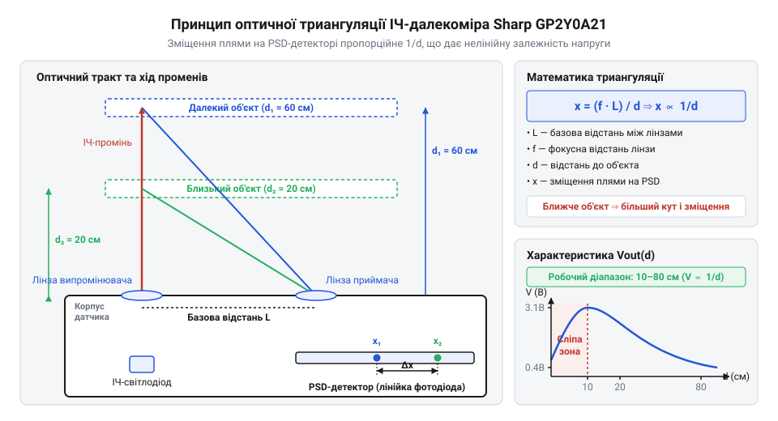
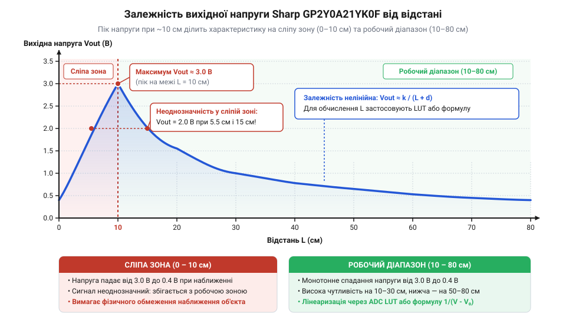
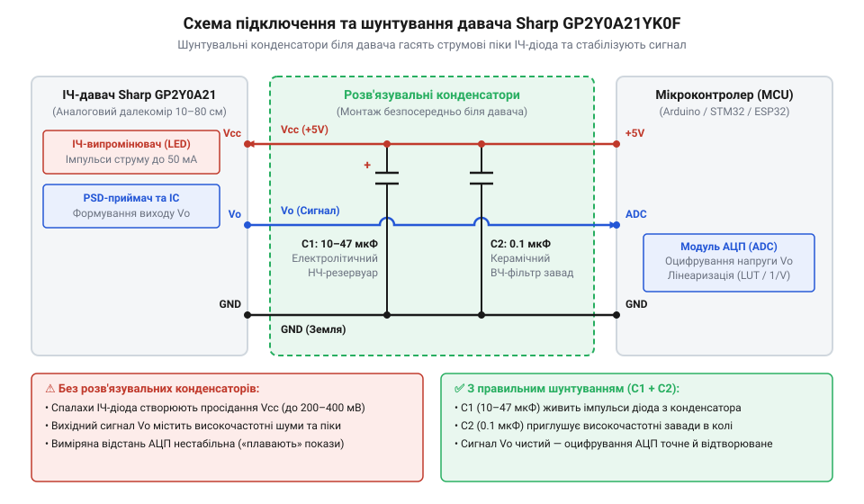

# Sharp GP2Y0A21YK0F — ІЧ-далекомір (10–80 см)

<preknowlist>
- [HC-SR04 — ультразвуковий далекомір](root:cat-hw-sensors/hc-sr04) — розрізнення геометричних та часових принципів вимірювання відстані й розуміння базових обмежень давачів прямої видимості
</preknowlist>

## Неоднозначність показів аналогового ІЧ-датчика

Оцінка інтенсивності відбитого світла здається найпростішим способом вимірювання відстані для мобільного робота. Проте на відміну від того, як [ультразвукові давачі вимірюють](root:cat-hw-sensors/hc-sr04) час проходження хвилі, амплітудний оптичний сенсор залежить від кольору й текстури поверхні. Через це темна перешкода поблизу сприймається як порожній простір.

На надкоротких дистанціях амплітуда сигналу стрімко спадає, що створює критичну неоднозначність: однакова напруга відповідає двом різним положенням об'єкта. Для надійного орієнтування потрібен аналоговий давач @@en|Sharp GP2Y0A21YK0F@@, який вимірює не яскравість світла, а геометрію його повернення.

## Оптична триангуляція на детекторі PSD

Щоб вимірювання не залежало від кольору поверхні, давач @@en|Sharp GP2Y0A21YK0F@@ використовує @@en|optical triangulation@@ (від грец. *trigonon* — трикутник). Вбудований випромінювач @@en|IR LED@@ спрямовує вузький інфрачервоний промінь на об'єкт, а відбите світло через приймальну лінзу потрапляє на напівпровідниковий детектор @@en|PSD@@ (англ. *Position Sensitive Detector*).


*Геометрія оптичної триангуляції: зміщення світлової плями на PSD-детекторі пропорційне вимірюваному куту відбитого променя.*

Зміна відстані до об'єкта змінює кут відбитого променя, що зміщує світлову пляму уздовж поверхні @@en|PSD-детектора@@. Детектор формує на краях два струми `I₁` та `I₂`, визначаючи координату плями `x` довжиною `L`:

```
x = (L ÷ 2) × (I₂ - I₁) ÷ (I₁ + I₂)
```

Колір чи текстура поверхні змінюють інтенсивність світла, масштабуючи струми `I₁` та `I₂` однаково. Ділення в знаменнику повністю компенсує ці зміни, роблячи координату `x` та відстань `d` залежними лише від геометрії.

## Нелінійність характеристики та сліпа зона

Вихідна напруга `V_out` давача @@en|Sharp GP2Y0A21YK0F@@ залежить від відстані нелінійно: у діапазоні 10–80 см вона спадає від 3.1 В до 0.4 В. На близькій відстані зміщення об'єкта викликає стрибок напруги, а біля 80 см чутливість падає.


*Графік залежності вихідної напруги від відстані: пік при 10 см і спад у сліпій зоні 0–10 см.*

Найбільша небезпека — діапазон від 0 до 10 см, що утворює @@en|blind zone@@ (англ. *blind zone* — сліпа зона). Ближче 10 см кут відбиття стає настільки гострим, що світлова пляма зсувається за край @@en|PSD-детектора@@ або перекривається оправою лінзи через @@fr|vignetting@@ (фр. *vignette* — віньєтування). Втрата світла викликає спад напруги й неоднозначність показів: наприклад, 1.5 В відповідає як відстані 20 см, так і 4 см. Щоб уникнути помилок, давач заглиблюють у корпус або додають [лазерні ToF-давачі](root:cat-hw-sensors/vl53l0x) для перевірки ближньої зони.

## Стабілізація живлення та апаратне підключення

Внутрішній @@en|ІЧ-світлодіод@@ модуля @@en|Sharp GP2Y0A21YK0F@@ працює короткими імпульсами із струмом до 200 мА. Ці швидкі кидки споживання створюють просідання напруги `VCC`, через що на аналоговому виході та в АЦП виникає високочастотний шум.


*Схема апаратного обв'язування давача: декупливальний конденсатор живлення та пасивний RC-фільтр сигнального виходу.*

Для стабілізації живлення біля роз'єму давача паралельно `VCC` та `GND` підключають @@en|decoupling capacitor@@ (англ. *decoupling capacitor* — розв'язувальний конденсатор) ємністю 10–47 мкФ. Вихід `V_out` подають на АЦП через [пасивний сигнальний RC-фільтр](root:hw-analog/rc-low-pass) із резистором `R1 = 100...470 Ом` та конденсатором `C2 = 0.1 мкФ`, який відсікає завади до програмної обробки.

## Програмна лінеаризація та фільтрація сигналу

Аналоговий сигнал з виходу RC-фільтра потребує двостадійної обробки. Спочатку імпульсні сплески від відблисків усувають за допомогою @@en|median filter@@ (від лат. *medianus* — серединний) з вікном у 3–5 відліків. Залишковий шум згладжують через @@en|EMA@@ (англ. *Exponential Moving Average* — експоненційне ковзне середнє) з коефіцієнтом `α = 0.2...0.3`.

Далі відфільтроване значення АЦП `ADC_raw` перераховують у відстань `d` (см). Оскільки залежність напруги від відстані в діапазоні 10–80 см гіперболічна, використовують формулу:

```
d = A ÷ (ADC_raw - B)
```

де `A` та `B` — калібрувальні константи. Для економії ресурсів обчислення можна замінити на @@en|LUT@@ (англ. *Look-Up Table* — таблиця відповідностей) з лінійною інтерполяцією.

:::tabs
@tab C (ESP-IDF)
:::code sharp-gp2y0a21/c/esp-idf/compare-uint16.c
@tab C++ (Arduino)
:::code sharp-gp2y0a21/cpp/arduino/sharpgp2y0a21.cpp
:::