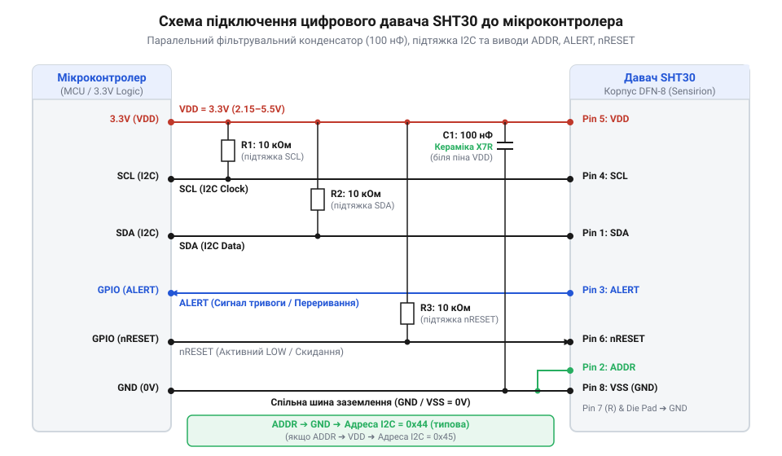
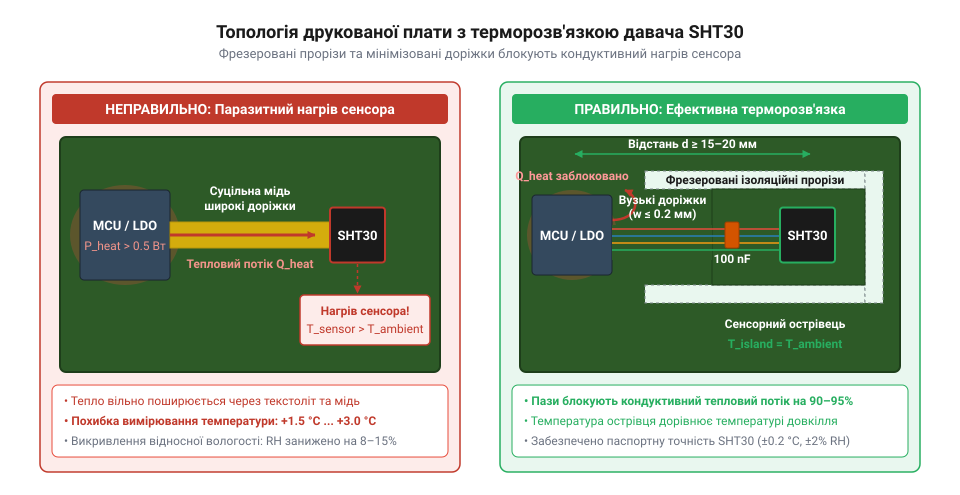

# Залізний інтерфейс SHT30: розводка ніжок, схеми підключення I2C та термічна ізоляція

## Викривлення показань через тепловий вплив

Цифровий давач SHT30 від компанії Sensirion є високоточним комбінованим сенсором, побудованим на базі технології @@en|CMOSens@@ (від @@en|Complementary Metal-Oxide-Semiconductor Sensor@@, «напівпровідниковий сенсор з вбудованою схемою»). На кристалі площею в кілька квадратних міліметрів виготовлено ємнісний елемент вимірювання відносної вологості повітря та напівпровідниковий давач температури з діапазоном @@en|bandgap@@. У лабораторних умовах цей пристрій забезпечує вражаючу паспортну точність: ±0.2 °C для температури та ±3% RH для відносної вологості. Однак після запаювання мікросхеми на реальну друковану плату розробники часто фіксують систематичне заниження вологості на 10%…20% RH та суттєве завищення температури на кілька градусів Цельсія порівняно з контрольно-вимірювальними приладами.

Причина такого спотворення полягає не в дефекті давача, а у фізиці термодинамічної рівноваги між давачем і довкіллям. Відносна вологість повітря RH виражає відношення парціального тиску водяної пари p_v до тиску насиченої пари p_sat(T) за поточної температури T:

    RH = (p_v / p_sat(T)) × 100%

Тиск насиченої пари експоненціально зростає зі збільшенням температури, що описує [формула Магнуса-Тетенса для водяної пари](root:cat-hw-sensors/magnus-formula). Якщо корпус давача нагрівається бодай на 1 °C вище за температуру навколишнього повітря, локальне значення p_sat(T) безпосередньо біля чутливої мембрани зростає. Оскільки кількість вологи в повітрі p_v за цей час не змінюється, виміряна давачем відносна вологість стрімко падає приблизно на 3%…5% RH на кожний градус перегріву.

Паразитне тепло потрапляє до давача двома основними шляхами:
1. Зовнішнє кондуктивне та конвективне нагрівання від суміжних компонентів плати: мікроконтролерів, потужних лінійних стабілізаторів напруги @@en|LDO@@ (від @@en|Low Dropout@@, «стабілізатор з малою падінням напруги»), силових транзисторів та навіть світлодіодів індикації. 2. Власне самонагрівання кристала SHT30. Воно виникає у разі надто частого опитування по шині I2C (коли внутрішня цифрова схема давача постійно перебуває в активному стані та розсіює потужність P = V_DD × I), а також при випадковому або тривалому ввімкненні вбудованого мікронагрівача (@@en|heater@@).

Спроби усунути це викривлення програмним шляхом — внесенням статичного поправкового коефіцієнта в код мікроконтролера — зазнають поразки. Тепловий опір друкованої плати та динаміка конвекційних потоків повітря залежать від завантаження процесора, зміни напруги живлення, наявності корпусу пристрою та швидкості обдуву. На відміну від простих давачів на зразок [модулів DHT11](root:cat-hw-sensors/dht11), високоточні сенсори рівня SHT30 або [чипів Si7021](root:cat-hw-sensors/gy-21) вимагають комплексної схемотехнічної та топологічної термоізоляції безпосередньо на етапі трасування друкованої плати.

## Призначення виводів корпусу DFN-8

Давач SHT30 поставляється в надкомпактному 8-вивідному корпусі @@en|DFN-8@@ (від @@en|Dual Flat No-leads@@, «двосторонній плоский корпус без виводів») розміром 2.5 × 2.5 × 0.9 мм з кроком виводів 0.5 мм. Для забезпечення стабільного функціонування інтерфейсу та вимірювального ядра кожен із восьми контактних виводів, а також центральний тепловий майданчик, мають суворо визначене схемотехнічне призначення.

Правильне призначення та електрична обв'язка виводів корпусу DFN-8 наведені нижче:

* **Вивід 1 (`SDA`, @@en|Serial Data@@):** Лінія даних послідовної шини @@en|I2C@@ (від @@en|Inter-Integrated Circuit@@, «міжмікросхемна шина»). Вихід реалізовано за схемою з відкритим стоком (@@en|open-drain@@), тому лінія потребує зовнішнього підтягувального резистора до шини живлення `VDD`. Через цей вивід відбувається двонапрямний обмін командами та виміряними даними між мікроконтролером і давачем. * **Вивід 2 (`ADDR`, @@en|Address Select@@):** Вхід вибору молодшого біта 7-бітної апаратної адреси I2C. Визначає шинний ідентифікатор пристрою:
  * Підключення виводу `ADDR` до спільного проводу `VSS` (логічний 0) задає адресу `0x44` (у двійковому форматі `01000100₂`). * Підключення виводу `ADDR` до лінії живлення `VDD` (логічна 1) задає адресу `0x45` (у двійковому форматі `01000101₂`). Цей вивід категорично заборонено залишати незапідключеним (у стані @@en|floating@@): високий вхідний опір CMOS-каскаду спричинить наведення завад, що призведе до хаотичної зміни адреси та втрати зв'язку по шині. * **Вивід 3 (`ALERT`, @@en|Interrupt / Alert@@):** Вихід апаратного сповіщення про вихід виміряних параметрів за задані межі. Працює як сигнал переривання або термостата (режим порівняльника). Якщо апаратний моніторинг порогів у проекті не використовується, цей вивід залишають непідключеним (@@en|NC@@, від @@en|No Connect@@). * **Вивід 4 (`SCL`, @@en|Serial Clock@@):** Вхідний сигнал тактування шини I2C. Керується майстром шини (мікроконтролером). Як і лінія даних, вимагає підтягувального резистора до `VDD`. * **Вивід 5 (`VDD`, @@en|Supply Voltage@@):** Лінія позитивного живлення внутрішньої цифрової та аналогової схемотехніки. Допустимий діапазон напруг становить від 2.4 В до 5.5 В, що дає змогу підключати SHT30 до систем із логікою 3.3 В або 5 В без додаткових перетворювачів напруги живлення. * **Вивід 6 (`nRESET`, @@en|Reset@@):** Вхід апаратного скидання давача з активним низьким рівнем (префікс `n` позначає інверсну логіку). Подача логічного 0 тривалістю понад 1 мкс ініціює повне перезавантаження внутрішніх регістрів та автокалібрувальних констант SHT30 без відключення напруги `VDD`. Якщо апаратне скидання від мікроконтролера не потрібне, вивід підтягують до `VDD`. * **Вивід 7 (`R`, @@en|Reserved@@):** Службовий вивід, зарезервований виробником для технологічного тестування кристала. Згідно зі специфікацією Sensirion, для підвищення завадостійкості цей вивід обов'язково має бути підключений до спільного проводу `VSS`. * **Вивід 8 (`VSS`, @@en|Ground@@):** Загальний вивід живлення (земля, 0 В). * **Центральний майданчик (`Die Pad` / `Thermal Pad`):** Металевий контакт під черевом корпусу DFN-8. Він призначений для механічного пайка та відведення тепла під час монтажу. Виробник рекомендує запаювати його на ізольований або з'єднаний із `VSS` контактний майданчик, однак категорично забороняє підключати його до великих мідних шин заземлення, які можуть виконувати роль теплових містків від гарячих зон плати.

## Схемотехніка живлення та шини I2C

Проєктування принципової електричної схеми для SHT30 вимагає дотримання двох критичних умов: забезпечення чистоти напруги живлення та забезпечення коректних часових характеристик фронтів сигналів шини I2C. Нехтування фільтрацією чи помилки в розрахунку підтягувальних резисторів призводять до збоїв зчитування CRC-чеків, заклинювання шини I2C або появи паразитного шуму у вимірюваннях.

*Електрична схема підключення SHT30: фільтрувальний конденсатор живлення розміщено біля виводів VDD/VSS, лінії SDA та SCL підтягнуті до VDD розрахованими резисторами, а пін ADDR зафіксовано на землі для адреси 0x44.*

Для стабілізації живлення між виводами `VDD` (вивід 5) та `VSS` (вивід 8) безпосередньо біля корпусу давача (на відстані не більше 2 мм) встановлюють керамічний розв'язувальний конденсатор C_dec номіналом 100 нФ з диелектриком типу @@en|X7R@@ або @@en|X5R@@. Цей конденсатор компенсує імпульсні кидки струму під час роботи аналогово-цифрового перетворювача SHT30. Якщо давач винесений на окремий шлейф завдовжки понад 10 см, паралельно до керамічного конденсатора додають танталовий або електролітичний конденсатор ємністю 1 мкФ…10 мкФ для гасіння низькочастотних пульсацій.

Сигнальні лінії `SDA` та `SCL` є виходами з відкритим стоком і потребують підтягувальних резисторів R_pullup до шини `VDD`. Оптимальний номінал R_pullup обчислюють на основі системних обмежень шини I2C: напруги живлення V_DD, максимально допустимого струму вихідного транзистора I_OL та сумарної паразитної ємності лінії C_line (яка складається з ємності доріжок плати, виводів мікросхем та кабелю).

Мінімально припустимий опір R_min обмежує струм через відкритий транзистор давача, щоб вихідна напруга низького рівня не перевищила поріг V_OL,max = 0.4 В при струмі I_OL = 3 мА:

    R_min = (V_DD - V_OL,max) / I_OL

Обчислимо мінімальний опір для напруги живлення V_DD = 3.3 В:

    R_min = (3.3 - 0.4) / 0.003
          = 2.9 / 0.003
          = 966.67 Ohm ≈ 967 Ohm

Максимально припустимий опір R_max визначається постійною часу RC-ланцюга, яка відповідає за тривалість наростання фронту сигналу t_r. Згідно зі специфікацією I2C для режиму @@en|Fast Mode@@ (400 кГц) тривалість фронту не повинна перевищувати t_r = 300 нс. Зв'язок між параметрами описується формулою:

    t_r = 0.8473 × R_pullup × C_line

Звідси виводимо формулу для обчислення граничного значення R_max:

    R_max = t_r / (0.8473 × C_line)

Припустимо, що сумарна ємність лінії C_line = 100 пФ. Обчислимо максимальний дозволений опір підтяжки:

    R_max = (300 × 10⁻⁹) / (0.8473 × 100 × 10⁻¹²)
          = 300 / 0.08473
          = 3540.66 Ohm ≈ 3.54 kOhm

Таким чином, для стабільної роботи шини на частоті 400 кГц при ємності лінії 100 пФ номінал підтягувальних резисторів має лежати в діапазоні від 967 Ом до 3.54 кОм. На практиці найчастіше вибирають стандартні номінали 2.2 кОм або 3.3 кОм.

Для лінії апаратного скидання `nRESET` рекомендується застосовувати схему захисту від хибних спрацьовувань від електромагнітних завад. Вивід підтягують до `VDD` через резистор 10 кОм і паралельно підключають керамічний конденсатор 10 нФ на землю `VSS`. Це формує фільтр низьких частот, який блокує короткочасні наведені імпульси.

## Топологія та термоізоляція друкованої плати

Навіть ідеально розрахована принципова схема не захистить SHT30 від викривлення показань, якщо топологію друкованої плати розведено без урахування законів теплопередачі. Тепло від гарячих компонентів (мікроконтролера, модуля Wi-Fi/Bluetooth, силових ключів) поширюється до давача трьома шляхами: теплопровідністю через мідні доріжки, теплопровідністю через склотекстоліт плати @@en|FR-4@@ та конвекцією через повітряний простір усередині корпусу.

Мідь має надзвичайно високий коефіцієнт теплопровідності (λ_Cu ≈ 385 Вт/(м·К)), тоді як вихідний матеріал плати FR-4 проводить тепло значно гірше (λ_FR4 ≈ 0.3…0.5 Вт/(м·К)). Проте через велику площу та товщину шарів текстоліту сумарний тепловий потік по платі виявляється достатнім для розігріву корпусу давача.

*Топологія розміщення SHT30 на окремому майданчику: фрезеровані прорізи зменшують теплопередачу по текстоліту, а вузькі сигнальні доріжки діють як тепловий бар'єр.*

Для мінімізації теплового впливу при проєктуванні друкованої плати застосовують наступні топологічні прийоми:

1. **Крайове або острівне розміщення:** Давач SHT30 розміщують на самому краю друкованої плати або на винесеному консольному острівці, якомога далі від джерел виділення тепла. Якщо пристрій має вертикальне орієнтування в просторі, давач обов'язково розташовують у найнижчій точці плати, оскільки нагріте повітря від мікроконтролера піднімається вгору завдяки природній конвекції. 2. **Фрезерування ізоляційних прорізів (@@en|milled thermal isolation slots@@):** Навколо майданчика з давачем роблять наскрізні фрезеровані пази у текстоліті з трьох боків, залишаючи лише вузький перешийок (консоль) для прокладання сигнальних доріжок. Відповідно до закону Фур'є, тепловий потік Q прямо пропорційний площі поперечного перерізу провідника A:

    Q = λ × A × (ΔT / L)

Видалення текстоліту з трьох боків зменшує площу поперечного перерізу A в десятки разів, створюючи високий тепловий опір між основною платою та острівцем давача.

3. **Мінімізація ширини мідних доріжок:** Сигнальні лінії `SDA`, `SCL`, `VDD` та `VSS`, що проходять через консольний перешийок, роблять максимально вузькими (типово 0.15…0.2 мм). Широкі провідники живлення або суцільні полігони заземлення працюють як ефективні теплові мости, якими тепло миттєво досягає давача. 4. **Терморозв'язка контактних площадок (@@en|thermal relief pads@@):** Підключати виводи SHT30 до шин заземлення чи живлення слід виключно через терморозв'язувальні елементи — вузькі містки міді, а не суцільним заливанням. Суцільні полігони заземлення безпосередньо під корпусом DFN-8 створюють масивний тепловий контакт із платою. Суцільне мідне покриття під давачем на всіх шарах плати має бути видалене (застосовується виріз полігону @@en|keepout zone@@).

Поєднання фізичного віддалення, фрезерованих пазів текстоліту та тонких доріжок дозволяє знизити паразитний перегрів SHT30 до незначних величин (< 0.1 °C), що зберігає високу точність вимірювання температури й вологості в реальних виробах.