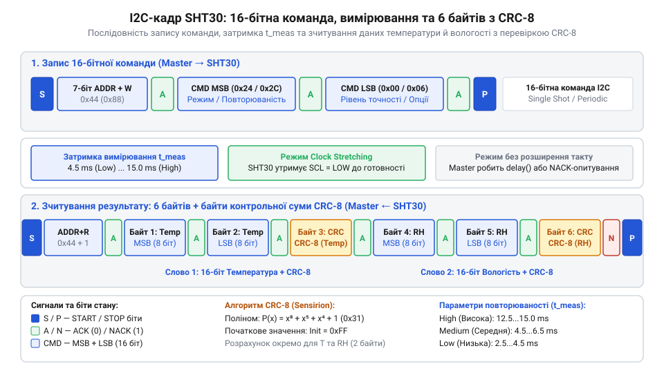
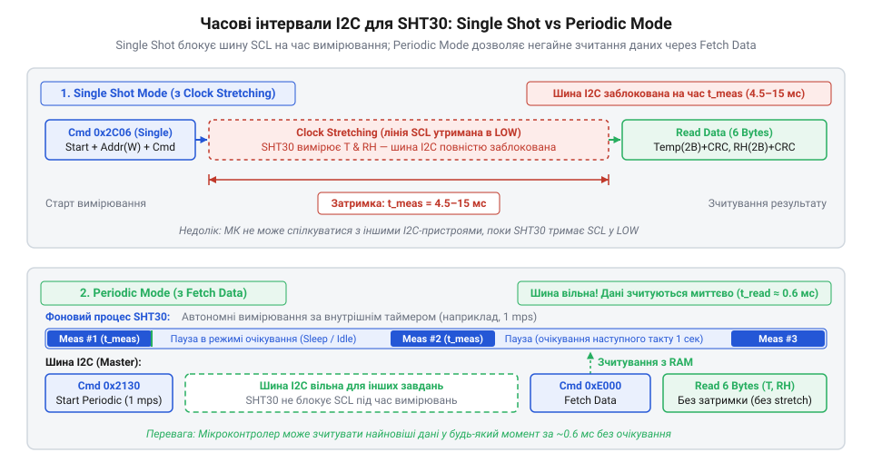

# Програмний інтерфейс SHT30: карта команд I2C, режими вимірювання та регістр стану

<preknowlist>
- [GY-21 (Si7021/HTU21D) — температура/вологість](root:cat-hw-sensors/gy-21) — Базові принципи I2C-обміну з цифровими сенсорами вологості та конвертації сирих 16-бітних відліків у фізичні величини.
- [Формула Магнуса-Тетенса для водяної пари](root:cat-hw-sensors/magnus-formula) — Принцип перерахунку отриманих відносних показників температури та вологості для розрахунку точки роси.
</preknowlist>

## Втрата зв'язку та зависання I2C

Спроба зчитати дані з `SHT30` по шині @@en|I2C@@ (від @@en|Inter-Integrated Circuit@@ — міжмікросхемна послідовна шина) без урахування часу вимірювання призводить до помилки таймауту, нульових байтів або блокування шини із затягнутою в низький логічний рівень лінією `SCL`.

Причина полягає в тому, що `SHT30` не зберігає готові вимірювання постійно. Його внутрішній аналого-цифровий перетворювач (@@en|ADC@@, від @@en|Analog-to-Digital Converter@@ — аналого-цифровий перетворювач) витрачає від 2.5 до 15.5 мілісекунд на вимірювання ємності полімерного давача вологості та напруги зсуву на @@en|MEMS@@-структурі (від @@en|Micro-Electro-Mechanical Systems@@ — мікроелектромеханічні системи). Спроба вичитати байти без паузи змушує давач відповідати сигналом @@en|NACK@@ (від @@en|Negative Acknowledgment@@ — негативне підтвердження) або розтягувати тактовий сигнал.

Крім апаратних затримок, керування `SHT30` здійснюється виключно двобайтними (16-бітними) командами зі старшим байтом (@@en|MSB@@, від @@en|Most Significant Byte@@ — старший значущий байт) та молодшим байтом (@@en|LSB@@, від @@en|Least Significant Byte@@ — молодший значущий байт). На відміну від однобайтних команд [давачів вологості GY-21](root:cat-hw-sensors/gy-21) чи однопровідного протоколу [цифрових сенсорів DHT11](root:cat-hw-sensors/dht11), передача лише одного байта або розрив транзакції змушує давач проігнорувати запит і залишитися в попередньому стані.

## Формат 16-бітних команд та CRC-8

Для взаємодії з `SHT30` мікроконтролер передає шиною @@en|I2C@@ 7-бітну адресу пристрою (`0x44` або `0x45`, залежно від виводу `ADDR`) із бітом запису `0`. Отримавши підтвердження @@en|ACK@@ (від @@en|Acknowledgment@@ — підтвердження прийому), контролер надсилає двобайтну команду: спочатку старший байт `MSB`, потім молодший `LSB`.

Після перетворення давач повертає 6-байтну відповідь: два байти сирої температури, байт контрольної суми @@en|CRC-8@@ (від @@en|Cyclic Redundancy Check@@ — циклічний контроль надлишковості), два байти сирої вологості та другий байт @@en|CRC-8@@.


*Структура пакета I2C для SHT30: двобайтна команда, часова пауза перетворення та шестибайтний фрейм даних із контрольною сумою CRC-8 для кожного двобайтного блоку.*

Порождаючий поліном @@en|CRC-8@@ має вигляд `P(x) = x⁸ + x⁵ + x⁴ + 1` (у шістнадцятковій формі `0x31`) із початковим значенням `0xFF`. Дані обробляються побайтово через алгоритм зсуву з виключним АБО (@@en|XOR@@, від @@en|Exclusive OR@@ — побітове виключне АБО). Промислові завади або довгі лінії @@en|I2C@@ можуть спотворити біти. Якщо обчислений контролером @@en|CRC-8@@ не збігається з прийнятим байтом, усю пару вимірювань відкидають.

Після успішної перевірки цілісності сире 16-бітне значення температури `S_T` перераховують у градуси Цельсія `T`:

```
T = -45 + 175 × (S_T / (2¹⁶ - 1))      [конвертація сирого значення температури]
```

Тут відлік `-45` задає температурний зсув шкали, а множник `175` масштабує діапазон вимірювання від `-45 °C` до `+130 °C` при `S_T` від `0` до `65535`.

Аналогічно сире 16-бітне значення вологості `S_RH` перераховують у відсотки відносної вологості `RH`:

```
RH = 100 × (S_RH / (2¹⁶ - 1))          [конвертація сирого значення вологості]
```

Множник `100` масштабує результат від `0%` до `100%`. Отримані дані дозволяють обчислювати межу випадання конденсату за [формулою Магнуса-Тетенса](root:cat-hw-sensors/magnus-formula).

Для перевірки цілісності даних на мікроконтролері використовують функцію обчислення @@en|CRC-8@@:

:::tabs
:::code api-sht30-protocol/c/esp-idf/sht30-crc8.c
:::code api-sht30-protocol/cpp/arduino/sht30crc.cpp
:::

## Режими вимірювання Single Shot та Periodic

Давач `SHT30` підтримує два режими роботи: одноразове вимірювання за запитом (@@en|Single Shot@@, від @@en|single shot@@ — однократний запуск) та періодичну генерацію даних (@@en|Periodic Mode@@, від @@en|periodic mode@@ — періодичний режим). Вони визначають архітектуру опитування пристрою та його енергетичний профіль.

У режимі @@en|Single Shot@@ давач більшість часу перебуває в глибокому сні з мікроамперним споживанням. Запитуючи вимірювання, контролер обирає варіант поведінки шини @@en|I2C@@:

1. **З розтягуванням тактового сигналу (@@en|Clock Stretching@@)**. При командах із сімейства `0x2C` (наприклад, `0x2C06` для високої точності) давач утримує лінію `SCL` у низькому стані на час роботи АЦП. Контролер «зависає» на апаратному рівні до відпускання `SCL`. Це усуває потребу в програмних таймерах, але якщо модуль @@en|I2C@@ контролера не підтримує @@en|Clock Stretching@@ або має жорсткий таймаут, транзакція завершиться помилкою.

2. **Без розтягування тактового сигналу (без @@en|Clock Stretching@@)**. При командах із сімейства `0x24` (наприклад, `0x2400`) `SHT30` не утримує `SCL`. Контролер витримує паузу `t_measure` і лише тоді відправляє запит на читання 6 байтів. Спроба зчитати дані раніше поверне @@en|NACK@@.

У режимі @@en|Periodic Mode@@ `SHT30` самостійно вимірює параметри з частотою 0.5–10 вимірювань за секунду (@@en|mps@@, від @@en|measurements per second@@ — вимірювань за секунду). Команди старту варіюються від `0x2032` (0.5 mps, висока повторюваність) до `0x2737` (10 mps, висока повторюваність), а нові відліки зберігаються у внутрішньому буфері.


*Порівняння блокуючого очікування при розтягуванні тактування в режимі Single Shot та миттєвого зчитування даних із внутрішнього буфера командою Fetch Data у режимі Periodic Mode.*

Щоб зчитати найсвіжіше значення з буфера, контролер надсилає команду @@en|Fetch Data@@ (`0xE000`) і миттєво отримує 6 байтів без затримки `SCL`, що дозволяє будувати асинхронне опитування без блокування потоків. Зупиняє періодичний режим команда @@en|Break@@ (`0x3093`).

У кожному режимі доступні три рівні повторюваності (@@en|Repeatability@@):
* **High Repeatability (Висока повторюваність)**: тривалість перетворення до 15 мс; найменший шум (RMS-шум вологості 0.08 %RH, температури 0.04 °C), але найбільше споживання. * **Medium Repeatability (Середня повторюваність)**: час перетворення близько 6 мс, компроміс між шумом і швидкодією. * **Low Repeatability (Низька повторюваність)**: вимірювання за 4 мс; мінімальне споживання, але вищий випадковий шум.

Порівняно з [термометрами DS18B20](root:cat-hw-sensors/ds18b20), де перетворення триває до 750 мс, `SHT30` навіть при високій точності спрацьовує за 15 мс. Проте для батарейних пристроїв вибір між @@en|Single Shot@@ із низькою повторюваністю та @@en|Periodic Mode@@ є вирішальним для тривалості автономної роботи.

## Аналіз та скидання регістра стану

Давач `SHT30` має 16-бітний регістр стану (@@en|Status Register@@, від @@en|status@@ — стан + @@en|register@@ — регістр), який фіксує системні події, факти перезавантаження, помилки команд та стан мікронагрівача. Аналіз регістра дає змогу діагностувати збої без знеструмлення платформи.

Для його зчитування мікроконтролер надсилає команду `0xF32D`, після чого отримує два байти вмісту та один байт контрольної суми @@en|CRC-8@@.

Бітова маска регістра стану має таку структуру:
* **Біт 15 (Alert Pending)**: `1` — наявність щонайменше однієї активної тривоги за пороговими значеннями. * **Біт 13 (Heater Status)**: стан нагрівача (`0` — вимкнений, `1` — увімкнений). * **Біт 11 (RH Tracking Alert)**: `1` — вихід вологості за встановлені межі. * **Біт 10 (T Tracking Alert)**: `1` — вихід температури за встановлені межі. * **Біт 4 (System Reset Detected)**: `1` — відбулося перезавантаження живлення (@@en|Hard Reset@@) або програмне скидання (@@en|Soft Reset@@). * **Біт 1 (Command Status)**: `0` — команда виконана успішно, `1` — команда не розпізнана або не пройшла перевірку контрольної суми. * **Біт 0 (Write Data Checksum Status)**: `0` — контрольна сума запису коректна, `1` — помилка @@en|CRC-8@@ при передачі даних.

Після аналізу виняткових ситуацій прапорці регістра необхідно скидати командою `0x3041` (Clear Status Register), яка обнуляє біти 15, 11, 10, 4, 1 та 0.

Алгоритм діагностики працює так: у разі збою опитування програма зчитує регістр стану. Якщо біт 4 дорівнює `1`, стався просад живлення, і давач потребує повторної ініціалізації періодичного режиму. Якщо `1` у бітах 1 або 0, причина збою — завади на лініях `SDA`/`SCL`. На відміну від [сенсорів AHT20](root:cat-hw-sensors/aht20-sensor), де статусний байт лише показує готовність даних, регістр `SHT30` забезпечує повноцінну діагностику причин відмови.

## Керування нагрівачем та програмне скидання

При високій вологості (близько 100 %RH) чи випаданні роси на поверхні мембрани `SHT30` утворюється водяна плівка. Через це давач тривалий час показує граничну вологість навіть після висихання довкілля. Для відновлення працездатності в кристал інтегровано мікронагрівач (@@en|Heater@@, від @@en|heater@@ — нагрівальний елемент).

Увімкнення нагрівача здійснюється командою `0x306D`, а вимкнення — `0x3066`. При активації через резистивний шар протікає струм близько 8 мА (33 мВт при 3.3 В), що викликає саморозігрів кристала та випаровує конденсат за кілька секунд.

Використання нагрівача вимагає враховувати дві особливості:
1. **Ефекти саморозігріву (@@en|Self-Heating Effect@@)**. Під час роботи нагрівача температура `SHT30` зростає вище реальної, а виміряна вологість штучно падає. Зчитані в цьому стані дані є невалідними для моніторингу клімату. 2. **Алгоритм регенерації**. Нагрівач вмикають лише періодично (наприклад, на 1–5 секунд раз на добу або при тривалому заліпанні вологості на 100 %), після чого його вимикають командою `0x3066` та роблять паузу на охолодження кристала перед вимірюванням.

Для програмного відновлення працездатності без відключення живлення `VDD` передбачено м'яке скидання (@@en|Soft Reset@@, від @@en|soft reset@@ — програмне перезавантаження) командою `0x30A2`. Тривалість процедури `t_SR` не перевищує 1.5 мілісекунди. Альтернативним способом є відправка по шині @@en|I2C@@ загального виклику скидання (@@en|General Call Reset@@) — байта `0x06` на адресу `0x00`.

Будь-який варіант м'якого скидання зупиняє періодичний режим вимірювання, очищає буфер відліків, скидає регістри та переводить `SHT30` у режим низького споживання @@en|Single Shot@@. При цьому прапорець `System Reset Detected` (біт 4 @@en|Status Register@@) встановлюється в `1`, сигналізуючи про готовність давача до нової конфігурації.