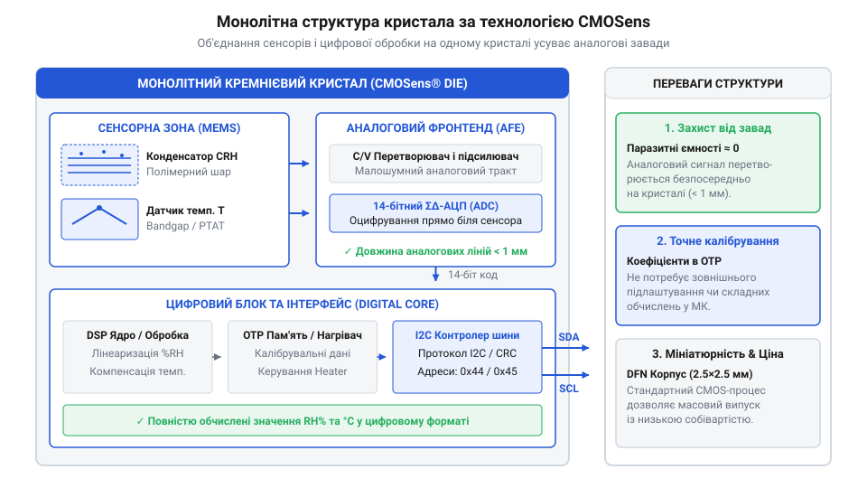
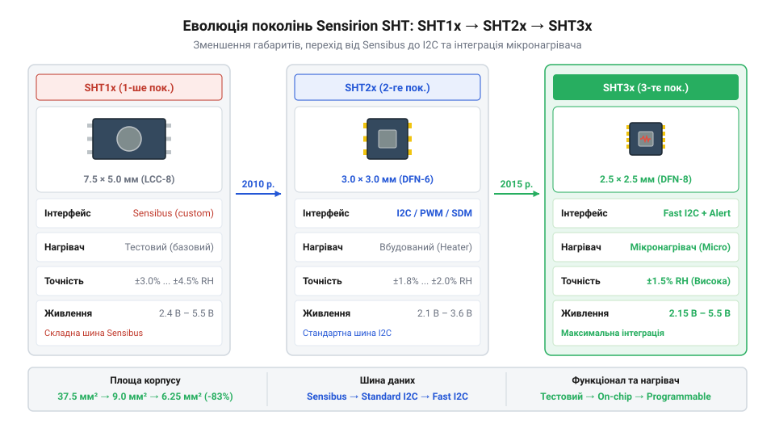

# Від еволюції SHT10 до сімейства SHT3x: історія технології CMOSens

<preknowlist>
- [DHT11 — температура/вологість](root:cat-hw-sensors/dht11) — базові принципи роботи комбінованих давачів вологості та температури
- [Формула Магнуса-Тетенса для водяної пари](root:cat-hw-sensors/magnus-formula) — фізичний зв'язок між температурою, тиском водяної пари та відносною вологістю
</preknowlist>

## Проблема аналогових давачів вологості

Наприкінці 1990-х років автоматизація промислових процесів, системи вентиляції та клімат-контролю, медична техніка й метеорологічні станції зіткнулися з викликом: створення компактного, дешевого й надійного давача для вимірювання відносної вологості повітря. Якщо вимірювання температури давно було розв'язаною задачею завдяки таким компонентам, як [аналогові резистивні термістори](root:cat-hw-sensors/ky-013-thermistor) або [напівпровідникові давачі температури](root:cat-hw-sensors/lm35), то точне вимірювання вологості залишалося джерелом постійних технічних компромісів.

Основою класичного вимірювання вологості є ємнісний гігрометр (від грецького @@el|υγρός@@ — вологий та @@el|μέτρον@@ — вимірювач). Його вимірювальна комірка являє собою тонкоплівковий конденсатор (від латинського @@la|condensare@@ — згущувати), у якому як діелектрик (від грецького @@el|διά@@ — через та @@el|ἤλεκτρον@@ — янтар) використовується гігроскопічний полімер (від грецького @@el|πολύς@@ — численний та @@el|μέρος@@ — частина). Коли вологість довкілля змінюється, @@el|полімер@@ поглинає або віддає молекули води, змінюючи свою діелектричну проникність `εᵣ`, що призводить до зміни ємності `C` самого @@la|конденсатора@@.

Проте перетворення цієї фізичної зміни на стабільний електричний сигнал у дискретних аналогових схемах стикалося з чотирма критичними бар'єрами:

1. **Нікчемний корисний сигнал.** Корисна зміна ємності `ΔC` тонкоплівкового @@el|полімера@@ становить лише частки пікофарада чи навіть @@en|фемтофарад@@ (`10⁻¹⁵ F`). 2. **Паразитна ємність монтажу.** Звичайні друковані доріжки плати, з'єднувальні дроти та виводи корпусів мають власну @@en|паразитна ємність@@ порядку `1..10 pF`. Ця величина в рази перевищує сам корисний сигнал @@el|гігрометра@@, через що дотик до кабелю чи зміна трасування плати повністю викривляли результати вимірювання. 3. **Чутливість до завад і температури.** Довгі аналогові лінії легко вловлювали електромагнітні завади від кіл живлення та мікроконтролерів. Крім того, діелектричні властивості @@el|полімера@@ залежать від температури, тому для обчислення відносної вологості потрібно одночасно вимірювати температуру й застосовувати складну [формулу Магнуса-Тетенса](root:cat-hw-sensors/magnus-formula). 4. **Висока вартість індивідуального калібрування.** Кожен дискретний аналоговий @@el|гігрометр@@ мав унікальні технологічні відхилення. Щоб отримати прийнятну точність, кожен виготовлений давач доводилося вручну витримувати у спеціальних камерних барокамерах із еталонною вологістю (наприклад, над насиченими сольовими розчинами) та підганяти аналогові підлаштовні резистори або розраховувати індивідуальні таблиці для кожного приладу.

У результаті масове виробництво недорогих і водночас точних аналогових давачів вологості було технічно неможливим. Ринок потребував принципово нового підходу, який об'єднав би вимірювальний елемент та схему обробки сигналу на одному кристалі.

## Монолітний прорив технології CMOSens

Відповіддю на кризу аналогових вимірювачів став технологічний прорив швейцарської компанії @@en|Sensirion@@, заснованої у 1998 році як @@en|spin-off@@ Швейцарської вищої технічної школи Цюриха (@@de|ETH Zürich@@) фізиками Феліксом Маєром (@@de|Felix Mayer@@) та Моріцом Лехнером (@@de|Moritz Lechner@@). Розробники запропонували відмовитися від з'єднання окремого давача із зовнішньою мікросхемою й об'єднати їх на єдиній кремнієвій підкладці за допомогою технології @@en|CMOSens@@.

Суть винаходу полягає у монолітній інтеграції мікроелектромеханічних структур (MEMS, від англійського @@en|Micro-Electromechanical Systems@@ — мікроелектромеханічні системи) безпосередньо у стандартний напівпровідниковий процес CMOS (від англійського @@en|Complementary Metal-Oxide-Semiconductor@@ — комплементарна структура метал-оксид-напівпровідник).

*Монолітна структура CMOSens: поєднання MEMS-сенсора вологості, датчика температури та цифрової схеми обробки сигналів на одному кристалі кремнію.*

У верхніх шарах кремнієвого кристала формується зустрічно-штирьова (гребінчаста) система мікроелектродів, вкрита захисним і чутливим @@el|полімерним@@ @@el|діелектриком@@. Поруч із цією @@en|MEMS@@-структурою на тому ж самому кристалі — на відстані, що не перевищує часток міліметра, — розташовано:
- напівпровідниковий давач температури на основі забороненої зони (@@en|bandgap@@);
- малошумний підсилювач на перемикальних @@la|конденсаторах@@;
- аналого-цифровий перетворювач (@@uk|АЦП@@);
- цифровий контролер керування та енергонезалежну пам'ять @@en|EEPROM@@.

Таке монолітне об'єднання розв'язало всі ключові проблеми аналогових давачів. По-перше, довжина провідників між чутливим @@el|полімером@@ та підсилювачем скоротилася до мікронів, завдяки чому @@en|паразитна ємність@@ ліній впала практично до нуля й перестала спотворювати вимірювання. По-друге, надзвичайно малий аналоговий сигнал від зміни ємності підсилюється та перетворюється на цифровий код безпосередньо всередині чипа, що робить його абсолютно нечутливим до зовнішніх електромагнітних завад на друкованій платі.

По-третє, технологія @@en|CMOSens@@ дозволила впровадити масове автоматизоване калібрування. Під час виготовлення на заводі кожен чип поміщають у калібрувальну камеру, після чого індивідуальні поправкові коефіцієнти записуються у вбудовану пам'ять @@en|EEPROM@@. Внутрішній цифровий процесор чипа самостійно зчитує дані з датчиків вологості й температури, обчислює скориговані значення та видає користувачеві вже готові цифрові дані.

## Покоління SHT1x та інтерфейс Sensibus

Першим практичним втіленням технології @@en|CMOSens@@ стала серія чипів @@en|SHT1x@@ (зокрема давачі @@en|SHT10@@, @@en|SHT11@@ та @@en|SHT15@@), випущена компанією @@en|Sensirion@@ у 2001 році. Це були перші у світі повністю калібровані цифрові давачі вологості й температури у корпусі для поверхневого монтажу (SMD, від англійського @@en|Surface Mount Device@@ — пристрій для поверхневого монтажу).

Конструктивно чипи сімейства @@en|SHT1x@@ виконувалися у специфічному корпусі типу LCC (від англійського @@en|Leadless Chip Carrier@@ — безвивідний корпус чипа) на керамічній або текстолітовій основі. Пластиковий ковпачок мав відкрите віконце, через яке атмосферне повітря вільно контактувало з чутливим @@el|полімером@@ на поверхні кремнієвого кристала. Моделі серії відрізнялися між собою насамперед точністю вимірювання вологості: @@en|SHT10@@ забезпечував базову точність `±4.5% RH`, @@en|SHT11@@ — розширену `±3.0% RH`, а флагманський @@en|SHT15@@ — високоточний рівень `±2.0% RH`.

Для обміну даними з мікроконтролером розробники створили власний двопровідний цифровий інтерфейс @@en|Sensibus@@. Він використовував дві лінії: тактову `SCK` та двонаправлену лінію даних `DATA`. Зовні цей інтерфейс нагадував поширену шину @@en|I2C@@, проте мав суттєву відмінність у послідовності стартового сигналу (@@en|Start Sequence@@).

Для формування умови розпізнавання початку обміну в @@en|Sensibus@@ лінійка `DATA` мала перемикатися за особливим алгоритмом: лінія `DATA` переводиться у низький стан під час високого рівня `SCK`, після чого `SCK` опускається, а потім `DATA` знову піднімається у високий стан при високому `SCK`. Стандартні апаратні периферійні контролери @@en|I2C@@ у мікроконтролерах не вміли генерувати таку послідовність автоматично. Через це розробникам доводилося реалізовувати протокол @@en|Sensibus@@ програмним маніпулюванням виводами (@@en|bit-banging@@).

Цикл вимірювання починався з надсилання мікроконтролером 8-бітної команди (наприклад, `00000101` для вимірювання вологості або `00000011` для температури). Після цього чип @@en|SHT1x@@ відпускав лінію `DATA` і розпочинав аналого-цифрове перетворення. Коли вимірювання завершувалося (що займало до `210 ms` при 14-бітній роздільній здатності), чип притискав лінію `DATA` до землі, сигналізуючи про готовність. Мікроконтролер зчитував два байти даних та додатковий байт контрольної суми (@@en|CRC@@).

Попри складність програмної реалізації протоколу @@en|Sensibus@@ та чутливість перших LCC-корпусів до температурних напружень під час паяння оплавленням припою, поява сімейства @@en|SHT1x@@ зробила справжню революцію. Вона витіснила застарілі аналогові модулі й заклала основу для створення наступних поколінь цифрових давачів, як-от [новішого сімейства SHT3x](root:cat-hw-sensors/sensirion-sht-family-overview) та [простіших цифрових датчиків](root:cat-hw-sensors/dht11).

## Стандартизація SHT2x у DFN-корпусах

Перше покоління цифрових гігрометрів швейцарської компанії @@en|Sensirion@@ довело життєздатність монолітної технології @@en|CMOSens@@, проте виявило суттєві інженерні бар’єри під час масового впровадження. Головним обмеженням серії @@en|SHT1x@@ залишався габаритний корпус LCC із вивідними контактами, який займав багато місця на друкованій платі та потребував специфічних умов розпаювання. Додаткову складність створював фірмовий двопровідний протокол @@en|Sensibus@@, що змушував розробників витрачати ресурси мікроконтролера на програмне формування сигналів (англ. @@en|bit-banging@@ — програмна генерація сигналів), адже апаратні інтерфейси чипів його не підтримували.

Наступний еволюційний крок відбувся із виходом серії @@en|SHT2x@@, де виробник повністю переглянув конструктивне виконання й протокол обміну. Центральним рішенням стало переведення датчика на стандартизовану шину @@en|I2C@@ (від англ. @@en|Inter-Integrated Circuit@@ — міжмікросхемний зв'язок). Впровадження апаратного @@en|I2C@@ дозволило підключати датчик до стандартних периферійних модулів мікроконтролерів без складання нестандартних програмних часових діаграм, спростивши розробку пристроїв на рівні з іншими цифровими компонентами, як-от [однопровідні датчики температури](root:cat-hw-sensors/ds18b20) чи [сумісні модулі серії GY-21](root:cat-hw-sensors/gy-21).

Паралельно зазнав кардинальних змін корпус пристрою: застарілу вивідну кераміку замінив безвивідний корпус @@en|DFN@@ (від англ. @@en|Dual Flat No-leads@@ — подвійний плаский безвивідний корпус) розміром усього 3 × 3 × 1.1 мм. Перехід на @@en|DFN@@ розв'язав одразу дві інженерні задачі. По-перше, площа монтажу зменшилася більше ніж утричі, що відкрило шлях до використання давача в портативній та мобільній електроніці. По-друге, мініатюризація маси кремнію й пластику різко знизила теплову інерцію чипа. Давач став значно швидше реагувати на стрибки температури навколишнього середовища, оскільки сам корпус перестав працювати як масивний тепловий акумулятор.

Конструкція корпуса @@en|DFN@@ містить спеціальне відкрите вікно безпосередньо над чутливою ділянкою полімерного конденсатора. Молекули водяної пари вільно дифундують у відкриту порожнину чипа до вимірювального @@en|MEMS@@-елемента, тоді як решта вимірювальної схеми обробки сигналів надійно запечатана компаундом. Усі калібрувальні коефіцієнти в @@en|SHT2x@@ записували в енергонезалежну @@en|OTP@@-пам'ять (від англ. @@en|One-Time Programmable@@ — одноразово програмований) безпосередньо на фабриці під час випробувань у кліматичних камерах.

*Еволюція цифрових давачів вологості Sensirion демонструє перехід від габаритного LCC-корпусу SHT1x до мініатюрного безвивідного DFN у SHT2x та високоточного SHT3x із вбудованою обробкою сигналів.*

## Сучасне сімейство чипів SHT3x

Потреби промислового сектору та високоточної медичної техніки вимагали подальшого підвищення точності вимірювань, розширення діапазону робочої напруги й захисту від жорстких умов експлуатації. Відповіддю на ці вимоги стало третє покоління чипів @@en|SHT3x@@, яке перетворилося на де-факто галузевий стандарт для вимірювання параметрів мікроклімату.

Лінійка @@en|SHT3x@@ розділилася на кілька градацій точності: від базової модифікації SHT30 для масової споживчої електроніки до високоточних чипів SHT31 (похибка вологості не перевищує ±2%) та SHT35 (похибка ±1.5%). Нова архітектура отримала розширений діапазон живлення від 2.15 В до 5.5 В. Це дозволило живити давач як від стандартних 5-вольтних систем, так і напряму від низьковольтних 3.3 В або 1.8 В мікроконтролерів без застосування зовнішніх перетворювачів рівнів.

Ключовим технічним розширенням @@en|SHT3x@@ стала інтеграція вбудованого мікроскопічного нагрівача безпосередньо в кремнієву підкладку чипа. Тривале перебування будь-якого полімерного гігрометра в умовах 100% відносної вологості або виникнення конденсату призводить до повного насичення пор полімеру рідкою водою, через що показники давача тривалий час заліпають у максимальному значенні. Примусова активізація вбудованого нагрівача підвищує температуру кристала на кілька градусів вище за навколишнє середовище, випаровуючи залишкову крапельну вологу. Цей процес забезпечує прискорену @@en|регенерацію@@ (від лат. @@la|regeneratio@@ — відродження, відновлення) полімерного діелектрика після занурення в конденсат або дії хімічних випарів.

Для захисту від пилу, бруду та прямого попадання води в серії @@en|SHT3x@@ з'явилися варіанти виконання зі спеціальною захисною мембраною @@en|PTFE@@ (від англ. @@en|Polytetrafluoroethylene@@ — політетрафторетилен), зафіксованою над відкритим вікном корпуса. Гідрофобний шар @@en|PTFE@@ затримує краплі води та механічні частки (рівень захисту IP67), але вільно пропускає газоподібні молекули водяної пари до сенсора.

Додатково в чипах @@en|SHT3x@@ реалізовано вивід переривань `ALERT`, який дозволяє мікроконтролеру перебувати в режимі глибокого сну доти, доки вологість або температура не вийдуть за задані межі. На відміну від простіших рішень, таких як [базові побутові гігрометри](root:cat-hw-sensors/dht11), сімейство @@en|SHT3x@@ забезпечує високу довгострокову стабільність. Це дає змогу використовувати його поряд із [сучасними інтегральними аналогами](root:cat-hw-sensors/aht20-sensor) та у складних вимірювальних комплексах поруч із [мультисенсорними платами тиску](root:cat-hw-sensors/aht20-bmp280).

## Розвінчання міфів про полімерні давачі

Широке розповсюдження технології @@en|CMOSens@@ породило низку стійких стереотипів серед інженерів і розробників, які викривляють розуміння фізичних процесів усередині ємнісного давача.

Перший поширений міф стверджує, що компанія @@en|Sensirion@@ винайшла самий принцип ємнісного вимірювання вологості за допомогою полімерів. Насправді ємнісний метод вимірювання вологості з використанням органічних тонких плівок застосовувався в лабораторній та промисловій вимірювальній техніці задовго до поява перших мікросхем @@en|SHT1x@@. Справжнім технологічним проривом @@en|Sensirion@@ було не винайдення нового фізичного явища, а створення монолітної структури: поєднання на одному кремнієвому кристалі чутливого полімерного @@en|MEMS@@-конденсатора, високоточного @@en|АЦП@@ та блоку обробки цифрового сигналу з пам'яттю @@en|OTP@@. Саме це дозволило усунути паразитні ємності довгих з'єднувальних дротів, які зводили нанівець точність дискретних аналогових схем.

Другий міф полягає у переконанні, що полімерний давач вологості є абсолютно вічним і не піддається дрейфу протягом експлуатації. Органічний полімер є пористою хімічною матрицею. У реальних умовах полімер поступово сорбує леткі органічні сполуки, випари розчинників, лаків та клеїв, які присутні на друкованих платах чи у навколишньому повітрі. Хімічне забруднення створює неповоротне зміщення нульової точки або систематичний @@en|дрейф вологості@@. Крім того, при тривалій роботі виникає @@grc|гістерезис@@ (від грец. @@grc|ὑστέρησις@@ — відставання, запізнення) — ефект, коли швидкість віддачі вологи полімером нижча за швидкість її поглинання. Для подолання цього явища розробники змушені періодично застосовувати циклічний прогрів вбудованим нагрівачем.

Третій міф припускає, що вбудований датчик температури чипа завжди показує точну температуру навколишнього повітря без додаткових запобіжних заходів. Кристал чипа під час активного опитування по шині @@en|I2C@@ виділяє незначну кількість тепла (самонагрів). Згідно з [формулою розрахунку тиску пари](root:cat-hw-sensors/magnus-formula), відносна вологість є критично чутливою до зміни температури: підвищення температури сенсора всього на 0.5 °C відносно навколишнього середовища викликає заниження показу відносної вологості на кілька відсотків. Для усунення цього ефекту друкована плата вимагає спеціальних ізолювальних прорізів та обмеження частоти вимірювань, аналогічно до того, як розводять [лінійні аналогові термодатчики](root:cat-hw-sensors/lm35).