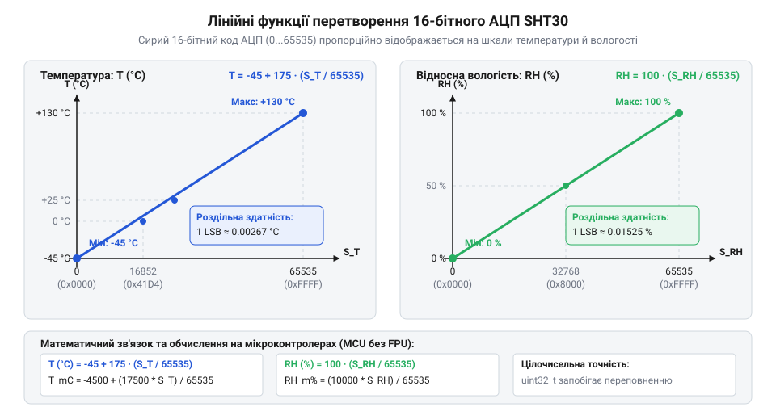
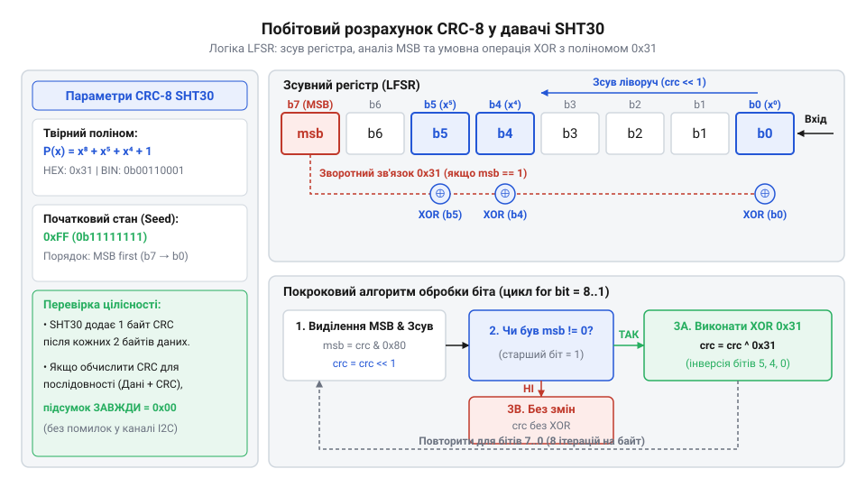

# Математичні формули перетворення коду АЦП та алгоритм CRC-8 для SHT30

<preknowlist>
- [GY-21 (Si7021/HTU21D) — температура/вологість](root:cat-hw-sensors/gy-21) — базові принципи зчитування цифрових показників температури й вологості через шину I2C.
- [DHT11 — температура/вологість](root:cat-hw-sensors/dht11) — концепція дискретизації фізичних величин та їх подання у вигляді цифрових відліків.
</preknowlist>

## Проблема інтерпретації даних давача SHT30

Підключаючи цифровий давач @@en|SHT30@@ розробки фірми @@en|Sensirion@@ до мікроконтролера, інженер розраховує отримати готові значення температури та відносної вологості. Проте після виконання запиту та зчитування даних через послідовний інтерфейс @@en|I2C@@ (англ. *Inter-Integrated Circuit* — міжмікросхемна шина) у буфері пам'яті опиняється масив з шести послідовних @@en|байтів@@ (англ. *byte*, від *bite* — шматок). Спроба прочитати перші два байти як звичайне ціле число без знаку дає комбінацію на кшталт `0x667F`, що у десятковій системі відповідає `26239`. Спроба використати таке число безпосередньо як показник температури призведе до того, що програма зафіксує безглузді `26239 °C`.

Ця неузгодженість виникає через те, що внутрішній @@lat|АЦП@@ (аналогово-цифровий перетворювач, від лат. *analogus* — відповідний, та *digitus* — палець) давача вимірює не самі градуси, а дискретну величину фізичного параметра. На відміну від [аналогових датчиків температури](root:cat-hw-sensors/lm35), де напруга на виході прямо пропорційна шкалі Цельсія, цифровий давач перетворює фізичний стан сенсорного елемента у безрозмірний 16-бітний @@lat|код@@. Щоб отримати з цього коду реальну температуру чи відносну вологість, необхідно застосувати чітку математичну функцію відображення.

Друга, ще небезпечніша проблема полягає у надійності передачі даних. Сигнали @@en|I2C@@ передаються відкритими лініями з підтягувальними резисторами, де електричні завади від силових кіл, паразитна ємність довгих провідників або короткочасні стрибки живлення можуть викривити окремі біти під час трансляції. Припустимо, що під час передачі старшого байта температури `0x66` (двійкове `01100110`₂) через наводку четвертий @@en|біт@@ (англ. *binary digit* — двійкова цифра) змінився на одиницю, утворивши `0x76` (`01110110`₂). У результаті зчитаний код `S_T` зросте з `26239` до `30335`, а декодована температура замість істинних `25.07 °C` раптово стрибне до `36.01 °C`. Спроба обробити такі викривлені дані у замкненій системі керування опаленням чи вентиляцією призведе до хибного вимкнення або увімкнення виконавчих реле.

Саме тому шість @@en|байтів@@, які надходять від давача @@en|SHT30@@, утворюють два строгі логічні блоки, кожен з яких містить власну контрольну суму @@en|CRC-8@@ (англ. *Cyclic Redundancy Check* — циклічний контрольний код):
1. Старший @@en|байт@@ температури @@en|T_MSB@@ (англ. *Most Significant Byte* — старший байт, від англ. *significant* — вагомий), молодший @@en|байт@@ @@en|T_LSB@@ (англ. *Least Significant Byte* — молодший байт) та байт перевірки @@en|T_CRC@@. 2. Старший @@en|байт@@ вологості @@en|RH_MSB@@, молодший @@en|байт@@ @@en|RH_LSB@@ та байт перевірки @@en|RH_CRC@@.

Об'єднання двох 8-бітних значень у єдине 16-бітне число виконується через побітовий зсув та арифметичне додавання:

Обчислення 16-бітного коду температури з двох окремих байтів:
```
S_T = (T_MSB · 256) + T_LSB
= (T_MSB << 8) | T_LSB                   [побітовий зсув старшого байта на 8 позицій вліво]
```

Отримане значення `S_T` являє собою 16-бітне ціле число без знаку у діапазоні від `0` до `65535`. Без попередньої математичної перевірки байта `T_CRC` за допомогою твірного полінома та без наступного відображення числа `S_T` на фізичну шкалу вимірювання, зчитані від давача дані залишаються лише сирим набором байтів у пам'яті.

## Математичне виведення формул перетворення АЦП

Внутрішнє аналогово-цифрове перетворення у давачі @@en|SHT30@@ має лінійну характеристику. Це означає, що при зміні фізичної величини від мінімального до максимального значення вихідний 16-бітний @@lat|код@@ @@lat|АЦП@@ змінюється рівномірно від `0` до `2¹⁶ - 1`, тобто до `65535`. Щоб перетворити цей безрозмірний код на градуси Цельсія, застосовують @@lat|інтерполяцію@@ (від лат. *interpolatio* — відновлення, вирівнювання) між граничними точками вимірювального діапазону.


*Залежність вихідних фізичних величин від цілочисельних відліків 16-бітного аналогово-цифрового перетворювача.*

Згідно зі специфікацією виробника @@en|Sensirion@@, вимірювальний елемент температури розрахований на робочий діапазон від `T_min = -40 °C` до `T_max = 125 °C`. Загальний температурний інтервал становить `ΔT = 130 - (-45) = 175 °C`. Граничному коду `S_T = 0` відповідає температура `-45 °C`, а максимальному коду `S_T = 65535` відповідає `130 °C`.

Розподіл повного діапазону `175 °C` на `65535` дискретних кроків визначає роздільну здатність перетворення. Один квант дискретизації @@lat|АЦП@@ дорівнює `175 / 65535 ≈ 0.00267 °C` на одиницю коду. У знаменнику формули стоїть саме `65535` (`2¹⁶ - 1`), а не `65536`, оскільки кількість інтервалів між `65536` точками відліку дорівнює `65535`.

Рівняння прямої лінії, що проходить через дві граничні точки, визначає залежність температури `T` у градусах Цельсія від отриманого коду `S_T`:

Виведення формули перетворення коду АЦП у градуси Цельсія:
```
T = T_min + (T_max - T_min) · (S_T / (2¹⁶ - 1))
= -45 + (130 - (-45)) · (S_T / 65535)    [підстановка граничних температурних меж Sensirion]
= -45 + 175 · (S_T / 65535)              [обчислення повного температурного діапазону 175 °C]
```

У цій формулі @@lat|коефіцієнт@@ (від лат. *co-* — разом, та *efficiens* — той, що робить) `175` відображає масштаб вимірювальної шкали, а число `-45` визначає зсув нуля. Ділення коду `S_T` на `65535` визначає відносну частку поточного відліку від повної шкали @@lat|АЦП@@.

Якщо вимірювальній системі потрібні значення у градусах Фаренгейта `T_F`, виведення можна виконати двома шляхами: через підстановку шкали Фаренгейта від `T_F_min = -49 °F` до `T_F_max = 266 °F` (з діапазоном `ΔT_F = 315 °F`), або через алгебраїчне перетворення формули Цельсія із співвідношенням `T_F = T · 1.8 + 32`:

Виведення формули для шкали Фаренгейта:
```
T_F = (-45 + 175 · (S_T / 65535)) · 1.8 + 32
= -45 · 1.8 + 175 · 1.8 · (S_T / 65535) + 32   [розкриття дужок множенням на 1.8]
= -81 + 315 · (S_T / 65535) + 32               [обчислення добутків констант]
= -49 + 315 · (S_T / 65535)                    [зведення подібних доданків -81 + 32]
```

Отриманий @@lat|коефіцієнт@@ `315` відповідає повному діапазону шкали Фаренгейта, а `-49` — точці відліку при коді `S_T = 0`.

Для відносної вологості повітря `RH` робочий діапазон датчика становить від `RH_min = 0 %` до `RH_max = 100 %`. На відміну від [платинових термоопорів](root:cat-hw-sensors/pt100-rtd), де характеристика вимагає складних рівнянь, відносна вологість @@en|SHT30@@ описується пропорційною залежністю без зсуву нуля. Квант вологості становить `100 / 65535 ≈ 0.00152 %` на одиницю коду:

Виведення формули відносної вологості повітря:
```
RH = RH_min + (RH_max - RH_min) · (S_RH / (2¹⁶ - 1))
= 0 + (100 - 0) · (S_RH / 65535)         [підстановка меж вологості від 0% до 100%]
= 100 · (S_RH / 65535)                   [спрощення виразу без зсуву нуля]
```

На відміну від складніших фізичних розрахунків тиску пари, таких як [формула Магнуса-Тетенса](root:cat-hw-sensors/magnus-formula), лінійна формула @@en|SHT30@@ дає безпосередній відсоток вологості прямо з коду `S_RH`.

Пряме обчислення за цими формулами у речових числах з плаваючою комою потребує наявності сопроцесора @@en|FPU@@ (англ. *Floating-Point Unit* — блок обчислень з плаваючою комою). На простих 8-бітних мікроконтролерах ділення у дробових числах виконується програмно і вимагає значних ресурсів процесора, що змушує шукати математичні шляхи цілочисельної оптимізації.

## Алгебраїчна модель контрольної суми CRC-8

Під час передачі виміряних значень по послідовній шині I2C електричні наводки, імпульсні завади від живлення та паразитна ємність довгих дротів можуть викривити поодинокі або серійні біти у байтах даних. Якщо мікроконтролер прийме викривлений код АЦП за істинний, це призведе до збоїв у системі автоматики. Просте додавання байтів для перевірки суми не забезпечує належної надійності, оскільки воно не помічає перестановку байтів місцями та компенсуючі помилки в сусідніх бітах.

Для гарантованого виявлення викривлень Sensirion застосовує циклічний контрольний код (від англ. @@en|Cyclic Redundancy Check@@ — циклічна перевірка надмірності, або @@en|CRC-8@@). В основі @@en|CRC-8@@ лежить математика скінченних полів, а саме поле Галуа (від англ. @@en|Galois field@@, на честь математика Еваріста Галуа) `GF(2)`. У цьому полі всі числа складаються лише з двох елементів: 0 та 1, а арифметичні операції додавання та віднімання виконуються за модулем 2. У цифрових схемах додавання та віднімання за модулем 2 абсолютно тотожні бітовій операції «виключне АБО» (від англ. @@en|Exclusive OR@@, або @@en|XOR@@):

0 + 0 = 0
0 + 1 = 1
1 + 0 = 1
1 + 1 = 0

Головна властивість арифметики `GF(2)` — повна відсутність міжрозрядного переносу під час додавання та відсутності позичення під час віднімання. Це дає змогу подати будь-який послідовний масив байтів даних у вигляді полінома (від англ. @@en|polynomial@@ — багаточлен), де біти даних виступають коефіцієнтами при відповідних степенях змінної `x`. Для двох байтів даних SHT30, наприклад `T_MSB` та `T_LSB`, вхідний поліном `M(x)` має вигляд:

M(x) = b₁₅ · x¹⁵ + b₁₄ · x¹⁴ + ... + b₁ · x¹ + b₀ · x⁰

Ділення таких поліномів відбувається не за правилами звичайної шкільної арифметики, а шляхом послідовного застосування операції @@en|XOR@@ між коефіцієнтами діленого та твірного полінома (від англ. @@en|generator polynomial@@). Для давача SHT30 специфіковано стандартний твірний поліном `G(x)` восьмого степеня:

G(x) = x⁸ + x⁵ + x⁴ + 1

У двійковому поданні коефіцієнти цього полінома відповідають дев'ятибітовому числу `1 0011 0001` (у шістнадцятковому вигляді `0x131`). Оскільки під час розрахунку 8-бітної контрольної суми найстарший біт `x⁸` (одиниця) завжди суміщається з поточним старшим бітом діленого й обнуляється в результаті @@en|XOR@@, у 8-бітних регістрах використовують лише молодшу маску `0x31` (двійкове `0011 0001`, що відповідає `x⁵ + x⁴ + 1`).

Алгебраїчний процес обчислення @@en|CRC-8@@ зводиться до ділення вхідного полінома `M(x)`, зсунутого на 8 бітів убік старших розрядів (що еквівалентно множенню на `x⁸`), на твірний поліном `G(x)` у полі `GF(2)`. Залишком від цього ділення і є шукана 8-бітна контрольна сума `R(x)`:

M(x) · x⁸ = Q(x) · G(x) + R(x)
R(x) = (M(x) · x⁸) mod G(x)      [ділення поліномів за модулем 2]

Тут `Q(x)` — частка від ділення (яка відкидається), а `R(x)` — остача степеня, меншого за 8, яка утворює контрольний байт.

Специфікація SHT30 вимагає ініціалізувати початковий стан обчислювача значенням `0xFF` (двійкове `1111 1111`), а не `0x00`. Це математично обґрунтовано: якщо початковий стан дорівнює нулю, то будь-яка кількість послідовних нульових байтів на початку передачі даватиме нульовий результат @@en|CRC-8@@. Ініціалізація значенням `0xFF` гарантує, що навіть масив із суцільних нулів змінить стан обчислювача та згенерує унікальну контрольну суму, дозволяючи виявити обрив лінії або замикання на землю.

Аналітичний розрахунок залишку можна продемонструвати на виведенні формули ділення для двобайтового слова даних:

[Крок 1: Формування розширеного діленого M'(x)]
M'(x) = (T_MSB · x⁸ + T_LSB) · x⁸
     = T_MSB · x¹⁶ + T_LSB · x⁸

[Крок 2: Накладання початкового стану 0xFF]
M''(x) = M'(x) ⊕ (0xFF · x¹⁶)     [операція XOR із початковим вектором]

[Крок 3: Отримання остачі в полі GF(2)]
R(x) = M''(x) mod G(x)           [поліноміальне ділення за маскою G(x)=0x131]

Ця алгебраїчна модель забезпечує стовідсоткове виявлення будь-яких поодиноких помилкових бітів, усіх подвійних помилок, а також будь-яких пакетних спалахів завад (від англ. @@en|burst errors@@) завдовжки до 8 бітів включно, що робить її значно надійнішою порівняно з простим додаванням байтів у [модулях DHT11](root:cat-hw-sensors/dht11). Докладніше про математичне обґрунтування та алгебраїчні критерії вибору поліномів для виявлення помилок у цифрових протоколах читайте у статті про [теорію твірних поліномів для CRC-8](root:com-modulation/crc8-polynomial-theory).

## Побітовий алгоритм розрахунку контрольної суми

Перенесення абстрактного алгебраїчного ділення поліномів у програмний код мікроконтролера не вимагає виконання важких арифметичних операцій ділення. Оскільки у полі `GF(2)` відсутній міжрозрядний перенос, ділення реалізується через лінійний зсувний регістр із зворотним зв'язком (від англ. @@en|Linear Feedback Shift Register@@, або @@en|LFSR@@), який обробляє вхідні дані побітово від найстаршого біта (від англ. @@en|Most Significant Bit@@, або @@en|MSB@@) до наймолодшого (від англ. @@en|Least Significant Bit@@, або @@en|LSB@@).


*Покрокова схема побітового обчислення CRC-8 для SHT30: зсув регістру вліво та умовне застосування операції XOR з поліномом 0x31 при виході одиничного старшого біта.*

Алгоритм обробки кожного нового байта складається з восьми ітерацій (за кількістю бітів у байті). На кожному кроці поточне значення регістру контрольної суми зсувається вліво на один біт (`crc << 1`). При цьому аналізується біт, який висунувся зі старшого розряду `x⁷` до зсуву:

1. Якщо старший біт дорівнював `1`, це означає, що поточна частина полінома ділиться на твірний поліном `G(x)`. Тому до вмісту регістру застосовується побітова операція @@en|XOR@@ з маскою полінома `0x31`. 2. Якщо старший біт дорівнював `0`, ділення на цьому кроці не відбувається, і регістр залишається зсунутим без застосування @@en|XOR@@.

Математичне обґрунтування використання маски `0x31` замість повного полінома `0x131` полягає в тому, що 9-й біт (`x⁸`) у результаті зсуву виходить за межі 8-бітного регістру. Зіставляючи старшу одиницю полінома `0x131` зі старшою одиницею регістру, операція `1 XOR 1` дає `0` у 9-му біті, а в самому 8-бітному регістрі залишається результат @@en|XOR@@ з молодшими бітами полінома `0x31`.

Нижче наведено покроковий розрахунок побітового зсуву для одного байта даних `0x64` при початковому стані `0xFF`:

[Початковий стан]
crc = 0xFF                       [1111 1111]
data = 0x64                      [0110 0100]
crc = crc ⊕ data = 0x9B          [1001 1011]

[Ітерація 1: біт 7 = 1]
crc = (0x9B << 1) ⊕ 0x31 = 0x36 ⊕ 0x31 = 0x07   [старший біт був 1, застосовано XOR]

[Ітерація 2: біт 7 = 0]
crc = 0x07 << 1 = 0x0E                         [старший біт був 0, лише зсув]

[Ітерація 3: біт 7 = 0]
crc = 0x0E << 1 = 0x1C                         [старший біт був 0, лише зсув]

Для програмної верифікації даних, прийнятих від SHT30, мікроконтролер обчислює @@en|CRC-8@@ для двох прийнятих байтів даних (`MSB` та `LSB`) і порівнює отримане значення з третім прийнятим байтом контрольної суми (`CRC`). Якщо обчислене значення збігається з прийнятим, дані вважаються цілісними.

Нижче наведено реалізацію побітового обчислення та перевірки @@en|CRC-8@@ для SHT30 мовами C та C++:

:::tabs
== C
:::code math-sht30-conversion-and-crc/c/sht30-calculate-crc8.c
== C++
:::code math-sht30-conversion-and-crc/cpp/sht30checksum.cpp
:::

На відміну від складних табличних методів, які потребують 256 байтів оперативної або флеш-пам'яті під готові значення, побітовий алгоритм вимагає мінімального обсягу машинного коду та лише один байт оперативної пам'яті під змінну `crc`. Це робить його ідеальним для компактних систем на базі [давачів AHT20](root:cat-hw-sensors/aht20-sensor) та SHT30.

## Цілочисельна математика перетворення без втрати точності

Після успішної перевірки цілісності двохбайтових слів контрольною сумою @@en|CRC-8@@ мікроконтролер отримує сирі 16-бітні коди АЦП: `S_T` для температури та `S_RH` для відносної вологості. У розділі 2 було виведено математичні формули лінійного відображення з плаваючою комою (від англ. @@en|floating-point unit@@, або @@en|FPU@@):

T = -45 + 175 · (S_T / 65535)             [температура в °C]
T_F = -49 + 315 · (S_T / 65535)           [температура в °F]
RH = 100 · (S_RH / 65535)                 [відносна вологість у %]

Проте більшість 8-бітних та 16-бітних мікроконтролерів (наприклад, ядра AVR чи ARM Cortex-M0) не мають апаратного модуля @@en|FPU@@. Використання стандартного типу `float` у програмі змушує компілятор підключати програмну бібліотеку емуляції обчислень із плаваючою комою. Це збільшує розмір прошивки на кілька кілобайтів та споживає сотні додаткових тактів процесора на кожну арифметичну операцію.

Для ефективного обчислення застосовують математику з фіксованою комою (від англ. @@en|fixed-point math@@). Суть методу полягає у переході від дробових одиниць (градусів та відсотків) до цілочисельних сотих часток (міліградусів чи сотих часток відсотка), де значення помножено на масштабуючий коефіцієнт `100`.

Для обчислення температури у сотих частках градуса Цельсія (`T_celsius_x100` у 0.01 °C) точну формулу видозмінюють так:

T_celsius_x100 = 100 · T
               = 100 · (-45 + 175 · (S_T / 65535))
               = -4500 + (17500 · S_T) / 65535      [розподільний закон множення]

При виділенні проміжного добутку `17500 · S_T` виникає ризик арифметичного переповнення (від англ. @@en|integer overflow@@). Максимальне значення 16-бітного коду `S_T` дорівнює `65535`. Обчислимо максимально можливе значення чисельника:

N_max = 17500 · 65535 = 1 146 862 500

Стандартне знакове 16-бітне ціле число `int16_t` вміщує значення лише до `32 767`, а беззнакове `uint16_t` — до `65 535`. Спроба виконати множення у 16-бітному типі призведе до відсікання старших розрядів та спотворення результату. Проте 32-бітне знакове ціле число `int32_t` може зберігати значення до `2 147 483 647` (2³¹ - 1). Оскільки `1 146 862 500 < 2 147 483 647`, чисельник повністю й безпечно вміщується у тип `int32_t` без жодної втрати точності.

Щоб запобігти втраті дробової частини при цілочисельному діленні (відсеченню за залишковим принципом до меншого цілого), до чисельника додають округлювальну константу, яка дорівнює половині знаменника: `65535 / 2 ≈ 32767`. Тоді виведена формула цілочисельного математичного перетворення набуває остаточного вигляду:

T_celsius_x100 = -4500 + (17500 · S_T + 32767) / 65535     [з округленням до найближчого цілого]

Аналогічним чином виводиться формула для обчислення температури у сотих частках градуса Фаренгейта (`T_fahrenheit_x100` у 0.01 °F):

T_fahrenheit_x100 = -4900 + (31500 · S_T + 32767) / 65535   [максимальний чисельник 2 064 352 500 < 2³¹-1]

Для відносної вологості у сотих частках відсотка (`RH_x100` у 0.01 % RH) математичне відображення має вигляд:

RH_x100 = (10000 · S_RH + 32767) / 65535                   [максимальний чисельник 655 350 000]

На відміну від [давача DS18B20](root:cat-hw-sensors/ds18b20), де дискретність становить 1/16 °C і перетворення виконується простим зсувом бітів, знаменник `65535` у SHT30 вимагає саме ділення. Іноді для прискорення обчислень на дуже повільних ядрах знаменник `65535` наближають числом 65536 (тобто 2¹⁶), що дає змогу замінити ділення швидким побітовим зсувом вправо на 16 бітів (`>> 16`). Проте таке наближення вносить системну похибку до +0.0015%, тому для прецизійних вимірювань слід використовувати точне цілочисельне ділення на `65535`.

Нижче наведено приклад реалізації цілочисельних обчислень для SHT30 з явним приведенням типів (від англ. @@en|type cast@@) мовами C та C++:

:::tabs
== C
:::code math-sht30-conversion-and-crc/c/sht30-convert-temp-celsius-x100.c
== C++
:::code math-sht30-conversion-and-crc/cpp/sht30reading.cpp
:::

Завдяки використанню 32-бітних проміжних змінних обчислення проходять повністю в цілочисельній арифметиці без залучення бібліотек плаваючої коми, гарантуючи високу швидкість виконання та збереження максимальної точності вимірювань давача SHT30 на будь-яких мікроконтролерах.