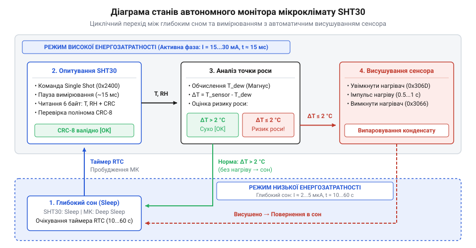
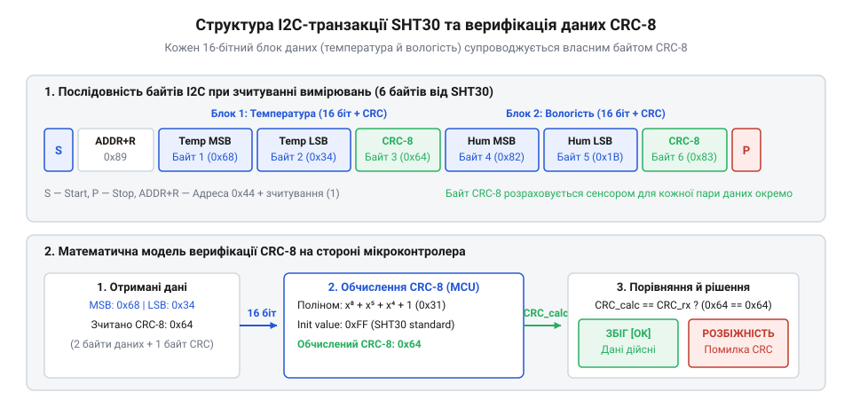

# Автономний монітор мікроклімату з контролем роси на базі SHT30

<preknowlist>
- [Формула Магнуса-Тетенса для водяної пари](root:cat-hw-sensors/magnus-formula) — принципи математичного зв'язку між температурою, відносною вологістю та температурою точки роси.
</preknowlist>

## Загроза роси та виклики автономності

Давачі вологості вимірюють параметри середовища, але їхня робота стає нестабільною, коли умови наближаються до точки утворення конденсату. Якщо температура сенсора опускається нижче точки роси, на його чутливому елементі випадає мікроскопічна плівка води. Це призводить до різкого спотворення результатів вимірювання — давач починає показувати 100% вологості навіть тоді, коли реальна вологість у приміщенні вже знизилася. Більше того, тривале перебування у стані конденсації прискорює деградацію полімерного шару сенсора та скорочує термін його служби. 

Щоб запобігти цьому, монітор мікроклімату має діяти на випередження: обчислювати точку роси і, якщо є ризик конденсації, примусово висушувати кристал за допомогою вбудованого мікронагрівача. Проте активне висушування та безперервне опитування давача потребують значних витрат енергії, що є критичним для пристроїв із живленням від батарей. Якщо мікроконтролер та сенсор працюватимуть постійно, елемент живлення розрядиться за кілька днів. Тому архітектура автономного пристрою будується навколо жорсткої економії: система більшу частину часу проводить у глибокому сні, короткочасно прокидається для вимірювання, перевіряє загрозу роси, і знову засинає.



Такий підхід забезпечує тривалу роботу, але вимагає узгодженого переведення як мікроконтролера, так і самого давача SHT30 у режим найнижчого енергоспоживання між циклами вимірювань. Під час активного зчитування сенсор споживає близько 800 мкА, а увімкнений мікронагрівач — одиниці міліампер, тому система не може залишатися активною довго. Щоб запобігти розряду батареї, мікроконтролер після завершення опитування вимикає власну периферію та засинає сам до наступного пробудження за апаратним таймером, оскільки давач автоматично переходить у стан очікування (@@en|Idle State@@), зменшуючи свій струм до 0.2 мкА.

## Обмін з SHT30 та валідація CRC-8

Взаємодія мікроконтролера з SHT30 відбувається через послідовну шину @@en|I2C@@. Давач підтримує два основних режими вимірювання: поодинокий (@@en|Single Shot@@) та періодичний (@@en|Periodic Mode@@). В автономних моніторах зазвичай використовують поодинокий режим, оскільки він дозволяє мікроконтролеру повністю керувати процесом: подати команду на вимірювання, дочекатися результату, зчитати його і негайно перевести сенсор у сон.

Для виконання поодинокого вимірювання мікроконтролер надсилає 16-бітну команду, яка визначає рівень повторюваності (@@en|Repeatability@@) — високий, середній або низький. Вищий рівень забезпечує більшу точність і стабільність показань, але вимагає більше часу на перетворення (до 15 мс) і, відповідно, споживає більше струму. Для більшості кліматичних задач високий рівень повторюваності є оптимальним балансом. Після завершення перетворення SHT30 повертає 6 байтів даних: два байти температури, байт контрольної суми, два байти вологості та ще один байт контрольної суми.



Контрольна сума CRC-8 є критично важливою для автономних пристроїв. Оскільки довгі лінії зв'язку або електромагнітні завади можуть спотворити дані на шині I2C, мікроконтролер повинен валідувати кожен зчитаний пакет. Якщо обчислена контрольна сума не збігається з переданою сенсором, пакет відкидається як пошкоджений. Це захищає систему від хибних спрацьовувань нагрівача чи запису некоректних даних у пам'ять.

:::tabs
```c|c
:::code proj-sht30-climate-monitor/c/include/i2c_bus.h
:::code proj-sht30-climate-monitor/c/include/sht30.h
:::code proj-sht30-climate-monitor/c/src/sht30.c
:::code proj-sht30-climate-monitor/c/src/main.c
```
```cpp|cpp
:::code proj-sht30-climate-monitor/cpp/CMakeLists.txt
:::code proj-sht30-climate-monitor/cpp/include/climate_monitor.hpp
:::code proj-sht30-climate-monitor/cpp/include/i2c_bus.hpp
:::code proj-sht30-climate-monitor/cpp/include/sht30.hpp
:::code proj-sht30-climate-monitor/cpp/src/climate_monitor.cpp
:::code proj-sht30-climate-monitor/cpp/src/main.cpp
:::code proj-sht30-climate-monitor/cpp/src/sht30.cpp
```
:::

## Розрахунок точки роси та прогнозування

Зчитані та перевірені значення температури й відносної вологості є основою для виявлення загрози конденсації. Точка роси — це температура, за якої водяна пара в повітрі стає насиченою і починає перетворюватися на рідину. Якщо температура сенсора впаде до цього значення, на ньому утвориться роса.

Для розрахунку точки роси в мікроконтролерах найчастіше застосовують [формулу Магнуса-Тетенса](root:cat-hw-sensors/magnus-formula). Вона дозволяє з достатньою точністю обчислити температуру конденсації, використовуючи лише поточну температуру повітря та його відносну вологість. Алгоритм спочатку обчислює проміжний параметр, що залежить від логарифма вологості та температури, а потім перетворює його на кінцеве значення точки роси. Запобігання логарифмуванню нуля досягається апаратним обмеженням мінімальної вологості в розрахунках.

Маючи значення точки роси, система оцінює безпечний температурний запас — різницю між поточною температурою середовища та точкою конденсації. Якщо цей запас стає критично малим (наприклад, менше 2 °C) або відносна вологість перевищує заданий поріг (наприклад, 85%), мікроконтролер активує нагрівач SHT30. Нагрівач підвищує температуру кристала на кілька градусів вище за температуру навколишнього повітря, локально знижуючи відносну вологість навколо сенсора і випаровуючи мікроплівку води, тим самим зберігаючи достовірність вимірювань і подовжуючи життя давача.

## Керування вбудованим нагрівачем давача

Цифровий давач SHT30 має вбудований мікронагрівач, який підвищує температуру чутливого елемента на кілька градусів вище температури навколишнього середовища. Коли відносна вологість сягає критичних значень або температура наближається до точки роси, на поверхні сенсора може утворитися конденсат. Краплі вологи спотворюють вимірювання та призводять до хибних показників, що можуть залишатися такими тривалий час після зниження вологості. Активація нагрівача швидко випаровує цю воду та відновлює точність приладу.

Процес керування зводиться до надсилання давачу відповідної 16-бітної команди через I2C: для увімкнення нагрівача надсилається `0x306D`, а для вимкнення — `0x3066`. Оскільки нагрівач суттєво підвищує енергоспоживання та спотворює показники навколишньої температури, його не можна тримати увімкненим постійно. Процедура сушки має бути строго лімітованою в часі.

Реалізація цієї логіки виглядає як послідовність дій: увімкнути нагрівач, вичекати заданий час (наприклад, одну-дві секунди) і вимкнути його. Після завершення сушки варто виконати програмне скидання давача (`Soft Reset`), щоб гарантовано стабілізувати внутрішні кола сенсора перед наступними вимірюваннями.

:::tabs
```c|esp-idf
:::code proj-sht30-climate-monitor/c/src/sht30.c 197-218
```
```cpp|arduino
:::code proj-sht30-climate-monitor/cpp/src/climate_monitor.cpp 45-60
```
:::

У наведених прикладах видно інкапсуляцію низькорівневих I2C-команд в інтерфейс драйвера. Для C-реалізації функція `sht30_set_heater` безпосередньо відправляє команди увімкнення та вимкнення. У C++ модулі високорівнева функція `perform_decondensation_cycle` керує повним циклом сушки, включаючи синхронну затримку та фінальне програмне скидання. 

## Оптимізація живлення та автономний цикл

Автономні монітори мікроклімату найчастіше працюють від батарей і змушені жорстко економити енергетичний ресурс. Якщо давач постійно вимірюватиме температуру та вологість, батарея виснажиться дуже швидко. Рішення полягає у використанні циклічного алгоритму роботи, що чергує коротку фазу активності з тривалою фазою глибокого сну.

У SHTC3 передбачено спеціальний режим сну, у який його можна перевести командою `0xB098`. Після її отримання сенсор відключає вимірювальні кола і споживає струм у межах мікроамперів. Пробудження відбувається автоматично під час наступної I2C-транзакції або програмного скидання. Алгоритм енергоефективного моніторингу будується навколо одиничних вимірювань (Single Shot). Мікроконтролер прокидається, ініціює разовий замір, зчитує дані, перевіряє їх цілісність, розраховує точку роси та, за відсутності загрози конденсації, миттєво відправляє давач і себе назад у сон.

Якщо ж виявлено ризик конденсації (наприклад, відносна вологість перевищує 85%), замість сну мікроконтролер запускає вже знайомий алгоритм сушки мікронагрівачем. Після успішного випаровування вологи вся система знову переходить до сплячого режиму до наступного циклу.

:::tabs
```c|esp-idf
:::code proj-sht30-climate-monitor/c/src/main.c 134-162
```
```cpp|arduino
:::code proj-sht30-climate-monitor/cpp/src/main.cpp 31-64
```
:::

У наведеному циклі виконання час активної роботи мінімізовано. Окремо варто звернути увагу на перевірку цілісності пакета даних перед будь-якими реакціями. Якщо контрольні суми збігаються, мікроконтролер аналізує фізичні величини. Відправка пристрою в сон, що демонструється в кінці C++ прикладу за допомогою виклику `monitor.enter_sleep_mode()`, є останнім і необхідним кроком для заощадження заряду батареї.