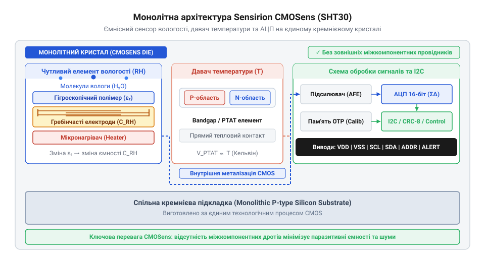
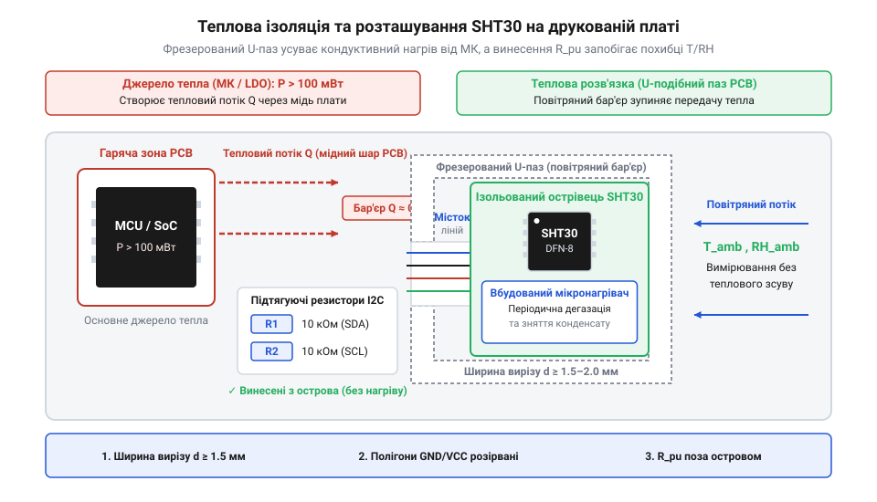
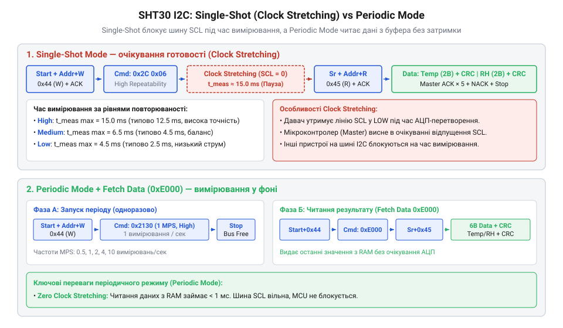
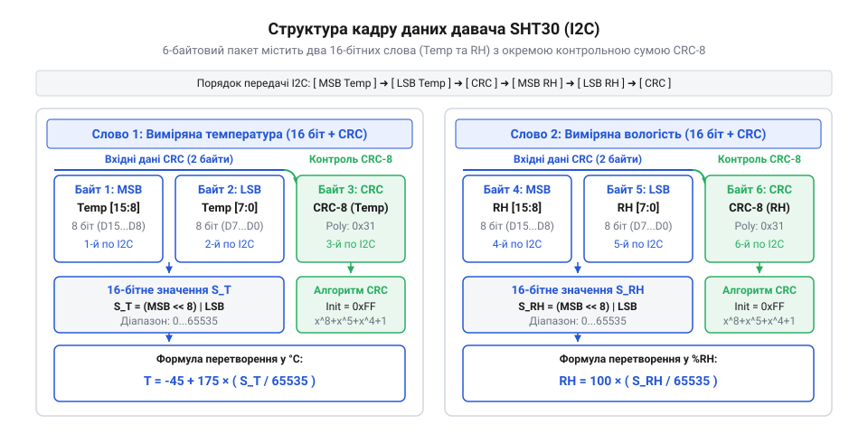

# SHT30 — температура й вологість (I2C)

<preknowlist>
- [DHT11](root:cat-hw-sensors/dht11) — Принципи ємнісного вимірювання вологості та фізичні обмеження дискретних сенсорів.
- [GY-21 (Si7021/HTU21D)](root:cat-hw-sensors/gy-21) — Концепції I2C-інтерфейсу в кліматичних сенсорах та обробку 16-бітних кодових значень АЦП.
- [Формула Магнуса-Тетенса для водяної пари](root:cat-hw-sensors/magnus-formula) — Залежність тиску насиченої пари від температури та фізичний сенс точки роси.
</preknowlist>

## Проблема дрейфу при вимірюванні вологості

Спроба виміряти вологість повітря за допомогою двох окремих датчиків завжди призводить до систематичної помилки, яка з часом лише зростає. Справа у фізичній природі атмосферної вологи: показник відносної вологості не існує сам по собі як абсолютна величина, а жорстко прив'язаний до термодинамічного стану середовища. Коли повітря охолоджується чи нагрівається хоча б на частку градуса, його здатність утримувати водяну пару змінюється експоненціально. Якщо чутливий елемент вологості та датчик температури знаходяться у різних точках простору або мають різну температуру поверхні, виміряне значення вологості втрачає фізичний сенс.

Фізична величина відносної вологості `RH` описує відношення поточного парціального тиску водяної пари `p_w` до максимально можливого тиску насиченої пари `p_s` за даної температури `T`. Співвідношення цих величин задається базовим рівнянням:

    RH = (p_w / p_s(T)) × 100%
    = (p_w / p_s(T)) · 100%                 [вираження відносної вологості у відсотках]

У цьому виразі `RH` — відносна вологість у відсотках, `p_w` — парціальний тиск водяної пари у паскалях, а `p_s(T)` — тиск насиченої пари у паскалях при температурі `T`. Головна складність полягає в тому, що тиск насиченої пари `p_s(T)` є сильно нелінійною функцією від температури. Залежність тиску насичення від температури описує [формула Магнуса-Тетенса](root:cat-hw-sensors/magnus-formula), з якої випливає, що при кімнатній температурі близько 20 °C підвищення температури всього на 1 °C збільшує тиск насичення `p_s` приблизно на 6.5%.

Розглянемо практичний приклад термодинамічної помилки, яка виникає при найменшому температурному градієнті між навколишнім середовищем та чутливим елементом. Припустимо, що реальна температура навколишнього повітря становить 20.0 °C, а реальна відносна вологість у приміщенні — 50.0%. Якщо первинний вимірювальний елемент вологості нагріється від власного вимірювального струму чи сусідніх компонентів плати всього на 0.5 °C (до 20.5 °C), обчислення локальної вологості на його поверхні кардинально зміниться.

Розрахуємо локальну вологість біля поверхні нагрітого елемента покроково:

    p_s(20.0) = 2338.1 Pa                    [тиск насиченої пари при 20.0 °C]
    p_w = 0.50 × 2338.1 Pa                   [абсолютний тиск пари при 50% RH]
        = 1169.05 Pa                         [парціальний тиск водяної пари]
    p_s(20.5) = 2409.8 Pa                    [тиск насиченої пари при 20.5 °C]
    RH_local = (1169.05 Pa / 2409.8 Pa) × 100% [локальна відносна вологість на поверхні]
             = 48.51%                        [хибний показник сенсора]

Отриманий результат показує систематичне заниження вологості на 1.49% `RH` лише через температурну різницю в 0.5 °C. Якщо ж температурний градієнт досягає 1.5–2.0 °C, що є типовим явищем для компактних друкованих плат із щільним монтажем та вбудованими процесорами, викривлення показників вологості перевищує 5–8% `RH`. При високій відносній вологості (понад 85% `RH`) зворотний ефект — локальне охолодження поверхні сенсора навіть на 0.3 °C нижче температури повітря — призводить до випадання мікрокрапель конденсату роси безпосередньо на чутливий полімер, хоча зовнішній термодатчик продовжує реєструвати безпечне сухе середовище.

Причиною таких спотворень є теплова поведінка пристінного прикордонного шару повітря. Молекули водяної пари дифундують крізь тонкий шар повітря безпосередньо біля поверхні сенсора. Якщо ця поверхня має іншу температуру, ніж об'єм повітря, у прикордонному шарі виникає локальне теплове поле з власною густиною насиченої пари. В результаті чутливий шар вимірює вологість не приміщення, а свого власного прикордонного шару.

Історично в кліматичних системах застосовували дискретні рішення, де поруч на друкованій платі розпаювали [аналоговий термістор KY-013](root:cat-hw-sensors/ky-013-thermistor) або окремий [цифровий датчик DS18B20](root:cat-hw-sensors/ds18b20) разом із дискретним ємнісним датчиком вологості. Навіть у популярних модулях типу [дискретний давач DHT11](root:cat-hw-sensors/dht11) чутливий полімер та терморезистор рознесені в просторі на кілька міліметрів всередині спільного пластмасового корпусу. Така дискретна конфігурація неминуче створює три основні фізичні проблеми:

Перша проблема — це просторовий тепловий градієнт та кондуктивне нагрівання через друковану плату. Мідні доріжки та шари живлення плати мають високу теплопровідність і діють як теплові мости. Тепло від мікроконтролера, стабілізаторів живлення чи світлодіодів передається через ніжки деталей нестаціонарним чином. Термодатчик вимірює температуру в одній точці плати, а полімерний конденсатор перебуває в іншому локальному тепловому полі.

Друга проблема — асинхронна динамічна теплова інерція. Фізична маса корпусу, виводів та кремнію дискретного термодатчика суттєво відрізняється від маси й геометричних розмірів тонкоплівкового ємнісного елемента вологості. При швидкій зміні температури середовища термодатчик має власну часову константу нагріву `τ_T`, а сенсор вологості — часову константу `τ_RH`. Під час перехідних процесів ця розбіжність викликає динамічний спайк помилки, коли розрахована вологість тимчасово відхиляється на 10–15% `RH`.

Третя проблема — некоректна температурна компенсація діелектрика та хибний дрейф. Фізичний механізм вимірювання вологості базується на молекулярній адсорбції води полімерним діелектриком (детально описують [фізичні принципи ємнісного вимірювання](root:hw-sensing/capacitive-humidity-sensor) вологості). Діелектрична проникність самого полімеру та його пружні механічні напруження зміщуються залежно від температури. Якщо математичний алгоритм компенсації використовує значення температури, зчитане з віддаленого датчика типу [модуля GY-21](root:cat-hw-sensors/gy-21), математична корекція діє з систематичною помилкою. Користувач сприймає це спотворення як незворотну деградацію або дрейф нуля сенсора.

Особливо гостро проблема дрейфу проявляється в закритих корпусах пристроїв із низькою швидкістю циркуляції повітря. За відсутності вимушеного обдуву навколо датчика формується застійна зона. У такій зоні будь-яке мінімальне тепловиділення від внутрішніх компонентів приладу викликає стійкий локальний перегрів на 2–5 °C. Якщо термодатчик винесено за межі корпусу, а сенсор вологості залишено всередині, обчислена вологість буде занижена на 15–25% `RH`. Навіть при спробах програмного виправлення застійні умови унеможливлюють точний розрахунок точки роси.

Для повного усунення просторових і часових температурних градієнтів чутливий елемент вологості та датчик температури повинні бути фізично об'єднані в єдиному кремнієвому мікрооб'ємі, маючи спільну теплоємність та миттєвий тепловий контакт.

## Монолітна архітектура чутливості технології CMOSens

Щоб повністю ліквідувати термодинамічні градієнти та часовий лаг між вимірюванням температури й вологості, компанія `@@en|Sensirion@@` розробила монолітну технологію `@@en|CMOSens@@` (від англ. *CMOS*, *Complementary Metal-Oxide-Semiconductor* — комплементарна структура метал-оксид-напівпровідник, та *sensor* — давач). Фізична концепція цієї технології полягає в інтеграції мікроелектромеханічних чутливих елементів (MEMS), аналогових підсилювачів, високоточних АЦП та цифрової логіки на єдиній монокристалічній кремнієвій підкладці за допомогою стандартного промислового `@@en|CMOS@@`-процесу. Як свідчить [історія еволюції CMOSens](root:cat-hw-sensors/sht30/hist-sensirion-cmosens-evolution.md), перехід від двокристальних модулів перших поколінь до монолітного чипа `@@en|SHT30@@` дозволив кардинально зменшити фізичні габарити, теплоємність та енергоспоживання пристрою. Усі компоненти розміщені всередині відкритого плаского корпусу `@@en|DFN-8@@` (від англ. *Dual Flat No-leads* — двосторонній плаский корпус без виводів) розміром 2.5 × 2.5 × 0.9 мм, що започаткувало новий етап у розвитку [родини датчиків Sensirion SHT](root:cat-hw-sensors/sensirion-sht-family-overview).

На єдиному кремнієвому кристалі `@@en|die@@` (від англ. *die* — кристалик кремнію) чипа `@@en|SHT30@@` реалізовано монолітну архітектуру, де чутливі елементи розміщені на відстані кількох мікронів один від одного:

Верхній шар напівпровідникового кристала займає ємнісний сенсор відносної вологості. Він сформований із зустрічно-штирьових мікроелектродів (гребінчастої топології), виготовлених у верхніх металевих шарах кремнієвої структури. Поверх електродів нанесено спеціально підібраний тонкоплівковий шар гігроскопічного полімеру. Молекули водяної пари з навколишнього повітря вільно дифундують у об'єм полімерної матриці. Оскільки відносна діелектрична проникність чистої води становить близько 80 (при 20 °C), тоді як діелектрична проникність сухого полімеру дорівнює лише 3–4, адсорбція молекул води викликає різке зростання результуючої діелектричної проникності `ε_r` плівки. Це спричиняє пропорційну зміну електричної ємності `C_sensor` між зустрічними мікроелектродами.

Безпосередньо під електродами полімерного конденсатора, у тому самому мікрооб'ємі кремнію, сформовано напівпровідниковий давач температури. Його виконано за топологією опорного джерела напруги `@@en|bandgap@@` (від англ. *bandgap* — ширина забороненої зони напівпровідника) на основі сполученої пари p-n переходів біполярних транзисторів, що працюють у режимі `@@en|PTAT@@` (від англ. *Proportional To Absolute Temperature* — пропорційний абсолютній температурі). Різниця напруг на емітерних переходах цих транзисторів прямо пропорційна абсолютній температурі кремнієвої ґратки. Оскільки монокристалічний кремній має високий коефіцієнт теплопровідності (`k ≈ 149 W/(m·K)` при 300 K), будь-який тепловий імпульс миттєво вирівнює температуру між полімерною плівкою вологості та напівпровідниковим термодатчиком. В результаті температурний градієнт між двома сенсорами на кристалі `@@en|SHT30@@` практично дорівнює нулю навіть при швидких зовнішніх змінах середовища.


*Архітектура технології CMOSens у датчику SHT30, яка забезпечує спільне розгублювання тепла та синхронне зчитування сигналів вологості й температури.*

Для захисту вимірювальної зони від самонагріву внутрішньої цифрової логіки чипа та теплового випромінювання плати в кристалі застосовано мікромеханічне селективне травлення (MEMS-технологію). Під чутливою зоною створено ізолюючу каверну з повітряним прошарком або мікромісток з низькою теплопровідністю. Цей мікромісток термічно ізолює чутливу зону від блоку аналогово-цифрового перетворення, цифрового процесора та шинного трансивера `@@en|I2C@@` (від англ. *Inter-Integrated Circuit* — міжмікросхемний зв'язок).

Оскільки чутливий полімерний шар повинен мати безпосередній контакт із навколишнім повітрям для дифузії водяної пари, відкрита зона кристала піддається ризику забруднення пилом, маслом чи хімічними конденсатами. Для захисту чутливих аналогових і цифрових схем решту поверхні кристала покривають щільним пасиваційним шаром із нітриду кремнію (`Si3N4`). Для особливо жорстких умов експлуатації поверх пасиваційного шару та відкритих електродів монтують мікропористу `@@en|PTFE@@`-мембрану (від англ. *PTFE*, *Polytetrafluoroethylene* — політетрафторетилен), яка вільно пропускає газоподібні молекули водяної пари, але надійно затримує краплі рідкої води, бруд та частинки аерозолів.

Сигнал з ємнісного полімерного сенсора має малу амплітуду: зміна ємності становить лише частки фемтофарад (`fF`) на один відсоток відносної вологості. У зовнішніх дискретних схемах наведення та паразитна ємність з'єднувальних провідників (яка становить 5–15 пФ) повністю затоплюють корисний сигнал. У чипі `@@en|SHT30@@` мікроелектроди підключені безпосередньо до входу малошумного дельта-сигма перетворювача ємності в цифровий код (`@@en|delta-sigma ADC@@`), розміщеного на відстані кількох десятків мікронів на тому ж кристалі. Це повністю усуває паразитні ємності та забезпечує високу завадостійкість. Паралельно другий канал АЦП з високою точністю підцифровує напругу `V_PTAT` із температурного сенсора.

Кожен примірник датчика `@@en|SHT30@@` проходить індивідуальне калібрування на заводі-виробникові в автоматизованих кліматичних камерах компанії `@@en|Sensirion@@`. Під час калібрування зчитуються первинні коди АЦП при строго контрольованих еталонних температурах і вологості. Розраховані поліноміальні коефіцієнти корекції записуються в апаратну енергонезалежну пам'ять `@@en|OTP@@` (від англ. *One-Time Programmable* — одноразово програмований), виготовлену безпосередньо на кристалі.

Під час виконання вимірювання внутрішній цифровий процесор (DSP) чипа зчитує первинні 16-бітні коди АЦП, витягує з пам'яті `@@en|OTP@@` індивідуальні коефіціенти та здійснює апаратну температурну компенсацію вологості в реальному часі. На вихідний цифровий шинний інтерфейс видаються вже сформовані й відкалібровані 16-бітні кодові слова вологості та температури. Перетворення цих сирих кодових слів у фізичні значення °C та % `RH`, а також математичний алгоритм контролю цілісності кадру висвітлюють [математичні формули перетворення](root:cat-hw-sensors/sht30/math-sht30-conversion-and-crc.md) та контрольна сума CRC-8. Фізичні вимоги до розводки друкованої плати, вибору підтягуючих резисторів та термічної ізоляції корпусу деталізовані у довіднику про [залізний інтерфейс SHT30](root:cat-hw-sensors/sht30/api-sht30-hardware.md).

## Режими вимірювання та шина I2C

Оцифровані показники температури й вологості, сформовані внутрішнім дельта-сигма АЦП чипа SHT30, необхідно передавати зовнішньому мікроконтролеру без втрати точності та без зайвого теплового випромінювання. Для розв'язання цієї задачі Sensirion застосовує двопровідний послідовний інтерфейс @@en|I2C@@ (від англ. @@en|Inter-Integrated Circuit@@, з латини *inter* — між, *integrare* — робити цілим, *circuitus* — обхід). Історично перші покоління сенсорів компанії використовували власні нестандартні протоколи обміну, проте [еволюція сімейства сенсорів Sensirion](root:cat-hw-sensors/sht30/hist-sensirion-cmosens-evolution.md) привела до впровадження стандартизованої шини @@en|I2C@@ у серії SHT3x, що спростило паралельне підключення кількох пристроїв.

На апаратному рівні давач SHT30 підключається до шини за допомогою двох сигнальних ліній: послідовних даних SDA та тактування SCL. Оскільки виходи шини @@en|I2C@@ виконані за схемою з відкритим стоком, обидві лінії потребують підтягувальних резисторів (@@en|Pull-up@@, підтягувальний резистор), підключених до шини живлення VDD. Типовий номінал підтяжки становить 4.7 кОм для стандартного (100 кГц) та швидкого (400 кГц) режимів роботи. Для вибору фізичної адреси на шині чип містить вивід `ADDR`. Якщо вивід `ADDR` з'єднано з землею GND (логічний нуль), давач займає 7-бітну адресу `0x44`. Якщо ж `ADDR` підключено до живлення VDD (логічна одиниця), адреса змінюється на `0x45`. Це дає змогу безпосередньо розміщувати два незалежні давачі SHT30 на одній фізичній шині @@en|I2C@@.

Найкритичнішою апаратною пасткою при монтуванні сенсора клімату є паразитна передача тепла від друкованої плати. Кристал SHT30 розміщено у компактному корпусі @@en|DFN-8@@ (від англ. @@en|Dual Flat No-leads@@ — подвійний плоский корпус без виводів). Мідні доріжки друкованої плати мають високу теплопровідність, тому тепло від мікроконтролера чи силових ключів швидко досягає сенсора. Як доведено у попередніх розділах, підвищення температури підкладки лише на 1 °C спричиняє систематичне заниження виміряної відносної вологості приблизно на 6 % RH. Для усунення цього ефекту виконують апаратну термічну ізоляцію: навколо майданчика DFN-8 у друкованій платі фрезерують U-подібний або замкнений ізоляційний проріз, залишаючи сенсорний острів зв'язаним із основною платою лише тонкими містками з сигнальними доріжками. Додатково [довідник апаратного підключення](root:cat-hw-sensors/sht30/api-sht30-hardware.md) рекомендує виносити підтягувальні резистори за межі сенсорного острова та розміщувати безпосередньо біля виводів VDD/GND блокувальний керамічний конденсатор ємністю 100 нФ для пригнічення високочастотних завад живлення.


*Топологія друкованої плати з тепловим вирізом запобігає передачі тепла від навколишніх компонентів до давача SHT30, зберігаючи точність вимірювання температури й вологості.*

Залежно від вимог до енергоспоживання та часового відгуку системи, SHT30 підтримує два концептуально різні режими вимірювання: режим одноразового зчитування та режим періодичного опитування.

У режимі одноразового зчитування (@@en|Single Shot Mode@@) давач більшу частину часу перебуває у стані глибокого сну з мікроамперним споживанням (менше 1 мкА). Мікроконтролер надсилає по шині @@en|I2C@@ 16-бітну команду на запуск вимірювання. Чип прокидається, активує дельта-сигма АЦП, виконує один цикл інтегрування сигналів ємнісного полімеру й напівпровідникового давача температури, записує результат у внутрішній буфер і знову повертається в режим сну. Цей режим є ідеальним для автономних моніторів з батарейним живленням, де опитування відбувається рідко (наприклад, раз на хвилину), оскільки зводить самонагрів кристала до нуля.

У режимі періодичного опитування (@@en|Periodic Mode@@) давач самостійно із заданою апаратною частотою виконує вимірювання та оновлює дані у своїх внутрішніх регістрах. Користувач може обрати частоту 0.5, 1, 2, 4 або 10 вимірювань на секунду (@@en|mps@@, від англ. @@en|measurements per second@@). Мікроконтролеру більше не потрібно щоразу надсилати команду запуску: він просто зчитує вже готові значення з регістрів даних у довільний момент часу. Режим також підтримує функцію прискореного часу відгуку (@@en|ART@@, від англ. @@en|Accelerated Response Time@@), яка оптимізує внутрішню фільтрацію для швидкого виявлення динамічних стрибків вологості. [Карта команд і регістрів](root:cat-hw-sensors/sht30/api-sht30-protocol.md) описує повний перелік двійкових кодів для налаштування частоти опитування.

Під час роботи в режимі @@en|Single Shot Mode@@ постає питання узгодження часу виконання конверсії АЦП із прочитанням даних по шині. SHT30 надає два варіанти поведінки:

1. З розширенням тактування (@@en|Clock Stretching@@, від англ. *clock* — тактовий сигнал, *stretch* — розтягувати): після отримання команди вимірювання давач примусово утримує лінію SCL у низькому стані (LOW) протягом усього часу роботи АЦП. Апаратний модуль @@en|I2C@@ мікроконтролера автоматично зупиняє генерацію тактових імпульсів і чекає, поки SHT30 відпустить лінію SCL після завершення перетворення. Якщо мікроконтролер підтримує [механізм розширення тактування шини](root:com-devices/i2c-clock-stretching-hardware), це гарантує негайне отримання даних одразу після готовності АЦП. Проте на деяких мікроконтролерах із помилками в апаратній реалізації @@en|I2C@@ тривале утримання SCL може призвести до зависання периферийного блоку. 2. Без розширення тактування (Non-Clock Stretching): давач не утримує лінію SCL, а одразу відповідає підтвердженням команди. Якщо мікроконтролер спробує зчитати дані до закінчення конверсії, SHT30 поверне сигнал негативного підтвердження (@@en|NACK@@, від англ. @@en|Negative Acknowledgment@@). У цьому разі мікроконтролер повинен самостійно витримати часову затримку або опитувати сенсор у циклі до отримання позитивного підтвердження (@@en|ACK@@, від англ. @@en|Acknowledgment@@).

Паралельно з вибором режиму вимірювання розробник обирає рівень повторюваності (@@en|Repeatability@@, від англ. *repeat* — повторювати): високий (High), середній (Medium) або низький (Low). Повторюваність визначає тривалість вибірки АЦП і статистичний розкид (середньоквадратичний шум) вихідних даних. При високій повторюваності АЦП працює близько 15 мс, досягаючи найвищої точності (шум вологості 0.08 % RH, температури 0.04 °C), проте середній струм споживання під час вимірювання сягає 800 мкА. При низькій повторюваності час перетворення скорочується до 2.5 мс, що зменшує енергоспоживання у 6 разів за незначного зростання шуму (до 0.15 % RH).

Для відновлення роботоздатності в умовах конденсації чип містить вбудований мікронагрівач (@@en|Micro-heater@@, від англ. *micro* — малий, *heater* — нагрівач). При відносній вологості 100 % на полімерній плівці ємнісного елемента випадає рідка роса, яка блокує подальші зміни ємності навіть після зниження вологості повітря. Включення мікронагрівача командою `0x306D` підводить до кристала теплову потужність близько 50 мВт. Підвищення температури підкладки на кілька градусів вище точки роси прискорює випаровування вологи з поверхні полімеру, повертаючи сенсор до нормального вимірювального стану за кілька секунд. Також нагрівач застосовують для самодіагностики: якщо після його включення сенсор реєструє стрибок температури, це підтверджує фізичну цілісність кристала та АЦП. Важливо пам'ятати: під час роботи нагрівача виміряна температура відображає нагрітий кристал, а не довкілля, тому перед звичайним моніторингом нагрівач вимикають командою `0x3066` і дають чипу охолонути.


*Трасограми сигналів шини I2C ілюструють утримання лінії SCL при розширенні тактування у режимі Single Shot та вільний доступ до регістрів даних у режимі Periodic Mode.*

## Обчислення показників та валідація CRC-8

Після виконання вимірювання за командою мікроконтролера давач SHT30 повертає по шині @@en|I2C@@ кадр даних, який складається чітко з 6 байтів. Перші два байти містять 16-бітний цифровий код температури, третій байт — байт контрольної суми для температури. Четвертий і п'ятий байти містять 16-бітний цифровий код відносної вологості, а шостий байт — контрольне значення CRC-8 для вологості.

Двобайтові коди передаються старшим байтом уперед (@@en|MSB@@, від англ. @@en|Most Significant Byte@@ — старший байт), за яким іде молодший байт (@@en|LSB@@, від англ. @@en|Least Significant Byte@@ — молодший байт). Для відновлення цілісного 16-бітного беззнакового числа виконують побітовий зсув: значення старшого байта зсувають на 8 біт ліворуч і об'єднують побітовим «АБО» з молодшим байтом.


*Формат відповіді SHT30 містить два 16-бітних цифрових коди АЦП, кожен з яких супроводжується власним байтом CRC-8 для надійної перевірки цілісності.*

Отримані 16-бітні коди є прямо пропорційними вихідним електричним сигналам чутливих елементів. Щоб перевести ці числові значення у фізичні величини, Sensirion заклала у специфікацію математичні формули лінійного масштабування. Повний розрахунковий апарат детально описує [довідник перетворення коду АЦП](root:cat-hw-sensors/sht30/math-sht30-conversion-and-crc.md).

Для обчислення температури T у градусах Цельсія використовують повну діапазонну шкалу від -45 °C до +130 °C (загальний розмах становить 175 °C). Зміщення нульової точки становить -45 °C, а кодове значення 16-бітного регістра змінюється від 0 до 65535 (що відповідає 2¹⁶ - 1). Формула розрахунку має такий вигляд:

```
T [°C] = -45 + 175 · (S_T / (2¹⁶ - 1))
       = -45 + 175 · (S_T / 65535)      [лінійна шкала АЦП від -45 °C до +130 °C]
```

де T — обчислена фізична температура в °C, S_T — 16-бітний беззнаковий код АЦП температури, отриманий із кадру даних, 175 — повна ширина температурного діапазону в °C, -45 — початкова точка вимірювальної шкали.

Для відносної вологості RH у відсотках шкала АЦП охоплює діапазон від 0 % до 100 % RH. Двійковий код 0 відповідає 0 % RH, а максимальне значення 65535 відповідає 100 % RH. Розрахункова формула записується так:

```
RH [%] = 100 · (S_RH / (2¹⁶ - 1))
       = 100 · (S_RH / 65535)           [лінійна шкала АЦП від 0 % до 100 %]
```

де RH — обчислена відносна вологість у %, S_RH — 16-бітний беззнаковий код АЦП вологості.

Отримані значення температури та вологості дозволяють не лише оцінювати поточний мікроклімат, а й вираховувати критичні точні параметри: наприклад, [формула тиску водяної пари](root:cat-hw-sensors/magnus-formula) дає змогу вирахувати точку роси для запобігання конденсації. Подібний обчислювальний алгоритм використовує [проєкт автономного монітора мікроклімату](root:cat-hw-sensors/sht30/proj-sht30-climate-monitor.md).

Розглянемо практичний приклад покрокового обчислення показників.

**Умова прикладу:** з давача SHT30 по шині @@en|I2C@@ зчитано послідовність із 6 байтів у шістнадцятковому форматі: `[0x66, 0x66, 0xA2, 0x80, 0x00, 0xA2]`.

1. Формуємо 16-бітний код температури S_T:
   MSB_T = 0x66 (102 у десятковій системі), LSB_T = 0x66 (102 у десятковій системі). S_T = (0x66 << 8) | 0x66 = 0x6666 = 26214 у десятковій системі.

2. Підставляємо значення S_T у формулу температури:

```
T = -45 + 175 · (26214 / 65535)
  = -45 + 175 · 0.40000305            [ділення коду АЦП на повну шкалу]
  = -45 + 70.00053                    [масштабування на 175 °C]
  = +25.0 °C                          [підсумкова температура]
```

3. Формуємо 16-бітний код вологості S_RH:
   MSB_RH = 0x80 (128 у десятковій системі), LSB_RH = 0x00 (0 у десятковій системі). S_RH = (0x80 << 8) | 0x00 = 0x8000 = 32768 у десятковій системі.

4. Підставляємо значення S_RH у формулу вологості:

```
RH = 100 · (32768 / 65535)
   = 100 · 0.5000076                  [ділення коду АЦП на повну шкалу]
   = 50.0 %                           [підсумкова відносна вологість]
```

Таким чином, зчитаний кадр відповідає температурі +25.0 °C та відносній вологості 50.0 %.

Проте перш ніж використовувати обчислені значення в керуючих алгоритмах, необхідно перевірити їхню цілісність. У промислових умовах довгі лінії шини @@en|I2C@@ або імпульсні завади від електродвигунів можуть спотворити окремі біти під час передачі. Для запобігання помилкам Sensirion супроводжує кожне 16-бітне слово окремим байтом контрольної суми @@en|CRC-8@@ (від англ. @@en|Cyclic Redundancy Check@@ — циклічний надлишковий контроль).

Алгоритм @@en|CRC-8@@ базується на діленні двійкового многочлена на заздалегідь визначений твірний поліном (@@en|Polynomial@@). На відміну від простої арифметичної суми байтів, @@en|CRC-8@@ гарантовано виявляє будь-які поодинокі спотворення бітів, подвійні помилки та групові пачки завад довжиною до 8 біт.

Специфікація Sensirion для SHT30 задає такі параметри контрольної суми:
- Твірний поліном (@@en|Polynomial@@): x⁸ + x⁵ + x⁴ + 1 (двійкове `0b00110001`, шістнадцяткове `0x31`). - Початкове значення регістра (@@en|Initialization@@): `0xFF`. - Фінальне операційне «виключне АБО» (XOR Mask): `0x00`.

Процес обчислення проходить покроково для кожного з двох байтів даних:
1. Внутрішній 8-бітний регістр CRC ініціалізується значенням `0xFF`. 2. Виконується операція «виключне АБО» (XOR) між поточним значенням регістра CRC та першим байтом даних (MSB). 3. Регістр обробляється побітово 8 разів: якщо старший біт регістра (MSB, `0x80`) дорівнює 1, регістр зсувається ліворуч на 1 біт і виконується XOR з поліномом `0x31`. Якщо старший біт дорівнює 0, регістр просто зсувається ліворуч на 1 біт. 4. Крок 2 та крок 3 повторюються для другого байта даних (LSB). 5. Отримане 8-бітне значення порівнюється з третім байтом (байтом CRC), що надійшов від давача SHT30. При повній збігу дані вважаються валідними; при розбіжності пакет відкидається.

Нижче наведено практичну реалізацію декодування даних та валідації CRC-8 для мікроконтролерних систем двома мовами програмування:

:::tabs
@tab C (ESP-IDF)
:::code sht30-d/c/esp-idf/sht30-calc-crc8.c
@tab C++ (Arduino)
:::code sht30-d/cpp/arduino/sht30decoder.cpp
:::

## Захист від самонагріву та конденсації

Навіть найточніший цифровий сенсор @@en|SHT30@@ втрачає вимірювальну точність, якщо він зазнає впливу теплових завад від власної схеми або навколишніх електронних компонентів. Оскільки кристал сенсора розміщено у компактному корпусі @@en|DFN-8@@ (від англ. @@en|Dual Flat No-leads@@ — двосторонній плаский корпус без виводів) розміром 2.5 × 2.5 мм, його теплоємність є вкрай малою. Мідні доріжки та внутрішні шари живлення друкованої плати @@en|PCB@@ (від англ. @@en|Printed Circuit Board@@ — друкована плата) мають високу теплопровідність і діють як ефективні теплові мости. Тепло, що виділяється потужними мікроконтролерами, лінійними стабілізаторами напруги, силовими транзисторами або навіть підтягувальними резисторами шини @@en|I2C@@ (від англ. @@en|Inter-Integrated Circuit@@ — міжмікросхемний зв'язок), швидким кондуктивним шляхом досягає контактних майданчиків сенсора. Підвищення температури кристала всього на 1 °C відносно довкілля призводить до заниження локальної відносної вологості біля чутливого полімеру приблизно на 6 % RH.

Окрім зовнішнього тепла, існує паразитне явище власного самонагріву (@@en|Self-heating@@, від англ. *self* — сам, *heating* — нагрівання). Під час виконання вимірювання активні блоки аналогово-цифрового перетворювача та цифрова логіка чипа споживають струм близько 800 мкА. У режимі одноразового зчитування (@@en|Single Shot Mode@@) із рідким опитуванням цей струм інтегрується у мікросекундні інтервали, і середньозважена теплова потужність є мізерною. Проте якщо застосувати режим періодичного опитування (@@en|Periodic Mode@@) із максимальною частотою 10 вимірювань на секунду та високим рівнем повторюваності, постійне виділення Джоулевого тепла на кремнієвій підкладці підвищує температуру чипа на 0.2–0.5 °C. У закритих герметичних корпусах за відсутності конвекції це викликає стійкий негативний зсув показників вологості.

Для усунення паразитного самонагріву застосовують комплексний підхід до проектирування топології @@en|PCB@@. Як роз'яснює [довідник апаратного підключення SHT30](root:cat-hw-sensors/sht30/api-sht30-hardware.md), першим обов'язковим кроком є фізичне термоізолювання вимірювальної зони:

1. Навколо контактних майданчиків корпусу @@en|DFN-8@@ у друкованій платі виконують фрезерований ізоляційний проріз (U-подібний або замкнений пропил завширшки 1–2 мм). Сенсор залишають на окремому тепловому острові (@@en|Thermal Island@@, від англ. *thermal* — тепловий, *island* — острів), який з'єднано з основною платою лише тонкими мідними містками завширшки не більше 0.5–1.0 мм для прокладання сигнальних ліній SDA, SCL та живлення. 2. Під корпусом чипа та на поверхні теплового острова повністю видаляють суцільні мідні полігони заземлення та живлення. Мідь має коефіцієнт теплопровідності близько 390 Вт/(м·К), тому видалення мідних площин різко збільшує тепловий опір між сенсором та рештою плати. 3. Підтягувальні резистори шини @@en|I2C@@ та фільтрувальні конденсатори розміщують за межами теплового острова на відстані не менше 10–15 мм. Струм, що протікає крізь підтяжку, розсіює теплову потужність, яка не повинна передаватися на чип @@en|SHT30@@. 4. У закритому пристрої плату орієнтують так, щоб сенсор @@en|SHT30@@ знаходився у найнижчій точці корпусу, нижче за всі гарячі компоненти. Оскільки нагріте повітря піднімається вгору завдяки природній конвекції, це запобігає омиванню давача тепловими потоками.

Другим критичним фактором, який порушує роботу давача, є конденсація рідкої вологи. За відносної вологості повітря 100 % RH або при падінні температури навколишнього середовища нижче точки роси (що розраховується за [формулою Магнуса-Тетенса](root:cat-hw-sensors/magnus-formula)), водяна пара переходить у рідку фазу. На відкритій поверхні гігроскопічного полімерного діелектрика утворюються мікрокраплі рідкої води. Оскільки відносна діелектрична проникність рідкої води дорівнює близько 80, що описується [фізикою ємнісного вимірювання вологості](root:hw-sensing/capacitive-humidity-sensor), ємність чутливого елемента миттєво зростає за межі робочого діапазону. Вхідний АЦП входить у стан насичення, а зчитане значення вологості блокується на позначці 100 % RH. Через капілярні сили та поверхневий натяг водяна плівка утримується всередині мікропор полімеру годинами навіть після того, як відносна вологість довкілля знижується до безпечних 50–60 % RH. У порівнянні з простішими датчиками типу [дискретного модуля DHT11](root:cat-hw-sensors/dht11) або [модуля GY-21](root:cat-hw-sensors/gy-21), давач @@en|SHT30@@ має апаратний механізм прискореного виведення з цього стану.

Для відновлення чутливості після випадання роси в структуру кремнієвого кристала @@en|SHT30@@ інтегровано вбудований мікронагрівач (@@en|Micro-heater@@, від англ. *micro* — малий, *heater* — нагрівач). Це резистивний елемент, розташований безпосередньо на тонкій MEMS-мембрані поруч із ємнісним полімером. При активації мікронагрівача до нього підводиться електрична потужність близько 50 мВт (при напрузі живлення 3.3 В). Це спричиняє швидкий локальний розігрів кремнієвої підкладки на 5–15 °C вище температури навколишнього повітря. Підвищення температури полімерної плівки різко збільшує тиск насиченої пари безпосередньо у прикордонному шарі, викликаючи швидке випаровування рідкої води з мікропор за кілька секунд. Як свідчить [історія розвитку технології CMOSens](root:cat-hw-sensors/sht30/hist-sensirion-cmosens-evolution.md), така інтеграція нагрівального елемента прямо на MEMS-структуру стала ключовою перевагою монолітних сенсорів @@en|Sensirion@@.

Застосування нагрівача вимагає чіткої програмної послідовності. Як зазначено в [карті команд та регістрів SHT30](root:cat-hw-sensors/sht30/api-sht30-protocol.md), активація та деактивація нагрівача виконуються відповідними 16-бітними командами @@en|I2C@@:
- Ввімкнення нагрівача: команда `0x306D` (Heater Enable). - Вимкнення нагрівача: команда `0x3066` (Heater Disable). - Зчитання стану нагрівача: команда `0xF32D` (Read Status Register), де біт 13 показує поточний стан мікронагрівача (1 — увімкнено, 0 — вимкнено).

Головне правило при використанні нагрівача: під час його роботи виміряні значення температури відображають нагрітий кристал, а не довкілля, а вологість локально падає практично до нуля. Тому нагрівач не можна тримати ввімкненим постійно під час штатного моніторингу microclimates. Алгоритм відновлення включає такі кроки:
1. Фіксація стану насичення (наприклад, показники вологості перевищують 99 % RH протягом кількох циклів). 2. Подача команди `0x306D` для ввімкнення мікронагрівача. 3. Витримання імпульсу нагріву тривалістю 1–2 секунди. 4. Подача команди `0x3066` для вимкнення мікронагрівача. 5. Обов'язкова технологічна пауза охолодження (5–10 секунд), протягом якої кристал повертається до теплової рівноваги з довкіллям. 6. Відновлення звичайного опитування АЦП із залученням [математичних формул перетворення АЦП](root:cat-hw-sensors/sht30/math-sht30-conversion-and-crc.md).

Додатково мікронагрівач використовують для функціональної самодіагностики пристрою. Якщо після подачі команди `0x306D` сенсор реєструє стрибок температури на кілька градусів за секунду (через напівпровідниковий давач @@en|PTAT@@, від англ. @@en|Proportional To Absolute Temperature@@), це є математичним підтвердженням фізичної справності кристала, дельта-сигма АЦП та лінії зв'язку @@en|I2C@@.

Нижче наведено практичний приклад реалізації алгоритму осушення та самодіагностики нагрівача @@en|SHT30@@ для систем на базі мікроконтролерів:

:::tabs
@tab C (ESP-IDF)
:::code sht30-d/c/esp-idf/sht30-send-cmd.c
@tab C++ (Arduino)
:::code sht30-d/cpp/arduino/sht30heatercontrol.cpp
:::

Правильне поєднання апаратної теплоізоляції плати та програмного контролю мікронагрівача забезпечує довгострокову стабільність вимірювань @@en|SHT30@@ у найскладніших кліматичних умовах. Повний комплекс цих рішень використовує [проєкт автономного монітора мікроклімату](root:cat-hw-sensors/sht30/proj-sht30-climate-monitor.md), що дозволяє запобігати хибним спрацьовуванням та захищати обладнання від випадання роси.