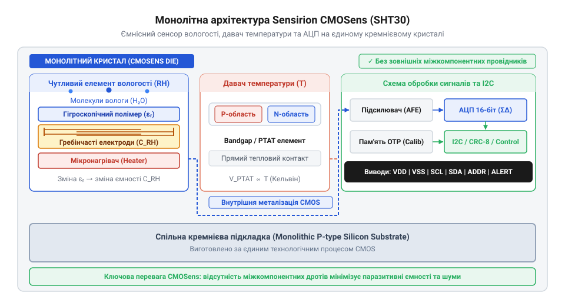
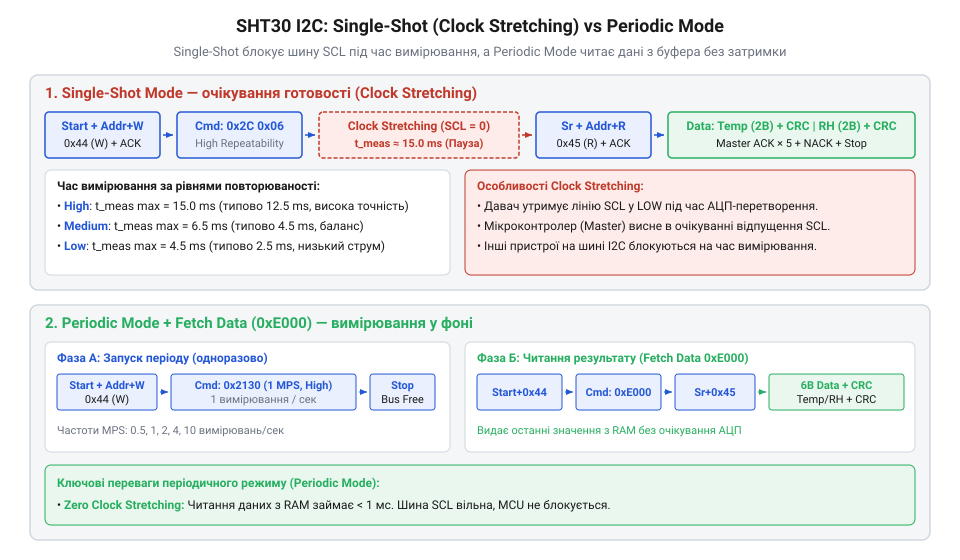
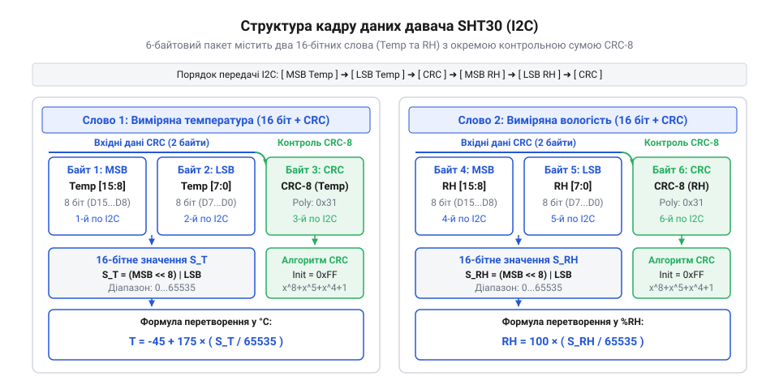
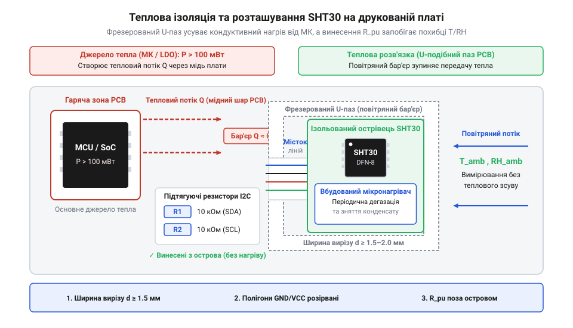

# SHT30 — температура й вологість (I2C)

<preknowlist>
- [DHT11 — температура/вологість](root:cat-hw-sensors/dht11) — принципи ємнісного вимірювання вологості та фізичні обмеження дискретних сенсорів
- [GY-21 (Si7021/HTU21D) — температура/вологість](root:cat-hw-sensors/gy-21) — концепції I2C-інтерфейсу в кліматичних сенсорах та обробка 16-бітних кодових значень АЦП
- [Формула Магнуса-Тетенса для водяної пари](root:cat-hw-sensors/magnus-formula) — залежність тиску насиченої пари від температури та фізичний сенс точки роси
</preknowlist>

## Проблема дрейфу при вимірюванні вологості

Вимірювання відносної вологості повітря прив'язане до температури, бо є відношенням парціального тиску водяної пари до тиску насиченої пари. Оскільки тиск насичення нелінійно зростає за [формулою Магнуса-Тетенса](root:cat-hw-sensors/magnus-formula), похибка визначення температури викривляє вологість.

Температурний градієнт у `0.5 °C` від паразитного тепла плати дає похибку вологості `3% RH` при `25 °C`.

У дискретних пристроях із рознесеними елементами (як у [сенсорах DHT11](root:cat-hw-sensors/dht11) чи [модулі GY-21](root:cat-hw-sensors/gy-21)) виникає просторовий і часовий дрейф. Просторовий розрив вимірює температуру підкладки замість полімеру, а різна маса окремих корпусів створює часовий дрейф із хибними сплесками при змінах середовища.

## Монолітна архітектура чутливості технології CMOSens

Для усунення просторового й часового дрейфу в давачі `@@en|SHT30@@` розроблено технологію `@@en|CMOSens@@`: ємнісний сенсор вологості та напівпровідниковий термодатчик інтегровано на єдиному кремнієвому кристалі. Висока теплопровідність кремнію миттєво вирівнює їхню температуру, ліквідовуючи просторовий градієнт.


*Монолітна архітектура чипа SHT30 забезпечує відсутність температурного градієнта між сенсорними елементами.*

На кристалі також розташовано дельта-сигма АЦП (`@@en|delta-sigma ADC@@`). Короткі мікронні зв'язки пригнічують паразитну ємність і захищають первинний сигнал від завад. Вбудований процесор застосовує калібрувальні коефіцієнти з пам'яті `@@en|OTP@@` (від англ. @@en|One-Time Programmable@@), забезпечуючи довгострокову стабільність вимірювань.

## Режими вимірювання та шина I2C

Мікросхема `@@en|SHT30@@` підключається до системного контролера через шину `@@en|I2C@@` (від англ. @@en|Inter-Integrated Circuit@@). Апаратна адреса пристрою задається напругою на виводі `@@en|ADDR@@`: з'єднання з `GND` встановлює 7-бітну адресу `0x44`, а з `VCC` — `0x45`.


*Порівняння часових послідовностей I2C при одноразовому та періодичному вимірюваннях.*

Давач підтримує два режими роботи:
- Режим одноразового зчитування (`@@en|Single Shot@@`): пристрій перебуває в стані сну зі споживанням `0.2 мкА`, прокидається за командою по шині `@@en|I2C@@`, виконує перетворення і знову засинає після видачі даних. - Режим періодичного опитування (`@@en|Periodic Mode@@`): чип самостійно вимірює параметри із частотою від `0.5` до `10 Гц` та оновлює внутрішні регістри. Контролер зчитує останні результати в довільний момент без очікування АЦП.

У режимі `@@en|Single Shot@@` можна задіяти розширення тактування (`@@en|Clock Stretching@@`, від англ. @@en|Clock Stretching@@, розтягування тактового сигналу): давач утримує лінію `SCL` низькою до завершення перетворення. Для обох режимів доступні три рівні повторюваності (`@@en|Repeatability@@`: `High`, `Medium`, `Low`), де вища точність зменшує шум, але підвищує час АЦП і споживання.

## Обчислення показників та валідація CRC-8

Результат вимірювання `@@en|SHT30@@` повертається 6-байтовим кадром із двох 16-бітних слів АЦП — температури `S_T` та відносної вологості `S_RH`, — де кожне слово супроводжується байтом контрольної суми `@@en|CRC-8@@` (від англ. @@en|Cyclic Redundancy Check@@, циклічний надлишковий код).


*Структура кадру відповіді SHT30 із контролем цілісності даних CRC-8 для кожного виміряного параметра.*

Отриманий 16-бітний код температури `S_T` перераховують у градуси Цельсія `T` за залежністю:

```
T = -45 + 175 × (S_T ÷ 65535)
```

Відносну вологість `RH` у відсотках обчислюють з отриманого коду `S_RH`:

```
RH = 100 × (S_RH ÷ 65535)
```

Цілісність даних перевіряють обчисленням `@@en|CRC-8@@` за твірним поліномом `0x31` із початковим значенням `0xFF`. Якщо розраховане значення не збігається з отриманим контрольним байтом, дані вважають спотвореними та відкидаються.

## Захист від самонагріву та конденсації

Тепло від компонентів плати поширюється мідними провідниками до `@@en|SHT30@@`, викривляючи показники вологості. Для термічної ізоляції давача застосовують фрезеровані вирізи, залишаючи вузький місток для доріжок `@@en|I2C@@`, та вилучають мідні полігони під корпусом.


*Фрезеровані вирізи та мінімізація мідних площин захищають сенсор SHT30 від теплового випромінювання плати.*

При 100% відносній вологості плівка конденсату блокує обмін водяною парою. Вбудований мікронагрівач (`@@en|heater@@`, від англ. @@en|heater@@ — нагрівач) короткочасно підвищує температуру кристала вище точки роси для випаровування води. Підйом температури під час нагріву також підтверджує справність вимірювального тракту при самодіагностиці.