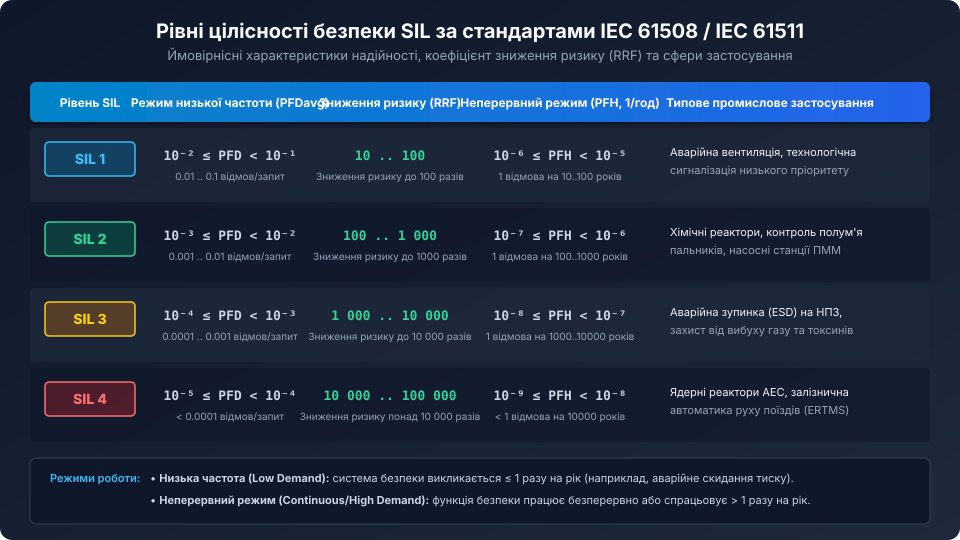
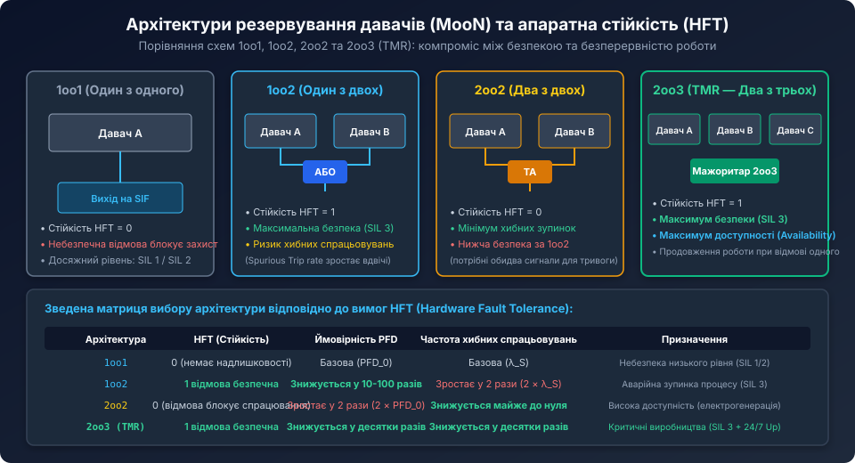
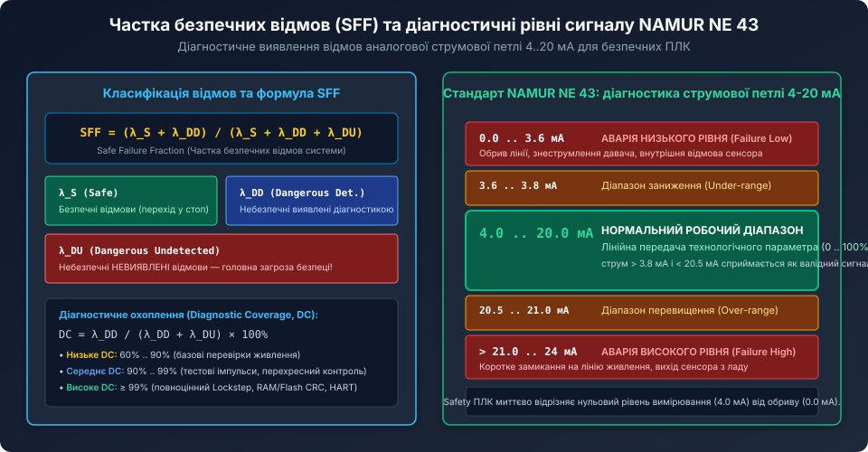

# Поглиблений аналіз надійності, математики відмов та архітектури систем функціональної безпеки SIL

<preknowlist>
- [Рівні цілісності безпеки SIL у промисловій автоматизації](root:cat-hw-sensors/sil-safety-levels) — базові визначення рівнів SIL 1..4, метрик PFDavg/PFH та стандарту NAMUR NE 43.
- [Цифровий монітор живлення INA226](root:cat-hw-sensors/ina226-power-monitor) — схемотехніка аналого-цифрових вимірювань струму та напруги.
- [Налаштування виводу ALERT та обробка тривожних подій в INA226](root:cat-hw-sensors/ina226-alert-pin-and-interrupts) — схемотехніка переривань та режимів защіпки.
</preknowlist>

## Математичні моделі розрахунку PFDavg для архітектур MooN

У стандартах IEC 61508 та IEC 61511 інтенсивність відмов виражається у спеціальних одиницях **FIT (Failures In Time)**:
`1 FIT = 1 відмова на 10^9 годин роботи` (приблизно 1 відмова на 114 155 років).



Для розрахунку середньої ймовірності небезпечної відмови на запит (`PFDavg`) розглядаються такі параметри:
- `lambda_DU` — інтенсивність небезпечних невиявлених відмов;
- `lambda_DD` — інтенсивність небезпечних виявлених відмов;
- `T_proof` — інтервал між періодичними контрольними перевірками (Proof Test Interval), зазвичай 1..5 років (8760 .. 43800 годин);
- `MTTR` — середній час відновлення та ремонту (Mean Time To Restoration), зазвичай 8..24 години;
- `beta` — коефіцієнт відмов загальної причини (Common Cause Failure — CCF).

### 1. Архітектура 1oo1 (Один з одного)

Для одинарного каналу без надлишковості небезпечна невиявлена відмова залишається непоміченою до моменту чергового регламентного тестування:

```text
PFDavg_1oo1 = (lambda_DU * T_proof) / 2 + lambda_DD * MTTR
```

Оскільки `MTTR` (години) на кілька порядків менший за `T_proof` (роки), доданком `lambda_DD * MTTR` у наближених інженерних розрахунках часто нехтують:

```text
PFDavg_1oo1 ≈ (lambda_DU * T_proof) / 2
```

### 2. Архітектура 1oo2 (Один з двох) та вплив відмов загальної причини (CCF)

У класичній математичній моделі паралельного з'єднання ймовірність спільної незалежної відмови двох каналів визначається добутком:

```text
PFDavg_indep = (lambda_DU^2 * T_proof^2) / 3
```

Однак у реальних умовах на обидва давачі одночасно впливають спільні фактори: перепади напруги живлення, електромагнітні перешкоди, вібрація, хімічна корозія або спільні помилки в програмному забезпеченні. Для врахування таких залежних відмов у стандарті застосовується **бета-факторна модель (Beta-factor model)**:

```text
PFDavg_1oo2 = ( (1 - beta)^2 * lambda_DU^2 * T_proof^2 ) / 3 + ( beta * lambda_DU * T_proof ) / 2
```

де `beta` — частка відмов із загальної причини (зазвичай від 1% до 10%, тобто `beta = 0.01 .. 0.10`).

Приклад: нехай `lambda_DU = 100 FIT` (10^-7 1/год), `T_proof = 8760 год` (1 рік), `beta = 5%` (0.05):
1. Незалежна складова: `(10^-7)^2 * (8760)^2 / 3 = 2.56 * 10^-7`;
2. Складова загальної причини: `0.05 * 10^-7 * 8760 / 2 = 2.19 * 10^-5`.

Складова загальної причини `beta` на два порядки перевищує незалежну! Це означає, що при дублюванні однакових датчиків надійність лімітується не випадковими відмовами електроніки, а спільними умовами середовища. 

Саме тому для надійного досягнення рівня **SIL 3** нормативні акти вимагають застосування **диверсифікованого резервування (Diverse Redundancy)** — використання датчиків різних фізичних принципів дії (наприклад, радарний та гідростатичний датчик рівня) або виробів різних виробників.



## Класифікація пристроїв типу A та типу B за стандартом IEC 61508-2

Стандарт розділяє всі датчики та підсистеми на дві категорії за складністю їхньої внутрішньої структури:

1. **Тип A (прості пристрої з повністю визначеними відмовами):**
   - Електромеханічні реле, кінцеві вимикачі, плавкі запобіжники, аналогові термопари, резистивні шунти.
   - Усі можливі форми відмов відомі заздалегідь, поведінка пристрою за несправності повністю передбачувана.

2. **Тип B (складні компоненти з мікропроцесорною обробкою):**
   - Смарт-перетворювачі тиску й температури на базі мікроконтролерів або ASIC, датчики з інтерфейсом HART/Profibus, оптичні енкодери.
   - Повна поведінка всіх внутрішніх цифрових станів не може бути вичерпно протестована на практиці.

### Таблиця архітектурних обмежень для компонентів типу B (Type B Subsystems)

Для застосування датчика типу B у контурі безпеки певного рівня SIL без дублювання (`HFT = 0`) або з дублюванням (`HFT = 1`) частка безпечних відмов `SFF` повинна строго задовольняти вимоги стандарту:

| Частка безпечних відмов (SFF) | Апаратна стійкість HFT = 0 | Апаратна стійкість HFT = 1 | Апаратна стійкість HFT = 2 |
| :--- | :--- | :--- | :--- |
| **< 60%** | Не дозволено | SIL 1 | SIL 2 |
| **60% .. 90%** | SIL 1 | SIL 2 | SIL 3 |
| **90% .. 99%** | SIL 2 | SIL 3 | SIL 4 |
| **≥ 99%** | SIL 3 | SIL 4 | SIL 4 |

Як видно з таблиці, мікропроцесорний смарт-датчик (Тип B) з `SFF = 95%` може самостійно (без дублювання, `HFT = 0`) забезпечувати лише рівень **SIL 2**. Для його використання в контурі **SIL 3** необхідне обов'язкове апаратне дублювання за схемою 1oo2 (`HFT = 1`).

## Динамічні тестові імпульси (Dark Test) та захист від перехресних замикань

Дискретні входи та виходи систем безпеки (Fail-Safe Digital I/O) мають постійно перевірятися на здатність відключити навантаження при виникненні аварії. Якщо транзисторний ключ вихідного каскаду пробитий накоротко на лінію 24 В, стандартний контролер не зможе цього зафіксувати доти, доки не знадобиться аварійна зупинка.

Для виявлення прихованих відмов застосовується технологія **темнових тестових імпульсів (Dark Test Pulses / Light Test Pulses)**:
- Вихідний ключ періодично короткочасно розмикається на час `T_pulse` (зазвичай від 100 до 500 мкс).
- Внутрішній компаратор контролера перевіряє факт зникнення напруги на клемі.
- Завдяки малій тривалості імпульсу індуктивні навантаження (котушки контакторів, електромагнітні клапани) не встигають фізично відпустити сердечник через власну механічну інерцію (час реакції котушки зазвичай 10..50 мс).
- Якщо під час тесту напруга не впала до нуля, контролер фіксує апаратний пробій ключа і блокує всю групу живлення.



Для дискретних датчиків (наприклад, аварійних кнопок E-Stop або кінцевиків захисних дверей) контролер подає на датчик два зсунутих у часі тестових тактових сигнали `T1` та `T2`. Якщо між проводами кабелю виникає коротке замикання (Cross-circuit fault), імпульси `T1` потрапляють на вхід каналу `T2`, що дозволяє контролеру миттєво локалізувати пошкодження ізоляції кабелю.

## Мережеві протоколи безпеки та концепція «Чорного каналу» (Black Channel)

У сучасних автоматизованих лініях передача сигналів безпеки від датчиків і контролерів ведеться через стандартні польові шини та промисловий Ethernet (Industrial Ethernet) з використанням спеціалізованих протоколів безпеки:
- **PROFIsafe** (поверх PROFINET / PROFIBUS);
- **CIP Safety** (поверх EtherNet/IP);
- **FSoE — Fail Safe over EtherCAT** (поверх EtherCAT);
- **openSAFETY** (поверх POWERLINK / Modbus TCP).

В основі всіх цих протоколів лежить **принцип чорного каналу (Black Channel Principle)** стандарту IEC 61784-3.

Згідно з цим принципом, уся транспортна інфраструктура (кабелі крученої пари, оптоволокно, стандартні мережеві комутатори, Wi-Fi точки доступу, мікросхеми трансиверів PHY і навіть стандартні мережеві стеки операційних систем) вважається ненадійною та схильною до збоїв.

Для гарантування цілісності рівня **SIL 3** поверх стандартних пакетів формується додатковий незалежний рівень безпеки (Safety Protocol Layer):
1. **Порядкові номери пакетів (Sequence Numbers):** захист від втрати, повторення або порушення хронологічного порядку передачі вибірок.
2. **Часові мітки та сторожові таймери (Timestamps & Watchdogs):** виявлення затримок та зависання пакетів у мережевих буферах комутаторів.
3. **Унікальні ідентифікатори джерела та призначення (Source/Destination IDs):** захист від перехресного надсилання даних іншому вузлу мережі.
4. **Контрольні суми безпеки (Safety CRC-32 / CRC-64):** математична поліноміальна гарантія виявлення спотворень навіть при масових електромагнітних завадах на лінію передачі.

## Вбудований C-модуль валідації безпечного вводу

Нижче наведено алгоритм обробки двохканального safety-входу з тестуванням перехресних замикань за тестовими імпульсами та захистом від дрейфу каналів:

```c
#include <stdint.h>
#include <stdbool.h>

// Конфігурація каналу
typedef struct {
    uint32_t discrepancy_limit_ms;
    uint32_t discrepancy_elapsed_ms;
    bool latched_fault;
} safety_din_channel_t;

// Стан апаратного виявлення тестових імпульсів
typedef struct {
    bool raw_input_ch1;
    bool raw_input_ch2;
    bool test_pulse_active_t1;
    bool test_pulse_active_t2;
} hardware_pins_state_t;

// Результат оцінки безпечного входу
typedef struct {
    bool safe_state;       // true = стан замкнено (норма), false = розімкнено (безпечна зупинка)
    bool fault_detected;   // прапор апаратної відмови лінії або сенсора
} safety_eval_result_t;

safety_eval_result_t process_safety_input(safety_din_channel_t *channel,
                                          const hardware_pins_state_t *pins,
                                          uint32_t delta_time_ms) {
    safety_eval_result_t result = { .safe_state = false, .fault_detected = false };

    // Якщо раніше зафіксовано защіплену помилку, система не може автоматично перезапуститися
    if (channel->latched_fault) {
        result.fault_detected = true;
        result.safe_state = false;
        return result;
    }

    // 1. Перевірка цілісності тестових імпульсів (Cross-circuit & Short-to-24V detection)
    if (pins->test_pulse_active_t1 && pins->raw_input_ch1) {
        // Канал 1 залишився у високому рівні при подачі імпульсу відключення T1 -> замикання на +24V
        channel->latched_fault = true;
        result.fault_detected = true;
        return result;
    }

    if (pins->test_pulse_active_t2 && pins->raw_input_ch2) {
        // Канал 2 залишився у високому рівні при подачі імпульсу відключення T2 -> замикання на +24V
        channel->latched_fault = true;
        result.fault_detected = true;
        return result;
    }

    // 2. Логічна оцінка станів контактів
    bool ch1_active = pins->raw_input_ch1;
    bool ch2_active = pins->raw_input_ch2;

    // 3. Контроль часу розбіжності контактів (Discrepancy monitoring)
    if (ch1_active != ch2_active) {
        channel->discrepancy_elapsed_ms += delta_time_ms;
        if (channel->discrepancy_elapsed_ms >= channel->discrepancy_limit_ms) {
            // Перевищено ліміт розбіжності: один з контактів датчика зламаний або зварений
            channel->latched_fault = true;
            result.fault_detected = true;
            result.safe_state = false;
            return result;
        }
        // Під час перехідного процесу безпечний вихід примусово скидається в 0
        result.safe_state = false;
    } else {
        // Обидва канали однакові -> скидаємо лічильник розбіжності
        channel->discrepancy_elapsed_ms = 0;
        
        // Нормальний робочий стан лише при активності обох каналів (конфігурація 1oo2D / 2oo2)
        if (ch1_active && ch2_active) {
            result.safe_state = true;
        } else {
            result.safe_state = false;
        }
    }

    return result;
}
```

Використання математичного аналізу PFDavg/PFH, розуміння архітектурних обмежень типів A/B, методів темнових тестів та протоколів Black Channel дозволяє проектувати надійні та сертифіковані системи протиаварійного захисту (SIS) відповідно до вимог міжнародних стандартів IEC 61508 та IEC 61511.
