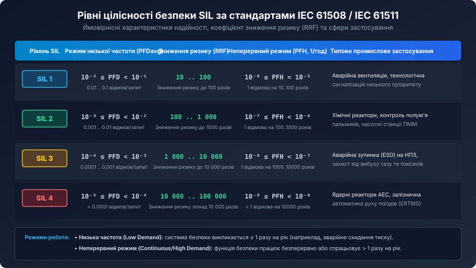
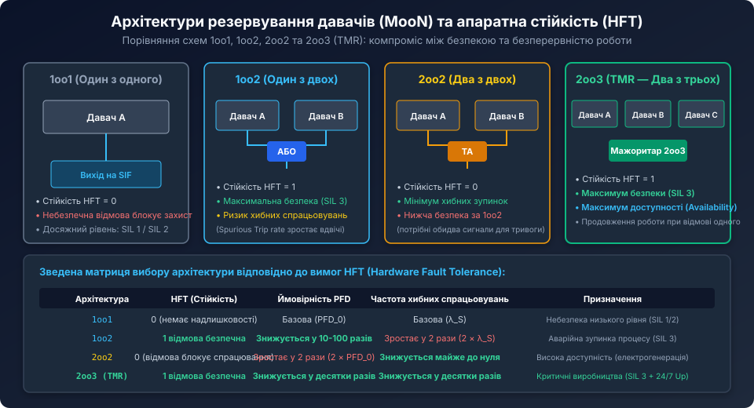
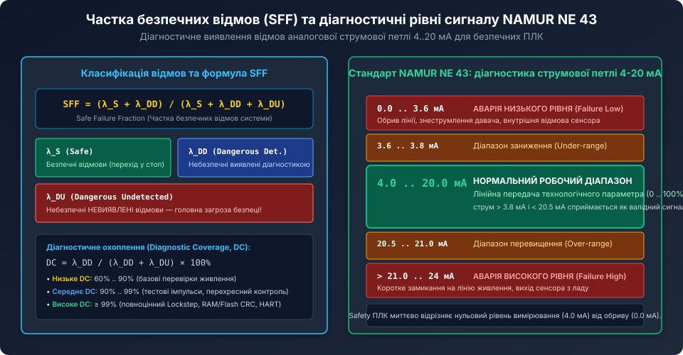

# Рівні цілісності безпеки SIL у промисловій автоматизації

<preknowlist>
- [Цифровий монітор живлення INA226](root:cat-hw-sensors/ina226-power-monitor) — базові принципи вимірювання струму та напруги у вимірювальних контурах.
- [Налаштування виводу ALERT та обробка тривожних подій в INA226](root:cat-hw-sensors/ina226-alert-pin-and-interrupts) — схемотехніка апаратної генерації аварійних сигналів та переривань.
</preknowlist>

## Концепція функціональної безпеки та стандарти IEC 61508 / IEC 61511

У сучасній промисловій автоматизації відмова датчика, контролера або клапана може призвести до катастрофічних наслідків: руйнування технологічного обладнання, вибухів, викидів токсичних хімічних речовин або загибелі персоналу. Для кількісної оцінки та мінімізації подібних ризиків розроблено концепцію функціональної безпеки (Functional Safety), центральним нормативним документом якої є міжнародний стандарт **IEC 61508** («Функціональна безпека систем електричних, електронних та програмованих електронних, пов'язаних з безпекою»), а також його галузевий аналог для нафтогазової та хімічної промисловості — **IEC 61511**.

Функціональна безпека визначається як частина загальної безпеки керованого процесу, яка залежить від коректного спрацьовування систем безпеки (Safety Instrumented Systems — SIS) у відповідь на виникнення небезпечних подій. Головним завданням SIS є переведення технологічного процесу у безпечний стан (Safe State) у разі виходу робочих параметрів за межі регламенту.

Кількісним мірилом надійності та спроможності системи виконувати свою захисну функцію є рівень цілісності безпеки — **SIL (Safety Integrity Level)**.

## Чотири дискретні рівні SIL та кількісні критерії відмов

Стандарт IEC 61508 визначає чотири дискретні рівні цілісності безпеки: від **SIL 1** (найнижчий рівень зниження ризику) до **SIL 4** (найвищий рівень безпеки). Кожен рівень SIL характеризується суворо нормованими діапазонами ймовірності відмови приладу.



Для кількісної оцінки стандарти виділяють два режими експлуатації контуру безпеки (Safety Instrumented Function — SIF):

### 1. Режим низької частоти запитів (Low Demand Mode)
У цьому режимі захисний контур викликається рідко — не частіше одного разу на рік (наприклад, аварійне скидання надлишкового тиску в автоклаві чи спрацьовування системи пожежогасіння).
Критерієм надійності виступає середня ймовірність небезпечної відмови за запитом — **PFDavg (Average Probability of dangerous Failure on Demand)**:

| Рівень SIL | Ймовірність відмови на запит (PFDavg) | Коефіцієнт зниження ризику (RRF) |
| :--- | :--- | :--- |
| **SIL 1** | від 0.01 до 0.1 (від 10^-2 до 10^-1) | від 10 до 100 |
| **SIL 2** | від 0.001 до 0.01 (від 10^-3 до 10^-2) | від 100 до 1 000 |
| **SIL 3** | від 0.0001 до 0.001 (від 10^-4 до 10^-3) | від 1 000 до 10 000 |
| **SIL 4** | від 0.00001 до 0.0001 (від 10^-5 до 10^-4) | від 10 000 до 100 000 |

Величина **RRF (Risk Reduction Factor)** показує, у скільки разів впровадження контуру безпеки зменшує початковий ризик: `RRF = 1 / PFDavg`. Наприклад, датчик рівня SIL 2 зменшує ризик переливу ємності у 100–1000 разів.

### 2. Неперервний режим або висока частота (Continuous / High Demand Mode)
Застосовується у системах, де контур захисту задіяний постійно або частіше одного разу на рік (наприклад, контури контролю швидкості обертання турбін, захисні світлові завіси пресів, системи запобігання зіткненням).
Критерієм є ймовірність небезпечної відмови за одну годину роботи — **PFH (Probability of dangerous Failure per Hour)**:
- **SIL 1:** від 10^-6 до 10^-5 відмов/год (1 відмова на 10..100 років);
- **SIL 2:** від 10^-7 до 10^-6 відмов/год (1 відмова на 100..1000 років);
- **SIL 3:** від 10^-8 до 10^-7 відмов/год (1 відмова на 1000..10000 років);
- **SIL 4:** від 10^-9 до 10^-8 відмов/год (менше 1 відмови на 10000 років).

У загальнопромисловій автоматиці найпоширенішими є рівні **SIL 2** та **SIL 3**. Рівень **SIL 4** через надзвичайну технічну складність та вартість застосовується виключно в ядерній енергетиці та залізничній автоматиці високих швидкостей.

## Архітектури резервування давачів (MooN) та апаратна відмовостійкість

Неможливо гарантувати високий рівень безпеки (наприклад, SIL 3) лише за рахунок вибору надійних електронних компонентів. Критичну роль відіграє архітектура дублювання первинних перетворювачів (давачів), що описується формулою **MooN (M out of N — M каналів з N загальних)**:



1. **Архітектура 1oo1 (One out of One):**
   - Використовується один датчик. 
   - Апаратна відмовостійкість (Hardware Fault Tolerance — HFT) дорівнює 0 (будь-яка одинична відмова виводить канал безпеки з ладу).
   - Застосовується для контурів SIL 1 або SIL 2 за наявності високого рівня внутрішньої самодіагностики.

2. **Архітектура 1oo2 (One out of Two):**
   - Встановлюються два незалежні датчики, підключені за схемою логічного «АБО» (якщо хоча б один датчик сигналізує про небезпеку, система ініціює аварійну зупинку).
   - Апаратна стійкість `HFT = 1` (система зберігає безпеку при відмові одного з давачів).
   - Забезпечує легке досягнення рівня **SIL 3**, однак удвічі збільшує ризик хибних спрацьовувань (Spurious Trip), що призводить до незапланованого простою виробництва.

3. **Архітектура 2oo2 (Two out of Two):**
   - Аварійне відключення відбувається лише тоді, коли обидва датчики одночасно фіксують небезпечний стан (логічне «ТА»).
   - `HFT = 0`. Схема розроблена для мінімізації хибних зупинок (висока експлуатаційна готовність — Availability), однак якщо один датчик заклинить у безпечному стані, аварійна функція не спрацює.

4. **Архітектура 2oo3 (Two out of Three / Triple Modular Redundancy — TMR):**
   - Три незалежні датчики з мажоритарним голосуванням (спрацювання за рішенням більшості: 2 з 3).
   - Поєднує переваги 1oo2 та 2oo2: забезпечує максимальний рівень безпеки **SIL 3** (`HFT = 1`) і одночасно захищає виробничу лінію від помилкового спрацьовування при одиничній відмові будь-якого давача.

## Діагностичне охоплення (DC), частка безпечних відмов (SFF) та NAMUR NE 43

Для сертифікації датчика на відповідність SIL за стандартом IEC 61508 усі можливі відмови компонентів поділяють на чотири категорії:
- `lambda_SD` (Safe Detected) — безпечні виявлені;
- `lambda_SU` (Safe Undetected) — безпечні невиявлені;
- `lambda_DD` (Dangerous Detected) — небезпечні виявлені внутрішньою діагностикою;
- `lambda_DU` (Dangerous Undetected) — небезпечні невиявлені (найнебезпечніша категорія, коли датчик "залипає" на нормальному значенні при реальній аварії).



### Частка безпечних відмов (Safe Failure Fraction — SFF)

Метрика SFF визначає відсоток відмов, які або самі по собі є безпечними, або вчасно виявляються діагностикою:

```text
SFF = (lambda_S + lambda_DD) / (lambda_S + lambda_DD + lambda_DU)
```

Для досягнення SIL 2 без дублювання (1oo1) частка SFF повинна перевищувати 90%, а для SIL 3 у конфігурації 1oo1 — понад 99%, що практично недосяжно без надскладної мікропроцесорної самодіагностики.

### Стандарт діагностики струмової петлі NAMUR NE 43

У класичній струмовій петлі 4..20 мА для передачі технологічного значення використовується робочий діапазон від 4.0 до 20.0 мА. Промислова рекомендація **NAMUR NE 43** регламентує використання піддіапазонів струму нижче 4 мА та вище 20 мА як діагностичних сигналів апаратної відмови:
- **0.0 .. 3.6 мА:** аварія низького рівня (Failure Low) — обрив кабельної лінії, втрата живлення або відмова чутливого елемента;
- **3.6 .. 3.8 мА:** діапазон заниження шкали (Under-range);
- **3.8 .. 20.5 мА:** валідний технологічний діапазон вимірювання (нормальний сигнал від 0% до 100%);
- **20.5 .. 21.0 мА:** діапазон перевищення шкали (Over-range);
- **21.0 .. 24.0 мА:** аварія високого рівня (Failure High) — коротке замикання датчика на позитивну шину живлення або апаратний збій перетворювача.

Завдяки стандарту NAMUR NE 43 safety-контролер миттєво відрізняє нульовий рівень вимірюваного тиску (струм 4.0 мА) від аварійного обриву кабелю (струм 0.0 мА), переводячи систему в безпечний стан.

## Практична схемотехніка та алгоритми обробки сигналів на C

Safety-входи сучасних промислових контролерів (наприклад, Siemens S7-1500F, Allen-Bradley GuardLogix або Beckhoff TwinSAFE) реалізують обов'язковий моніторинг розбіжностей (Discrepancy Time) між резервованими каналами давачів.

Якщо один датчик зафіксував перевищення температури, а інший — ні, різниця сигналів не повинна перевищувати час затримки розбіжності `T_discrepancy` (зазвичай від 50 до 500 мс). Якщо за цей час другий датчик не підтвердив аварію, контролер діагностує відмову вимірювального каналу і переходить у стан безпечного блокування (Fail-Safe).

Нижче наведено програмний модуль мажоритарної обробки пари аналогових датчиків 1oo2 з діагностикою за стандартом NAMUR NE 43:

```c
#include <stdint.h>
#include <stdbool.h>

// Пороги струму за стандартом NAMUR NE 43 (в мікроамперах)
#define NAMUR_FAULT_LOW_UA      3600    // < 3.6 мА: обрив або відмова
#define NAMUR_VALID_MIN_UA      3800    // >= 3.8 мА: початок валідного сигналу
#define NAMUR_VALID_MAX_UA      20500   // <= 20.5 мА: кінець валідного сигналу
#define NAMUR_FAULT_HIGH_UA     21000   // > 21.0 мА: коротке замикання

// Порогове значення аварійного відключення процесу (наприклад, 18.0 мА)
#define SIF_TRIP_THRESHOLD_UA   18000   

typedef enum {
    CHANNEL_OK = 0,
    CHANNEL_FAULT_LOW,
    CHANNEL_FAULT_HIGH
} channel_health_t;

typedef struct {
    uint32_t discrepancy_timeout_ms;
    uint32_t discrepancy_timer_ms;
    bool discrepancy_active;
} safety_context_t;

// Перевірка здоров'я аналогового каналу за NAMUR NE 43
channel_health_t check_namur_health(uint32_t current_ua) {
    if (current_ua < NAMUR_FAULT_LOW_UA) return CHANNEL_FAULT_LOW;
    if (current_ua > NAMUR_FAULT_HIGH_UA) return CHANNEL_FAULT_HIGH;
    return CHANNEL_OK;
}

// Логіка 1oo2 з діагностикою розбіжностей та безпечним відключенням
bool evaluate_safety_1oo2(safety_context_t *ctx, 
                          uint32_t sensor_a_ua, 
                          uint32_t sensor_b_ua, 
                          uint32_t dt_ms, 
                          bool *system_alarm) {
    channel_health_t health_a = check_namur_health(sensor_a_ua);
    channel_health_t health_b = check_namur_health(sensor_b_ua);

    // Принцип Fail-Safe: якщо будь-який канал має апаратну відмову, переходимо в аварійний стоп
    if (health_a != CHANNEL_OK || health_b != CHANNEL_OK) {
        *system_alarm = true; // Аварійна зупинка через відмову сенсора
        return false;         // Стан несправності контуру
    }

    bool trip_a = (sensor_a_ua >= SIF_TRIP_THRESHOLD_UA);
    bool trip_b = (sensor_b_ua >= SIF_TRIP_THRESHOLD_UA);

    // Контроль розбіжності каналів (Discrepancy Monitoring)
    if (trip_a != trip_b) {
        if (!ctx->discrepancy_active) {
            ctx->discrepancy_active = true;
            ctx->discrepancy_timer_ms = 0;
        } else {
            ctx->discrepancy_timer_ms += dt_ms;
            if (ctx->discrepancy_timer_ms >= ctx->discrepancy_timeout_ms) {
                // Час розбіжності вичерпано: один датчик відмовив без аварії струму
                *system_alarm = true;
                return false;
            }
        }
    } else {
        ctx->discrepancy_active = false;
        ctx->discrepancy_timer_ms = 0;
    }

    // Логіка 1oo2: спрацьовування за сигналом хоча б одного датчика
    if (trip_a || trip_b) {
        *system_alarm = true;
    } else {
        *system_alarm = false;
    }

    return true; // Контур працює штатно
}
```

Використання наведених архітектурних принципів, багаторівневого резервування та стандарту NAMUR NE 43 дозволяє інженерам створювати безпечні вимірювальні контури рівня SIL 2 та SIL 3, що гарантують безаварійну експлуатацію найскладніших об'єктів промисловості.
