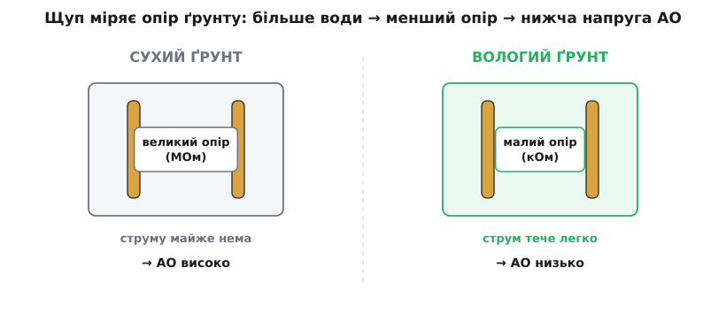
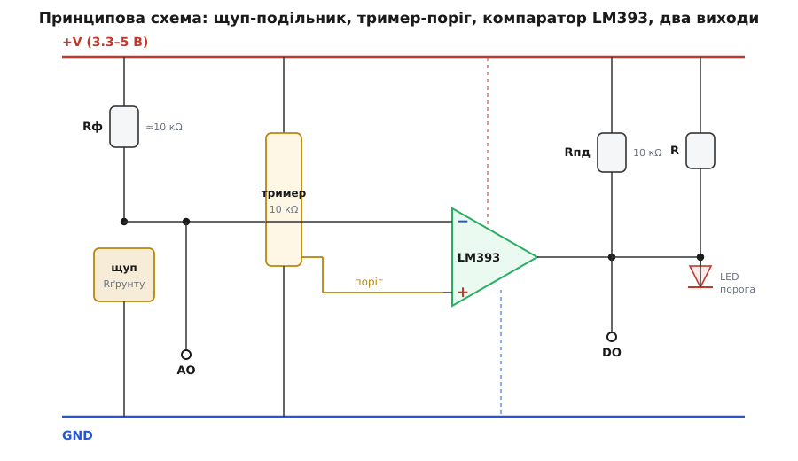
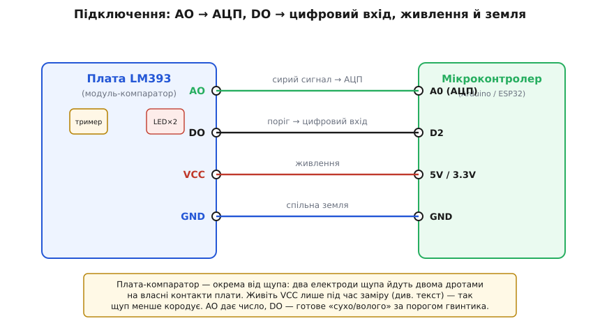
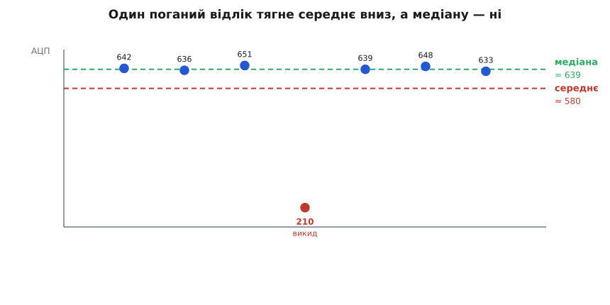
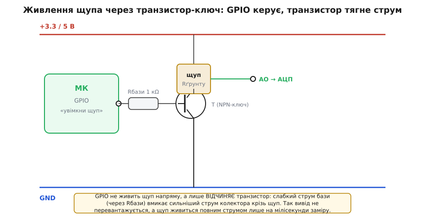

# Резистивний давач вологості ґрунту з компаратором LM393

Резистивний давач вологості ґрунту — це один із найпоширеніших базових сенсорів у навчальних наборах, системах кімнатного автополиву та агромоніторингу початкового рівня. Пристрій дозволяє контролювати стан зволоженості субстрату, передаючи в мікроконтролер як плавний аналоговий сигнал пропорційно опору землі, так і готовий двійковий поріг «сухо / волого».

---

## 1. Принцип дії та фізичні основи резистивного вимірювання

Робота давача ґрунту базується на прямій залежності між вмістом вологи в пористому середовищі та його питомою електричною провідністю:



- **Сухий ґрунт:** Сухе мінеральне середовище (кварцовий пісок, суха глина, торф) містить мінімум вільних носіїв електричного заряду. Опір між електродами становить від сотень кілоомів до десятків мегаомів — електричний струм практично не протікає.
- **Вологий ґрунт:** При внесенні води утворюються суцільні капілярні містки. Оскільки природна вода завжди містить розчинені мінеральні солі (нітрати, фосфати, хлориди), вона перетворюється на рідкий електроліт. Рухливі позитивні та негативні іони вільно переносять заряд між зануреними пластинами щупа.
- **Електричний опір:** Що вища вологість — то менший опір ділянки ґрунту між контактними доріжками вилки.
- **Відносний характер вимірювання:** Давач вимірює не абсолютну масову частку води у відсотках, а сумарну іонну провідність. На покази суттєво впливають щільність утрамбування землі навколо щупа та концентрація розчинених добрив.

---

## 2. Будова модуля: вилка-щуп та плата компаратора LM393

Комплект складається з двох фізично відокремлених компонентів, з'єднаних парою гнучких дротів:



1. **Занурювальний щуп (вилка):** Двошаровий текстоліт із двома довгими друкованими доріжками під захисним лудінням або золоченням. Доріжки виконують роль електродів у ґрунті. Щуп є змінним витратним елементом і не містить жодних електронних компонентів.
2. **Плата узгодження та обробки сигналу:**
   - **Аналоговий подільник напруги:** Опір ґрунту увімкнено послідовно з опорним фіксованим резистором номіналом близько 10 кОм. Напруга в середній точці подільника подається безпосередньо на вивід `AO`.
   - **Компаратор LM393:** Прецизійний здвоєний компаратор низької напруги. Порівнює напругу з подільника щупа з опорним рівнем.
   - **Підстроювальний резистор (тример):** Синій багатооборотний потенціометр, що задає опорну напругу порогу спрацьовування компаратора.
   - **Світлодіодна індикація:** Червоний індикатор сигналізує про наявність живлення схеми, а зелений (або синій) вмикається, коли вологість падає нижче встановленої межі.

---

## 3. Схема підключення та призначення виводів

Модуль компаратора оснащений стандартним 4-контактним штировим роз'ємом із кроком 2.54 мм:



| Вивід | Тип сигналу | Призначення та діапазон напруги | Рекомендоване підключення |
| :--- | :--- | :--- | :--- |
| **VCC** | Живлення | Напруга живлення схеми від 3.3 В до 5.0 В | До шини живлення або цифрового виводу GPIO (імпульсний режим) |
| **GND** | Земля | Спільний мінус схеми (0 В) | До загального виводу GND мікроконтролера |
| **AO** | Аналоговий вихід | Напруга, обернено пропорційна вологості (0...VCC) | До аналогового входу мікроконтролера (ADC / A0) |
| **DO** | Цифровий вихід | Дискретний вихід компаратора з відкритого колектора | До дискретного входу GPIO з підтримкою переривань |

> ⚠️ **Застереження щодо рівнів напруги:** Якщо мікроконтролер має 3.3-вольтову логіку (ESP32, STM32, Raspberry Pi Pico), живлення модуля `VCC` обов'язково слід подавати від лінії 3.3 В. Живлення від 5 В призведе до появи 5-вольтового сигналу на лінії `AO`, що може безповоротно вивести з ладу вбудований АЦП мікроконтролера.

---

## 4. Програмне зчитування аналогового сигналу AO та налаштування цифрового порогу

Найбільшу інформативність забезпечує читання аналогового виходу `AO`. Оскільки напруга з подільника змінюється плавно, програмне забезпечення може контролювати декілька станів ґрунту (наприклад: «перелив», «оптимально», «помірний дефіцит», «критична сухість»).



Для запобігання помилковим спрацьовуванням через випадкові бульбашки повітря або контактний деренч рекомендується застосовувати комбінацію медіанного фільтра та порогів з гістерезисом:

```cpp
/**
 * @file soil_moisture_basic.ino
 * @brief Базовий приклад читання аналогового сигналу вологості з гістерезисом
 */

const int PIN_SOIL_AO = A0;   // Підключення до аналогового входу
const int PIN_PUMP_RELAY = 8; // Вихід керування реле помпи

// Калібрувальні пороги для конкретного ґрунту (10-бітний АЦП: 0..1023)
// Зверніть увагу: більше число відповідає сухішому ґрунту!
const int THRESHOLD_DRY = 720; // Поріг вмикання поливу (ґрунт сухий)
const int THRESHOLD_WET = 450; // Поріг вимикання поливу (ґрунт достатньо зволожений)

bool is_pump_active = false;

// Функція зняття 5 замірів та обчислення простої медіани
int readSoilMoistureMedian() {
  int samples[5];
  for (int i = 0; i < 5; i++) {
    samples[i] = analogRead(PIN_SOIL_AO);
    delay(10);
  }
  // Просте сортування масиву з 5 елементів
  for (int i = 0; i < 4; i++) {
    for (int j = i + 1; j < 5; j++) {
      if (samples[i] > samples[j]) {
        int temp = samples[i];
        samples[i] = samples[j];
        samples[j] = temp;
      }
    }
  }
  return samples[2]; // Повертаємо центральний елемент (медіану)
}

void setup() {
  Serial.begin(115200);
  pinMode(PIN_PUMP_RELAY, OUTPUT);
  digitalWrite(PIN_PUMP_RELAY, LOW); // Реле вимкнено
}

void loop() {
  int soil_raw = readSoilMoistureMedian();
  
  // Логіка гістерезису: насос не смикається біля одного значення
  if (!is_pump_active && (soil_raw > THRESHOLD_DRY)) {
    is_pump_active = true;
    digitalWrite(PIN_PUMP_RELAY, HIGH);
    Serial.println(F("[СТАН] Ґрунт сухий! Увімкнення поливу."));
  } else if (is_pump_active && (soil_raw < THRESHOLD_WET)) {
    is_pump_active = false;
    digitalWrite(PIN_PUMP_RELAY, LOW);
    Serial.println(F("[СТАН] Вологість відновлена. Полив вимкнено."));
  }

  Serial.print(F("Поточний код АЦП: "));
  Serial.print(soil_raw);
  Serial.print(F(" | Стан помпи: "));
  Serial.println(is_pump_active ? "АКТИВНА" : "ВИМКНЕНА");

  delay(2000);
}
```

---

## 5. Головна проблема електролізу, заходи захисту та типові помилки

Головним конструктивним недоліком резистивних давачів є швидка деградація контактів внаслідок електрохімічної корозії:



1. **Фізика електролізу:** Коли через вологе солоне середовище безперервно протікає постійний струм, позитивний електрод (анод) інтенсивно розчиняється. За 2–4 тижні безперервної роботи мідна доріжка повністю розпадається, через що покази АЦП назавжди зависають у зоні «максимальна сухість».
2. **Імпульсне живлення (Duty Cycling):** Найпростіший спосіб подовжити термін служби щупа до 1–2 років — подавати напругу на вивід `VCC` тільки на час заміру (на 20–50 мілісекунд раз на 15–60 хвилин) безпосередньо з цифрового піна GPIO або через P-канальний MOSFET-транзистор.
3. **Типові помилки експлуатації:**
   - **Спроба регулювати аналоговий вихід тримером:** Потенціометр на платі змінює виключно опорний поріг цифрового виходу `DO` і взагалі не впливає на аналоговий сигнал `AO`.
   - **Нещільне занурення:** Наявність повітряних прошарків між землею та металом викликає хаотичні сплески сигналу. Щуп слід занурювати до упору в утрамбований ґрунт.
   - **Плутанина полярності DO:** Різні версії плат LM393 можуть встановлювати низький або високий рівень при пересиханні залежно від внутрішнього розведення входів компаратора. Необхідно попередньо перевіряти полярність експериментально.
