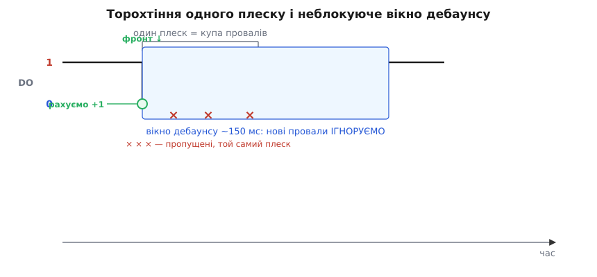
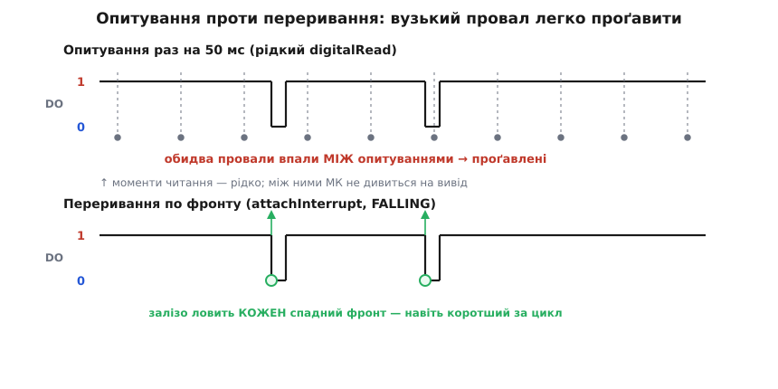
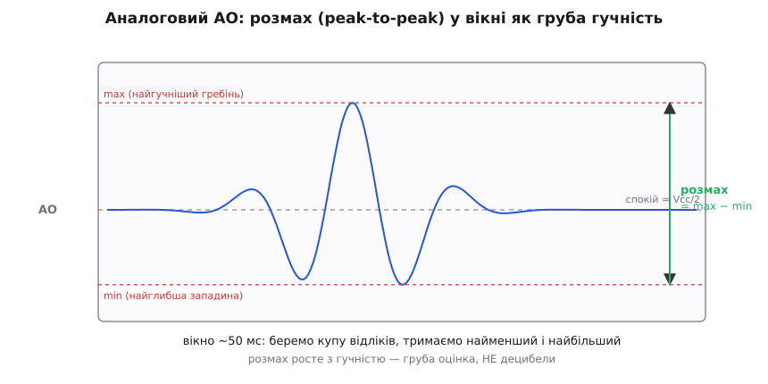

# ⚙️ proj: прошивка звукового давача на LM393 — від «блимнути на плеск» до надійної події

Мікрофонний модуль на компараторі віддає прошивці рівно один провід із двома станами: у спокої лінія тримається високо, а достатньо гучний звук на коротку мить притискає її до землі. Це дуже мало інформації — по суті кнопка, яку натискає не палець, а звук, — і саме тому все цікаве відбувається не в залізі, а в коді. Наївний скетч «якщо читання дорівнює нулю, блимни світлодіодом» запуститься за хвилину, а потім почне поводитися незбагненно: один плеск дасть сім спрацювань, гучний удар зовсім не помітиться, а спроба зміряти гучність упреться в те, що на виході тільки нуль або одиниця. Кожна з цих бід має точну причину, і кожну знімає конкретний прийом у прошивці.

Розберемо чотири речі, на яких тримається серйозна робота з цим давачем: як читати вихід — опитуванням чи перериванням, і коли що; як приборкати «торохтіння» одного плеску, не заморозивши програму затримками; як накрутити поріг чутливості не викруткою, а з коду; і як на 4-штиревих платах вичавити з аналогового виходу грубу оцінку гучності замість голого «є звук / нема». Наприкінці — закінчені прошивки цілком і перелік пасток, у які легко впасти. Усі чотири прийоми спираються на речі, що є в кожному мікроконтролері (вивід, здатний на переривання; вільний лічильник часу; АЦП; підтяжка на вході) і лише **називаються** в кожному середовищі по-своєму — тому кожен приклад нижче йде вкладками: **Arduino**, **ESP-IDF**, **STM32 HAL**. Це справжня прошивка, яку можна залити без переписування, а не псевдокод.

> 🔧 **Навіщо це.** Різниця між іграшкою й пристроєм — саме в цих чотирьох прийомах. Сигналізація, яка ловить дзенькіт скла, «плескни-й-увімкни-світло», лічильник ударів по мішені, будильник-реакція на грюкіт дверей — усі вони читають той самий один біт, і всі ламаються однаково, якщо біт читати наївно. Опанувавши прошивку тут, ви носитимете її від модуля до модуля: усередині — компаратор, а це означає стрибок рівня, брязкіт переходів і поріг, хоч би що стояло на вході.

## Модель сигналу: що саме бачить нога мікроконтролера

Перш ніж писати бодай рядок, треба чітко уявити, який електричний сигнал приходить на вивід. Вихід компаратора зроблено з [відкритим колектором](root:hw-digital/open-drain-bus-pullup-sizing): мікросхема вміє лише **притягнути лінію до землі**, а вгору лінію повертає зовнішній резистор [підтяжки](root:hw-digital/floating-pullups), що вже стоїть на платі. Звідси — увесь характер сигналу.

У тиші компаратор мовчить, транзистор виходу закритий, і підтяжка тримає лінію вгорі: читання ноги дає **1**. Гучний звук на мить перекидає компаратор, транзистор відкривається й садить лінію на землю: те саме читання дає **0**. (Зветься воно скрізь по-своєму — `digitalRead` в Arduino, `gpio_get_level` в ESP-IDF, `HAL_GPIO_ReadPin` у STM32 HAL, — а робить одне.) Тобто полярність оманлива для новачка — **спокій це одиниця, а подія це нуль**, — і будувати логіку треба саме так. (На рідкісних платах вихід розведений навпаки; про перевірку полярності — нижче.)

Але найважливіше не полярність, а **форма** цього нуля. Гучний звук — не рівний тон, а пакет коливань: тиск повітря стрибає туди-сюди десятки разів, поки звук згасає. Компаратор порівнює сигнал мікрофона з порогом на кожному з цих коливань окремо, тож поки триває плеск, вихід не лежить рівно в нулі, а **торохтить**: серія коротких провалів у нуль з поверненнями в одиницю між ними. Один-єдиний ляскіт у долоні на осцилографі виглядає як щіточка з п'яти-десяти вузьких імпульсів завширшки лічені мілісекунди кожен, розкиданих на 20–100 мілісекунд.


*Що насправді робить лінія DO на один плеск. Тиша тримає «1»; звук дає не рівний «0», а щіточку коротких провалів, бо компаратор перекидається на кожному коливанні хвилі. Перший спадний фронт — це наша подія (рахуємо +1); усі провали, що впали у вікно дебаунсу (тут ~150 мс), належать тому самому плескові й мають бути проігноровані.*

Із цієї картинки випливають одразу два висновки, які визначають усю прошивку. По-перше, **провал вузький** — якщо читати вивід рідко, між читаннями легко проскочить увесь імпульс, і подію буде проґавлено; звідси питання опитування проти переривання. По-друге, **провалів багато на одну подію** — якщо рахувати кожен, один плеск роздметься на чергу спрацювань; звідси потреба в дебаунсі. Розберемо обидва.

## Опитування проти переривання: хто не проспить вузький імпульс

Найпростіший спосіб читати вивід — **опитування** (англ. *polling*): у головному циклі раз за разом читати рівень ноги й дивитися, чи він не впав. Спосіб чесний і зрозумілий, але має пастку, прямо пов'язану з вузькістю провалу. Головний цикл робить не лише читання давача — він оновлює дисплей, крутить іншу логіку, часом чекає; між двома сусідніми читаннями минає якийсь час. Якщо цей проміжок довший за провал, мікроконтролер саме в момент імпульсу дивиться в інший бік — і подія проходить повз.


*Той самий сигнал двома очима. Угорі — опитування раз на 50 мс: обидва вузькі провали впали між моментами читання, і програма їх не побачила. Внизу — переривання по спадному фронту: залізо стежить за лінією безперервно й ловить кожен перехід «1→0», навіть коротший за один прохід циклу.*

Порахуймо, щоб відчути масштаб. **Умова.** Провал на виході триває близько 4 мс. Головний цикл через дисплей і затримки повертається до читання давача раз на 50 мс.

```
частка часу, коли провал «видимий» опитуванню:
  4 мс / 50 мс ≈ 0.08  →  ~8 %

імовірність проґавити один плеск (усі його провали між читаннями):
  для щіточки з кількох імпульсів шанс піймати росте,
  але для ОДИНОЧНОГО короткого удару легко проскочити зовсім
```

Отже, рідке опитування — це не «трохи неточно», а «часто зовсім сліпе» до коротких звуків. Ліки два. Простіший — **опитувати щільно**: тримати цикл коротким і читати вивід якомога частіше, щоб проміжок між читаннями був меншим за провал. Це працює, коли пристрій більше нічим важким не зайнятий:

:::tabs
:::code api-sound-lm393/c/arduino/opytuvannia-proty.ino
:::code api-sound-lm393/c/esp-idf/opytuvannia-proty.c
:::code api-sound-lm393/c/stm32/opytuvannia-proty.c
:::

Тут головне — **ловити перехід, а не рівень**. Наївна перевірка самого рівня (`if (digitalRead(SOUND) == LOW)` і її двійники в інших середовищах) спрацьовуватиме на кожному проході, поки триває провал, тобто десятки разів за один короткий імпульс. Порівняння `prev == HIGH && now == LOW` реагує лише в ту мить, коли лінія щойно впала, — це і є **фронт**, одна подія на один спад. Зберігати попередній стан і дивитися на різницю — той самий фокус, що й у надійному читанні кнопки.

Другий, правильніший для реального пристрою спосіб — **переривання** (англ. *interrupt*): доручити стеження за лінією апаратному блокові мікроконтролера, який сам, незалежно від головного циклу, покличе вашу функцію тієї ж миті, коли на нозі станеться потрібний фронт. Головний цикл при цьому може займатися чим завгодно — залізо його перерве. Оскільки нас цікавить перехід «1→0», настроюємо переривання на **спадний фронт** — в Arduino це `FALLING`, в ESP-IDF `GPIO_INTR_NEGEDGE`, у STM32 режим ноги `GPIO_MODE_IT_FALLING`:

:::tabs
:::code api-sound-lm393/c/arduino/opytuvannia-proty-2.ino
:::code api-sound-lm393/c/esp-idf/opytuvannia-proty-2.c
:::code api-sound-lm393/c/stm32/opytuvannia-proty-2.c
:::

Три речі в цьому коді не косметичні, а обов'язкові, і кожна має причину.

Перше — слово **`volatile`** біля змінних, які чіпає обробник. Компілятор оптимізує код, припускаючи, що змінна сама собою не міняється між рядками; він може закешувати її в регістрі й не перечитувати з пам'яті. Але `hit` міняється «поза чергою» — з переривання, у будь-яку мить. `volatile` каже компіляторові: не кешуй, перечитуй щоразу з пам'яті. Без цього головний цикл ризикує ніколи не побачити, що обробник виставив прапорець.

Друге — обробник **мусить бути коротким**. Поки він виконується, головна програма стоїть, а часто й інші переривання заблоковані. Тому в ISR не місце для друку (`Serial.print`, `ESP_LOGI`, `printf`), сну (`delay`, `vTaskDelay`, `HAL_Delay`) чи важких обчислень: виставили прапорець, записали час — і вийшли. Уся робота (надрукувати, ввімкнути реле, оновити екран) робиться потім, у головному циклі, коли він побачить прапорець. Це поділ праці: **залізо ловить момент, цикл робить діло**.

Третє — **не кожна нога вміє переривання**, і це треба з'ясувати про свій контролер, перш ніж вибирати вивід. На Arduino Uno (ATmega328P) зовнішніх переривань лише два: D2 (переривання 0) і D3 (переривання 1); `digitalPinToInterrupt(pin)` акуратно переганяє номер ноги в номер переривання, тож не треба пам'ятати цю відповідність напам'ять і код лишається читабельним. На ESP32 переривання є на будь-якій GPIO, зате служба переривань одна на всіх — її треба разово підняти (`gpio_install_isr_service`), а обробники вішати вже на неї. У STM32 фронт ловить блок EXTI, і в нього своя пастка: лінія спільна для однакових номерів ніг — PA0 і PB0 не можуть переривати водночас, бо це та сама лінія EXTI0. Спершу подивіться, що вміє обрана нога, — і аж тоді паяйте.

## Дебаунс без заморозки: неблокуючий фільтр на millis

Тепер найголовніша практична біда — **торохтіння**. Хоч опитуванням, хоч перериванням ви спіймаєте не одну подію на плеск, а стільки, скільки провалів у щіточці: п'ять, вісім, десяток. Для лічильника ударів це катастрофа — один удар рахується як черга. Потрібно **зарахувати лише перший фронт плеску, а решту провалів того самого плеску ігнорувати** якийсь час, поки звук не згасне. Цей прийом — придушення брязкоту, або [дебаунс](root:hw-digital/contact-debounce) (англ. *debounce*), — той самий, що рятує від багаторазового спрацювання механічну кнопку; звук дає точно таку ж щіточку переходів, тож і лік від неї той самий.

Спокуса зробити дебаунс «у лоб» велика й хибна: спіймали фронт — і поставили `delay(150)`, мовляв, перечекаємо торохтіння. Це працює в навчальному скетчі й розвалює будь-який реальний пристрій, бо `delay` **заморожує геть усе**: поки програма спить ці 150 мс, вона не читає інших давачів, не оновлює дисплей, не відповідає на кнопки, а якщо ви на перериванні — можете й наступні фронти проґавити, бо цикл стоїть. `delay` у пристрої з кількома задачами — майже завжди помилка.

Правильний дебаунс **неблокуючий**: замість спати, програма **запам'ятовує час** зарахованої події і при кожному новому фронті просто питає годинник — чи минуло вже досить? Годинник — це вільний лічильник часу від старту плати; він тікає сам, не спиняючи програму: `millis()` в Arduino й `HAL_GetTick()` у STM32 (обидва в мілісекундах), `esp_timer_get_time()` в ESP-IDF (у мікросекундах). Логіка проста: зарахувати подію лише тоді, коли від попередньої зарахованої минуло більше за вікно (скажімо, 150 мс); усі фронти всередині вікна — це той самий плеск, їх пропускаємо.

:::tabs
:::code api-sound-lm393/c/arduino/debauns-bez-zamorozky.ino
:::code api-sound-lm393/c/stm32/debauns-bez-zamorozky.c
:::

Серце цього коду — умова `t - lastHit > WINDOW`. Вона пропускає лише перший фронт плеску: щойно він зарахований, `lastHit` стає «зараз», і всі наступні провали тієї ж щіточки провалюють перевірку `t - lastHit > WINDOW` (бо різниця ще мала) — їх мовчки ігноровано. Коли ж мине 150 мс і пролунає **новий** плеск, різниця знову стане великою, і його перший фронт зарахується. Так один плеск дає рівно одну подію, а два окремі плески — дві.

Зверніть увагу на **арифметику з відніманням часу**. Ми пишемо `t - lastHit > WINDOW`, а не `t > lastHit + WINDOW`. Це не примха стилю: 32-бітний лічильник мілісекунд переповнюється (обнуляється) приблизно раз на 50 діб — байдуже, `millis()` це чи `HAL_GetTick()`, — і форма з відніманням переживає це переповнення коректно завдяки тому, як працює беззнакова арифметика, а форма з додаванням — ні. Для пристрою, який має жити тижнями, це різниця між «працює завжди» і «раз на 50 діб дуріє». Правило просте: **порівнюй різницю часів, а не суми**.

> 🔧 **Навіщо це.** Вікно дебаунсу — це фізичний параметр вашої задачі, а не магічне число. Ловите поодинокі плескання в долоні — 150–200 мс саме враз: людина не плескає частіше. Рахуєте швидкі удари по мішені — вікно треба коротше (50–80 мс), бо інакше два справжні удари поспіль зіллються в один. Ловите тривалий гучний шум (сирена, гавкіт) — навпаки, вікно ширше, щоб один довгий звук не розсипався на десяток «подій». Крутіть це число під свій звук: замале — вернеться торохтіння, завелике — програєте швидкі події.

### Дебаунс на перериванні

Той самий неблокуючий підхід лягає й на переривання — лише перенесемо перевірку часу почасти в обробник. Обробник сам відкидає надто близькі фронти, тож головна програма дістає вже «чисту» подію — через прапорець (Arduino, STM32) або через чергу планувальника (ESP-IDF):

:::tabs
:::code api-sound-lm393/c/arduino/debauns-na-pereryvanni.ino
:::code api-sound-lm393/c/esp-idf/debauns-na-pereryvanni.c
:::code api-sound-lm393/c/stm32/debauns-na-pereryvanni.c
:::

Обробник лишається коротким: одне віднімання, одне порівняння, три присвоєння. Уся «повільна» робота — друк — робиться в головному циклі за прапорцем `ready`. Це і є канонічна форма: **переривання відсіює й позначає, цикл обробляє**.

## Калібрування порога: гвинтиком чи з коду

Поріг спрацювання — межа, за якою «тихо» стає «гучно», — на класичній платі крутить синій підстроювальний [гвинтик](root:hw-components/potentiometer): це тример у ролі подільника напруги, що задає опорний рівень на другому вході компаратора. Крутиш за годинниковою — поріг повзе в один бік, проти — в інший (напрям залежить від розводки конкретної плати, тож орієнтуйтеся не на «за годинниковою», а на поведінку). Це фізичне калібрування, і його **не можна зробити з коду**: жодною командою з прошивки до тримера не дотягтися, він механічний.

Калібрування гвинтиком робиться так, і найзручніше — з увімкненим власним світлодіодом тривоги на платі як живим індикатором. Метод «на межу»: у тиші повільно крутіть гвинтик у бік більшої чутливості, поки світлодіод не почне спалахувати від найменшого шуму (давач «зривається»). Тоді трохи відкрутіть назад — рівно настільки, щоб у тиші він замовк. Тепер поріг стоїть на самій межі: давач мовчить у спокої, але ловить будь-який звук, гучніший за фон. Хочете грубіше (тільки на гучне) — відкрутіть далі від межі. Дві типові помилки тут — **крайнє положення гвинтика**: закрутили до упору в один бік — давач «бачить тривогу» постійно (поріг нижчий за власний шум), до упору в інший — не реагує навіть на крик (поріг вищий за будь-який сигнал). Обидва крайні положення виглядають як «поломка», а це просто не накручений поріг.

А що коли хочеться крутити поріг **з коду** — наприклад, вдень грубіше, вночі чутливіше, або підбирати автоматично? Прямо тримером — ніяк, але є два шляхи.

**Перший: рахувати поріг у прошивці з аналогового виходу.** Якщо ваша плата 4-штирева й виводить AO (сирий аналоговий сигнал мікрофона), можна взагалі не користуватися ані цифровим виходом, ані гвинтиком: заводьте AO на [АЦП](root:hw-analog/adc) і порівнюйте з порогом, який тримаєте **числом у програмі**. Тоді поріг — це змінна, і крутити його можна як завгодно, хоч за розкладом, хоч самонавчанням. Механіку читання AO й обчислення розмаху розглянемо окремо; тут важить головне — **перенісши порівняння в код, ви робите поріг програмним** і звільняєтеся від механічного гвинтика зовсім.

**Другий: залишити цифровий вихід, а гвинтик виставити «на максимум чутливості» й далі фільтрувати в коді.** Накрутіть тример так, щоб давач ловив навіть тихе (поріг низько), — тоді цифровий вихід даватиме події й на слабкі звуки. А вже в прошивці відсівайте зайве: наприклад, рахуйте лише ті плескання, що йдуть **серіями** (два підряд у короткому вікні — «навмисний сигнал», поодинокий — «випадковий шум»), або вимагайте кількох подій за секунду. Так поріг «гучності» лишається на залізі, а поріг «наміру» ви накручуєте логікою — і міняєте його з коду скільки завгодно.

## Аналоговий вихід AO: груба гучність через розмах

Цифровий вихід дає один біт: звук перескочив поріг чи ні. Це навмисне збіднення — уся тонкість гучності стиснута до «так/ні». На 4-штиревих платах є спосіб отримати більше: **аналоговий вихід AO** віддає сирий сигнал мікрофона (той самий, що йде на компаратор), не збіднений до біта. Завівши AO на АЦП мікроконтролера, можна дістати грубу оцінку гучності — не децибели, але вже не голе «є/нема».

Одразу межа, щоб не було ілюзій: справжнього підсилювача на цій платі немає, сигнал мікрофона кволий і нелінійний, тож **шумоміра з цього не вийде** — лише грубе «тихіше / гучніше». Але для «реагувати, коли стало помітно гучніше» цього досить.

Ключова ідея — **розмах** (англ. *peak-to-peak*), а не миттєве значення. Сигнал мікрофона коливається довкола середнього рівня (приблизно половина живлення): у тиші майже рівний, на звук — розмахується вгору-вниз. Один відлік АЦП нічого не скаже: у будь-яку мить сигнал може випадково бути близько до середини навіть під час гучного звуку. Тому міряють **амплітуду коливань за вікно часу**: беруть багато відліків за, скажімо, 50 мс, тримають найменший і найбільший, а різниця `max − min` і є грубою мірою гучності. Тихо — розмах малий; гучно — великий.


*Чому саме розмах. Сигнал гойдається довкола спокою ≈ Vcc/2; один відлік нічого не важить. За вікно (тут ~50 мс) збираємо купу відліків, тримаємо найглибшу западину (min) і найвищий гребінь (max) — їхня різниця росте з гучністю. Це груба оцінка, не децибели: підсилення на платі нелінійне.*

Прийом від контролера не залежить — залежать лише **числа**: розрядність АЦП і його опорна напруга. На Arduino Uno АЦП 10-бітний (значення 0–1023), опорна — живлення (5 В); на типовому STM32 — 12-бітний (0–4095) від 3.3 В. Ось той самий вимір:

:::tabs
:::code api-sound-lm393/c/arduino/analohovyi-vykhid-ao-hruba.ino
:::code api-sound-lm393/c/stm32/analohovyi-vykhid-ao-hruba.c
:::

Прийом простий: у циклі, поки не мине вікно, безперервно читаємо АЦП і оновлюємо `lo`/`hi`; після вікна повертаємо різницю. Поріг «гучно» тепер — звичайне число (`60` у прикладі), яке легко міняти з коду під будь-яку задачу. Стартові значення важливі: `lo` заводимо у **верх шкали** (1023 на 10 бітах, 4095 на 12), `hi` — у мінімум (0), щоб перший же відлік їх правильно посунув.

### Той самий вимір на ESP32 — і його тонкощі

На ESP32 ідея та сама, але АЦП інший, і кілька його особливостей конче знати, інакше цифри дуритимуть.

По-перше, **розрядність і діапазон**: АЦП тут 12-бітний, значення 0–4095, а повна шкала відповідає 3.3 В (за замовчуванням із максимальним послабленням). Тому межі стартових значень і поріг інші, ніж на Uno.

По-друге — і це вкрай важливо — **не всякий вивід можна читати, коли працює Wi-Fi**. АЦП ESP32 поділений на два блоки: ADC1 (виводи GPIO32–39) і ADC2 (частина інших). Блок **ADC2 конфліктує з Wi-Fi**: коли радіо ввімкнене, читання з ADC2-ноги повертає сміття. Тому для будь-якого проєкту з мережею заводьте AO **тільки на ногу з ADC1** — наприклад, GPIO34, GPIO35, GPIO32 чи GPIO33. Це не забаганка, а джерело незбагненних «то читає, то ні».

По-третє, **АЦП ESP32 галасливий і нелінійний**. Рекламовані 12 біт на практиці ближчі до дев'яти плюс шум; ба більше, він «сліпий» на самих краях — приблизно нижче 0.1 В він тримає нуль, а вище ~3.1 В — залипає в 4095, тобто крайні ділянки шкали з'їдені. Для нашої грубої оцінки це стерпно (нам важить не точне значення, а зміна розмаху), але два заходи допомагають: невеликий конденсатор (0.1 мкФ) між ногою АЦП і землею гасить високочастотний шум, а для перерахунку в реальні мілівольти краще брати не сирий `analogRead`, а `analogReadMilliVolts` — воно повертає вже відкалібровані мілівольти, обходячи частину нелінійності.

:::tabs
:::code api-sound-lm393/c/arduino/toi-samyi-vymir-na-esp32-i.ino
:::code api-sound-lm393/c/esp-idf/toi-samyi-vymir-na-esp32-i.c
:::

Логіка ідентична Uno-версії — різняться лише стартові межі (`4095` замість `1023`), поріг гучності та вибір ноги. Саме тому варто тримати вимір розмаху окремою функцією: тіло `measurePeakToPeak` переносне, змінюються тільки константи під конкретний АЦП.

## Повні робочі скетчі

Зберемо прийоми в закінчені прошивки, які можна залити як є. Усі вони читають **цифровий вихід** (найпоширеніший випадок — 3-штирева плата), ловлять фронт, гасять торохтіння неблокуючим дебаунсом і блимають вбудованим світлодіодом на кожен зарахований плеск.

**На перериванні з дебаунсом в обробнику — Arduino Uno і STM32 (HAL).**

:::tabs
:::code api-sound-lm393/c/arduino/povni-robochi-sketchi.ino
:::code api-sound-lm393/c/stm32/povni-robochi-sketchi.c
:::

Тут `delay(30)` (і `HAL_Delay(30)` у STM32-вкладці) для блимання світлодіодом — виняток, де коротка затримка припустима: вона в головному циклі, поза дебаунсом, і не заважає лову звуку, бо той на перериванні. Якби пристрій робив щось критичне щомілісекунди, і це блимання варто було б перевести на `millis()`.

**ESP32 — на перериванні з IRAM_ATTR: Arduino-ядро із захистом спільної змінної й чистий ESP-IDF із чергою.**

:::tabs
:::code api-sound-lm393/c/arduino/povni-robochi-sketchi-2.ino
:::code api-sound-lm393/c/esp-idf/povni-robochi-sketchi.c
:::

ESP32-версія додає два штрихи проти Uno. Перший — **`IRAM_ATTR`** перед обробником: він змушує покласти код ISR у швидку внутрішню пам'ять (IRAM), а не у флеш. Це не косметика: якщо ISR лежить у флеші, а той у момент переривання зайнятий (скажімо, йде читання з нього), обробник не зможе виконатися — і програма впаде або зависне. Друге — **критична секція** (`portENTER_CRITICAL`/`portENTER_CRITICAL_ISR` довкола спільних змінних): на двоядерному ESP32 головний цикл і обробник можуть чіпати `ready`/`count` буквально одночасно з різних ядер, і без захисту читання зіпсується. Спінлок `mux` гарантує, що поки один бік працює зі спільними даними, другий чекає. На простому одноядерному Uno цієї турботи немає — там переривання просто на мить спиняє головний код, — тож і `IRAM_ATTR`, і `portMUX` там ні до чого; це ціна багатоядерності ESP32. Вкладка ESP-IDF знімає ту саму біду інакше й чистіше: спільних змінних між обробником і задачею просто нема — ISR кладе подію в чергу (`xQueueSendFromISR`), а синхронізацію бере на себе сама черга.

## Складність і пастки

Модуль дешевий і на вигляд примітивний, але саме тому легко впасти в помилку, яка виглядає як «залізо бракує», а насправді — недогляд у підході. Ось найчастіші, з причиною й ліками:

- **У спокої давач показує «тривогу» (1 читається як подія).** Полярність оманлива: через відкритий колектор із підтяжкою **спокій — це одиниця, а звук — нуль**. Наївне «якщо рівень високий — подія» вважатиме тишу за подію. Пишіть логіку під «спокій = високий рівень, подія = спадний фронт 1→0». Якщо ваша конкретна плата поводиться навпаки — спершу прочитайте рівень спокою на старті прошивки й будуйте логіку від нього, а не від чужого прикладу.

- **Один плеск рахується багато разів.** Це не брязкіт контактів, а **природа звуку**: хвиля коливається, компаратор перекидається чергою, даючи щіточку провалів. Лік — неблокуючий дебаунс за вільним лічильником часу (зарахувати перший фронт, ігнорувати решту вікна), як у прошивках вище. Ніколи не глушіть це сном (`delay`, `HAL_Delay`, `vTaskDelay`) — заморозите весь пристрій.

- **Гучний звук зовсім не помічається.** Дві причини. Або **поріг не накручений** (гвинтик у крайньому положенні — задертий так, що його не пробити навіть криком); крутіть тример «на межу». Або **опитування надто рідке**: провал завширшки кілька мілісекунд легко проскочити повільним циклом із затримками. Опитуйте щільно (без сну в циклі) або, надійніше, переходьте на переривання по спадному фронту.

- **Давач «зривається» — спрацьовує від найменшого шуму без упину.** Дзеркальна біда: **поріг накручений надто низько**, нижче за власний шум мікрофона й фон кімнати. Відкрутіть гвинтик від межі в бік грубості, поки в тиші давач не замовкне.

- **Хочеться зміряти гучність, а виходить лише 0/1.** Цифровий вихід за задумом віддає один біт. Грубу оцінку дає **розмах по аналоговому AO** (на 4-штиревих платах) через АЦП — але це наближено, не децибели: підсилювача на платі нема. Для справжнього виміру рівня звуку потрібен модуль зі справжнім підсилювачем.

- **На ESP32 аналогове читання дає випадкові числа.** Майже завжди — AO заведено на **ADC2-ногу при ввімкненому Wi-Fi**, а ADC2 із радіо несумісний. Перевісьте AO на ногу ADC1 (GPIO32–39). Плюс пам'ятайте, що АЦП ESP32 галасливий і сліпий на краях шкали — фільтруйте конденсатором 0.1 мкФ і не сподівайтеся на точність біля 0 і біля повної шкали.

- **Обробник переривання «іноді» валить програму на ESP32.** Забутий **`IRAM_ATTR`** перед ISR: код у флеші не годиться для переривання, коли флеш зайнятий. Позначайте кожен ISR `IRAM_ATTR`. І не тримайте в ISR нічого важкого — ні друку, ні сну: лише виставити прапорець (чи покласти подію в чергу) і записати час.

- **Лічильник дуріє раз на кілька тижнів.** Форма перевірки часу `t > lastHit + WINDOW` ламається на переповненні 32-бітного лічильника мілісекунд (`millis()`, `HAL_GetTick()` — раз на ~50 діб). Завжди порівнюйте **різницю**: `t - lastHit > WINDOW` — беззнакова арифметика переживає переповнення правильно.

- **Дві однакові на вигляд плати поводяться інакше.** Різні партії мають різні мікрофони, різну підтяжку, іноді перевернуту полярність і навіть іншу цоколівку. Не покладайтеся на чужий малюнок: **звіряйте букви на своїй платі** і на старті прошивки разово прочитайте рівень спокою, перш ніж будувати логіку.

Головне про прошивку цього давача тримається на одній думці: **залізо віддає лише короткий брудний імпульс, і вся якість пристрою — у тому, як ви цей імпульс читаєте.** Ловіть фронт, а не рівень; гасіть торохтіння часом, а не сном; для точного лову беріть переривання, а не рідке опитування; а якщо потрібна бодай груба гучність — рахуйте розмах по аналоговому виходу, тримаючи в голові, що це оцінка, а не вимір. Ці чотири прийоми переносяться на будь-який модуль із компаратором на борту — хоч звук, хоч волога, хоч дим: усередині завжди стрибок рівня, брязкіт переходів і поріг.
