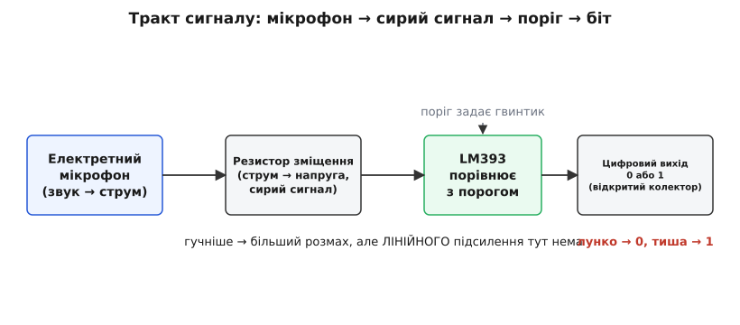
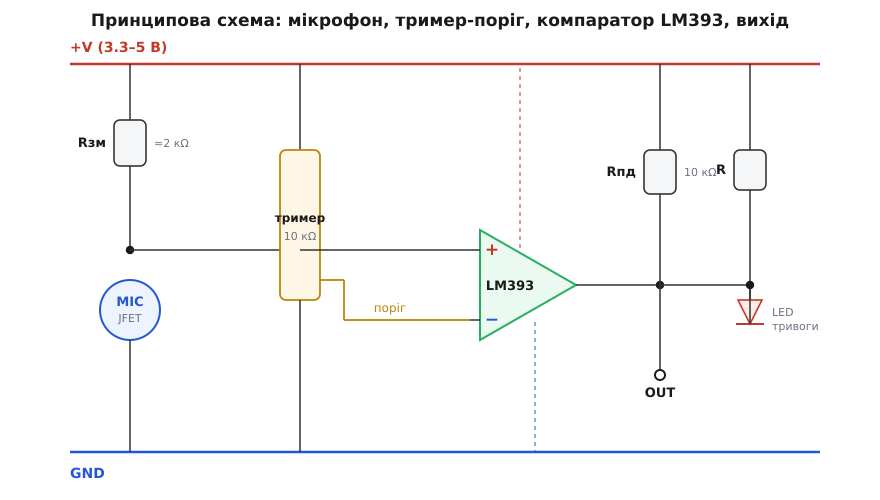
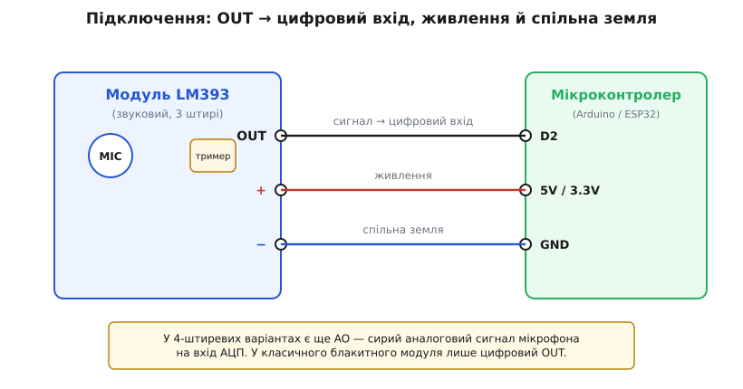
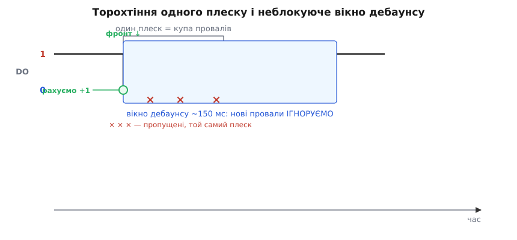

# Звуковий давач з мікрофоном (LM393)

<preknowlist>
- [Компаратор](root:hw-analog/comparator) — принцип роботи порогового елемента та перемикання цифрового виходу.
- [Електретний мікрофон](root:hw-sensing/electret-microphone) — будова чутливого елемента з вбудованим JFET-транзистором і резистором зміщення.
- [Підтяжка та відкритий колектор](root:hw-digital/floating-pullups) — необхідність підтягувального резистора на лінії виходу LM393.
</preknowlist>

## Призначення та концепція порогового звукового давача

Модуль звукового давача на основі компаратора LM393 — це компактний і доступний компонент для виявлення звукових сплесків в аматорській та промисловій автоматиці. Його основне призначення полягає в реєстрації раптових шумів: плескотів у долоні, ударів по поверхні, стуку у двері, дзенькоту розбитого скла або гучних окриків. Давач часто використовується в схемах акустичних реле («плесни в долоні, щоб увімкнути світло»), датчиках тривоги охоронних систем та інтерактивних іграшках.

Принципово важливо розуміти базову концепцію модуля: **це не шумомір і не вимірювач гучності, а пороговий детектор подій**. Він не може виміряти рівень звукового тиску в децибелах, розпізнати людську мову чи зафіксувати тональність звуку. Його завдання — сформувати одиничний цифровий перепад напруги тієї миті, коли амплітуда коливань повітря перевищить заданий рівень.

## Внутрішній тракт: електретний мікрофон та відсутність підсилювача

Вхідною ланкою модуля є мініатюрний електретний мікрофон. Він є різновидом конденсаторного мікрофона, в якому одна з обкладок виконана з тонкої полімерної мембрани з фіксованим електричним зарядом (електретом):

*Тракт проходження сигналу: від акустичної хвилі до цифрового виходу.*

1. **Електретна мембрана:** звукові хвилі викликають мікроскопічні коливання мембрани, змінюючи ємність конденсатора. Оскільки внутрішній заряд залишається постійним, коливання ємності породжують крихітні зміни напруги.
2. **Вбудований польовий транзистор (JFET):** для узгодження надвисокого опору мембрани всередині металевого циліндра мікрофона встановлено транзистор. Він перетворює коливання напруги на коливання струму між виводами стоку та витоку.
3. **Резистор зміщення:** на платі модуля встановлено резистор (близько 2.2 кОм), підтягнутий до шини живлення. Струм мікрофона, протікаючи крізь цей резистор, формує змінну аналогову напругу.
4. **Амплітудні межі:** на класичному модулі відсутній окремий лінійний підсилювач напруги (операційний підсилювач). Тому сигнал на вході компаратора залишається надзвичайно слабким: тиха розмова створює розмах лише в одиниці мілівольтів, а гучний ляскіт — до 30–50 мВ. Саме тому модуль ефективно ловить лише різкі й гучні акустичні події.

## Роль компаратора LM393 та підстроювального тримера

Серцем аналогової обробки модуля виступає інтегральна мікросхема **LM393** — здвоєний диференційний компаратор:

*Схема модуля: вхідний електретний мікрофон, подільник опорної напруги на тримері та вихідний каскад.*

- **Опорна напруга:** синій багатообертовий або однообертовий потенціометр (тример) опором 10 кОм працює як подільник напруги живлення. Обертанням гвинта користувач налаштовує порогову напругу, що подається на інвертувальний вхід компаратора.
- **Порівняння рівнів:** на неінвертувальний вхід надходить пульсуючий сигнал з мікрофона. Поки в приміщенні тихо, сигнал мікрофона не досягає порогу, і вихід залишається відпущеним. Коли звукова хвиля створює сплеск вище порогового рівня, компаратор миттєво змінює стан.
- **Вихід з відкритим колектором:** вихідний транзистор компаратора LM393 вміє лише притягувати лінію до землі (GND). Високий рівень на лінії формується за допомогою підтягувального резистора (pull-up, зазвичай 10 кОм до VCC).
- **Полярність сигналу:** у стані спокою лінія виходу тримається у високому рівні («1»). Під час фіксації гучного звуку компаратор притискає вихід до землі, формуючи короткий активний низький рівень («0»).
- **Світлодіодна індикація:** на платі розташовано два світлодіоди. Світлодіод живлення світиться постійно, а індикатор спрацьовування спалахує синхронно з появою низького рівня на цифровому виході, що спрощує налаштування порогу викруткою.

## Підключення модуля та інтерфейсні виводи

Більшість звукових модулів мають 3-контактний роз'єм для підключення до плати розробника:

*Схема підключення звукового модуля до цифрового входу мікроконтролера.*

- **VCC (+):** живлення модуля. Завдяки широкому діапазону живлення LM393 (від 2 В до 36 В) плата надійно працює як від 3.3 В, так і від 5 В. Рекомендується живити модуль тією напругою, яку використовує логіка мікроконтролера (3.3 В для ESP32 / STM32 і 5 В для класичної Arduino AVR).
- **GND (−):** загальний спільний провід (земля).
- **OUT (DO):** цифровий вихід детектора порогу. Підключається до цифрового виводу GPIO з підтримкою зовнішніх апаратних переривань.
- **Вивід AO (на 4-штиревих версіях):** деякі модифікації модулів містять четвертий контакт — прямий аналоговий вихід із мікрофона (до компаратора). Його можна завести на АЦП мікроконтролера для оцінки розмаху амплітуди пік-в-пік (peak-to-peak).

## Особливості сигналу: акустичний брязкіт і вікно дебаунсу

Звуковий сплеск від удару чи плеску в долоні є загасаючою хвилею, що містить десятки коливань. Компаратор спрацьовує на кожній півхвилі, амплітуда якої перевищує поріг.

*Акустичний брязкіт: одинична подія викликає серію провалів тривалістю 20–100 мс.*

Через це вихідний сигнал не падає в статичний нуль, а являє собою пачку (щіточку) коротких імпульсів тривалістю в кілька мікросекунд або мілісекунд. Для надійної роботи в прошивці мікроконтролера обов'язково застосовують:
1. **Апаратні переривання за спадним фронтом (falling edge):** щоб зафіксувати найперший перепад без ризику пропустити вузький імпульс при повільному опитуванні в циклі.
2. **Програмний дебаунс (dead-time вікно):** після фіксації першого фронту встановлюється блокувальний часовий інтервал (зазвичай 100–200 мс), протягом якого всі наступні імпульси ігноруються як складові того самого звуку.
