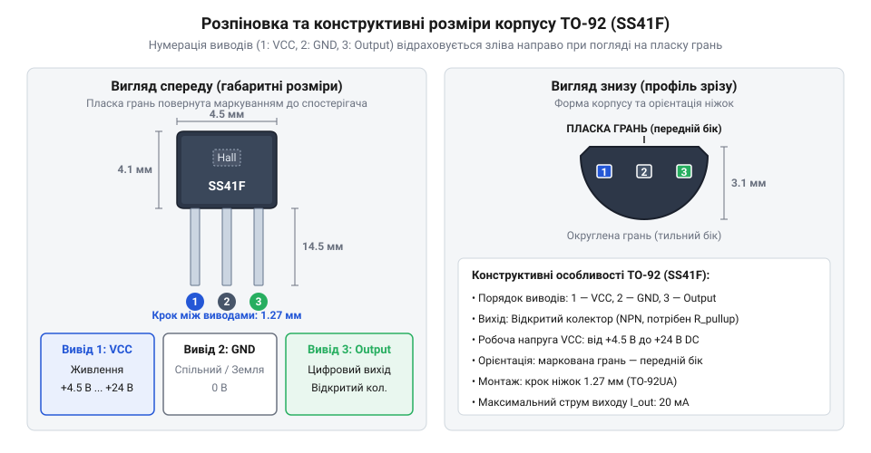
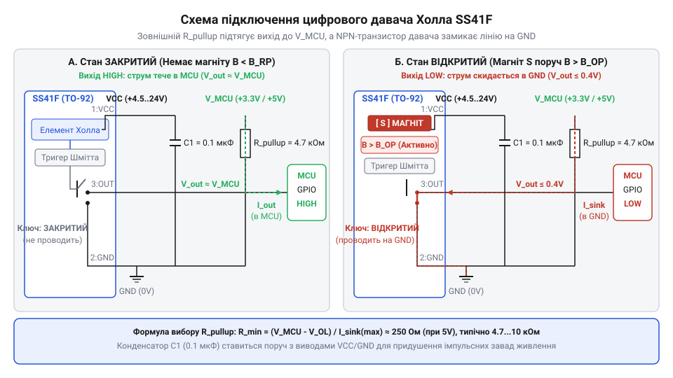
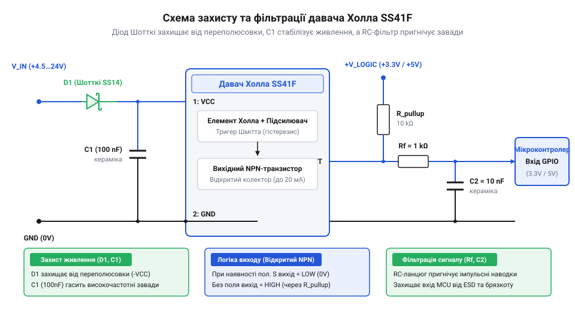

# Залізний інтерфейс: розводка ніжок, схеми підключення та електричні межі SS41F

<preknowlist>
- [KY-003 / KY-024 — давач Голла](root:cat-hw-sensors/ky-003-hall) — загальні уявлення про реакцію напівпровідникового елемента Холла на зовнішнє магнітне поле
- [A3144 — модуль давача Холла](root:cat-hw-sensors/a3144-hall-module) — базові відмінності між дискретними давачами Холла та готовими платами з обв'язкою
</preknowlist>

## Чому пряме підключення SS41F викликає збої

При проектуванні систем вимірювання обертів двигуна або контролю положення вала розробники часто розглядають напівпровідниковий @@en|SS41F Hall sensor@@ як пряму заміну звичайного механічного контактного вузла. Здається природним підключати вихід давача безпосередньо до цифрового вводу мікроконтролера, очікуючи сигналів за аналогією з тим, як працює [міні герконовий давач](root:cat-hw-sensors/ky-021-reed) або кнопка. Проте спроба такого прямого з'єднання призводить до двох типових сбоїв: хаотичного зчитування хибних імпульсів або миттєвого термічного виходу компонента з ладу.

Причина виникнення хаотичних збоїв полягає у фізичному влаштуванні вихідного каскаду. Механічний контакт або [геркон у скляній колбі](root:cat-hw-sensors/ky-025-reed) фізично перемикає електричне коло між двома станами, тоді як кремнієвий елемент SS41F має вихідний каскад типу @@en|open collector@@ (від англ. *open collector* — відкритий колектор, незакріплений вихідний вивід транзистора). За відсутності відповідного магнітного поля вихідний транзистор всередині мікросхеми знаходиться у закритому стані й повністю ізолює вихідний вивід від внутрішніх кіл. Лінія зв'язку між давачем і мікроконтролером опиняється у стані високого імпедансу (@@en|high impedance@@), тобто «зависає» у повітрі. Цифровий вхід мікроконтролера у такому стані працює як високочутлива антена, збираючи електромагнітні наведення від довколишніх дротів, через що логічний рівень самовільно змінюється між одиницею та нулем тисячі разів на секунду.

Друга небезпека прямого включення виникає при неправильному розумінні енергетичних меж і намаганні подати на вихід напругу живлення без обмежувальних елементів. Внутрішній транзистор давача при наближенні магніту з належною полярністю відкривається і насичується, з'єднуючи вихідний вивід безпосередньо із затискачем спільної землі GND. Якщо вихідний дріт був підключений до шини живлення без послідовного опору, виникає режим прямого короткого замикання. Через напівпровідниковий кристалик площею менше квадратного міліметра починає протікати необмежений струм джерела живлення, що викликає локальний @@en|thermal breakdown@@ (від англ. *thermal breakdown* — тепловий пробій, руйнування p-n переходу через перегрів) і незворотне пошкодження пристрою за частки мілісекунди.

На відміну від готових плат, де базові захисні елементи вже розпаяні на друкованому вузлі, як-от [модуль давача Холла](root:cat-hw-sensors/a3144-hall-module), дискретний інтегральний давач SS41F вимагає свідомого проективання зовнішньої обв'язки. Для забезпечення стабільного логічного сигналу та збереження працездатності напівпровідника необхідно детально розібратися з призначенням його фізичних виводів, допустимими напругами живлення та правилами розрахунку зовнішніх узгоджувальних компонентів. Для реалізації побудови систем позиціонування ротора у силових електроприводах перегляньте [схему розстановки давачів Холла у безколекторних двигунах](root:hw-motion/bldc-motor-hall-array).

## Розпіновка TO-92 та робочі електричні межі

Основою безпечного монтажу є точна ідентифікація фізичних виводів давача у просторі та дотримання його допустимих режимів живлення. Давач SS41F випускається у стандартному пластиковому корпусі @@en|TO-92@@ (від англ. *Transistor Outline 92* — конструктивний стандарт корпусів для малопотужних транзисторів і мікросхем). Трьохвивідний корпус має зрізаний трапецієподібний профіль із двома нерівними гранями: пласкою передньою поверхнею, на яку нанесене маркування моделі, та скошеною напівкруглою задньою поверхнею.

Для правильного визначення розпіновки корпус орієнтують пласкою маркованою гранню до себе, спрямовуючи гнучкі виводи донизу. У такому положенні нумерація ніжок відраховується зліва направо від першої до третьої:

1. Перший вивід (зліва) — VCC (від англ. *Voltage Collector Collector*, шина живлення мікросхеми). 2. Другий вивід (по центру) — GND (від англ. *Ground*, спільний дріт та негативний полюс живлення). 3. Третій вивід (справа) — Output (сигнальний вихід з відкритим колектором).

*Призначення та розташування виводів VCC, GND та Output на корпусі TO-92 давача SS41F при огляді з боку маркування.*

Електричні межі живлення SS41F визначені специфікацією внутрішнього компенсатора напруги та чутливого елемента. Робочий діапазон напруги живлення становить від `4.5 V` до `24 V` постійного струму. Абсолютний максимально допустимий рівень напруги на виводі VCC становить `30 V`, проте тривала робота поблизу цієї межі створює ризик пробою при найменших сплесках у лінії.

Важливо враховувати системну особливість: давач SS41F не здатен повноцінно функціонувати від джерела з напругою `3.3 V`. При підключенні VCC до лінії `3.3 V` внутрішній підсилювач сигналів Холла та диференціальний @@en|Schmitt trigger@@ (від англ. *Schmitt trigger* — тригер Шмідта, гістерезисний компаратор) не отримують достатнього потенціалу для зсуву p-n переходів. Внаслідок цього вихідний транзистор залишається у невизначеному стані незалежно від сили зовнішнього магнітного поля. Тому живлення VCC давача завжди підключають до шини `5 V`, `12 V` або `24 V`, навіть якщо керувальний мікроконтролер живиться від `3.3 V`.

Струм споживання самого давача по лінії VCC у стані спокою та під час перемикання є незначним і зазвичай не перевищує `4 mA` до `9 mA`. Проте вихідний транзистор розрахований на протікання зовнішнього струму через колекторний вивід. Максимальний довготривалий струм утримування виходу у відкритому стані `I_SINK` становить `20 mA`. Перевищення цього значення спричиняє швидкий перегрів напівпровідникового кристала та руйнування внутрішнього NPN-транзистора.

## Принцип відкритого колектора та розрахунок підтяжки

Вихідний каскад SS41F сформовано на базі одного NPN-транзистора, емітер якого жорстко з'єднаний із виводом GND, а колектор виведений назовні без будь-яких внутрішніх зв'язків із шиною VCC. Таке схемотехнічне рішення називається каскадом з @@en|open collector@@. Транзистор працює виключно як електронний ключ, здатний замикати сигнальну лінію на землю, але не здатний подавати на неї позитивний потенціал.

Коли зовнішнє магнітне поле досягає порогу спрацьовування, внутрішня схема формує струм бази, транзистор відкривається і входить у режим насичення. Вихідний вивід з'єднується із землею через малий опір відкритого каналу, створюючи на сигнальній лінії напругу насичення `V_SAT ≈ 0.4 V`. Мікроконтролер зчитує цей стан як логічний нуль (LOW). Якщо магнітне поле змінює полярність або зникає, транзистор закривається, і його колекторний перехід перестає проводити струм. За відсутності зовнішньої підтяжки напруга на виході стає невизначеною. Детальніше про механізм перемикання станів та значення магнітних порогів B_OP і B_RP читайте у матеріалі про [біполярне магнітне тригерування давачів SS41F](root:cat-hw-sensors/hall-effect-digital-sensors-family).

Для формування повноцінного двостабільного логічного сигналу між вихідним виводом Output та лінією живлення цифрових кіл мікроконтролера `V_MCU` встановлюють зовнішній резистор підтяжки `R_pullup` (від англ. *pull-up resistor* — підтягувальний резистор).

*Принципова схема підключення SS41F до мікроконтролера з резистором R_pullup до лінії V_MCU та шунтувальним конденсатором C1.*

Розрахунок опору `R_pullup` виконується на основі вибору двох меж: нижньої (безпека транзистора) та верхньої (завадостійкість і швидкість наростання фронту).

Нижня межа опору `R_min` визначається з умови, щоб струм `I_SINK`, який протікає через відкритий транзистор давача на землю, не перевищував максимально допустимого значення `I_SINK_MAX = 20 mA`. Формула розрахунку базується на законі Ома для кола колектора:

R_min = (V_MCU - V_SAT) / I_SINK_MAX

Для системи з логічними рівнями `5 V` при `V_MCU = 5 V` та `V_SAT = 0.4 V`:

R_min = (5 - 0.4) / 0.020        [закон Ома для кола колектора]
= 4.6 / 0.020                    [обчислення різниці напруг]
= 230 Ω                          [мінімальний опір підтяжки]

Для системи з логікою `3.3 V` при `V_MCU = 3.3 V`:

R_min = (3.3 - 0.4) / 0.020      [закон Ома для кола колектора]
= 2.9 / 0.020                    [обчислення різниці напруг]
= 145 Ω                          [мінімальний опір підтяжки]

Встановлення резистора з опором, меншим за `R_min`, призведе до перевищення струму `20 mA` і термічного пошкодження давача при кожному спрацьовуванні.

Верхня межа опору `R_max` обмежується струмом витоку цифрового входу мікроконтролера (зазвичай `I_leak ≈ 1 μA`) та паразитною ємністю лінії `C_stray` (близько `20 pF` до `50 pF`). Занадто великий опір (наприклад, понад `100 kΩ`) утворює з паразитною ємністю RC-ланцюг із великою сталою часу, що затягує фронт наростання напруги від `0.4 V` до `V_MCU` і викликає збої при високій частоті перемикання.

На практиці для більшості застосувань вибирають типові значення `R_pullup` у діапазоні від `4.7 kΩ` до `10 kΩ`. Перевіримо струм протікання для стандартного резистора `4.7 kΩ` при підтяжці до `5 V`:

I_SINK = (5 - 0.4) / 4700        [розрахунок струму колектора]
= 4.6 / 4700                     [поділ напруги на опір]
≈ 0.000978 A                     [результат у амперах]
≈ 0.98 mA                        [робочий струм через відкритий транзистор]

Струм `0.98 mA` становить менше 5% від граничної межі `20 mA`, що забезпечує мінімальне тепловиділення та тривалий ресурс роботи кристала.

Головною перевагою відкритого колектора є можливість узгодження різнорівневих систем (@@en|level shifting@@). Якщо SS41F отримує живлення `VCC = 12 V` від автомобільного акумулятора або промислової шини `24 V`, його вихід через резистор `R_pullup` підтягують до шини `3.3 V` мікроконтролера. При закритому транзисторі на вхід контролера поступає безпечний рівень `3.3 V`, а при відкритому — `0.4 V`, що виключає ризик спалити 3.3-вольтовий вхід високою напругою живлення давача. На відміну від первинних безблокних елементів, які порівнюються у оглядах, як-от базовий [давач Голла](root:cat-hw-sensors/ky-003-hall), дискретний SS41F із зовнішньою підтяжкою дає повну гнучкість у виборі робочих напруг.

## Фільтрація завад та захист від переполюсовки

Реальні умови експлуатації давачів Холла у складі електроприводів, безколекторних моторів чи промислових верстатів супроводжуються потужними електромагнітними завадами. Комутація обмоток двигунів створює високочастотні пульсації та високовольтні сплески у спільній лінії живлення, які можуть призводити до хибних спрацьовувань внутрішнього компаратора SS41F або виклику нестабільності його роботи.

Для придушення високочастотних завад у коло живлення давача обов'язково вводять шунтувальний керамічний конденсатор `C1` номіналом `0.1 μF` (100 nF) — так званий @@en|decoupling capacitor@@ (від англ. *decouple* — розв'язувати, блокувати високочастотні струми). Конденсатор встановлюють паралельно між виводами VCC та GND на мінімальній фізичній відстані від пластикового корпуса TO-92 (не далі `5 mm` до `10 mm` від ніжок). Конденсатор виступає локальним буфером енергії: при швидких імпульсних стрибках струму споживання або падіннях напруги на підвідних дротах `C1` віддає накопичений заряд, підтримуючи стабільний потенціал на внутрішній схемі давача.

Другою поширеною причиною виходу з ладу давачів при монтажі та обслуговуванні є @@en|reverse polarity@@ (зворотна полярність живлення), тобто випадкове переплутування дротів VCC та GND. Внутрішня структура напівпровідникового кристала містить технологічні p-n переходи між підкладкою та елементами схеми. При подачі позитивного потенціалу на GND і негативного на VCC ці переходи відкриваються у прямому напрямку, утворюючи короткий замикальний шлях для струму, що призводить до негайного вигорання мікросхеми.

Для захисту від переполюсовки у послідовний розрив лінії живлення VCC перед конденсатором `C1` впаюють захисний діод. Оскільки кожен звичайний кремнієвий діод створює падіння напруги близько `0.7 V`, для систем із низькою напругою живлення рекомендується використовувати @@en|Schottky diode@@ (від англ. *Schottky diode* — діод Шотткі, напівпровідниковий діод з низьким прямим падінням напруги). Діод Шотткі (наприклад, 1N5819 або BAT54) має пряме падіння напруги всього `0.2 V` до `0.3 V`. При живленні від лінії `5 V` на вивід VCC давача поступає напруга `4.7 V ... 4.8 V`, що залишається у межах гарантованого робочого діапазону (від `4.5 V`).

У випадках, коли сигнальний дріт прокладається на значну відстань (понад 0.5–1 метр) поруч із силовими кабелями, на сигнальний вихід Output додатково встановлюють простий фільтр низьких частот. Вхідний дріт мікроконтролера з'єднують із виводом Output через послідовний резистор `100 Ω`, а безпосередньо біля ніжки мікроконтролера ставлять конденсатор `C2` номіналом `1 nF` до `10 nF` на землю. Це утворює RC-фільтр з частотою зрізу, яка відсікає наведення від комутації силових ключів, але не заважає зчитуванню механічних обертів вала. Захищена таким чином схема SS41F забезпечує безперебійну роботу в промислових та автомобільних умовах.

*Принципова схема підключення SS41F із захисним діодом Шотткі, вирівнювальним конденсатором C1 та вихідним RC-фільтром C2 демонструє повний комплекс захисту від завад і помилок монтажу.*