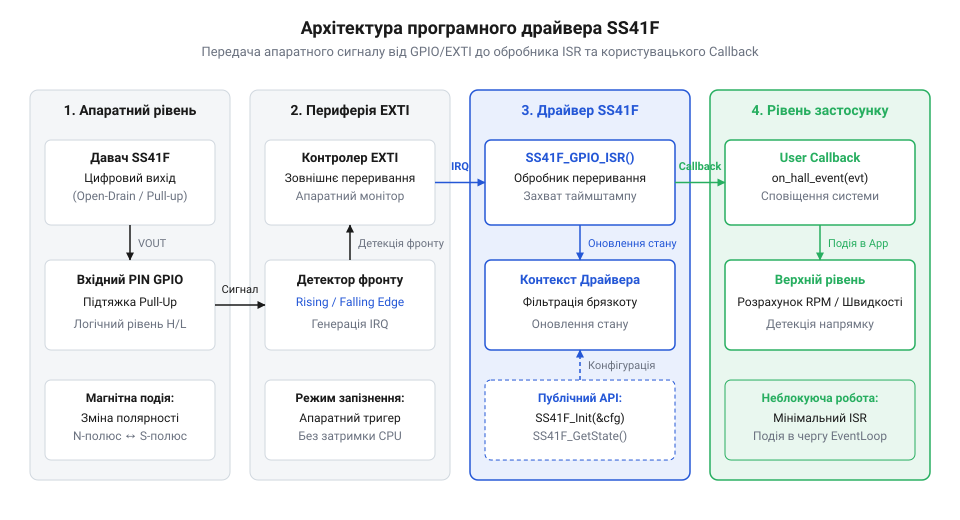
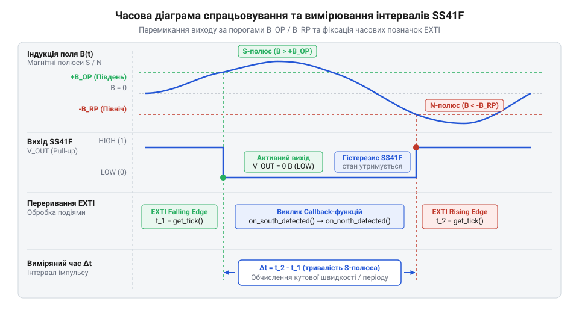

# Програмний інтерфейс: драйвер зчитування та обробки переривань SS41F

<preknowlist>
- [KY-003 / KY-024 — давач Голла](root:cat-hw-sensors/ky-003-hall) — Принцип дії елемента Холла та цифровий вихід давача
- [A3144 — модуль давача Холла](root:cat-hw-sensors/a3144-hall-module) — Відмінності між уніполярним та біполярним зчитуванням магнітного поля
</preknowlist>

## Проблема затримок та втрати перемикань

При вимірюванні швидкості обертання вала двигуна чи колеса за допомогою біполярного давача Холла SS41F цифровий вихід давача змінює свій логічний стан щоразу, коли повз його чутливий елемент проходить протилежний магнітний полюс — південний (S) або північний (N). На високих обертах вала частота цих перемикань сягає сотень або тисяч герц, що відповідає тривалості імпульсів у сотні мікросекунд. Якщо програма мікроконтролера намагається зчитувати стан цифрового виходу через пряме опитування вхідного піна @@en|GPIO@@ (англ. General-Purpose Input/Output, вхід/вихід загального призначення) у головному циклі `while(1)`, розробник неминуче стикається з двох боків із системними обмеженнями.

З одного боку, якщо головний цикл зайнятий іншими завданнями — оновленням дисплея, обробкою мережевих пакетів чи записом даних у пам'ять, — тривалість одного обходу циклу може перевищувати тривалість самого магнітного імпульсу. У результаті мікроконтролер пропускає короткі перехідні фронти сигналу, що призводить до втрати даних про обертання та фатальних помилок у розрахунках швидкості. З іншого боку, якщо реалізувати щільний блокуючий цикл очікування зміни стану піна, процесор повністю блокується на виконання єдиного завдання, марнуючи обчислювальні ресурси та унеможливлюючи паралельну роботу інших підсистем.

Для розв'язання цієї проблеми обробку сигналів біполярного давача Холла необхідно винести у фоновий апаратний шар мікроконтролера. Блок зовнішніх переривань @@en|EXTI@@ (англ. External Interrupt) або режим захоплення входу @@en|Input Capture@@ таймера дозволяють апаратно фіксувати будь-яку зміну логічного рівня (перехід з низького стану в високий або навпаки) миттєво, без участі головної програми. Для детального ознайомлення з конфігурацією магістралей, регістрів маскування та пріоритетів у контролерах STM32 перегляньте статтю про [налаштування зовнішніх переривань EXTI в мікроконтролерах STM32](root:hw-arch/interrupt-driven-io).


*Схема архітектури драйвера SS41F: апаратні переривання EXTI фіксують зміну полярності та передають події у користувацький callback через шар драйвера.*

Низькорівневий @@en|драйвер@@ (англ. driver, від drive — керувати) створює необхідну абстракцію між апаратними перериваннями мікроконтролера та високорівневою логікою застосунку. При виникненні фронту сигналу апаратний блок мовчки перериває поточну роботу процесора, викликає коротку процедуру обробки переривання @@en|ISR@@ (англ. Interrupt Service Routine) та передає подію у @@en|callback-функцію@@ (англ. callback — зворотний виклик) користувача. Це забезпечує повністю неблокуючу архітектуру: процесор виконує поточні завдання, реагуючи на магнітні полюси SS41F за лічені наносекунди. Відмінності від звичайних уніполярних сенсорів, таких як [уніполярні давачі Холла A3144](root:cat-hw-sensors/a3144-hall-module) чи [модулі давачів KY-003](root:cat-hw-sensors/ky-003-hall), полягають саме в біполярному фіксуванні, що вимагає точного відстеження обох фронтів сигналу.

## Структура стану та ініціалізація драйвера

Програмний інтерфейс драйвера SS41F базується на принципі суворого відокремлення налаштувань апаратного середовища (номер піна, порт, налаштування переривання) від поточного стану обробки сигналу. Стан драйвера описується спеціальною структурою даних, яка зберігає поточний логічний рівень давача, часову позначку останньої зміни полюса, налаштований часовий інтервал фільтрації брязкоту та вказівник на функцію зворотного виклику.

Структура конфігурації `ss41f_config_t` задає первинні параметри, потрібні для прив'язки до периферії, тоді як структура контексту `ss41f_driver_t` містить внутрішній стан та лічильники подій.

Функція ініціалізації `ss41f_init()` виконує такі послідовні дії:
1. Перевіряє коректність наданих вказівників та конфігураційних параметрів. 2. Налаштовує вхідний pin @@en|GPIO@@ у режим входу з підтягувальним резистором (англ. @@en|pull-up resistor@@, від @@en|pull up@@ — підтягувати вгору). Підтяжка до живлення фізично необхідна через вихід типу @@en|відкритий колектор@@ в SS41F: внутрішній вихідний транзистор за наявності відповідного магнітного поля відкривається і замикає лінію на землю (низький рівень), а при зміні полярності закривається, залишаючи вихід розімкненим. Без підтягувального резистора вхідний pin стає @@en|плаваючим входом@@ (англ. @@en|floating input@@, від @@en|float@@ — плавати), на якому через довколишні електромагнітні наводки напруга хаотично коливається між 0 та 1. Це призводить до хибних спрацьовувань переривань @@en|EXTI@@, зайвого енергоспоживання входів та некоректного визначення полярності; детальніше [апаратне підключення давача](root:cat-hw-sensors/a3144-hall-module) описує відповідна стаття. 3. Зчитує початковий логічний стан на вході для визначення поточного магнітного полюса. 4. Конфігурує переривання @@en|EXTI@@ на спрацьовування за обома фронтами (англ. rising and falling edges). 5. Зберігає конфігурацію в контексті драйвера та переводить екземпляр у стан готовності.

Розглянемо практичну реалізацію інтерфейсу ініціалізації мовами C та C++.

:::tabs
@tab C
:::code api-ss41f-mcu-driver-interface/c/ss41f-init.c
@tab C++
:::code api-ss41f-mcu-driver-interface/cpp/ss41fpole.cpp
:::

Завдяки відокремленню конфігурації від стану екземпляр `ss41f_driver_t` гарантує безпечне оголошення як глобального об'єкта чи елемента статичного масиву для обслуговування кількох давачів Холла одночасно.

## Обробка переривань та системні callbacks

Коли вихідний сигнал SS41F змінює логічний рівень через зміну полярності магнітного поля, мікроконтролер генерує апаратне переривання @@en|EXTI@@. Головне правило написання обробника переривань @@en|ISR@@ — мінімальний час перебування в ньому. Увесь важкий обчислювальний аналіз та обробка бізнес-логіки мають бути винесені в основний цикл програми або завдання RTOS.

Обробник переривання реалізує таку послідовність дій:
1. Зчитує поточний точний час у мікросекундах від системного таймера. 2. Опитує поточний логічний стан піна @@en|GPIO@@ для визначення напрямку переходу (N або S). 3. Перевіряє часовий інтервал від попередньої події для програмного придушення брязкоту (якщо `t_now - t_last < t_debounce`, подія ігнорується). 4. Оновлює внутрішній стан структури драйвера (`current_pole`, `last_change_us`, `event_count`). 5. Якщо зареєстровано користувацьку @@en|callback-функцію@@, викликає її безпосередньо або надсилає сповіщення у чергу подій.

Важливо враховувати, що змінні, які змінюються всередині @@en|ISR@@ та зчитуються в головному коді, повинні мати кваліфікатор @@en|volatile@@ (від лат. *volatilis* — летючий) для запобігання небажаним оптимізаціям компілятора, які можуть закешувати значення у регістрах процесора. Проте @@en|volatile@@ лише змушує компілятор щоразово звертатися до пам'яті і не гарантує @@en|атомарність@@ (від грец. *ἄτομος* — неподільний) читання. Якщо головна програма опитує багатобайтову змінну (наприклад, 32-бітну мітку часу `last_change_us` або лічильник `event_count` на 8- чи 16-бітному мікроконтролері), зчитування виконується послідовно за декілька команд процесора. Якщо апаратне переривання виникне посеред цього процесу й @@en|ISR@@ змінить значення змінної, головний код прочитає частину старих і частину нових байтів, отримавши спотворений результат та @@en|стан гонитви@@ (англ. @@en|race condition@@). Щоб уникнути цього, зчитування багатобайтового стану в головному коді обов'язково виконують у @@en|критичній секції@@ (англ. @@en|critical section@@) — тимчасово заблокувавши переривання на час копіювання даних.

:::tabs
@tab C
:::code api-ss41f-mcu-driver-interface/c/ss41f-isr-handler.c
@tab C++
```cpp
void handleInterrupt(SS41FDriver& driver, uint32_t current_time_us, bool pin_level_high) {
    // Внутрішня методика обробки переривання для C++ об'єкта
    SS41FPole new_pole = pin_level_high ? SS41FPole::North : SS41FPole::South;
    // Оновлення стану драйвера та безпечний виклик збереженої події
}
```
:::

Використання асинхронного callback дозволяє вищому рівню програми реагувати на зміну полюсів (наприклад, переключати обмотки безколекторного двигуна чи реєструвати крок тахометра) негайно, не витрачаючи ресурси на опитування прапорців. Про особливості реєстрації обробників переривань GPIO та передачу подій у середовищі ESP-IDF читайте у матеріалі про [обробку переривань GPIO в середовищі ESP-IDF](root:sys-fw/esp32-gpio-isr-driver).

## Зчитування стану та вимірювання інтервалів

Для побудови системи вимірювання частоти обертання (тахометра) або оцінки швидкості переміщення простої реєстрації подій недостатньо. Необхідно вимірювати часовий інтервал між послідовними перемиканнями полюсів S → N та N → S.

Вихідний сигнал біполярного давача SS41F при постійному обертанні ротора з магнітами є періодичним прямокутним імпульсом. Часовий інтервал між сусідніми фронтами сигналу `t_delta` обчислюється як різниця поточного значення часу `t_now` та збереженого часу попереднього перемикання `t_prev`:

```
t_delta = t_now - t_prev
```

Звідси повний період двох послідовних перемикань полюсів (одна повна магнітна пара N-S) дорівнює:

```
T_period = t_delta_SN + t_delta_NS
```

Частота зміни полярності магнітного поля обчислюється за формулою:

```
f_rot = 1 ÷ T_period
```


*Часова діаграма перемикання виходу SS41F під дією змінних магнітних полюсів із вимірюванням тривалості імпульсів t_delta.*

Розглянемо реалізацію функцій API драйвера для отримання поточного стану та обчислення мікросекундних інтервалів між фронтами:

:::tabs
@tab C
:::code api-ss41f-mcu-driver-interface/c/ss41f-get-pole.c
@tab C++
:::code api-ss41f-mcu-driver-interface/cpp/ss41fintervalmeter.cpp
:::

Обчислення інтервалів із захистом від переповнення 32-бітного таймера мікросекунд дозволяє надійно вимірювати тривалість перемикань навіть при тривалій автономній роботі пристрою.

## Обробка брязкоту та нештатних ситуацій

При експлуатації біполярного давача Холла в реальних умовах виникають ситуації, здатні порушити роботу драйвера:
1. **Магнітний брязкіт та завади.** Якщо магніт зупиняється або повільно рухається біля самої межі перемикання тригера Холла, механічна вібрація чи електричні наводки на лінії живлення можуть викликати швидку серію логічних перепадів. Хоча SS41F має вбудований @@en|гістерезис@@ (грец. ὑστέρησις — відставання), зовнішні завади іноді спричиняють логічний хибний брязкіт. На відміну від механічних контактів у [герконових вимикачах KY-021](root:cat-hw-sensors/ky-021-reed) чи [модулях KY-025](root:cat-hw-sensors/ky-025-reed), брязкіт у давачі Холла має електромагнітне походження. 2. **Перевищення допустимої частоти.** Якщо швидкість обертання перевищує максимально допустиму частоту оновлення давача або здатності MCU обробляти переривання, виникає стан перевантаження. 3. **Відсутність імпульсів (Таймаут).** Зупинка вала призводить до відсутності переривань. API драйвера повинне вміти виявляти зупинку за таймаутом без очікування апаратних подій.

Для захисту від завад застосовується часовий @@en|програмний дебаунс@@ (англ. debounce — усунення брязкоту). Якщо між двома послідовними спрацьовуваннями переривання пройшло менше ніж `debounce_window_us` (наприклад, менше ніж 10–50 мікросекунд), драйвер ігнорує поточний фронт і повертає код помилки `SS41F_ERR_DEBOUNCE_BLOCKED`.

Також драйвер повинен надавати розширений API з поверненням діагностичних кодів помилок.

:::tabs
@tab C
:::code api-ss41f-mcu-driver-interface/c/ss41f-check-timeout.c
@tab C++
:::code api-ss41f-mcu-driver-interface/cpp/ss41fdiagstatus.cpp
:::

Використання програмного дебаунсу та діагностики таймауту гарантує стійкість системи до фізичних завад і дає можливість коректно обробляти як раптові зупинки обертання, так і екстремальні сплески частоти.