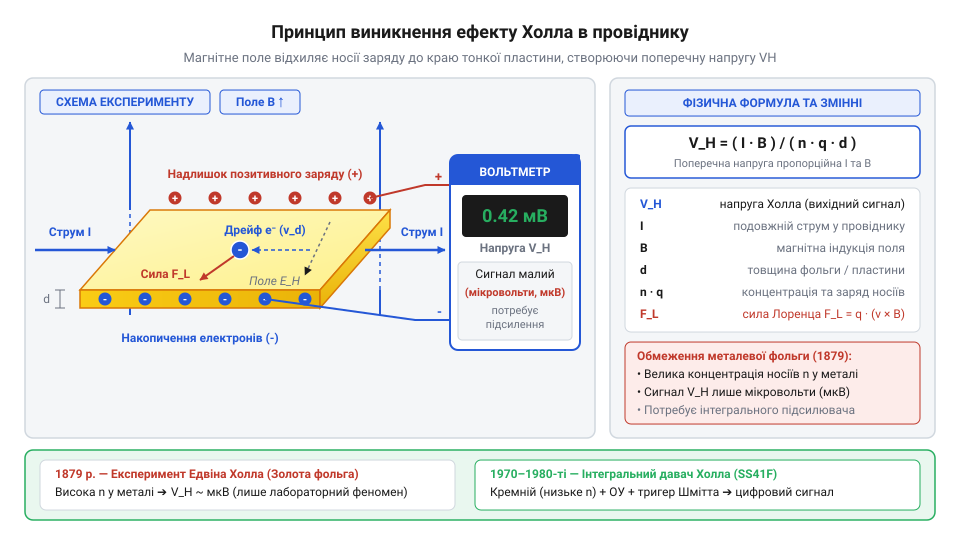
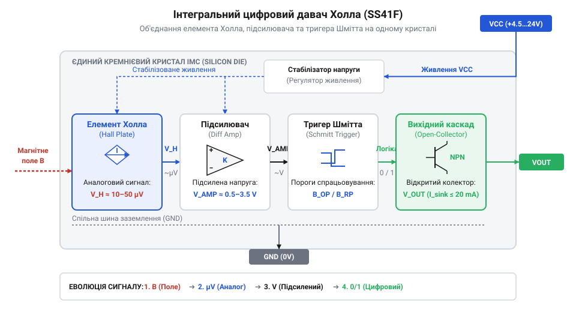

# Від відкриття Едвіна Холла до кремнієвого тригера

<preknowlist>
- [KY-021 — міні герконовий давач](root:cat-hw-sensors/ky-021-reed) — принцип дії герконних контактів під дією магнітного поля та їхні механічні обмеження
- [KY-003 / KY-024 — давач Голла](root:cat-hw-sensors/ky-003-hall) — базові принципи функціонування сучасних модулів давачів Холла
- [A3144 — модуль давача Холла](root:cat-hw-sensors/a3144-hall-module) — практичне використання твердотільних перемикачів у цифрових мікроконтролерних системах
</preknowlist>

## Ненадійність механічних контактів у промисловості

Наприкінці XIX століття єдиним інструментом автоматизації були механічні вимикачі, кінцевики та реле, що замикали коло фізичним зіткненням металевих пластин. Під час роботи на високій частоті або в умовах вібрації пружність металу під час змикання викликає серію швидких відскоків. Замість одного переходу виникає `@@en|деренчання контактів@@` (з англ. *contact bounce* — пружний відскок контактних поверхонь), що генерує десятки хибних імпульсів.

Під час розмикання контактів під навантаженням струм іонізує повітряний проміжок, викликаючи `@@en|іскріння@@` (з англ. *sparking* — електричний розряд у газовому середовищі) й електричну дугу. Висока температура дуги випаровує метал і спричиняє `@@en|зношування контактів@@` (з англ. *contact erosion* — руйнування матеріалу розрядом), через що електроди вигорають або зварюються.

Спробою розв'язати проблему окиснення став `@@en|геркон@@` (від укр. *герметичний контакт*; англ. `@@en|reed switch@@` від *reed* — гнучкий язичок) — феромагнітні пластини в скляній колбі з інертним газом, що замикаються зовнішнім магнітним полем. Використовуючи [компактні герконові вимикачі](root:cat-hw-sensors/ky-021-reed) або [геркон у скляній колбі](root:cat-hw-sensors/ky-025-reed), інженери ізолювали електроди від середовища. Проте геркон залишається механічним: через втому металу та резонанс він пропускає спрацьовування на частотах понад кілька сотень герц і руйнується після 10⁷–10⁸ циклів.

Для надійної автоматики потрібен був інший фізичний принцип: безконтактне перетворення магнітного поля в електричний сигнал усередині монолітного твердого тіла без рухомих деталей і зносу.

## Експеримент 1879 року та мікровольтовий бар'єр

У 1879 році в Університеті Джонса Хопкінса американський фізик Едвін Герберт Холл перевіряв припущення Джеймса Клерка Максвелла про те, що магнітна сила діє на сам провідник, а не на електричний струм. Холл прагнув з'ясувати, чи здатне магнітне поле безпосередньо відхиляти носії заряду.

Для досліду він виготовив тонку смужку із `@@en|золотої фольги@@` (з англ. *gold foil* — надтонка металева пластина), наклеєну на скляну основу. Крізь фольгу пропустив струм `I`, а пластину помістив між полюсами електромагніту так, щоб вектор магнітної індукції `B` був перпендикулярним до поверхні. Вимірюючи напругу між бічними кромками гальванометром, Холл виявив поперечну різницю потенціалів, яка з'являлася лише за одночасної наявності струму та магнітного поля.

Механізм цього явища пояснюється дією сили, яку описав Гендрік Лоренц. Коли носії заряду `q` рухаються зі середньою дрейфовою швидкістю `v` у перпендикулярному магнітному полі `B`, на кожну частинку діє `@@en|сила Лоренца@@` (з нід. *Lorentz-kracht*, на честь Г. Лоренца; англ. `@@en|Lorentz force@@`):

```
F = q · (v × B)
```

Ця сила відхиляє електрони до однієї з бічних граней пластини, створюючи надлишок негативного заряду на одному краї та позитивного на протилежному. Накопичення зарядів створює поперечне електричне поле `E_H`, яке протидіє подальшому відхиленню. Рівновага настає, коли електрична сила балансує магнітну:

```
q · E_H = q · v · B
```

Поперечне поле `E_H` уздовж ширини пластини `w` утворює різницю потенціалів, яку називають `@@en|напругою Холла@@` (з англ. *Hall voltage* — поперечна напруга у провіднику у магнітному полі):

```
V_H = E_H · w
```

Щоб виразити напругу через струм `I` та товщину пластини `t`, врахуємо концентрацію носіїв `n` та елементарний заряд `e`:

```
I = n · e · v · w · t
```

Виразивши дрейфову швидкість `v` із рівняння струму й підставивши її у вираз напруги, отримуємо підсумкову формулу:

```
V_H = v · B · w
    = (I / (n · e · w · t)) · B · w      [заміна дрейфової швидкості v]
    = (I · B) / (n · e · t)               [скорочення ширини w]
```


*На схемі показано тонку провідну пластину під дією перпендикулярного магнітного поля B, крізь яку тече струм I.*

Отримане рівняння пояснює, чому відкритий `@@en|ефект Холла@@` (з англ. *Hall effect* — виникнення поперечної напруги під дією магнітного поля) залишався лабораторним феноменом майже століття. У знаменнику стоїть концентрація носіїв `n`. У металах (золоті, міді) концентрація вільних електронів колосальна (`~10²⁸ m⁻³`), тому знаменник надзвичайно великий, а напруга `V_H` навіть у полях у кілька Тесла не перевищує часток мікровольта (`10⁻⁶ V`).

Сигнал амплітудою в кілька мікровольт не міг керувати реле чи механізмами XIX століття. Дрібні температурні коливання викликали в контактах паразитну термо-ЕРС, що повністю перекривала корисний сигнал. Металеві елементи Холла вимагали складних дзеркальних гальванометрів і були непридатними для практичної автоматики.

## Кремнієва інтеграція та поява тригера Шмітта

Вирішальний крок від лабораторного ефекту до масового промислового давача відбувся у середині XX століття з розвитком фізики напівпровідників. У матеріалах, таких як кремній (`Si`) або антимонід індію (`InSb`), концентрація вільних носіїв заряду `n` становить приблизно `10²² m⁻³`, що на 4–6 порядків менше, ніж у металах. Зменшення `n` у знаменнику формули збільшує напругу Холла: при однакових струмі `I` та полі `B` напівпровідниковий елемент видає сигнал мілівольтового діапазону (`10⁻³ V`), що в тисячі разів перевищує відгук золотої фольги.

Проте самого лише напівпровідника було недостатньо для надійного вимикача. Вихідна мілівольтова напруга залишалася аналоговою: при повільному наближенні магніту вона плавно зростала. Пряме підключення аналогового сигналу до цифрового входу контролера спричиняє хаотичні перемикання та невизначеність логічного рівня через найменший шум на межі спрацьовування.

Справжній технологічний прорив відбувся у 1970-х роках із розвитком монолітних інтегральних схем. Інженери об'єднали на єдиному кремнієвому кристалі площею в кілька квадратних міліметрів три функціональні блоки:


*На блочній схемі показано поєднання кремнієвого елемента Холла, операційного підсилювача та тригера Шмітта на одному кристалі.*

Перший блок — напівпровідниковий елемент Холла, який перетворює магнітний потік на мілівольтову різницю потенціалів. Другий блок — диференційний @@en|операційний підсилювач@@ (з англ. *operational amplifier* — підсилювач постійного струму з великим коефіцієнтом підсилення), що масштабує сигнал до кількох вольт та компенсує температурний дрейф. Третій блок — @@en|тригер Шмітта@@ (названий на честь Отто Шмітта; англ. @@en|Schmitt trigger@@, див. також [принцип роботи тригера Шмітта](root:hw-analog/schmitt-trigger)), який перетворює плавно підсилену напругу на стрибкоподібний цифровий сигнал.

Тригер Шмітта вводить магнітний @@en|гістерезис@@ (з дав.-гр. *ὑστέρησις* — запізнення; англ. @@en|hysteresis@@) за допомогою двох порогів: увімкнення `B_OP` (з англ. *magnetic operate point*) та вимкнення `B_RP` (з англ. *magnetic release point*). Коли індукція перевищує `B_OP`, вихід миттєво змінює стан. При віддаленні магніту вихід утримує стан, поки індукція не впаде нижче `B_RP`. Різниця між порогами `B_HYS = B_OP - B_RP` створює зону нечутливості до шумів, що усуває тріпотіння виходу при вібраціях.

Вихідний каскад перемикачів будують за схемою з @@en|відкритим колектором@@ (з англ. *open collector* — вихідний транзисторний каскад без внутрішньої підтяжки до живлення) для гнучкого узгодження з рівнями цифрової логіки.

Поява масових твердотільних перемикачів, таких як [давач Голла KY-003](root:cat-hw-sensors/ky-003-hall) або біполярний [цифровий вимикач A3144](root:cat-hw-sensors/a3144-hall-module), змінила промисловість. Інтеграція елемента Холла з підсилювачем і тригером створила надійні безконтактні вимикачі. Зокрема, @@en|біполярний давач Холла@@ (з англ. *bipolar Hall sensor* — давач, що змінює стан лише при зміні полярності поля) типу @@en|SS41@@ відкрив шлях до безколекторних двигунів (@@en|BLDC@@, з англ. *Brushless Direct Current motor*), забезпечуючи електронну комутацію обмоток без механічного зношування.

## Біполярні давачі SS41 у безколекторних двигунах

Спроба керувати потужним двигуном на високих обертах вимагає точної синхронізації фаз. У класичному мотері постійного струму цю задачу виконує механічний колектор зі щітками, що супроводжується іскрінням та зношуванням контактів. Щоб усунути тертя й перейти до безколекторних систем, контролер мусить безконтактно знати положення ротора. Ззвичайний перемикач тут не працює: коли магнітний полюс пролітає повз давач, індукція падає до нуля, і чутливий елемент без логіки утримання стану хаотично перемикається від найменших вібрацій вала.

Розв'язком цієї проблеми став біполярний фіксатор @@en|SS41@@ (від англ. *bipolar latch*). На відміну від однополярного [модуля давача Холла](root:cat-hw-sensors/a3144-hall-module), що реагує лише на один полюс, біполярний перемикач змінює стан виключно при зміні полярності. Коли північний полюс перевищує поріг спрацьовавання `B_OP` (від англ. @@en|operating point@@ — точка спрацьовування), вихідний транзистор відкривається. Давач зберігає цей стан і після віддалення магніту — доки південний полюс не перевищить поріг повернення `B_RP` (від англ. @@en|release point@@ — точка повернення). Такий полярний @@grc|гістерезис@@ (від грец. *hystēresis* — запізнення, відставання) створює тригерну пам'ять, а обертання ротора формує на виході прямокутний цифровий сигнал.

У трифазному безколекторному двигуні (англ. @@en|brushless DC motor@@, або @@en|BLDC@@) три @@en|біполярні давачі Холла@@ розміщують довкола @@lat|статора@@ (від лат. *stator* — той, що стоїть) під кутом 120 або 60 електричних градусів. Їхні сигнали дозволяють драйверу в момент переходу @@lat|ротора@@ (від лат. *rotare* — обертати) @@lat|комутувати@@ (від лат. *commutatio* — зміна) відповідні силові ключі. Порівняно з [міні герконовим давачем](root:cat-hw-sensors/ky-021-reed), твердотільна комутація працює на частотах у десятки кілогерц без деренчання контактів і механічного зношування. На цьому ж принципі будують магнітний @@en|енкодер@@ (від англ. *encoder* — кодувальник) для вимірювання швидкості та кута обертання вала в умовах пилу й оливного туману.

## Розвінчання міфів про походження твердотільних давачів

Поширене уявлення стверджує, ніби американський фізик Едвін Холл у 1879 році створив готовий магнітний давач для автоматики. Насправді його експеримент в Університеті Джонса Гопкінса був суто фундаментальним дослідженням. Металева золота фольга принципово не могла слугувати промисловим давачем: через гігантську концентрацію носіїв заряду поперечна різниця потенціалів становила частки мікровольта, тонула в шумах і вимагала лабораторних дзеркальних @@grc|гальванометрів@@ (від італ. *Galvani* та грец. *metron* — вимірювач). Практичний прорив стався лише у 1970–1980-х роках із розвитком кремнієвої планарної технології. Зменшення концентрації носіїв у напівпровіднику та монолітна інтеграція елемента Холла й підсилювача створили сучасний [простий давач Голла](root:cat-hw-sensors/ky-003-hall).

Інший міф полягає у переконанні, що напівпровідниковий давач є беззастережною заміною для будь-яких магнітних комутаторів. На відміну від пасивного пристрою, яким є [геркон у скляній колбі](root:cat-hw-sensors/ky-025-reed), твердотільний перемикач є @@lat|активним пристроєм@@ (від лат. *activus* — дієвий). Він вимагає постійного зовнішнього живлення й власного споживання струму навіть у стані очікування, що унеможливлює його використання в автономних пристроях із наднизьким енергоспоживанням від однієї дискової батарейки.

Крім того, кремнієва структура має власні фізичні обмеження. Підвищення температури понад 125–150 °C збільшує струми витоку й спричиняє температурний дрейф точок спрацьовування `B_OP` та `B_RP`. Через технологічну асиметрію елемента виникає залишковий офсет, який вимагає внутрішньосхемної динамічної компенсації (англ. @@en|chopper stabilization@@ — чоперна стабілізація). Також кристал чутливий до високовольтних імпульсів та завад. Тому інженер обирає давач свідомо: для швидкісної @@lat|комутації@@ та енкодерів застосовують давачі Холла, для вимірювання великих струмів — [модуль давача струму](root:cat-hw-sensors/acs712-current-sensor-module), а для простих енергонезалежних контактів — геркони або оптичні датчики.