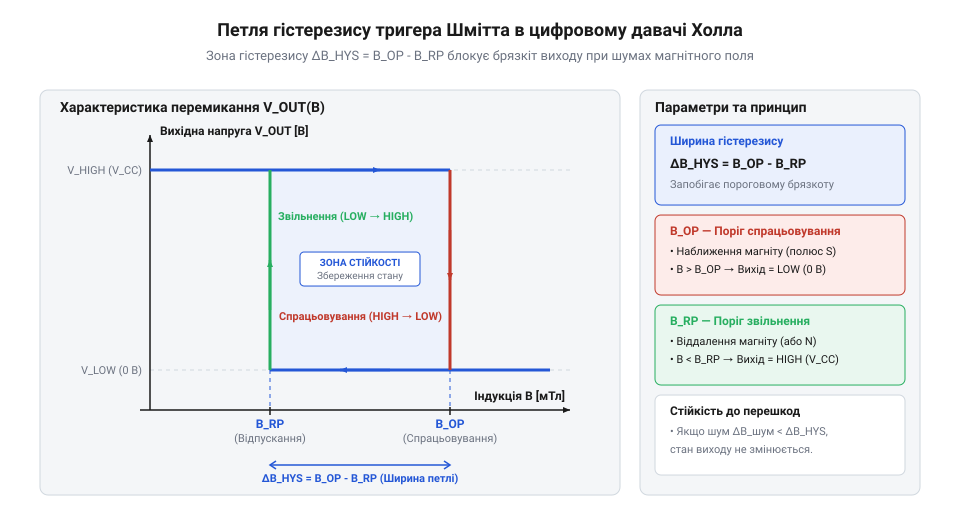
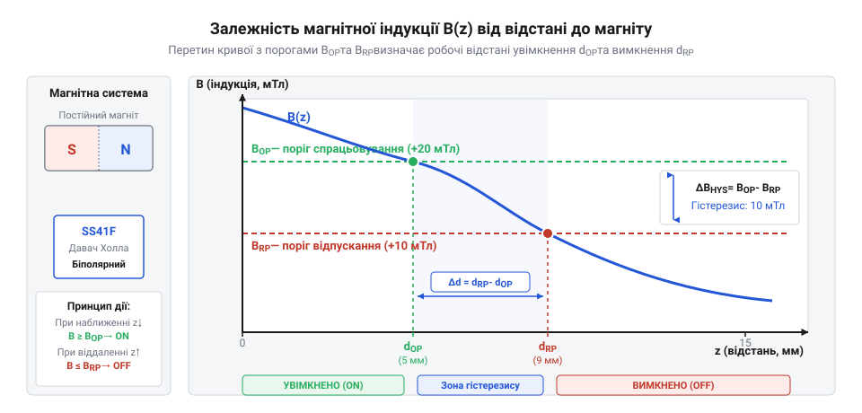

# Фізичні рівняння ефекту Холла та магнітний гістерезис

<preknowlist>
- [KY-003 / KY-024 — давач Голла](root:cat-hw-sensors/ky-003-hall) — Загальні принципи роботи цифрових і аналогових модулів Холла та їх застосування в схемах.
- [A3144 — модуль давача Холла](root:cat-hw-sensors/a3144-hall-module) — Базові характеристики цифрового ключа Холла та структура його вихідних станів.
</preknowlist>

## Невизначеність перемикання біля магнітного порогу

Уявіть механічний вузол, у якому магніт, закріплений на рухомому штоку чи шестерні, повільно наближається до напівпровідникового елемента давача. Якщо внутрішній компаратор пристрою налаштований на єдине фіксоване значення порогової індукції, наприклад 5 мТл, то в реальних умовах експлуатації система неминуче зіштовхнеться з деструктивною поведінкою вихідного сигналу.

Реальне магнітне поле в робочому зазорі ніколи не буває абсолютно статичним. Воно містить дрібні пульсації, зумовлені механічною вібрацією кронштейна, тепловим шумом напівпровідника, температурним розширенням деталей та электромагнітними наводками від сусідніх силових кабелів чи електродвигунів. Коли магніт зупиняється або повільно рухається в зоні, де середня @@en|індукція магнітного поля@@ становить саме 5 мТл, дрібні високочастотні коливання амплітудою всього у кілька десятих часток мілітесла змушують сумарне поле неперервно перетинати поріг у 5 мТл вгору та вниз по кілька тисяч разів на секунду.

Якщо компаратор реагує на єдиний поріг, його цифровий вихід почне хаотично перемикатися між логічним нулем та одиницею. Цей ефект називається @@en|брязкіт@@ (від англійського chattering — хаотичні осциляції). Хаотичний @@en|брязкіт@@ виходу створює одразу кілька серйозних проблем для електронної системи:
1. Захоплений перериваннями мікроконтролер сприймає тисячі хибних імпульсів замість одного реального факту наближення магніту, що повністю блокує обробку програмного коду або спотворює показники лічильника обертів. 2. Вихідний транзистор давача не встигає перейти в режим повного насичення чи відсічки, тривалий час перебуваючи в лінійному режимі підсилення. Це викликає підвищене струмове навантаження, перевитрату енергії та критичний перегрів напівпровідникового кристала. 3. Швидкі хаотичні перепади напруги на вихідній лінії генерують потужні імпульсні завади в колі живлення та сусідніх сигнальних провідниках.

Просте аналогове підсилення первинної напруги, яку генерує @@en|ефект Холла@@ (від прізвища американського фізика Edwin Hall), не здатне вирішити цю проблему. Первинна @@en|ЕРС Холла@@ є неперервною аналоговою величиною, яка плавно відтворює всі шуми та пульсації зовнішнього магнітного поля. Якщо подати такий підсилений аналоговий сигнал безпосередньо на цифрову схему з одним порогом порівняння, шумова смуга в точці перетину неминуче перетвориться на хаотичну серію хибних перемикань. На відміну від механічних контактів, які використовує [міні герконовий давач](root:cat-hw-sensors/ky-021-reed) і де існує механічне пружне прилипання, напівпровідникові давачі потребують спеціального схемотехнічного рішення для формування дискретних рівнів.

Для усунення невизначеності та забезпечення чіткого перемикання логічного стану необхідно перетворювати неперервну аналогову @@en|ЕРС Холла@@ на дискретні рівні за допомогою вимірювального вузла з двома розділеними порогами. Щоб побудувати таку математичну модель, спочатку необхідно зрозуміти фізичний механізм виникнення первинної аналогової напруги в напівпровіднику, а потім сформулювати модель двопорогового перетворювача.

## Фізичне виведення електрорушійної сили Холла

Виникнення первинного аналогового сигналу в давачі ґрунтується на явищі відхилення рухомих носіїв заряду під дією зовнішнього магнітного поля. Розглянемо тонку прямокутну пластину з напівпровідникового матеріалу товщиною `d`, шириною `w` та довжиною `l`, яка описує первинний перетворювач, що використовує класичний [давач Холла KY-003](root:cat-hw-sensors/ky-003-hall) або вимірювальний [давач струму ACS712](root:cat-hw-sensors/acs712-current-sensor-module). Уздовж пластини (уздовж осі x) пропускають стабільний струм керування `I`. Зовнішнє магнітне поле з індукцією `B` спрямоване перпендикулярно до площини пластини (уздовж осі z).

Електричний струм у напівпровіднику являє собою впорядкований рух вільних носіїв заряду (електронів або дірок), які рухаються із середньою швидкістю, що називається @@en|швидкість дрейфу@@ `v_d`. Коли заряджена частинка із зарядом `q` рухається в магнітному полі, на неї діє поперечна @@en|сила Лоренца@@ (від прізвища нідерландського фізика Hendrik Lorentz). Модуль цієї сили визначається виразом:

```
F_L = |q| · v_d · B                          [абсолютна величина сили Лоренца]
```

Оскільки @@en|сила Лоренца@@ спрямована перпендикулярно як до вектора швидкості дрейфу `v_d`, так і до вектора індукції `B`, вона відхиляє носії заряду до однієї з бічних граней пластини (уздовж осі y). На накопичення носіїв заряду біля однієї грані вказує виникнення некомпенсованого заряду протилежного знаку на протилежній бічній гранці. Це просторове розділення зарядів створює всередині пластини поперечне електричне поле, яке описує @@en|напруженість електричного поля@@ Холла `E_H`.

Утворене поперечне електричне поле діє на носії заряду з кулонівською силою `F_E`, спрямованою протилежно до сили Лоренца:

```
F_E = |q| · E_H                              [електрична сила кулонівського відштовхування]
```

У стаціонарному стані встановлюється динамічна рівновага, за якої поперечна електрична сила повністю врівноважує магнітну силу Лоренца:

```
F_E = F_L                                    [умова динамічної рівноваги]
    = |q| · E_H = |q| · v_d · B              [підстановка виразів для сил]
    = E_H = v_d · B                          [скорочення заряду q]
```

Щоб пов'язати @@en|напруженість електричного поля@@ `E_H` із зовнішнім вимірюваним струмом керування `I`, скористаємося зв'язком струму та швидкості дрейфу. Повний струм через поперечний переріз площею `A = w · d` дорівнює добутку густини струму `j` на площу перерізу: `I = j · w · d`. Оскільки @@en|густина струму@@ визначається концентрацією носіїв `n` як `j = n · |q| · v_d`, @@en|швидкість дрейфу@@ можна виразити через струм керування:

```
v_d = I / (n · |q| · w · d)                  [вираження швидкості дрейфу через струм]
```

Поперечна різниця потенціалів між бічними гранями пластини шириною `w` становить первинну @@en|ЕРС Холла@@ `V_H`. Підставивши рівноважне значення електричного поля та вираз для швидкості дрейфу, отримуємо покрокове виведення:

```
V_H = E_H · w                                [визначення напруги через напруженість]
    = v_d · B · w                            [підстановка умови рівноваги E_H = v_d · B]
    = (I / (n · |q| · w · d)) · B · w        [підстановка швидкості дрейфу v_d]
    = (1 / (n · |q|)) · (I · B / d)          [скорочення ширини пластини w]
    = R_H · (I · B / d)                      [позначення коефіцієнта Холла R_H]
```

У підсумковому рівнянні величина `R_H = 1 / (n · |q|)` називається @@en|коефіцієнт Холла@@ (від прізвища американського фізика Edwin Hall). З отриманої математичної моделі випливають три фундаментальні фізичні висновки:
1. Лінійність: генерується аналогова @@en|ЕРС Холла@@ `V_H`, яка прямо пропорційна індукції магнітного поля `B` та струму керування `I`. 2. Обернена залежність від товщини: напруга `V_H` обернено пропорційна товщині пластини `d`. Саме тому напівпровідникові елементи виготовляють у вигляді надтонких плівок. 3. Перевага напівпровідників: концентрація носіїв заряду `n` у напівпровідниках на 4–5 порядків менша, ніж у металах. Внаслідок цього @@en|коефіцієнт Холла@@ `R_H` у напівпровідникових матеріалах (наприклад, InSb, GaAs чи Si) на кілька порядків більший, що дозволяє отримувати відчутні значення напруги в мілівольтній області без застосування гігантських струмів.

Розглянемо практичний розрахунок величини сигналу для реального напівпровідникового давача.

**Розрахунок вихідної ЕРС Холла для кремнієвого елемента**

Нехай тонкоплівковий напівпровідниковий елемент має товщину `d = 1.5 мкм = 1.5 × 10⁻⁶ м`, @@en|коефіцієнт Холла@@ `R_H = 4.0 × 10⁻⁴ м³/Кл` та живиться постійним струмом керування `I = 4 мА = 4 × 10⁻³ А`. На пластину діє зовнішня @@en|індукція магнітного поля@@ `B = 60 мТл = 0.06 Тл`. Обчислимо вихідну напругу `V_H`:

```
V_H = R_H · I · B / d                        [формула ЕРС Холла]
    = (4.0 × 10⁻⁴) · (4 × 10⁻³) · 0.06 / (1.5 × 10⁻⁶) [підстановка числових значень]
    = 9.6 × 10⁻⁸ / (1.5 × 10⁻⁶)              [обчислення чисельника]
    = 0.064 В                                [результат у вольтах]
    = 64 мВ                                  [переведення у мілівольти]
```

Як видно з розрахунку, вихідна @@en|ЕРС Холла@@ становить 64 мВ. Такий аналоговий сигнал лінійно відтворює зміну магнітної індукції. Саме цей сигнал надходить на вхід двопорогового схематичного вузла для формування цифрового виходу.

## Математична модель гістерезису тригера Шмітта

Щоб перетворити лінійну та неперервну напругу `V_H` на стабільні логічні рівні без хаотичного брязкоту, первинний аналоговий сигнал подають на інтегральний компаратор із позитивним зворотним зв'язком — @@en|тригер Шмітта@@ (від прізвища американського інженера Otto Schmitt).

Замість одного порогу порівняння математична модель такого перетворювача визначає два окремі порогові значення магнітної індукції:
1. `B_OP` (від англійського Operating Point) — @@en|поріг спрацьовування@@. Коли @@en|індукція магнітного поля@@ зростає і досягає значення `B_OP`, вихідний транзистор давача відкривається, переводячи цифровий вихід у активний логічний стан (наприклад, низький рівень LOW для виходу з відкритим колектором). 2. `B_RP` (від англійського Release Point) — @@en|поріг звільнення@@. Коли магніт віддаляється і @@en|індукція магнітного поля@@ зменшується, вихід давача залишається в активному стані доти, доки значення поля не впаде нижче порогу `B_RP`.

Різниця між цими двома порогами визначає ширину петлі, яку описує @@en|гістерезис@@ (від грецького hysteresis — запізнення, відставання):

```
ΔB_HYS = B_OP - B_RP                         [ширина петлі гістерезису]
```

Графічно ця залежність описується замкненою петлею прямокутної або трапецеїдальної форми.


*Петля гістерезису тригера Шмітта з виділеними порогами спрацьовування B_OP, звільнення B_RP та зоною нечутливості до шуму ΔB_HYS.*

Математичний зміст петлі гістерезису полягає у створенні зони нечутливості до магнітного шуму. Якщо розмах високочастотних пульсацій магнітної індукції або механічної вібрації становить `B_N`, то для запобігання брязкоту ширина петлі гістерезису повинна перевищувати амплітуду шуму. Після того як поле перетинуло поріг `B_OP`, будь-які коливання з амплітудою, меншою за `ΔB_HYS`, не здатні перемикнути вихід назад, оскільки для зворотного перемикання поле має знизитися аж до порогу `B_RP`.

За залежністю порогів від полярності магнітного поля цифрові давачі Холла поділяють на дві основні категорії, логіку роботи яких деталізують [біполярні та уніполярні ключі](root:cat-hw-sensors/hall-effect-digital-sensors-family):
- @@en|біполярний давач@@ — має симетричні або різнополярні пороги: поріг спрацьовування `B_OP > 0` (реагує на південний полюс S), а поріг звільнення `B_RP < 0` (реагує на північний полюс N). Для зміни стану такого давача необхідно послідовно підносити до нього протилежні полюси магніту. - @@en|уніполярний давач@@ — має пороги однієї полярності (`B_OP > B_RP > 0`). Такий пристрій, який реалізує [модуль давача A3144](root:cat-hw-sensors/a3144-hall-module), вмикається при наближенні південного полюса магніту та вимикається при його віддаленні тим самим полюсом.

Проілюструємо обчислення стійкості до магнітного шуму на конкретному прикладі.

**Обчислення допустимого рівня магнітного шуму**

Розглянемо біполярний цифровий давач, для якого за специфікацією поріг спрацьовування становить `B_OP = 15 мТл`, а поріг звільнення `B_RP = 5 мТл`. Визначимо ширину петлі гістерезису та максимально припустимий рівень завад:

```
ΔB_HYS = B_OP - B_RP                         [ширина петлі гістерезису]
       = 15 - 5                              [підстановка значень порогів]
       = 10 мТл                              [ширина петлі у мілітеслах]
```

Для гарантованої відсутності брязкоту виходу амплітуда шуму `B_N_max` повинна задовольняти умову:

```
B_N_max < ΔB_HYS                             [критерій завадостійкості]
B_N_max < 10 мТл                             [граничне значення шуму]
```

Якщо в реальній системі магнітні пульсації від наводки силового обладнання не перевищують `3 мТл`, умова `3 мТл < 10 мТл` виконується з великим запасом. Це гарантує абсолютно стабільну роботу цифрового виходу без жодного хибного спрацьовування.

Розрахована модель гістерезису задає чіткі критерії для розрахунку геометрії магнітної системи: у робочій точці наближення магніт повинен створювати індукцію, що перевищує верхню межу розбору `B_OP`, а в точці відведення — поле, менше за нижню межу `B_RP`.

## Залежність індукції магніту від відстані

У практичному проектуванні механотронних вузлів та давачів положення інженер стикається з потребою перетворити механічне переміщення об'єкта у стабільний електричний сигнал. Щоб інтегральний @@en|тригер Шмітта@@ надійно перемикав свій вихід, @@en|індукція магнітного поля@@ у точці розташування кристала повинна гарантовано досягати порогу `B_OP` при наближенні та опускатися нижче порогу `B_RP` при віддаленні. Проте магнітне поле не зберігається постійним у просторі: воно швидко спадає зі збільшенням відстані. Для розрахунку механічного зазору необхідно побудувати математичну модель, яка описує просторовий розподіл поля залежно від геометрії, якою володіє @@en|постійний магніт@@.

Найпоширенішою конфігурацією в давачах наближення є дисковий або циліндричний магніт, що має @@en|аксіальне намагнічування@@ (від латинського axis — вісь), де полюси розташовані на пласких торцях. Для обчислення індукції на центральній осі намагнічування `z` скористаємося принципом суперпозиції елементарних струмів амперівського походження. Позначимо геометричні та магнітні параметри системи:
- `B_r` — @@en|залишкова магнітна індукція@@ (від англійського residual induction, від латинського remanere — залишатися) матеріалу магніту;
- `R` — радіус циліндра;
- `L` — довжина магніту уздовж осі намагнічування `z`;
- `z` — відстань від торця магніту до площини чутливого елемента.

Аналітичне рівняння просторового розподілу магнітної індукції `B(z)` для аксіально намагніченого циліндра має вигляд:

```
B(z) = (B_r / 2) · [ (z + L) / √((z + L)² + R²) - z / √(z² + R²) ] [розподіл індукції циліндричного магніту]
```

Аналіз отриманого геометричного рівняння розкриває важливі фізичні властивості магнітного поля:
1. На самому торці магніту (при `z = 0`) значення індукції дорівнює `B(0) = (B_r / 2) · [ L / √(L² + R²) ]`. Якщо магніт являє собою довгий стрижень (`L >> R`), індукція на полюсі наближається до півзначення залишкової індукції `B_r / 2`. 2. На великих відстанях (`z >> R` та `z >> L`) вираз асимптотично наближається до закономірності спадання поля точкового диполя, де @@en|індукція магнітного поля@@ зменшується обернено пропорційно кубу відстані `1 / z³`. 3. Для прямокутних брусків з шириною `W` та висотою `H` математична модель має аналогічну структуру, проте описується сумою арктангенсів кутових координат.

Взаємозв'язок між спаданням магнітної індукції та електронними порогами перемикання наочно демонструє просторовий графік.


*Просторовий графік спадання індукції B(z) уздовж осі намагнічування магніту з прив'язкою до порогових рівнів перемикання тригера Шмітта.*

Графік показує, що геометричне рівняння `B(z)` зв'язує електронні параметри давача з механічною координатою. Щоб пристрій, наприклад класичний [давач Холла KY-003](root:cat-hw-sensors/ky-003-hall), увімкнувся, магніт повинен наблизитися на відстань, де крива `B(z)` перетинає горизонтальну лінію `B_OP`. Для вимкнення магніт має віддалитися на відстань, де поле впаде нижче порогу `B_RP`.

Розглянемо практичний розрахунок індукції для реальної геометричної системи.

**Обчислення індукції неодимового магніту на заданій відстані**

Нехай використовується дисковий неодимовий магніт марки N35, який має @@en|залишкова магнітна індукція@@ `B_r = 1.2 Тл = 1200 мТл`, радіус `R = 3 мм` та довжину `L = 5 мм`. Обчислимо індукцію `B(z)` на відстані `z = 4 мм` від торця магніту до напівпровідникового кристала:

```
(z + L) = 4 + 5 = 9 мм                           [сумарна відстань до далекого полюса]
√((z + L)² + R²) = √(9² + 3²) = √(81 + 9) = √90 ≈ 9.4868 мм [гіпотенуза далекого полюса]
(z + L) / √((z + L)² + R²) = 9 / 9.4868 ≈ 0.9487 [геометричний множник далекого полюса]
√(z² + R²) = √(4² + 3²) = √(16 + 9) = √25 = 5.0000 мм [гіпотенуза ближнього полюса]
z / √(z² + R²) = 4 / 5.0000 = 0.8000            [геометричний множник ближнього полюса]
Δk = 0.9487 - 0.8000 = 0.1487                   [різниця геометричних факторів]
B(4 мм) = (1200 / 2) · 0.1487                   [підстановка у формулу B(z)]
        = 600 · 0.1487                          [множення на півзначення B_r]
        = 89.22 мТл                             [результат у мілітеслах]
```

Значення `89.22 мТл` суттєво перевищує стандартний @@en|поріг спрацьовування@@ `B_OP ≈ 15 мТл`, що підтверджує надійність перемикання на відстані 4 мм. Проте в реальних пристроях необхідно враховувати не лише номінальні геометричні розміри, а й відхилення параметрів при зміні температури та виготовленні.

## Розрахунок граничних робочих відстаней перемикання

У реальних умовах експлуатації розрахована номінальна відстань перемикання піддається впливу цілої низки дестабілізуючих факторів. По-перше, @@en|постійний магніт@@ змінює свою індукцію при нагріванні: неодимові магніти втрачають орієнтовно `0.12%` індукції на кожний градус Цельсія. Це явище характеризує @@en|температурний коефіцієнт індукції@@ `α_B`. По-друге, сам напівпровідниковий елемент має @@en|температурний дрейф@@ (від англійського temperature drift) порогових напруг компаратора та технологічний розкид параметрів виготовлення, де @@en|поріг спрацьовування@@ `B_OP` та @@en|поріг звільнення@@ `B_RP` можуть відхилятися від номіналу на `±20%...30%`. Нарешті, механічні допуски виготовлення кронштейнів додають свою похибку `±Δz_mech`.

Щоб пристрій працював безвідмовно в усьому діапазоні температур (наприклад, від `-40°C` до `+85°C`), розрахунок граничних відстаней виконують для найгіршого випадку (worst-case scenario):
1. Максимальна відстань увімкнення `z_OP_min` — це найменша відстань, на яку магніт повинен гарантовано наблизитися, щоб ввімкнути давач за найменшого значення `B_r(T_max)` та найбільшого порогового значення `B_OP_max`. 2. Мінімальна відстань вимкнення `z_RP_max` — це наибольша відстань, на яку магніт повинен віддалитися, щоб давач гарантовано вимкнувся за найбільшого значення `B_r(T_min)` та найменшого порогового значення `B_RP_min`.

Залежність залишкової індукції від температури описується рівнянням:

```
B_r(T) = B_r(25°C) · [ 1 + α_B · (T - 25°C) ]   [температурна залежність індукції]
```

А граничні порогові значення давача з урахуванням розкиду `δ` та температурного коефіцієнта `α_sens` становлять:

```
B_OP_max = B_OP_typ · (1 + δ_Bop) · [ 1 + α_sens · (T_max - 25°C) ] [найгірший поріг спрацьовування]
B_RP_min = B_RP_typ · (1 - δ_Brp) · [ 1 - α_sens · (T_max - 25°C) ] [найгірший поріг звільнення]
```

Розв'язуючи геометричні рівняння `B(z_OP) = B_OP_max` та `B(z_RP) = B_RP_min`, отримуємо граничні значення відстаней. Зону між ними описує @@en|гістерезисний зазор@@ (від грецького hysteresis — запізнення, відставання), який гарантує відсутність хибного стану в межах стійкого @@en|гістерезису@@.

Якщо механічний хід системи не забезпечує виходу за межі `z_RP_max`, давач залишиться заблокованим увімкненим, а якщо магніт не досягне `z_OP_min` — давач жодного разу не спрацює. На відміну від контактних вузлів, де застосовують [геркон у скляній колбі](root:cat-hw-sensors/ky-025-reed) з суто механічним утриманням контакту, безконтактний напівпровідниковий вузол потребує чіткого розрахунку просторового ходу.

Проілюструємо повний розрахунок граничних відстаней перемикання на інженерному прикладі.

**Розрахунок граничних робочих відстаней та ходу магніту**

Нехай використовується біполярний або уніполярний давач, для якого призначений [модуль давача A3144](root:cat-hw-sensors/a3144-hall-module). За специфікацією номінальні пороги становлять `B_OP_typ = 18 мТл` та `B_RP_typ = 5 мТл`. З урахуванням розкиду допусків та температури `+85°C` найгірші граничні пороги становлять `B_OP_max = 24 мТл` та `B_RP_min = 3 мТл` (при `-40°C`).

Магніт — циліндр N35 (`R = 3 мм`, `L = 5 мм`, `B_r(25°C) = 1200 мТл`, `α_B = -0.0012 K⁻¹`). Обчислимо значення залишкової індукції магніту при `+85°C`:

```
ΔT = 85 - 25 = 60°C                              [температурна різниця]
B_r(85°C) = 1200 · [ 1 + (-0.0012) · 60 ]        [підстановка у температурну формулу]
          = 1200 · [ 1 - 0.072 ]                 [обчислення відносного зниження]
          = 1200 · 0.928                         [коефіцієнт збереження індукції]
          = 1113.6 мТл                           [залишкова індукція при 85°C]
```

Для знаходження граничної відстані увімкнення `z_OP_min` розв'язуємо рівняння `B(z) = 24 мТл` при `B_r = 1113.6 мТл`. Шляхом покрокової підстановки для `z = 7.5 мм`:

```
(z + L) = 7.5 + 5 = 12.5 мм                      [відстань до далекого полюса]
√((z + L)² + R²) = √(12.5² + 3²) = √165.25 ≈ 12.855 мм [гіпотенуза далекого полюса]
(z + L) / √((z + L)² + R²) = 12.5 / 12.855 ≈ 0.97238 [фактор далекого полюса]
√(z² + R²) = √(7.5² + 3²) = √65.25 ≈ 8.0777 мм   [гіпотенуза ближнього полюса]
z / √(z² + R²) = 7.5 / 8.0777 ≈ 0.92848          [фактор ближнього полюса]
Δk = 0.97238 - 0.92848 = 0.04390                 [різниця факторів]
B(7.5 мм) = (1113.6 / 2) · 0.04390               [обчислення індукції]
          = 556.8 · 0.04390                      [множення]
          = 24.44 мТл                            [результат B(7.5 мм)]
```

Оскільки `24.44 мТл > 24 мТл`, гарантована максимальна відстань наближення для увімкнення становить `z_OP_min = 7.5 мм`.

Тепер обчислимо граничну відстань вимкнення `z_RP_max` при найвищому значенні індукції магніту при `-40°C`: `B_r(-40°C) = 1200 · [ 1 + (-0.0012) · (-65) ] = 1200 · 1.078 = 1293.6 мТл`. Розв'язуємо `B(z) = 3 мТл` для `z = 18.7 мм`:

```
(z + L) = 18.7 + 5 = 23.7 мм                     [відстань до далекого полюса]
√((z + L)² + R²) = √(23.7² + 3²) = √570.69 ≈ 23.889 мм [гіпотенуза далекого полюса]
(z + L) / √((z + L)² + R²) = 23.7 / 23.889 ≈ 0.99209 [фактор далекого полюса]
√(z² + R²) = √(18.7² + 3²) = √358.69 ≈ 18.939 мм [гіпотенуза ближнього полюса]
z / √(z² + R²) = 18.7 / 18.939 ≈ 0.98738          [фактор ближнього полюса]
Δk = 0.99209 - 0.98738 = 0.00471                 [різниця факторів]
B(18.7 мм) = (1293.6 / 2) · 0.00471              [обчислення індукції]
           = 646.8 · 0.00471                     [множення]
           = 3.05 мТл                            [результат B(18.7 мм)]
```

Для гарантованого вимкнення магніт повинен віддалитися на відстань `z_RP_max ≥ 18.7 мм`.

Таким чином, розрахований мінімальний механічний хід магнітної системи становить `Δz_stroke = z_RP_max - z_OP_min = 18.7 - 7.5 = 11.2 мм`. Забезпечення цього ходу з урахуванням механічних допусків гарантує абсолютну надійність перемикання давача в будь-яких експлуатаційних умовах, завершуючи цілісний математичний розрахунок від фізики носіїв заряду до конструкції механічного вузла.