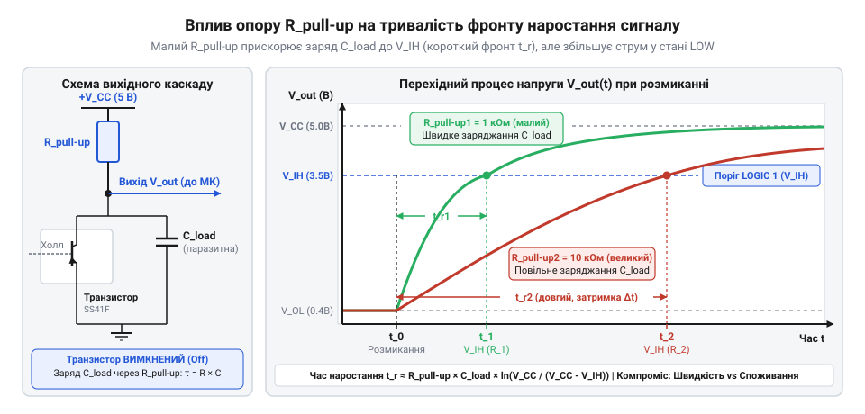

# Розрахунок підтягувального резистора для відкритого колектора

<preknowlist>
- [KY-003 / KY-024 — давач Голла](root:cat-hw-sensors/ky-003-hall) — принцип роботи вихідного каскаду з відкритим колектором у цифрових давачах Холла
- [A3144 — модуль давача Холла](root:cat-hw-sensors/a3144-hall-module) — схему підключення виходу NPN-транзистора давача до цифрового входу мікроконтролера
</preknowlist>

## Проблема висячого стану відкритого колектора

Коли дискретний давач магнітного поля, як-от [модуль давача Холла](root:cat-hw-sensors/a3144-hall-module), виявляє магнітне поле, його внутрішній @@en|NPN-транзистор@@ замикається на землю, створюючи чіткий електричний потенціал логічного нуля. Проте щойно магніт віддаляється, внутрішній ключ давача повністю закривається, перериваючи зв'язок вихідного провідника із землею.

Оскільки колектор вихідного транзистора не має внутрішніх з'єднань із лінією живлення всередині давача (звідси й назва вихідної топології — @@en|відкритий колектор@@, з англійської *open collector* — вихідний каскад із незаключеним колектором транзистора), вихідний вузол миттєво переходить у стан високого імпедансу або @@en|High-Z@@ (з англійської *high impedance* — стан високого імпедансу). У цьому стані вихід давача не підтримує жодного фіксованого електричного потенціалу, а опір між лінією сигналу та іншими кола принципово прямує до нескінченності.

Цифровий вхід сучасних мікроконтролерів, побудований на КМОН-транзисторах (від англійського @@en|CMOS@@ — *Complementary Metal-Oxide-Semiconductor*), має власний вхідний опір порядку десятків або сотень мегаом. Коли до такого входу підключається провідник у стані @@en|High-Z@@, цей провідник перетворюється на чутливу антену. Будь-які зовнішні електромагнітні завади, паразитні наводки від побутової електромережі чи наведення від сусідніх високочастотних доріжок друкованої плати здатні довільно змінювати заряд на вхідній ємності мікроконтролера. У результаті зчитувач мікроконтролера фіксує хаотичні хибні спрацьовування та невизначені логічні рівні замість очікуваного стабільного сигналу відсутності магніту. Детальніше про будову КМОН-входів, вхідну ємність та вбудовані підтягувальні резистори читайте у статті про [внутрішню схему цифрового входу мікроконтролера](root:hw-digital/mcu-digital-input-stage).

Для вирішення проблеми висячого вузла між вихідною лінією давача та шиною живлення `V_CC` підключають зовнішній резистор. Такий резистор називають підтягувальним резистором або @@en|pull-up@@ (з англійської *pull up* — підтягувати вгору). Його завдання — примусово «підтягнути» потенціал лінії до напруги живлення `V_CC`, коли вихідний ключ давача закритий. Коли ж транзистор відкривається, він долає опір підтяжки й з'єднує лінію із землею, формуючи логічний нуль.

Проте вибір значення опору підтяжки створює суттєву суперечність:
* Занадто малий опір струмово перевантажує відкритий ключ давача, викликаючи перевищення допустимого струму та тепловий деструктивний пробій транзистора. * Занадто великий опір не здатен компенсувати паразитні струми витоку та повільно заряджає паразитні ємності лінії, що спотворює прямокутні імпульси сигналу й унеможливлює роботу на високих частотах.

Для надійної роботи схеми необхідно математично розрахувати припустимий діапазон опору підтяжки `R_pull_up_min ≤ R_pull_up ≤ R_pull_up_max`, враховуючи як статичні граничні параметри струмів і напруг, так і динамічні характеристики лінії.

## Обчислення мінімально припустимого опору підтяжки

Розглянемо електричний стан кола, коли вихідний транзистор давача відкритий і перебуває в режимі насичення. У цьому стані через підтягувальний резистор `R_pull_up` напряму від шини живлення `V_CC` до землі через кристал транзистора протікає струм. Цей струм називають струмом занурення або @@en|sink current@@ (з англійської *sink current* — струм занурення, який приймає вихідний каскад).

Реальний напівпровідниковий ключ у стані насичення володіє залишковим опором каналу, тому на ньому виникає спад напруги `V_OL` (з англійської *Output Low Voltage* — напруга виходу низького рівня). У документації (з англійської @@en|datasheet@@ — технічний паспорт компонента) виробник давача обов'язково вказує два критичні параметри вихідного каскаду:
* `V_OL` — максимальна напруга на відкритому колекторі за визначеного струму занурення (зазвичай становить від `0.1 В` до `0.4 В`). * `I_OL` — гранично припустимий струм занурення ключа (з англійської *Output Low Current*), перевищення якого призводить до перегріву й термічного руйнування p-n переходу транзистора.

За законом Ома різниця потенціалів на резисторі підтяжки дорівнює напрузі живлення `V_CC` мінус спад напруги на відкритому ключі `V_OL`. Струм `I_pull_up`, що протікає через підтягувальний резистор у відкритий транзистор, обчислюється як:

```
I_pull_up = (V_CC - V_OL) ÷ R_pull_up
```

Щоб запобігти виходу давача з ладу, струм `I_pull_up` не повинен перевищувати гранично припустиме значення `I_OL`, вказане у документації:

```
(V_CC - V_OL) ÷ R_pull_up ≤ I_OL
```

Шляхом алгебраїчного перетворення цієї нерівності відносно опору `R_pull_up` отримуємо формулу нижньої межі опору підтяжки `R_pull_up_min`:

```
R_pull_up
≥ (V_CC - V_OL) ÷ I_OL        [перегрупування нерівності за законом Ома]
```

Отже, мінімально припустимий опір `R_pull_up_min` обчислюється за виразом:

```
R_pull_up_min = (V_CC - V_OL) ÷ I_OL
```

Обчислимо нижню межу опору для типового практичного прикладу.

**Розрахунок нижньої межі опору підтяжки**
Умови: напруга живлення кола `V_CC = 5.0 В`, спад напруги на відкритому ключі давача `V_OL = 0.4 В`, максимально припустимий струм занурення ключа `I_OL = 20 мА` (або `0.020 А`).

```
R_pull_up_min = (V_CC - V_OL) ÷ I_OL
= (5.0 В - 0.4 В) ÷ 0.020 А      [підстановка напруг та граничного струму]
= 4.6 В ÷ 0.020 А                [обчислення спаду напруги на резисторі]
= 230 Ом                        [ділення спаду напруги на граничний струм]
```

Розрахунок показує, що встановлення підтягувального резистора з опором менше `230 Ом` призведе до того, що струм через відкритий транзистор перевищить `20 мА`. Це спричинить надмірне виділення теплової потужності на кристалі давача та його деструктивний пробій. Тому значення `230 Ом` слугує суворою нижньою межею безпеки для даної схеми.

Аналогічний розрахунок занурення струму застосовують і для інших силових чи вимірювальних пристроїв, таких як [давачі струму ACS712](root:cat-hw-sensors/acs712-current-sensor-module), де вихідні каскади мають чітко нормовані струмові обмеження.

## Верхня межа опору та струми витоку

Орієнтуючись лише на мінімізацію енергоспоживання, може виникнути бажання обрати якомога більший опір підтяжки — наприклад, сотні кілоом або навіть кілька мегаом. Проте у закритому стані транзистора лінія сигналу не є ідеально ізольованим вузлом: через елементи кола протікають паразитні струми витоку (з англійської @@en|leakage current@@ — струм витоку).

У реальній схемі підключення давача до мікроконтролера існують два основних джерела витоку струму з сигнальної лінії на землю:
* `I_leak(TR)` — струм витоку закритого вихідного транзистора давача через зворотно зміщений p-n перехід (зазвичай становить від `0.1 мкА` до `10 мкА`). * `I_leak(MCU)` — вхідний струм витоку цифрового піна мікроконтролера, зумовлений паразитними провідностями КМОН-структури входу (зазвичай становить від `0.1 мкА` до `1 мкА`).

У моменти, коли транзистор давача закритий, обидва паразитні струми протікають від шини живлення `V_CC` через резистор підтяжки `R_pull_up` у напрямку землі. Сумарний струм витоку лінії `I_leak_sum` дорівнює їхній сумі:

```
I_leak_sum = I_leak(TR) + I_leak(MCU)
```

Проходячи через резистор `R_pull_up`, сумарний струм витоку створює на ньому спад напруги `ΔV = I_leak_sum × R_pull_up`. Через цей спад напруга високого рівня `V_OH` (з англійської *Output High Voltage*), яка реально формується на вхідному піні мікроконтролера, стає меншою за напругу живлення `V_CC`:

```
V_OH = V_CC - (I_leak_sum × R_pull_up)
```

Щоб мікроконтролер гарантовано розпізнав сигнал як логічну одиницю, фактична напруга `V_OH` повинна перевищувати порогову вхідну напругу високого рівня `V_IH` (з англійської *Input High Voltage*), яка для більшості мікроконтролерів КМОН-архітектури становить `0.7 × V_CC` або `0.8 × V_CC`.

Сформуємо нерівність для забезпечення надійної логічної одиниці на вході:

```
V_CC - (I_leak_sum × R_pull_up) ≥ V_IH
```

Виразивши опір підтяжки `R_pull_up` із цієї нерівності, отримуємо обмеження зверху:

```
R_pull_up
≤ (V_CC - V_IH) ÷ I_leak_sum    [перегрупування нерівності відносно опору]
```

Таким чином, формула максимально припустимого статичного опору підтяжки `R_pull_up_max` має вигляд:

```
R_pull_up_max = (V_CC - V_IH) ÷ I_leak_sum
```

Проведемо розрахунок верхньої межі опору для практичної схеми.

**Розрахунок верхньої статичної межі опору підтяжки**
Умови: напруга живлення `V_CC = 5.0 В`, порогова напруга логічної одиниці мікроконтролера `V_IH = 3.5 В` (тобто 70% від `V_CC`), струм витоку закритого транзистора давача `I_leak(TR) = 10 мкА`, вхідний струм витоку мікроконтролера `I_leak(MCU) = 1 мкА`.

```
I_leak_sum = I_leak(TR) + I_leak(MCU)
= 10 мкА + 1 мкА              [додавання двох джерел витоку]
= 11 мкА = 0.000011 А         [переведення значення в ампери]

R_pull_up_max = (V_CC - V_IH) ÷ I_leak_sum
= (5.0 В - 3.5 В) ÷ 0.000011 А [підстановка напруг та сумарного витоку]
= 1.5 В ÷ 0.000011 А           [обчислення максимально припустимого спаду]
= 136 363 Ом ≈ 136.3 кОм      [ділення спаду напруги на струм витоку]
```

Якщо обрати опір підтяжки більшим за `136.3 кОм`, спад напруги на резисторі під дією струмів витоку перевищить `1.5 В`. У результаті напруга на вході мікроконтролера впаде нижче `3.5 В`, і мікроконтролер перестане стабільно розпізнавати логічну одиницю, спричиняючи збої в зчитуванні даних.

## Вплив паразитної ємності на фронт сигналу

Визначивши статичний діапазон опорів від `230 Ом` до `136.3 кОм`, необхідно врахувати динамічну поведінку кола під час перемикання. Будь-який фізичний провідник сигнальної лінії володіє паразитною ємністю навантаження `C_load` (з англійської @@en|load capacitance@@ — ємність навантаження). Ця ємність складається з ємності доріжки друкованої плати, вихідної ємності колекторного переходу давача та вхідної ємності піна мікроконтролера (сумарно від `20 пФ` до `150 пФ`). Фізичні причини виникнення паразитної ємності та її вплив на високовольтні й високочастотні лінії розкрито в матеріалі про [паразитну ємність доріжок друкованої плати](root:hw-pcb/pcb-trace-parasitic-capacitance).

Динаміка зміни напруги на сигнальній лінії є суттєво асиметричною:
* Коли транзистор давача відкривається, паразитна ємність `C_load` миттєво розряджається на землю через малий опір відкритого каналу транзистора. Це формує дуже крутий спадаючий фронт сигналу або @@en|fall time@@ (з англійської *fall time* — тривалість спаду фронту). * Коли транзистор закривається, струм для заряджання ємності `C_load` може протікати **виключно** через резистор підтяжки `R_pull_up` від джерела `V_CC`.


*Часова діаграма спотворення фронту наростання сигналу через RC-ланцюг паразитної ємності лінії.*

Процес заряджання ємності `C_load` через резистор `R_pull_up` описується експоненційним законом для @@en|RC-ланцюг@@ (з англійської *RC circuit* — резистивно-ємнісний ланцюг):

```
V(t) = V_CC × (1 - e^(-t ÷ (R_pull_up × C_load)))
```

Часова константа `τ = R_pull_up × C_load` визначає швидкість наростання напруги. Стандартна тривалість наростання фронту `t_r` (з англійської @@en|rise time@@ — тривалість наростання від 10% до 90% від напруги `V_CC`) обчислюється через натуральний логарифм співвідношення напруг:

```
t_r = ln(9) × R_pull_up × C_load ≈ 2.2 × R_pull_up × C_load
```

Якщо час наростання `t_r` виявиться занадто великим, прямокутний імпульс перетвориться на згладжену пилоподібну хвилю, і на високих частотах лінія просто не встигатиме досягати порогу логічної одиниці `V_IH`.

Обчислимо тривалість фронту наростання та граничну частоту для реальної лінії.

**Оцінка тривалості фронту наростання та граничної частоти**
Умови: паразитна ємність лінії `C_load = 100 пФ` (або `100 × 10⁻¹² Ф`), обраний опір підтяжки `R_pull_up = 10 кОм` (`10000 Ом`).

```
t_r = 2.2 × R_pull_up × C_load
= 2.2 × 10000 Ом × 100 × 10⁻¹² Ф    [підстановка опору та ємності лінії]
= 2.2 × 10⁻⁶ с                       [обчислення добутку параметрів]
= 2.2 мкс                            [переведення значення у мікросекунди]
```

Гранична робоча частота прямокутних імпульсів `f_max`, за якої фронт наростання займає не більше половини півперіоду сигналу, оцінюється як:

```
f_max ≈ 1 ÷ (2 × t_r)
= 1 ÷ (2 × 2.2 × 10⁻⁶ с)             [підстановка тривалості фронту наростання]
= 1 ÷ (4.4 × 10⁻⁶ с)                 [обчислення подвоєного інтервалу фронту]
≈ 227 272 Гц ≈ 227 кГц              [обчислення граничної частоти перемикання]
```

Визначений виразом `t_r` розрахунок дає підґрунтя для свідомого вибору підтяжки в розрахованому діапазоні від `230 Ом` до `136.3 кОм`:
* Для високочастотних давачів, наприклад при підключенні [цифрового давача Холла KY-003](root:cat-hw-sensors/ky-003-hall) у ролі швидкого тахометра, слід обирати менший опір підтяжки (наприклад `1 кОм` – `2.2 кОм`). Це зменшує `t_r` до часток мікросекунди й забезпечує чіткі фронти імпульсів на частотах у сотні кілогерц. * Для низькочастотних або автономних давачів з батарейним живленням, таких як [герконові давачі KY-021](root:cat-hw-sensors/ky-021-reed) або [модулі геркона KY-025](root:cat-hw-sensors/ky-025-reed), доцільно обирати більший опір (наприклад `10 кОм` – `47 кОм`). Це мінімізує струмове споживання схеми у ті тривалі проміжки часу, коли вихідний транзистор закритий чи відкритий, зберігаючи при цьому стабільний рівень логічної одиниці.