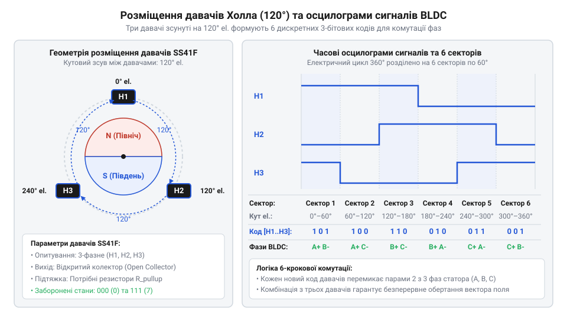
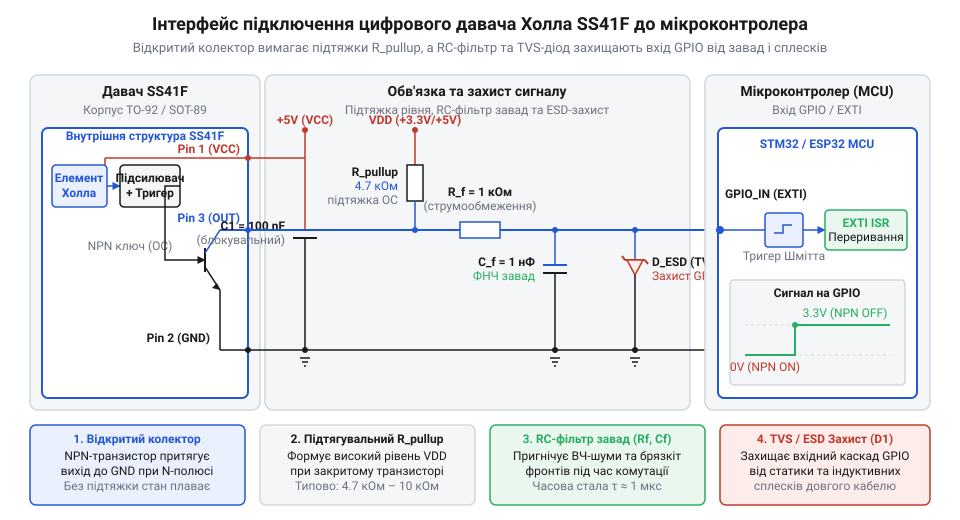

# Визначення положення ротора BLDC двигуна на SS41F

<preknowlist>
- [KY-003 / KY-024 — давач Голла](root:cat-hw-sensors/ky-003-hall) — Принцип роботи напівпровідникового давача Холла та схема відкритого колектора.
- [A3144 — модуль давача Холла](root:cat-hw-sensors/a3144-hall-module) — Поняття магнітної полярності, гістерезису та порогів перемикання біполярних давачів.
</preknowlist>

## Проблема сліпого керування безколекторним двигуном

У звичайному колекторному двигуні момент перемикання обмоток визначається механічно — щітками та колектором. Безщітковий двигун постійного струму (@@en|BLDC@@) позбавлений цього вузла. Його статор має три фазні обмотки, а ротор містить постійні магніти. Щоб ротор обертався, мікроконтролер має по черзі подавати напругу на дві з трьох фаз статора, створюючи магнітне поле, яке тягне за собою магніти ротора. Цей процес називається комутацією. 

Якщо ми не знаємо, в якому саме положенні зараз знаходиться ротор, подача напруги на фази перетворюється на вгадування. Якщо магнітне поле статора випереджатиме ротор або відставатиме від нього, замість плавного обертання двигун почне смикатися. Якщо ж поле виявиться протилежним до потрібного, ротор заклинить, струм в обмотках різко зросте, що призведе до перегріву та втрати крутного моменту. Сліпе керування працює лише на стабільних і низьких навантаженнях, але при старті чи зміні навантаження двигун втрачає синхронізацію. Помилковий вибір сектора комутації створює вектор магнітного поля статора, спрямований всупереч положенню ротора, що спричиняє стрибкоподібне зростання імпульсних фазних струмів до значення короткого замикання обмоток. У результаті виникає апаратне перенавантаження ключових транзисторів інвертора, термічний пробій напівпровідників та повна зупинка механізму через нульовий результуючий крутний момент.

Фізична неминучість постійного зворотного зв'язку за положенням магнітних полюсів вимагає точного знання кута ротора. Для вчасного перемикання силових ключів інвертора достатньо знати, в якому із шести станів перебуває ротор відносно статора. Це означає, що один електричний оберт (цикл зміни магнітного поля від північного до південного полюса і назад) потрібно розбити на шість дискретних секторів по 60 градусів. Цю задачу вирішують за допомогою трьох просторово рознесених цифрових давачів Холла.

## Геометрія давачів SS41F та 6-секторна таблиця

Щоб розділити цикл на шість секторів, три біполярні цифрові давачі Холла SS41F розміщують на статорі з кутовим зсувом 120 електричних градусів один відносно одного. [Біполярний давач Холла](root:cat-hw-sensors/a3144-hall-module) реагує на зміну магнітної полярності: він вмикається (притягує вихід до землі), коли повз нього проходить південний полюс, і вимикається (відпускає лінію), коли проходить північний. 

Коли ротор обертається, його магнітні полюси по черзі проходять повз кожен із трьох давачів. Оскільки давачі зміщені на 120 градусів, їхні стани змінюються не одночасно. У будь-який момент часу кожен давач видає один біт інформації (0 або 1). Разом три давачі формують 3-бітовий код. Завдяки зсуву на 120 градусів, на кожні 360 електричних градусів ці коди змінюються рівно шість разів, утворюючи унікальну послідовність (наприклад, 101, 100, 110, 010, 011, 001). 

Ці 6 унікальних комбінацій сигналів дозволяють однозначно визначити, в якому з шести 60-градусних секторів зараз перебуває ротор. Комбінації 000 та 111 у такій конфігурації фізично неможливі під час нормальної роботи, тому їх поява свідчить про апаратну помилку. Маючи поточний 3-бітовий код давачів, мікроконтролер звертається до логічної таблиці комутації. За нею він точно знає, який сектор ротора зараз активний, та якій полярності фаз статора (A, B, C) це відповідає для подачі живлення на обмотки через інвертор.

Відповідність між 3-бітним кодом давачів (де біти сформовані як `H_A << 2 | H_B << 1 | H_C`), електричним сектором ротора та станом фаз статора (A, B, C у режимах високого рівня `1`, низького рівня `0` або високоімпедансного стану `Z` для трифазного мосту) наведена в таблиці комутації:

| 3-бітний код (H_A H_B H_C) | Електричний сектор | Кутовий діапазон | Стан фази A | Стан фази B | Стан фази C | Коментар / Комутація |
| :---: | :---: | :---: | :---: | :---: | :---: | :--- |
| `000` | `INVALID` | — | `Z` | `Z` | `Z` | Заборонений стан (обрив VCC/GND/сигналів) |
| `001` | Сектор 6 | 300° – 360° | `0` | `1` | `Z` | Фаза A до мінуса, фаза B до плюса |
| `010` | Сектор 3 | 120° – 180° | `1` | `Z` | `0` | Фаза A до плюса, фаза C до мінуса |
| `011` | Сектор 2 | 60° – 120° | `Z` | `1` | `0` | Фаза B до плюса, фаза C до мінуса |
| `100` | Сектор 5 | 240° – 300° | `Z` | `0` | `1` | Фаза B до мінуса, фаза C до плюса |
| `101` | Сектор 1 | 0° – 60° | `1` | `0` | `Z` | Фаза A до плюса, фаза B до мінуса |
| `110` | Сектор 4 | 180° – 240° | `0` | `Z` | `1` | Фаза A до мінуса, фаза C до плюса |
| `111` | `INVALID` | — | `Z` | `Z` | `Z` | Заборонений стан (коротке на VCC або обрив з pull-up) |

Завдяки такій таблиці апаратний шар драйвера (наприклад, реалізований у файлі `ss41f_hall.c`) миттєво декодує стан пінів і формує керуючі впливи для силових ключових транзисторів інвертора.

## Схема апаратного підключення відкритих колекторів

Вихід цифрового [давача SS41F](root:cat-hw-sensors/ky-003-hall) реалізований за схемою відкритого колектора. Це означає, що давач може лише притягнути сигнальну лінію до землі (сформувати логічний 0), але не здатний видати напругу живлення (логічну 1). Щоб вхід мікроконтролера міг прочитати стан давача, лінію необхідно підтягнути до напруги живлення логіки через зовнішній резистор (@@en|pull-up@@). 

Коли давач неактивний, струм тече через резистор на вхід мікроконтролера (@@en|GPIO@@), створюючи високий логічний рівень. Коли давач спрацьовує від магнітного поля, його внутрішній транзистор відкривається і замикає лінію на землю, формуючи низький логічний рівень. Номінал підтягувального резистора (зазвичай від 2.2 кОм до 10 кОм) обирають як компроміс: надто великий опір зробить лінію вразливою до завад і сповільнить фронт сигналу, а надто малий спричинить великий струм через відкритий транзистор давача.

Безколекторний привід є джерелом потужних електромагнітних завад, що генеруються швидким перемиканням силових транзисторів інвертора. Ці високочастотні викиди можуть наводитись на довгі сигнальні проводи давачів Холла, спричиняючи помилкові переривання в мікроконтролері. Для пригнічення таких завад безпосередньо біля виводів мікроконтролера встановлюють апаратний RC-фільтр нижніх частот. Резистор послідовно з сигнальною лінією та конденсатор на землю згладжують короткі сплески напруги. Параметри фільтра розраховують так, щоб він блокував високочастотний шум (одиниці мегагерц), але пропускав корисний сигнал зміни стану давача без значної затримки (зазвичай частота перемикання становить до кількох кілогерц).

## Обробка переривань та обчислення параметрів руху

Мікроконтролер має миттєво реагувати на зміну положення ротора, щоб вчасно перемкнути обмотки статора. Якщо перевіряти стан входів у циклі, мікроконтролер може пропустити момент зміни або відреагувати із затримкою. Тому для читання стану давачів Холла використовують зовнішні переривання — механізм, який зупиняє основну програму й викликає обробник рівно в ту мить, коли сигнал змінюється.

Лінії від трьох давачів @@en|SS41F@@ підключають до входів @@en|GPIO@@, налаштованих на виклик переривання за будь-яким фронтом — наростаючим чи спадаючим. 

Коли магнітне поле змінюється і стан одного з давачів перемикається, програма переходить до обробника переривань. Усередині обробника мікроконтролер зчитує поточний стан усіх трьох входів і формує з них 3-бітове число. Це число є індексом масиву, який містить номери секторів.

Отримавши новий сектор, мікроконтролер порівнює його з попереднім і визначає напрямок обертання. Наприклад, якщо попередній сектор був `1`, а став `2`, ротор крутиться в одному напрямку; якщо став `6` — у зворотному. Кожне переривання також фіксує поточний час за допомогою апаратного таймера. Різниця в часі між двома сусідніми перериваннями відповідає часу проходження одного сектора. Знаючи цей час, мікроконтролер розраховує кутову швидкість. Чим менший час між перериваннями, тим швидше обертається двигун.

:::code proj-bldc-hall-rotor-position/c/include/stm32_gpio_exti.h
:::code proj-bldc-hall-rotor-position/c/src/stm32_gpio_exti.c
:::code proj-bldc-hall-rotor-position/cpp/include/stm32_gpio_exti.hpp
:::code proj-bldc-hall-rotor-position/cpp/src/stm32_gpio_exti.cpp
:::code proj-bldc-hall-rotor-position/cpp/include/ss41f_hall_decoder.hpp
:::code proj-bldc-hall-rotor-position/cpp/src/ss41f_hall_decoder.cpp

## Діагностика заборонених станів і захист приводу

У реальних умовах на сигнальні лінії впливають електромагнітні завади від силової частини інвертора, а контакти можуть відходити. Обробник переривань має вміти розпізнавати помилки й захищати двигун від некоректної комутації, яка призводить до короткого замикання фаз.

З трьох давачів Холла можна отримати вісім комбінацій станів. Шість із них відповідають робочим секторам, а дві комбінації — `000` та `111` — є забороненими. Стан `000` виникає, коли пропадає живлення давачів або сигнальні лінії замикаються на землю. Стан `111` свідчить про обрив усіх трьох сигнальних ліній або коротке замикання на лінію живлення, оскільки лінії підтягнуті до високого рівня через резистори. Поява будь-якого з цих станів означає критичну апаратну помилку.

Окрім перевірки на заборонені комбінації, алгоритм стежить за правильністю переходу між секторами. Ротор не може перестрибнути через сектор. Наприклад, перехід із першого сектора в другий є допустимим, а з першого в третій — ні. Неприпустимий перехід свідчить про пропущений сигнал, брязкіт контактів або імпульсну заваду.

Якщо обробник виявляє заборонений стан або некоректний перехід, він негайно сигналізує про помилку фазування. У цьому разі система керування миттєво знімає керуючі імпульси з транзисторів інвертора та переводить обмотки двигуна у знеструмлений стан. Такий захист запобігає пошкодженню силової частини.

:::code proj-bldc-hall-rotor-position/c/include/ss41f_hall.h
:::code proj-bldc-hall-rotor-position/c/src/ss41f_hall.c
:::code proj-bldc-hall-rotor-position/c/src/main.c
:::code proj-bldc-hall-rotor-position/cpp/src/main.cpp