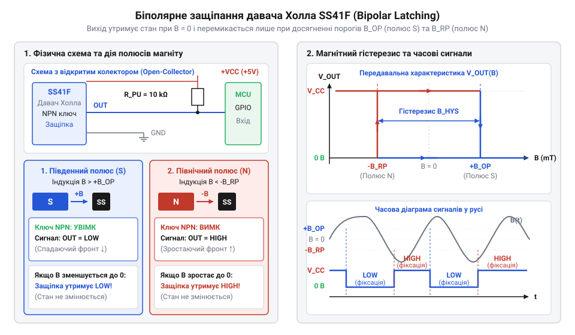

# Магнітний тахометр та лічильник обертів

<preknowlist>
- [A3144 — модуль давача Холла](root:cat-hw-sensors/a3144-hall-module) — Ефект Холла та базове формування цифрового сигналу від магнітного поля.
- [KY-003 / KY-024 — давач Голла](root:cat-hw-sensors/ky-003-hall) — Схемотехніка відкритого колектора та застосування підтягувального резистора.
</preknowlist>

## Проблема вимірювання обертів у брудному середовищі

Моніторинг кутової швидкості обертання валу та кількості зроблених обертів лежить в основі багатьох завдань промислової автоматики та робототехніки. Класичним підходом для цього традиційно є оптичні енкодери та диски з отворами або мітками. Проте в реальних умовах експлуатації механізми часто працюють у запилених, вологих або закритих вузлах, де наявність бруду, мастила та сторонніх часток швидко призводить до повної відмови оптичних систем. Потрапляння пилу на фотоприймач перекриває світловий потік, і давач починає пропускати імпульси або видавати хибні стани. Механічні ж контакти та щіткові тахометри схильні до швидкого стирання, що робить їх непридатними для тривалої безперервної роботи.

Розв'язанням цієї проблеми є перехід на безконтактне магнітне зчитування, яке не залежить від оптичної прозорості середовища. Магнітне поле вільно проходить крізь шари пилу, бруду, вологи, а також немагнітні діелектрики чи метали, не вступаючи з ними у фізичний контакт. Завдяки відсутності механічного тертя магнітні системи забезпечують невичерпний ресурс роботи та високу надійність у найжорсткіших умовах експлуатації.

## Фізика біполярного давача Холла SS41F

Для реалізації безконтактного вимірювання обертів використовується ефект Холла, виникнення поперечної різниці потенціалів у провіднику зі струмом під дією перпендикулярного магнітного поля. Проте базові аналогові сенсори потребують складних схем обробки сигналу з аналого-цифровими перетворювачами, тоді як для лічильників імпульсів потрібен чіткий дискретний сигнал. Тут застосовуються цифрові інтегральні давачі, серед яких особливе місце займають біполярні комутатори.

Біполярний давач Холла @@en|SS41F@@ реагує на зміну полярності магнітного поля. На відміну від уніполярних сенсорів, які вмикаються від одного полюса і вимикаються при його зникненні, біполярний давач потребує почергового впливу південного та північного полюсів магніту для перемикання свого вихідного стану. 

Схема перемикання біполярного давача SS41F під дією чередованих полюсів N та S з графіком гістерезису магнітної індукції.

Внутрішня структура давача містить чутливий елемент Холла, підсилювач, схему компенсації та тригер Шмітта із внутрішнім магнітним гістерезисом. Коли повз датчик проходить південний полюс (@@en|South pole@@) магніту, індукція перевищує поріг спрацьовування, і внутрішній транзистор відкривається, замикаючи вихід на масу. Завдяки гістерезису, після віддалення магніту вихідний стан зберігається замкненим, запобігаючи хибним спрацьовуванням від коливань поля. Тільки наближення північного полюса (@@en|North pole@@) з іншим знаком індукції змушує тригер перемкнутися у протилежний стан і розімкнути вихід. Таким чином, для повного циклу перемикання виходу давача на обертовому диску необхідно по черзі розміщувати магнітні полюси різної орієнтації.

Для реалізації безконтактного вимірювання обертів використовується ефект Холла, виникнення поперечної різниці потенціалів у провіднику зі струмом під дією перпендикулярного магнітного поля. Проте базові аналогові сенсори потребують складних схем обробки сигналу з аналого-цифровими перетворювачами, тоді як для лічильників імпульсів потрібен чіткий дискретний сигнал. Тут застосовуються цифрові інтегральні давачі, серед яких особливе місце займають біполярні комутатори, здатні чітко розрізняти зміни магнітної полярності для надійного перемикання без хибних спрацьовувань від випадкових наводок.

## Підключення відкритого колектора до мікроконтролера

Вихідний каскад давача SS41F виконаний за схемою з @@en|open collector@@ (відкритим колектором). Це означає, що внутрішній транзистор мікросхеми може лише притягувати вихідний термінал до електричного нуля (землі), але не здатний самостійно формувати високий рівень напруги. Якщо залишити такий вихід «підвішеним», напруга на ньому буде невизначеною, що призведе до збоїв у роботі цифрової логіки.

Для коректного формування сигнальних рівнів між виходом давача та шиною живлення встановлюється зовнішній @@en|pull-up resistor@@ (підтягувальний резистор). Коли внутрішній транзистор давача закритий, резистор підтягує потенціал виходу до напруги живлення мікроконтролера, формуючи чіткий логічний одиничний рівень. Коли магнітне поле перемикає давач, транзистор відкривається і закорочує вихід на масу, створюючи логічний нуль. Номінал резистора зазвичай обирається в діапазоні від чотирьох до десяти кілоомів, що забезпечує достатній струм для швидкого перезаряджання ємності кабелю без зайвих втрат енергії.

Через довгі з'єднувальні дроти в промислових умовах на вхід мікроконтролера можуть наводитися електромагнітні завади. Для їх придушення паралельно сигнальній лінії ставиться конденсатор невеликої ємності, утворюючи апаратний RC-фільтр низьких частот, який зрізає високочастотні голчасті імпульси. Підключений сигнал заводиться на вивод мікроконтролера, налаштований на апаратне переривання по обох фронтах, що дозволяє фіксувати як момент замикання, так і розмикання виходу з високою точністю.

## Обчислення частоти RPM та обертів

Отримавши дискретні імпульси від апаратних переривань, мікроконтролер повинен перетворити їх на реальні експлуатаційні параметри: кутову швидкість та загальну кількість пройдених обертів. Оскільки давач SS41F реагує на зміну полюсів, повний електричний цикл сигналу (період від одного спадного фронту до наступного аналогічного) відповідає проходженню однієї пари магнітних полюсів. Якщо на обертовому диску закріплено кілька пар магнітів, один повний оберт валу породжує кілька таких циклів.

Для визначення миттєвої швидкості вимірюється інтервал часу між послідовними перериваннями за допомогою системного таймера з високою роздільною здатністю. Знайдений період часу перераховується у частоту обертання за хвилину, враховуючи загальну кількість імпульсів на один оберт валу.

<період часу між імпульсами>
= t_2 - t_1                                    [вимірювання різниці часу між двома сусідніми перериваннями]
= T

<частота обертання в RPM>
= 60 ÷ (T × N_poles)                           [переведення періоду в хвилини та врахування кількості пар полюсів N_poles]
= RPM

Тут виміряний інтервал часу в секундах обернено пропорційний швидкості обертання. Паралельно з цим на кожне спрацьовування переривання інкрементується загальний лічильник імпульсів, який після ділення на повну кількість імпульсів за оберт дає точну сумарну кількість зроблених валом обертів.

Щоб перетворити окремі миттєві значення періоду на стійкий показник частоти, який не стрибає від мікрозавад на лінії, виміряні інтервали проходять через цифрову фільтрацію або накопичувальне усреднення. Оскільки швидкість обертання механічних систем не може змінюватися стрибкоподібно через їхню інерційність, занадто різкі коливання послідовних вимірів усуваються за допомогою ковзного середнього або експоненційного згладжування. Це дозволяє нівелювати випадкові похибки часу спрацьовування та отримати стабільне значення обертів за хвилину для виведення на дисплей чи подачі в контур керування.

## Фільтрація завад та обробка зупинки

На практиці вимірювальний тракт стикається з двома критичними проблемами: шумами на малих швидкостях та відсутністю імпульсів при повній зупинці валу. Коли вал обертається надзвичайно повільно або зупиняється в такому положенні, коли магнітне поле утримує давач у відкритому стані, нових переривань не надходить. Простий алгоритм розрахунку RPM у такому разі застрягає на останньому обчисленому значенні, хибно показуючи, що механізм досі обертається.

Для усунення цього ефекту вводиться програмний @@en|timeout watchdog@@ (таймаут неактивності). Якщо з моменту останнього зафіксованого переривання минув час, що перевищує максимально допустимий період для мінімально вимірюваної швидкості, поточне значення RPM примусово скидається в нуль. 

Додатково для захисту від випадкових стрибків та дребеску фронтів застосовується програмна фільтрація мінімально допустимого інтервалу часу між імпульсами. Якщо час між сусідніми перериваннями виявляється меншим за фізично можливий максимум для даної конструкції механізму, такий імпульс ігнорується як апаратна завада. Поєднання апаратного RC-фільтра, таймауту зупинки та перевірки мінімального інтервалу гарантує стабільну і безвідмовну роботу тахометра в реальних умовах експлуатації.