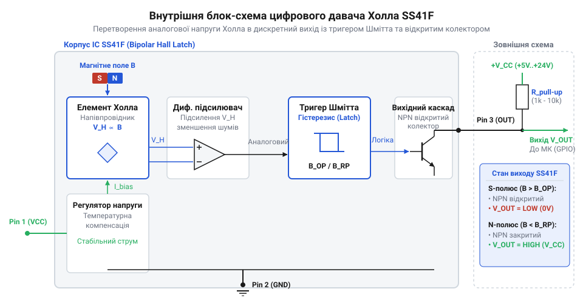
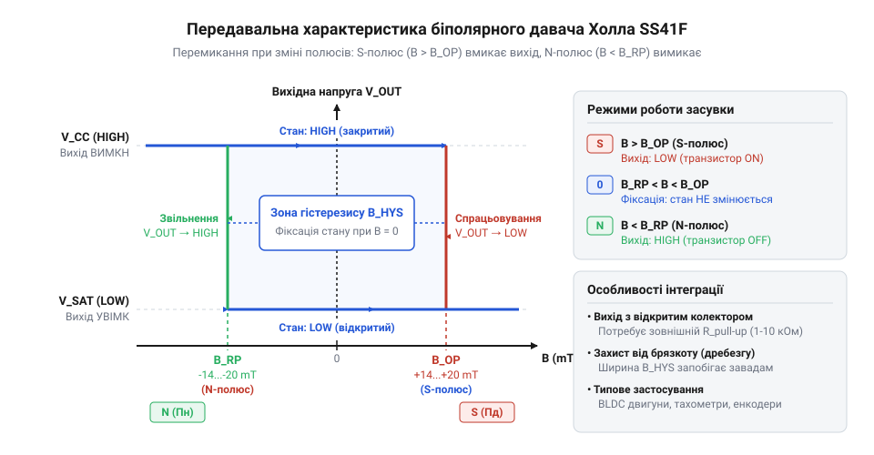
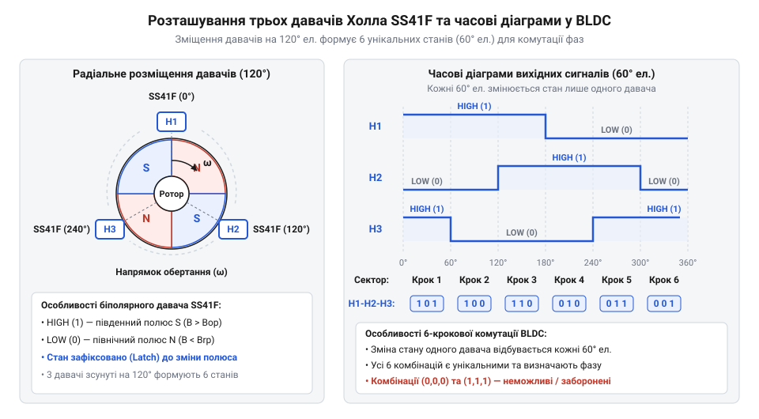
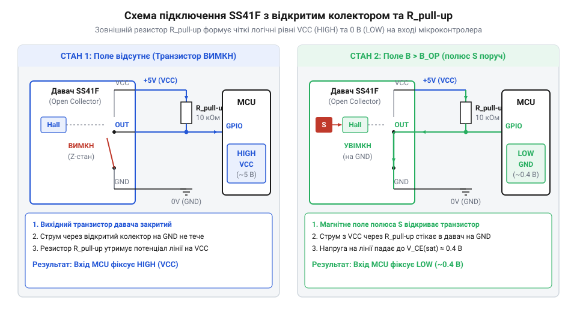
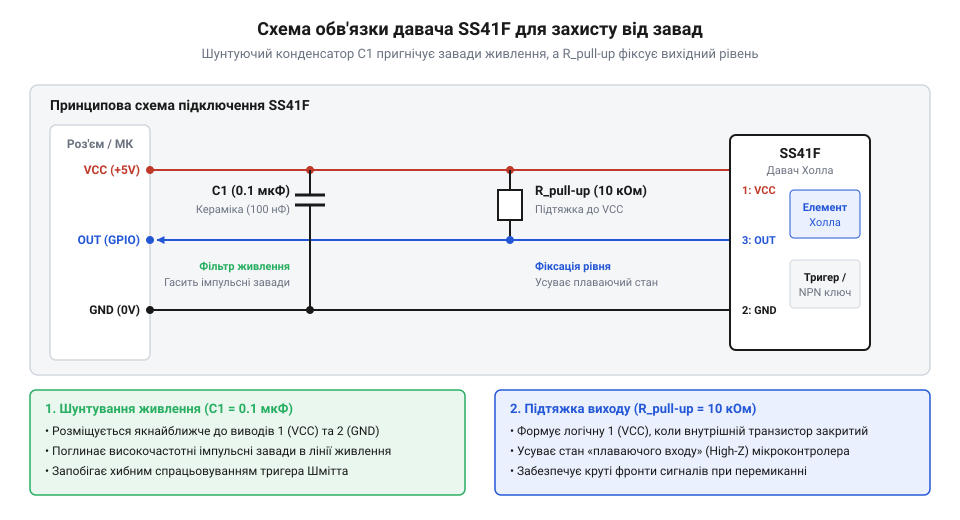

# SS41F — цифровий давач Холла

<preknowlist>
- [KY-003 / KY-024 — давач Голла](root:cat-hw-sensors/ky-003-hall) — базовий принцип перетворення магнітної індукції в електричний сигнал за допомогою ефекту Холла
- [A3144 — модуль давача Холла](root:cat-hw-sensors/a3144-hall-module) — роботу однополярного цифрового давача Холла та концепцію магнітних порогів спрацьовування в напівпровідникових корпусах
</preknowlist>

## Проблема відстеження позиції в динамічних механізмах

У швидкісних механічних вузлах, де вали електромоторів, турбін чи коліс обертаються зі швидкістю тисяч обертів на хвилину, точне вимірювання кутового положення та частоти обертання стає критичною точкою надійності всієї електронної системи. Найпростішим історичним рішенням для фіксації магнітного поля був @@en|геркон@@ (скорочення від «герметизований контакт», англійською @@en|reed switch@@). Проте при спробі застосувати механічний [геркон KY-021](root:cat-hw-sensors/ky-021-reed) або його аналог [геркон у скляній колбі](root:cat-hw-sensors/ky-025-reed) у високодинамічних системах розробник миттєво стикається з жорсткими фізичними обмеженнями механіки. Гнучкі феромагнітні язички всередині скляного балона мають власний механічний резонанс та інерцію маси, що обмежує граничну частоту перемикань кількома сотнями герц. При спробі перевищити цю частоту язички просто не встигають розмикатися або входять у хаотичний резонанс.

Головною ж перешкодою для цифрових систем стає @@en|дребезг контактів@@ (від англійського @@en|contact bounce@@): під час кожного фізичного зіткнення пружні металеві пластини багаторазово соваються, соскакують та відскокують одна від одної, генеруючи хаотичну пачку електричних імпульсів тривалістю в кілька мілісекунд. Для мікроконтролера, що обробляє апаратні переривання, такий @@en|дребезг контактів@@ виглядає як десятки швидких обертів вала замість одного реального переходу. Програмне придушення @@en|дребезгу@@ через затримки або цифрове фільтрування блокує процесорний час і не дає змоги зчитувати високочастотні сигнали. Окрім того, крихкий скляний корпус @@en|геркона@@ легко руйнується від вібрацій, а механічне зношування та зварювання контактів через електричне іскріння обмежують ресурс пристрою мільйоном спрацьовувань. У реальному промисловому двигуні цей ресурс вичерпується за кілька діб безперервної роботи.

Перехід від механічних контактів до твердотілих напівпровідникових давачів повністю усуває проблеми зносу, вібраційної крихкості та @@en|контактного дребезгу@@, але висуває нові вимоги до способу обробки магнітного сигналу. Коли на зміну @@en|герконам@@ прийшов напівпровідниковий [давач Холла KY-003](root:cat-hw-sensors/ky-003-hall) або дискретний [однополярний давач A3144](root:cat-hw-sensors/a3144-hall-module), з'явилася можливість перемикати електронний вихід із частотою у десятки й сотні кілогерц без жодного механічного зносу. Проте однополярний @@en|давач Холла@@ (названий на честь фізика Едвіна Холла, англійською @@en|Hall sensor@@) має власну специфіку: він відкривається при наближенні лише одного визначеного полюса (наприклад, південного) і закривається, коли цей самий полюс віддаляється на достатню відстань.

У системах відстеження обертання з одним магнітом на валу однополярний @@en|давач Холла@@ генерує короткий вихідний імпульс на кожен оберт. Однак якщо диск має механічне биття вала, або відстань між давачем і магнітом коливається через радіальний люфт підшипника, індукція в точці вимірювання може впадати нижче порогу спрацьовування. Однополярний пристрій починає пропускати оберти або генерувати хибні перемикання на межі чутливості, адже в нього немає механізму утримання стану в паузах між магнітними імпульсами.

Ситуація ще більше ускладнюється, коли потрібно не просто рахувати оберти, а побудувати точний магнітний енкодер або комутувати обмотки безколекторного двигуна постійного струму. У таких задачах на роторі розміщується кільце з чередованими магнітними полюсами (південь-північ-південь-північ). Якщо застосувати однополярний @@en|давач Холла@@, він реагуватиме лише на південні полюси, повністю ігноруючи північні. Між сусідніми південними полюсами вихідний сигнал повертатиметься у вимкнений стан, проте точка цього повернення сильно залежатиме від температури, напруги живлення та повітряного зазору. При нагріванні двигуна магнітна індукція постійних магнітів падає, через що тривалість увімкненого стану давача скорочується. Це викликає спотворення робочої свердловини вихідного меандру та призводить до асиметрії в алгоритмах керування фазами двигуна.

Для стабільного відстеження динамічних механізмів потрібен пристрій з принципово іншим логічним алгоритмом — @@en|біполярна засувка@@ (від латинського *bis* — двічі, *polus* — полюс, та англійського @@en|bipolar latch@@). На відміну від однополярних схем, біполярний тригерний давач реагує на обидва полюси магніту по-різному: південний полюс фіксує вихідний каскад увімкненим, а північний полюс — вимкненим. Після того як південний полюс відійшов від давача, вихід не повертається у початковий стан самостійно; пристрій «пам'ятає» свій останній стан доти, доки безпосередньо перед ним не з'явиться протилежний, північний полюс. Таке тригерне утримання стану робить вихідний сигнал повністю інертним до вібрацій, люфтів вала та коливань повітряного зазору в паузах між полюсами.

Для захисту від випадкових перемикань під дією слабких зовнішніх полів розсіювання або фонового магнітного поля Землі @@en|біполярна засувка@@ поєднується з фізичним явищем — @@en|гістерезис@@ (від грецького *hysteresis* — запізнення або відставання). Спрацьовування відбуваються не при нульовій магнітній індукції, а при чітко симетрично рознесених порогах: для ввімкнення потрібна позитивна індукція південного полюса, а для вимкнення — негативна індукція північного полюса. Навіть якщо магнітне поле ротора згасає через нагрів, пропорція між полюсами залишається симетричною, що забезпечує ідеальний вихідний меандр із 50-відсотковою свердловиною.

Твердотіла кремнієва структура з тригерною фіксацією стану поєднує високу частоту перемикань, відсутність механічного зносу, повну захищеність від @@en|контактного дребезгу@@ та чітке розрізнення послідовності магнітних полюсів. Розуміння того, як фізичний ефект перетворення магнітного поля в електричний потенціал пройшов шлях від лабораторного відкриття до створення інтегральних цифрових тригерів, дає історична вставка [від відкриття Едвіна Холла](root:cat-hw-sensors/ss41f-hall/hist-hall-effect-discovery.md).

Ринковий запит на швидкісні та безвідмовні давачі позиції призвів до створення інтегрального біполярного давача @@en|SS41F@@, внутрішня будова якого об'єднує напівпровідниковий елемент, диференціальний підсилювач та тригерну засувку в одному компактному корпусі. Різні [цифрові давачі Холла](root:cat-hw-sensors/hall-effect-digital-sensors-family) застосовують власні комбінації магнітних порогів, проте саме @@en|біполярна засувка@@ є стандартом для побудови тахометрів, енкодерів і систем керування електроприводами. Щоб зрозуміти, як саме @@en|SS41F@@ забезпечує таку надійність, необхідно розглянути його внутрішню архітектуру та первинний аналоговий тракт перетворення магнітної індукції.

## Внутрішня архітектура та елемент Холла

Уся вимірювальна, підсилювальна та тригерна логіка давача @@en|SS41F@@ інтегрована на єдиному напівпровідниковому кристалі кремнію, розміщеному всередині компактного трививідного пластикового корпусу TO-92. Щоб зрозуміти, як зовнішнє магнітне поле перетворюється на стабільний дискретний цифровий сигнал, необхідно простежити повний шлях вимірюваної величини від первинного фізичного сенсора до вихідного транзисторного каскаду.


*Структурна схема внутрішніх вузлів біполярного цифрового давача SS41F.*

Первинним перетворювачем у давачі є тонкий напівпровідниковий елемент Холла — квадратна пластина з кремнію N-типу проводимості. Вибір N-типу зумовлений високою рухливістю основних носіїв заряду (електронів), що забезпечує високу чутливість первинної ЕРС. Від внутрішнього стабілізатора напруги крізь пластину у поздовжньому напрямку протікає калібрований постійний струм керування `I_C`. За відсутності зовнішнього магнітного поля електрони рухаються прямолінійно, і потенціали на бічних гранях пластини є абсолютно однаковими.

Коли перпендикулярно до площини кремнієвого кристала проходить магнітна індукція `B`, на кожен рухомий електрон починає діяти @@en|сила Лоренца@@ (названа на честь фізика Хендріка Лоренца). Ця сила спрямована перпендикулярно як до вектора швидкості носіїв заряду, так і до вектора магнітної індукції. Вона відхиляє електрони до однієї з бічних граней пластини, створюючи просторове розділення зарядів: одна грань накопичує надлишок негативного заряду, а на протилежній утворюється його дефіцит. У результаті між бічними гранями виникає поперечна різниця потенціалів — ЕРС Холла або напруга Холла `U_H`.

Величина згенерованої напруги Холла прямо пропорційна перпендикулярній складовій магнітної індукції та струму керування і обернено пропорційна товщині напівпровідникового шару. Фізичне співвідношення для напруги `U_H` описується формулою:

U_H = R_H · (I_C · B / d)

де `U_H` — поперечна напруга Холла у вольтах, `R_H` — коефіціент Холла, що визначається типом та концентрацією носіїв заряду в кремнії, `I_C` — струм керування пластиною в амперах, `B` — магнітна індукція перпендикулярного поля в теслах, а `d` — товщина напівпровідникової пластини в метрах.

З цієї формули чітко видно фізичний механізм біполярної чутливості: при зміні напрямку магнітного поля (при наближенні північного полюса замість південного) вектор магнітної індукції `B` змінює свій знак на протилежний. Відповідно, @@en|сила Лоренца@@ починає відхиляти електрони до протилежної грані пластини, змінюючи полярність вихідної напруги `U_H` з позитивної на негативну.

Первинна ЕРС `U_H`, знята з бічних електродів пластини Холла, є надзвичайно слабкою — її амплітуда становить від кількох мікровольт до одиниць мілівольт. Окрім того, напівпровідниковий кристалик піддається впливу внутрішніх механічних напружень корпуса та температурних розширень, що створює значне паразитичне зміщення нуля (офсет напруги). Для виділення корисної різниці потенціалів сигнал надходить на @@en|диференційний підсилювач@@ (від латинського *differentia* — різниця, англійською @@en|differential amplifier@@). Диференційна схема підсилює лише корисну різницю напруг між бічними електродами, ефективно придушуючи синфазні завади по лінії живлення та загальні шуми напівпровідникового субстрату.

Щоб повністю компенсувати температурний дрейф та механічний офсет кремнію, в аналоговому тракті @@en|SS41F@@ застосовується @@en|чопперна стабілізація@@ (від англійського *to chop* — рубати, переривати, @@en|chopper stabilization@@). Внутрішній електронний комутатор із високою частотою (сотки кілогерц) періодично змінює напрямок протікання струму `I_C` крізь пластину Холла на 90 градусів та відповідно перемикає вимірювальні електроди. В результаті паразитна напруга зміщення перетворюється на високочастотну змінну складову та відфільтровується, а корисний аналоговий сигнал, пропорційний магнітному полю, залишається чистим та стабільним у широкому температурному діапазоні від -40 °C до +150 °C.

Очищений та підсилений аналоговий сигнал надходить на @@en|тригер Шмітта@@ (названий на честь винахідника Отто Шмітта, англійською @@en|Schmitt trigger@@), який виконує функцію біполярної засувки. Внутрішній порівнювальний блок має два строго відкалібровані магнітні пороги: поріг спрацьовування `B_OP` (Operating Point) та поріг звільнення `B_RP` (Release Point). Відстань між цими порогами визначає ширину магнітного @@en|гістерезису@@ `ΔB = B_OP - B_RP`.

Коли південний полюс магніту створює позитивну індукцію, що перевищує поріг `B_OP` (зазвичай близько +4...+9 мТл для SS41F), @@en|тригер Шмітта@@ миттєво перемикає свій внутрішній стан у логічну одиницю. Якщо магніт віддаляється і поле зменшується до нуля, вихід не змінюється, зберігаючи стан логічної одиниці. Лише при наближенні північного полюса, який створює від'ємну індукцію, що опускається нижче порогу `B_RP` (зазвичай близько -4...-9 мТл), @@en|тригер Шмітта@@ скидається в логічний нуль. Наявність ширини @@en|гістерезису@@ `ΔB` виключає дребезг або тремтіння вихідного сигналу під час перебування магніту в зоні нульового поля.

Вихідний сигнал @@en|тригера Шмітта@@ керує затвором внутрішнього NPN-транзистора, який формує @@en|відкритий колектор@@ (від англійського @@en|open collector@@, через непідключений електрод колектора вихідного транзистора). Коли тригер перебуває у стані логічної одиниці (під дією південного полюса), внутрішній транзистор відкривається і переходить у режим насичення, замикаючи вивід `Output` на спільну шину `GND`. Напруга на виході давача падає до низького логічного рівня (близько 0.1–0.4 В). Коли тригер скидається в логічний нуль (під дією північного полюса), вихідний транзистор повністю закривається, переводячи вивід `Output` у високоімпедансний стан (Z-стан).

Оскільки вихідний каскад з @@en|відкритим колектором@@ не здатний самостійно джерелювати струм у навантаження, для формування високого логічного рівня між виводом `Output` та шиною живлення `V_CC` обов'язково підключається зовнішній @@en|підтягувальний резистор@@ (від англійського @@en|pull-up resistor@@). Коли внутрішній транзистор закритий, саме цей резистор підтягує напругу виходу до рівня живлення мікроконтролера. Здатність вихідного транзистора @@en|SS41F@@ поглинати струм досягає 20 мА, що дозволяє підключати до виходу не лише цифрові входи мікроконтролерів, а й світлодіоди індикації або оптичні розв'язки.

На відміну від аналогових давачів, таких як [лінійні давачі Холла](root:cat-hw-sensors/linear-hall-effect-sensors), які видають безперервну напругу, пропорційну індукції, @@en|SS41F@@ є суто цифровим дискретним пристроєм. Його вихідний сигнал ідеально узгоджується з цифровими портами мікроконтролерів.

Детальні [рівняння ефекту Холла](root:cat-hw-sensors/ss41f-hall/math-hall-effect-and-hysteresis-thresholds.md) та фізичний розрахунок температурної залежності порогів спрацьовування розгортають математичну модель напівпровідника. Схемотехнічні особливості, якими володіє [вихід з відкритим колектором](root:hw-digital/open-drain-output), визначають вибір опору підтяжки та захисних компонентів у реальних схемах.

## Механізм біполярної засувки та гістерезис

Аналоговий сигнал, знятий із напівпровідникової пластини Холла та підсилений диференційним каскадом, не може безпосередньо подаватися на цифрові входи мікроконтролера. Через природні шуми напівпровідника, температурні коливання та зміну повітряного зазору аналогова напруга на межі спрацьовування неминуче коливатиметься. Це призвело б до неконтрольованого хаотичного перемикання виходу. Для перетворення плавної аналогової величини на чіткий дискретний сигнал із двома стабільно фіксованими станами в аналогово-цифровий тракт давача @@en|SS41F@@ вбудовано @@en|тригер Шмітта@@ (на честь американського біофізика Отто Шмітта, від англ. *trigger* — заскочка, спусковий гачок). Цей компаратор порівнює вихідну напругу підсилювача з двома строго відкаліброваними порогами магнітної індукції.

Перший поріг — це поріг спрацьовування `B_OP` (від англійського @@en|Operating Point@@). Він відповідає позитивній магнітній індукції, яку створює південний полюс магніту (S), спрямований до лицьового боку корпуса давача. Коли зовнішнє магнітне поле зростає і перевищує значення `B_OP` (що для давача @@en|SS41F@@ зазвичай становить від +4 до +9 мТл), @@en|тригер Шмітта@@ миттєво змінює свій внутрішній стан. Це призводить до відкриття вихідного транзистора та переведення вихідного виводу в низький логічний рівень.


*Графік магнітної характеристики перемикання біполярної засувки SS41F.*

Другий поріг — це поріг звільнення `B_RP` (від англійського @@en|Release Point@@), який відповідає від'ємній магнітній індукції від північного полюса магніту (N). Коли південний полюс віддаляється, а на його зміну наближається північний полюс, напрямок магнітної індукції змінюється на протилежний. Щойно індукція падає нижче від'ємного порогу `B_RP` (зазвичай від -4 до -9 мТл), @@en|тригер Шмітта@@ скидається у початковий стан. Вихідний транзистор закривається, а вихідний сигнал повертається до високого логічного рівня.

Головною архітектурною особливістю давача @@en|SS41F@@ є механізм, який називається @@en|біполярна засувка@@ (від англ. *bipolar latch*, де *bi-* — два, *pole* — полюс та *latch* — засувка, фіксатор). Якщо магніт повністю прибрати від давача і магнітна індукція в точці вимірювання впаде до нуля (`B = 0`), пристрій не змінить свій вихідний стан. Він надійно зберігатиме у пам'яті той стан, у який його перевів останній активний полюс. Якщо давач був увімкнений південним полюсом, він залишатиметься ввімкненим у нульовому полі доти, доки безпосередньо перед ним не з'явиться північний полюс.

У цьому полягає фундаментальна відмінність @@en|біполярної засувки@@ від інших типів давачів. Наприклад, [однополярний модуль Холла](root:cat-hw-sensors/a3144-hall-module) самостійно вимикається, щойно південний полюс віддаляється і поле спадає до нуля. Водночас [інші цифрові давачі](root:cat-hw-sensors/hall-effect-digital-sensors-family), зокрема омніполярні, реагують на будь-який полюс, але також вимикаються у нульовому полі. Давач @@en|SS41F@@ вимагає обов'язкового чередування магнітних полюсів (S-N-S-N) для кожного циклу перемикання. Математичний зв'язок між параметрами напівпровідникової пластини та магнітними порогами описує розгортка, де [математично розраховується вхідний поріг](root:cat-hw-sensors/ss41f-hall/math-hall-effect-and-hysteresis-thresholds.md) і температура кристала.

Різниця між порогами спрацьовування та звільнення визначає ширину магнітного явища — @@grc|гістерезис@@ (від грец. *ὑστέρησις* — відставання, запізнення). Величина гістерезису обчислюється як різниця між порогами:

```
ΔB = B_OP - B_RP
```

Для давача @@en|SS41F@@ ширина гістерезису `ΔB` становить від 8 до 18 мТл. Саме @@grc|гістерезис@@ захищає систему від цифрового дребезгу. Якщо ротор механізму має радіальне биття, або якщо магніт зупинився безпосередньо біля давача і зазнає механічних вібрацій, індукція може злегка коливатися. Проте доки ці коливання не виходять за межі діапазону від `B_RP` до `B_OP`, вихідний стан @@en|SS41F@@ залишається абсолютно нерухомим. Це усуває потребу в застосуванні програмних затримок або цифрових фільтрів розмикання.


*Схема просторового розташування трьох давачів SS41F навколо ротора BLDC-двигуна та відповідні часові діаграми вихідних сигналів.*

Завдяки симетричному розташуванню порогів відносно нуля (`B_OP ≈ -B_RP`), при обертанні ротора з рівномірно розташованими постійними магнітами чергова зміна полюсів генерує на виході ідеальний @@en|меандр@@ (від грец. *Μαίανδρος* — звивиста річка Меандр) з 50-відсотковим робочим циклом. Ця властивість робить @@en|SS41F@@ незамінним елементом у безколекторних електроприводах постійного струму, де три давачі Холла, розміщені під кутом 120 або 60 електричних градусів, дозволяють мікроконтролеру чітко [визначати кутове положення ротора](root:cat-hw-sensors/ss41f-hall/proj-bldc-hall-rotor-position.md) і синхронно перемикати силові ключі фазних обмоток.

## Вихідний каскад та розрахунок підтяжки

Вихідний блок давача @@en|SS41F@@ побудовано за схемою з відкритим колектором на базі одного NPN-біполярного транзистора. У такій конфігурації колектор транзистора виведено безпосередньо на зовнішній контакт `Output` корпуса TO-92, тоді як емітер з'єднано з внутрішньою шиною заземлення `GND`. Внутрішніх резисторів, які б з'єднували колектор із шиною живлення `V_CC`, всередині мікросхеми немає.

Коли внутрішній @@en|тригер Шмітта@@ активується південним полюсом магніту, на базу NPN-транзистора подається відкривний струм. Транзистор переходить у режим насичення, створюючи низькоомний шлях між виводом `Output` та шиною `GND`. Напруга на виході падає до рівня насичення `V_SAT` (близько 0.1–0.4 В), що відповідає логічному нулю. Коли північний полюс скидає тригер, базовий струм зникає, і транзистор повністю закривається. У цьому стані вивід `Output` переходить у високоімпедансний стан (Z-стан), фактично відключаючись від внутрішньої схеми давача.

Якщо залишити вихідний вивід давача без зовнішніх компонентів, виникає проблема, відома як @@en|плаваючий вхід@@ (від англ. *floating input*). Коли вихідний транзистор закритий, провідник між давачем та цифровим входом мікроконтролера висить у повітрі. Вхідний каскад мікроконтролера має дуже високий власний опір (десятки мегаом), тому він починає працювати як антена, збираючи електромагнітні завади, статичні заряди та наведення від сусідніх кіл. У результаті мікроконтролер фіксує хаотичні логічні рівні замість стабільної одиниці.

Для усунення цієї невизначеності між виводом `Output` та шиною живлення обов'язково вмикається зовнішній @@en|підтягувальний резистор@@ (від англ. *pull-up resistor*). Схемотехніка, яку дає [вихід із відкритим колектором](root:hw-digital/open-drain-output), визначає підтяжку як єдиний спосіб формування високого логічного рівня. Коли вихідний транзистор закритий, струм через резистор підтягує напругу лінії до рівня `V_CC`. Коли транзистор відкривається, він долає опір підтяжки і коротко замикає лінію на землю.


*Схемотехнічна діаграма підключення виходу з відкритим колектором SS41F до мікроконтролера.*

Вибір опору підтягувального резистора `R_pull-up` є компромісом між споживаною потужністю, швидкістю наростання фронту сигналу та навантажувальною здатністю транзистора. Опір обмежений двома математичними межами — мінімальною та максимальною.

Мінімально допустимий опір `R_pull-up(min)` розраховується з умови захисту вихідного NPN-транзистора від струмового перевантаження. Згідно з документацією @@en|SS41F@@, максимально допустимий струм поглинання колектора становить `I_sink(max) = 20 мА`. Для розрахунку мінімального опору підтягувального резистора застосовують закон Ома для кола відкритого колектора у стані насичення:

```
R_pull-up(min) = (V_CC - V_SAT) ÷ I_sink(max)
= (5.0 - 0.4) ÷ 0.020                 [підстановка напруги живлення та граничного струму]
= 4.6 ÷ 0.020                         [різниця потенціалів на резисторі]
= 230 Ом                              [найменший допустимий опір]
```

Використання резистора з опором, меншим за 230 Ом при живленні 5 В, призведе до перевищення граничного струму 20 мА та термічного пробою вихідного транзистора.

Максимально допустимий опір `R_pull-up(max)` визначається паразитною ємністю лінії зв'язку `C_line` (яка складається з ємності друкованої плати, з'єднувального кабелю та вхідного контакту мікроконтролера) і вимогами до частоти перемикань. Коли вихідний транзистор закривається, @@en|паразитна ємність@@ (від англ. *parasitic capacitance*) заряджається через підтягувальний резистор. Час наростання фронту сигналу `t_rise` від 10% до 90% рівня описується виразом:

```
t_rise ≈ 2.2 · R_pull-up · C_line
```

Якщо припустити, що типова @@en|паразитна ємність@@ лінії становить `C_line = 100 пФ`, а для надійного зчитування високої частоти обертів час наростання фронту не повинен перевищувати `t_rise = 1 мкс`, максимальний опір обчислюється так:

```
R_pull-up(max) = t_rise ÷ (2.2 · C_line)
= 0.000001 ÷ (2.2 · 0.000000000100)   [підстановка часу наростання та ємності лінії]
= 0.000001 ÷ 0.000000000220           [обчислення знаменника]
= 4545 Ом                             [найбільший допустимий опір для високочастотного сигналу]
```

Якщо обрати занадто великий опір (наприклад, 100 кОм), фронти прямокутних імпульсів стануть заваленими та закругленими, що спричинить збої при вимірюванні високих швидкостей. На практиці для більшості схем із частотою перемикань до 10 кГц обирають стандартні значення 4.7 кОм або 10 кОм, а для швидкісних енкодерів (до 100 кГц) — від 1 кОм до 2.2 кОм. Детальний [графічний розрахунок опору підтяжки](root:cat-hw-sensors/ss41f-hall/math-open-collector-pullup-calculation.md) враховує також розкид напруги та струми витоку.

Особливою перевагою виходу з відкритим колектором є легкість узгодження логічних рівнів. Давач @@en|SS41F@@ вимагає напруги живлення `V_CC` від 4.5 В до 24 В. Проте якщо його потрібно підключити до мікроконтролера з логічним рівнем 3.3 В (наприклад, ESP32 або STM32), підтягувальний резистор підключають не до шини живлення давача `V_CC = 5 В`, а до шини живлення мікроконтролера `V_MCU = 3.3 В`. Оскільки закритому транзистору байдуже, до якої напруги підтягнуто вихід, напруга на вході мікроконтролера ніколи не перевищить безпечні 3.3 В. Повний [довідник електричних меж підключення](root:cat-hw-sensors/ss41f-hall/api-ss41f-hardware-pinout-and-wiring.md) містить розпіновку корпусу TO-92 та схемотехніку захисту від зворотної полярності.

Для забезпечення стабільної роботи у промислових умовах з високим рівнем завад коло живлення давача обов'язково шунтують керамічним розв'язувальним конденсатором ємністю 0.1 мкФ (100 нФ), розміщеним якомога ближче до виводів `VCC` та `GND`.


*Принципова схема обв'язки давача SS41F для захисту від імпульсних завад.*

Таке схемотехнічне виконання дозволяє легко використовувати @@en|SS41F@@ в імпульсних вимірювачах швидкості. Наприклад, на базі цього давача можна [розробити цифровий тахометр](root:cat-hw-sensors/ss41f-hall/proj-ss41f-magnetic-tachometer.md) для підрахунку частоти обертання вала. Для обробки сигналів на мікроконтролері використовують апаратні переривання за будь-яким фронтом (CHANGE). Детальніше [програмний драйвер переривань](root:cat-hw-sensors/ss41f-hall/api-ss41f-mcu-driver-interface.md) розкриває структуру драйвера для надійного зчитування даних.

Нижче наведено ідіоматичні приклади ініціалізації вхідного порту мікроконтролера та обробки апаратних переривань від давача @@en|SS41F@@ для платформ ESP-IDF та Arduino.

:::tabs
@tab C (ESP-IDF)
:::code ss41f-hall-d/c/esp-idf/hall-sensor-isr-handler.c
@tab C++ (Arduino)
:::code ss41f-hall-d/cpp/arduino/onhallsensorchange.cpp
:::

## Застосування у BLDC двигунах та тахометрах

У класичних колекторних двигунах постійного струму перемикання напрямку струму в обмотках ротора відбувається механічно — за допомогою вугільних щіток та мідного колектора. У сучасних приводах від цього вузла відмовляються на користь @@en|безколекторний двигун@@ (від англ. *Brushless Direct Current motor*, BLDC), де щітки відсутні, а комутацію фаз здійснює зовнішній електронний інвертор на транзисторних ключах. Щоб інвертор подавав напругу на потрібну фазну обмотку в точний момент часу, мікроконтролер повинен безперервно знати поточне кутове положення ротора. Оптичні давачі в умовах пилу, мастила та вібрацій швидко забруднюються і виходять з ладу. Перевіреним рішенням цієї задачі є застосування цифрових давачів Холла. Завдяки тому, що @@en|SS41F@@ працює як @@en|біполярна засувка@@ (від англ. *bipolar latch*), він не лише фіксує момент проходження магнітного полюса, а й зберігає свій стан у нульовому магнітному полі, створюючи надійний цифровий базис для синхронізації приводу.

Для повноцінного керування трифазним безколекторним двигуном у статор пристрою вбудовують три давачі @@en|SS41F@@ (їх позначають як Hall A, Hall B та Hall C), розміщені вздовж кола ротора з просторовим зсувом на 120 або 60 електричних градусів. Співвідношення між геометричним (механічним) кутом повороту вала та електричним кутом перемикання фаз залежить від кількості магнітних полюсів ротора:

```
θ_elec = θ_mech · (P ÷ 2)
```

де `θ_elec` — електричний кут у градусах, `θ_mech` — механічний кут повороту вала у градусах, а `P` — загальна кількість магнітних полюсів ротора (наприклад, 4, 8 або 12 полюсів).

**Розрахунок електричного кута для 8-полюсного ротора:**
```
θ_elec = θ_mech · (P ÷ 2)
= 45° · (8 ÷ 2)                        [підстановка механічного кута та кількості полюсів]
= 45° · 4                              [ділення кількості полюсів на 2 пари]
= 180°                                 [електричний кут повертання ротора]
```

Під час обертання ротора повз кожен із трьох давачів почергово проходять південні (S) та північні (N) полюси постійних магнітів. Оскільки давачі просторово зміщені на 120 електричних градусів, сукупність їхніх вихідних сигналів `(A, B, C)` формує 6-крокову комбінацію цифрових станів (`100`, `110`, `010`, `011`, `001`, `101`). Важливою схемотехнічною перевагою розташування під кутом 120° є те, що комбінації `000` та `111` у такій системі принципово неможливі. Якщо мікроконтролер фіксує три нулі або три одиниці, це слугує миттєвим апаратним сигналом про обрив кабелю живлення чи сигнальної лінії. Кожна з 6 допустимих комбінацій відповідає сектору у 60 електричних градусів. Мікроконтролер зчитує цей 3-бітовий код через апаратні переривання і перемикає відповідну пару силових транзисторів інвертора, забезпечуючи плавну трапецієподібну комутацію. Повний приклад побудови такої системи наведено у матеріалі про [визначення положення ротора BLDC](root:cat-hw-sensors/ss41f-hall/proj-bldc-hall-rotor-position.md).

Окрім комутації двигунів, давач @@en|SS41F@@ широко застосовують у цифрових @@en|тахометр@@ (від грец. *τάχος* — швидкість та *μέτρον* — міра, вимірювач) та ротаційних енкодерах. Для вимірювання частоти обертання на вал механізму встановлюють магнітний диск із чередованими радіальними полюсами N-S-N-S, а давач @@en|SS41F@@ розміщують паралельно до його поверхні. Кожна пара полюсів (N та S), що проходить повз давач, змушує @@en|SS41F@@ виконати один повний цикл перемикання — від низького логічного рівня до високого і навпаки.

Частота вихідного прямокутного сигналу `f_elec` (у герцах) пов'язана зі швидкістю обертання вала `RPM` (у обертах за хвилину) та кількістю пар полюсів `N_pairs` співвідношенням:

```
f_elec = (RPM ÷ 60) · N_pairs
```

**Обчислення вихідної частоти для тахометра із 8-полюсним магнітним диском:**
```
f_elec = (RPM ÷ 60) · N_pairs
= (3000 ÷ 60) · 4                      [переведення обертів за хвилину в оберти за секунду]
= 50 · 4                               [множення частоти обертання вала на кількість пар полюсів]
= 200 Гц                               [частота вихідного імпульсного сигналу давача]
```

Оскільки вихідний сигнал @@en|SS41F@@ за завчасно відкаліброваних симетричних порогів `B_OP ≈ -B_RP` має симетричний робочий цикл (меандр 50%), мікроконтролер може обчислювати швидкість двома методами: вимірюванням кількості імпульсів за фіксований проміжок часу (для високих швидкостей) або вимірюванням періоду між сусідніми фронтами (для наднизьких швидкостей). Якщо на валу встановити два давачі @@en|SS41F@@, просторово зміщені на 90 електричних градусів, утворюється квадратурний магнітний енкодер. Така конфігурація дозволяє мікроконтролеру визначати не лише швидкість, а й напрямок руху вала за фазовим випередженням одного з сигналів. Практичну реалізацію вимірювача обертів розкрито у матеріалі про [побудову цифрового тахометра](root:cat-hw-sensors/ss41f-hall/proj-ss41f-magnetic-tachometer.md).

Еволюція технологій від відкриття фізичного ефекту до його масового кремнієвого втілення висвітлена у матеріалі про [історію відкриття ефекту Холла](root:cat-hw-sensors/ss41f-hall/hist-hall-effect-discovery.md). Впровадження інтегральних тригерів Шмітта дозволило замінити зношувані механічні геркони та вразливі оптичні диски безконтактними напівпровідниковими рішеннями.

## Діагностика помилок та захист від завад

Незважаючи на високу надійність давача @@en|SS41F@@, під час розробки та експлуатації електронних вузлів розробники нерідко стикаються з розривами логіки або хибними спрацьовуваннями. Переважна більшість таких проблем викликана недотриманням схемотехнічних правил підключення або неврахуванням специфіки біполярного перемикання.

Найпоширенішою діагностичною помилкою є ситуація, коли вихід давача зависає в одному стані — постійно низькому (0 В) або постійно високому (`V_CC`). Причиною цього майже завжди є використання однополярного магніту чи неправильна орієнтація магнітних полюсів. Оскільки @@en|SS41F@@ є @@en|біполярна засувка@@, при наближенні південного полюса (S) вихідний транзистор відкривається і фіксує низький рівень. Якщо магніт віддаляється, індукція в точці вимірювання падає до нуля. Проте давач не вимикається, бо нульове поле лежить у зоні між порогами `B_RP` та `B_OP`. На відміну від однополярних модулів на кшталт [A3144](root:cat-hw-sensors/a3144-hall-module), які самостійно скидаються у нульовому полі, @@en|SS41F@@ вимагає обов'язкової подачі північного полюса (N) для розблокування. Іншою причиною зависання є занадто великий повітряний зазор між магнітом та корпусом TO-92, через що магнітна індукція не досягає порогу спрацьовування `B_OP`. Нарешті, якщо відсутній @@en|підтягувальний резистор@@ (від англ. *pull-up resistor*), вихідний каскад із @@en|відкритий колектор@@ перебуває у високоімпедансному стані, викликаючи ефект, відомий як @@en|плаваючий вхід@@.

Друга група проблем — це хибні подвійні спрацьовування ("фантомні" імпульси) та цифровий дребезг під час роботи двигуна чи силових реле. Основною причиною завад є відсутність локального керамічного конденсатора по живленню давача. Під час перемикання силових транзисторів інвертора в шині живлення виникають імпульсні просідання та високочастотні пульсації, які проникають у внутрішній компаратор давача.

Для забезпечення завадостійкості у промислових умовах застосовують комплексний схемотехнічний захист. По-перше, між виводами `VCC` та `GND` давача @@en|SS41F@@ на відстані не більше 5–10 мм від корпуса TO-92 обов'язково встановлюють керамічний розв'язувальний конденсатор ємністю 0.1 мкФ (100 нФ). По-друге, при використанні довгих сигнальних ліній (понад 1–2 метри) паразитна ємність кабелю та високий опір підтяжки створюють ризик наведення завад від фазних дротів двигуна. У таких випадках опір підтягувального резистора зменшують до 1–2.2 кОм, а біля входу мікроконтролера монтують низькочастотний RC-фільтр з послідовного резистора `R_f` та шунтуючого конденсатора `C_f`.

Частота зрізу `f_c` такого RC-фільтра обчислюється за формулою:

```
f_c = 1 ÷ (2 · π · R_f · C_f)
```

**Розрахунок частоти зрізу RC-фільтра завад:**
```
f_c = 1 ÷ (2 · π · R_f · C_f)
= 1 ÷ (2 · 3.1416 · 1000 · 0.0000000047) [підстановка опору 1 кОм та ємності 4.7 нФ]
= 1 ÷ (6.2832 · 0.0000047)            [обчислення знаменника]
= 1 ÷ 0.00002953                      [обчислення постійної часу RC]
≈ 33860 Гц                            [частота зрізу фільтра, приблизно 33.9 кГц]
```

Значення частоти зрізу близько 33.9 кГц гарантовано пропускає корисні імпульси давача Холла з частотою до 10 кГц, але ефективно пригнічує високочастотні завади ШІМ-управління (20–50 кГц) силових ключів.

Окрему увагу слід приділити топології заземлення. Неприпустимо об'єднувати земляний провідник давача @@en|SS41F@@ із силовими провідниками повернення струму мотора на спільній вузькій доріжці друкованої плати. Високі імпульсні струми (dI/dt), проходячи через індуктивність силової землі, створюють падіння напруги, що викликає @@en|земляний стрибок@@ (від англ. *ground bounce*). У результаті потенціал землі давача зсувається відносно землі мікроконтролера, спричиняючи помилкові спрацьовування цифрового входу. Сигнальну землю давача потрібно підключати окремим провідником безпосередньо до системної точки заземлення мікроконтролера (схема «зірка»). Повний довідник залізного інтерфейсу містить [схеми підключення та електричні межі](root:cat-hw-sensors/ss41f-hall/api-ss41f-hardware-pinout-and-wiring.md).

На програмному рівні для захисту від випадкових сплесків в обробнику апаратних переривань реалізують часову затримку бездіяльності (англ. *blanking time* або програмний фільтр сплесків). Якщо нове переривання надходить раніше, ніж це фізично можливо при максимальній швидкості обертання вала `t_min`, обробник ігнорує такий імпульс. Повний опис структури програмної обробки наведено у довіднику на [драйвер обробки переривань](root:cat-hw-sensors/ss41f-hall/api-ss41f-mcu-driver-interface.md).

Нижче наведено приклади захищеної обробки переривань із часовою фільтрацією завад для платформ ESP-IDF та Arduino.

:::tabs
@tab C (ESP-IDF)
:::code ss41f-hall-d/c/esp-idf/hall-isr-filtered-handler.c
@tab C++ (Arduino)
:::code ss41f-hall-d/cpp/arduino/onhallchangefiltered.cpp
:::