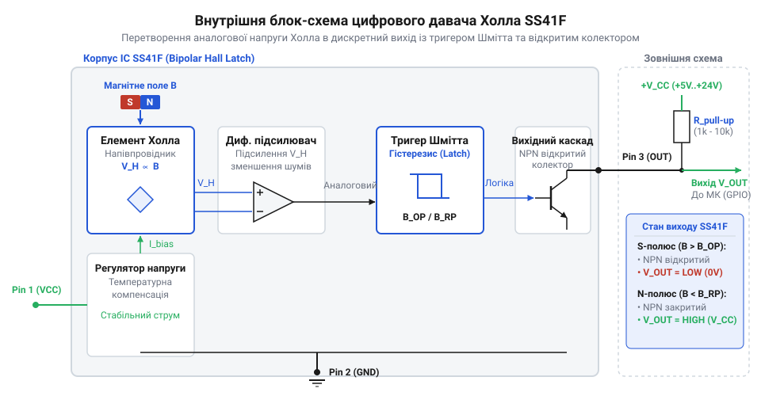
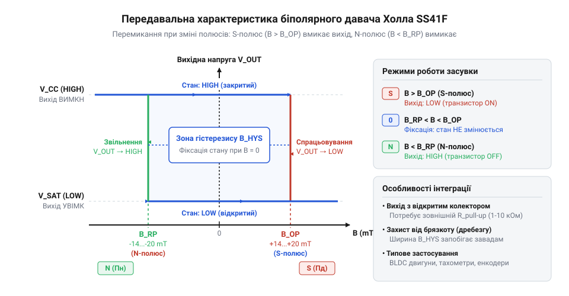
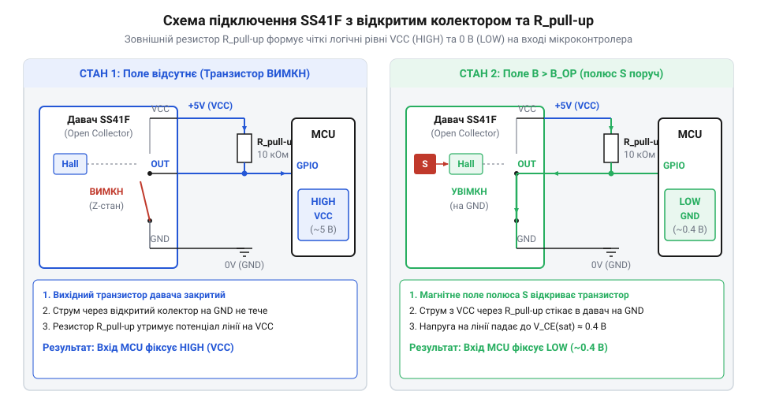
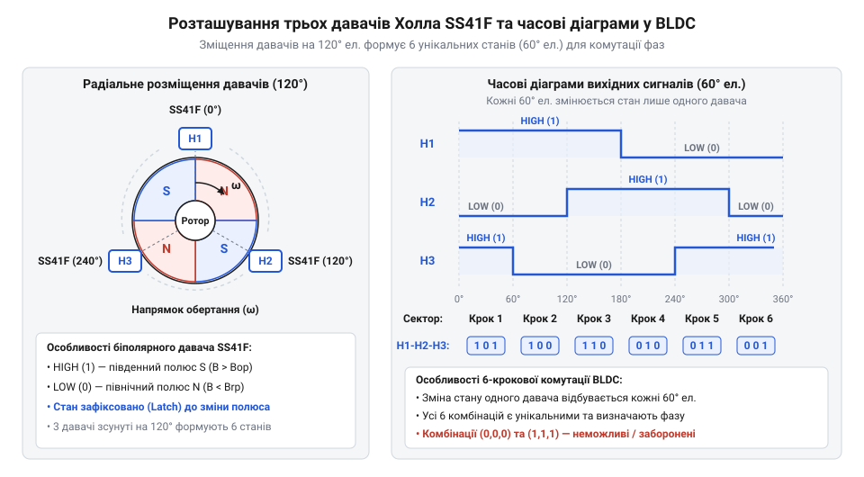

# SS41F — цифровий давач Холла

<preknowlist>
- [KY-003 / KY-024 — давач Голла](root:cat-hw-sensors/ky-003-hall) — базовий принцип перетворення магнітної індукції в електричний сигнал за допомогою ефекту Холла
- [A3144 — модуль давача Холла](root:cat-hw-sensors/a3144-hall-module) — роботу однополярного цифрового давача Холла та концепцію магнітних порогів спрацьовування в напівпровідникових корпусах
</preknowlist>

## Проблема відстеження позиції в механізмах

Для вимірювання позиції тихохідних валів тривалий час застосовували [герконові перемикачі](root:cat-hw-sensors/ky-021-reed). Проте контактний дребезг (англ. @@en|contact bounce@@) породжує хибні імпульси при кожному замиканні, а механічний резонанс і втома металу руйнують контакти на високих частотах.

Напівпровідниковий [однополярний давач Холла](root:cat-hw-sensors/a3144-hall-module) усуває зношування, але має інший недолік: він вмикається біля південного полюса й вимикається при його віддаленні. Якщо вал зупиняється на межі спрацьовування, вібрація чи температурний дрейф кристала викликають хаотичні перемикання виходу і лічбу фантомних обертів.

Для захисту від завад стан виходу має фіксуватися в нульовому магнітному полі. Для цього призначена біполярна засувка (від англ. @@en|latch@@ — клямка, фіксатор стану) @@en|SS41F@@. Вона перемикається лише протилежними полюсами: південний вмикає вихід, а північний — вимикає. У слабкому чи відсутньому полі сенсор зберігає останнє значення, ігноруючи вібрації вала.

## Внутрішня архітектура та елемент Холла

В основі мікросхеми @@en|SS41F@@ лежить напівпровідникова пластина N-типу. Струм живлення та перпендикулярне магнітне поле створюють силу Лоренца, яка відхиляє електрони до краю пластини й формує мікровольтну ЕРС Холла.


*Внутрішній тракт давача SS41F перетворює мікровольтний сигнал елемента Холла на цифровий вихід.*

Цей слабкий і залежний від температури сигнал очищається чопперною стабілізацією та підсилюється диференційним підсилювачем для придушення синфазних завад. Підсилений сигнал надходить на тригер Шмітта, який формує чіткі цифрові фронти та керує вихідним @@en|NPN@@-транзистором. Докладніший опис алгоритмів скасування температурного дрейфу та напруги зміщення викладено у статті про [чопперну стабілізацію в давачах Холла](root:cat-hw-sensors/hall-effect-chopper-stabilization).

## Принцип біполярної засувки та гістерезис

Поведінка @@en|SS41F@@ визначається симетричними порогами увімкнення `B_OP` (англ. @@en|operating point@@) та звільнення `B_RP` (англ. @@en|release point@@).


*Гістерезисна петля показує збереження вихідного стану при напруженості поля між порогами спрацьовування.*

Південний полюс із полем понад `B_OP` (типово `+4.0 mT`) відкриває вихідний NPN-транзистор, формуючи логічний 0. При знятті поля стан зберігається. Перемикання в логічну 1 вимагає дії північного полюса з індукцією нижче `B_RP` (типово `-4.0 mT`).

Інтервал між порогами утворює магнітний гістерезис (грец. *hysteresis* — відставання). Він відсікає цифровий дребезг при люфті вала, утримуючи вихід до перетину протилежного порогу.

## Вихідний каскад та підтягувальний резистор

Вихідний каскад @@en|SS41F@@ виконаний за схемою з відкритим колектором (англ. @@en|open collector@@): NPN-транзистор лише притягує вивід до землі. Без зовнішнього підтягувального резистора (англ. @@en|pull-up resistor@@) вхід мікроконтролера залишатиметься в плаваючому стані.


*Підтягування виходу до лінії 3.3 В дає змогу безпечно узгодити рівні з 5-вольтовим живленням сенсора.*

Мінімальний опір `R_pullup` захищає транзистор від струмового перевантаження:

```
R_min = V_CC / I_sink_max
```

При `V_CC = 5 V` та `I_sink_max = 20 mA` маємо `R_min = 250 Ом`, а на практиці беруть `1 kOm`–`10 kOm`. Верхня межа `R_max` обмежена паразитною ємністю лінії, яка затягує наростання фронту сигналу.

Підтягування виходу до шини `3.3 V` мікроконтролера замість `5 V` живлення сенсора узгоджує рівні без додаткових конвертерів напруги.

## Застосування в двигунах та завадозахист

Головна галузь застосування біполярних засувок @@en|SS41F@@ — визначення положення ротора в безколекторних двигунах (англ. @@en|BLDC motor@@). Три давачі встановлюють у статорі зі зсувом 120 електричних градусів. Їхні перемикання формують трифазний меандр, що кодує 6 секторів ротора для комутації обмоток та вимірювання частоти обертання вала. Детальніше про алгоритм 6-крокової комутації фаз за сигналами трьох сенсорів читайте у матеріалі про [керування BLDC-двигунами за давачами Холла](root:cat-hw-drivers/bldc-motor-hall-sensored-control).


*Зсув сигналів трьох біполярних засувок визначає точне кутове положення ротора в кожній з шести фаз.*

Для захисту від завад силової комутації біля виводів `V_CC` і `GND` установлюють розв'язувальний конденсатор (англ. @@en|decoupling capacitor@@) ємністю `0.1 uF`. У разі довгих дротів вихідний сигнал додатково фільтрують @@en|RC@@-ланцюжком (`100 Om` та `1 nF`), запобігаючи хибним фронтам на входах мікроконтролера.