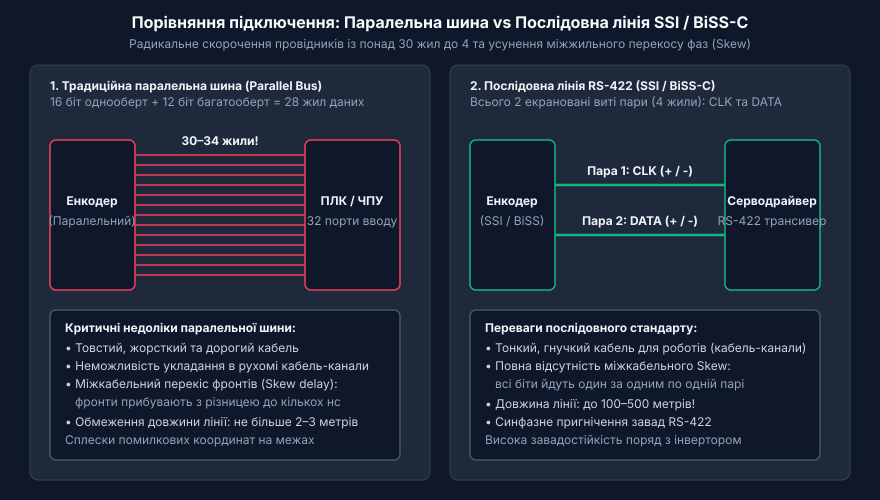
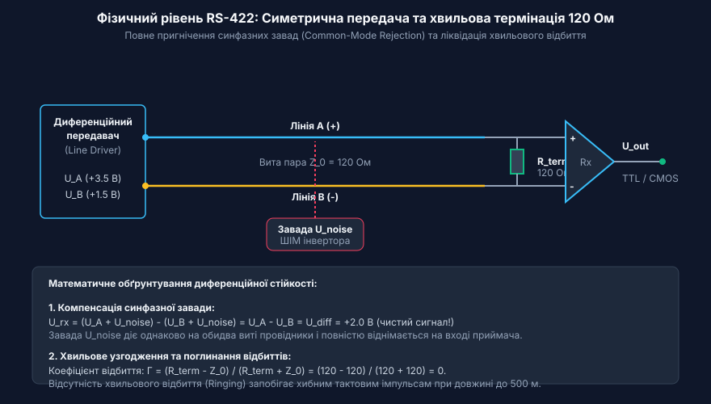
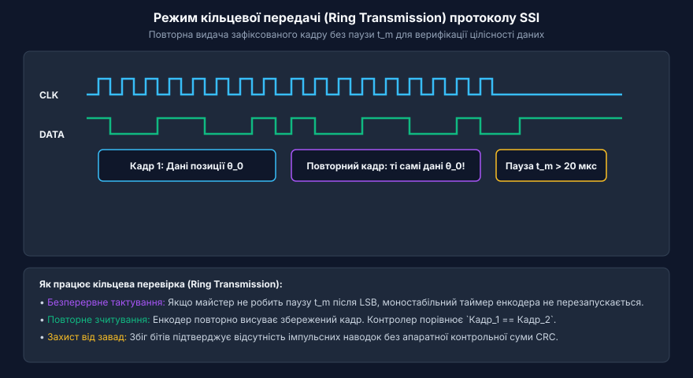
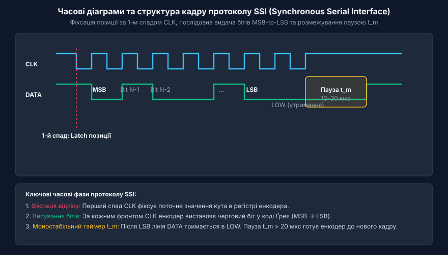
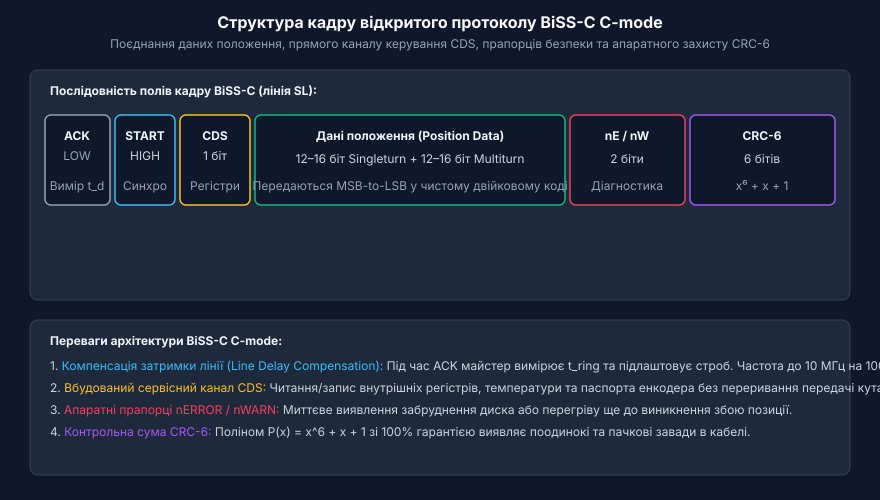

# Цифрові послідовні інтерфейси енкодерів SSI та BiSS-C

<preknowlist>
- [Енкодери кутового та лінійного переміщення](root:cat-hw-sensors/optical-and-magnetic-encoders) — поняття про відмінності між інкрементальними й абсолютними енкодерами та принципи первинного оцифрування механічного переміщення
- [Код Ґрея в енкодерах та цифрових кутомірах](root:cat-hw-sensors/gray-code) — влаштування однобітного зміщення кодових комбінацій та його роль у запобіганні помилкам зчитування абсолютного кута
</preknowlist>

## Проблема передачі абсолютного положення впродовж лінії

У сучасних автоматизованих виробничих комплексах, таких як багатоосьові верстати з числовим програмним керуванням, роторні друкарські машини, важкі мостові крани та промислові робот-маніпулятори, точність визначення просторового положення є критичним фактором. Робочі органи цих механізмів рухаються з високими швидкостями та прискореннями, виконуючи технологічні операції з мікронними допускними межами. Якщо система керування позиціонуванням отримує викривлені дані про точний кут обертання вала або лінійний зсув виконавчого органу, наслідками стають вихід з ладу дорогого інструменту, бракування всієї партії продукції або аварійне зіткнення рухомих частин обладнання з конструкціями цеху.

Історично першим і найпростішим рішенням для вимірювання переміщення були інкрементальні енкодери, які генерують послідовність електричних імпульсів при обертанні кодового диска. Зсунуті на 90 градусів фазні сигнали A та B дозволяють зовнішньому лічильнику визначати напрямок обертання, а нульова позначка (індексний канал Z) фіксує початок відліку кожного повного оберту. Проте функціонування інкрементальних каналів у промисловому середовищі пов'язане з фундаментальною вразливістю. Будь-яка короткочасна електромагнітна завада, наведена на кабель живленням від сусіднього частотного перетворювача, може згенерувати хибний спалах напруги, який лічильний вхід мікроконтролера зафіксує як реальний крок. Оскільки інкрементальний лічильник виконує виключно відносне підсумовування пульсацій, один-єдиний втрачений або доданий імпульс спричиняє постійну накопичувальну помилку позиціонування. Ця помилка зберігатиметься і збільшуватиметься аж до моменту, поки механізм не пройде нульову референтну мітку для перезавантаження лічильника.

Другим критичним обмеженням інкрементального підходу є енергозалежність. Під час зникнення живлення в електромережі — чи то внаслідок аварійного відключення, чи при плановій зупинці обладнання — поточне значення лічильника позиції в пам'яті контролера повністю втрачається. Після відновлення живлення сервопривод не має жодної інформації про реальний кут вала і змушений виконувати процедуру базового позиціонування (англ. @@en|homing@@ — пошук референтної точки). Для виконання цієї процедури механізм повинен фізично переміститися до спрацьовування кінцевого вимикача. На багатоосьових роботах або прецизійних лінійних приводах під навантаженням такий рух без знання поточної конфігурації звеньїв є неприпустимим, оскільки створює ризик аварійного заклинювання.

Для подолання цих обмежень було розроблено абсолютні енкодери, у яких кожна кутова або лінійна позиція має унікальну комбінацію кодових доріжок. Оцифроване значення кута доступне одразу при ввімкненні живлення без будь-яких попередніх переміщень вала. Проте перші моделі абсолютних датчиків будувалися на основі паралельних цифрових шин, де кожен біт виміряного значення виводився на окремий провідник кабелю.

Зі зростанням вимог до роздільної здатності паралельні інтерфейси зіштовхнулися з фізичними обмеженнями. Розглянемо енкодер із роздільною здатністю 16 бітів на один оберт (однооборотне значення) та 12 бітів для підрахунку кількості обертів (багатооборотне значення). Для виведення 28-бітного двійкового числа потрібен кабель, що містить 28 жил для даних, а також додаткові провідники для живлення, заземлення, стробування та сигналів помилки — загалом понад 30–34 провідники на один датчик. Такий багатожильний кабель має суттєву масу, високу вартість і значну жорсткість, що унеможливлює його прокладання у гнучких кабель-каналах (англ. @@en|drag chain@@ — кабелеукладач) сервоприводів.

Крім фізичних габаритів кабелю, паралельна передача на відстані понад 2–3 метри потерпає від міжкабельного часового зсуву сигналів (англ. @@en|skew@@ — перекіс фаз сигналів). Через відмінності в товщині диелектрика, довжині звивання та паразитній ємності окремих жил кабелю швидкість поширення електричних фронтів по різних провідниках не є однаковою. Якщо значення кута змінюється, наприклад, із комбінації `0111111111111111` на `1000000000000000`, усі 16 бітів мають змінити свій стан одночасно. Проте через міжкабельний перекіс фронти прибувають до приймача з різними затримками у кілька наносекунд. В узкому часовому вікні зчитування приймальний каскад бачить викривлені проміжні кодові комбінації, що призводить до сплесків помилкових координат.


*Порівняльне кабельне підключення паралельного та послідовного енкодера. Перехід від паралельного виводу до послідовної симетричної лінії усуває проблему міжкабельного перекосу фаз і радикально зменшує товщину кабельного джгута.*

Частковим вирішенням проблеми нестабільності проміжних станів стало [застосування коду Грея](root:cat-hw-sensors/gray-code), у якому при переході між двома сусідніми градаціями змінюється стан лише одного біта. Проте використання коду Грея не вирішує проблему громіздкості кабельного джгута і не рятує від низької завадостійкості однополярних сигналів рівнів @@en|TTL@@ (0–5 В) або @@en|HTL@@ (0–24 В). Однополярні сигнали сильно спотворюються паразитними ємностями довгого кабелю, а перемикання десятків бітів одночасно генерує внутрішні кидки струму на платі датчика (англ. @@en|ground bounce@@ — підскок потенціалу землі).

Виходом із цієї технологічної глупого кута став перехід від паралельних шин до послідовних синхронних інтерфейсів прямого зв'язку «точка-до-точки» (англ. @@en|point-to-point@@). Ідея полягає у тому, щоб паралельний код позиції усередині енкодера зафіксувати у зсувному регістрі та передати на контролер послідовно біт за бітом через одну сигнальну лінію під керуванням зовнішнього тактового сигналу.

Історично еволюція інтерфейсів проходила шлях від громіздких паралельних ліній 1970-х років до винайдення фірмою Stegmann у 1980-х роках однонаправленого стандарту @@en|SSI@@ (від англ. *Synchronous Serial Interface* — синхронний послідовний інтерфейс), а згодом — до створення відкритого двонаправленого протоколу @@en|BiSS-C@@ (від англ. *Bidirectional Synchronous Serial*, де літера C означає *Continuous mode* — неперервний режим). Детальніше про цей шлях і зміну вимог у промисловості можна прочитати у висвітленні [історії цифрових інтерфейсів](root:cat-hw-sensors/ssi-bissc-digital-interfaces/hist-encoder-interfaces-evolution.md).

Послідовна передача радикально скорочує кількість сигнальних провідників у кабелі всього до чотирьох жили (дві пари): одна вита пара призначена для передачі тактових імпульсів від контролера (англ. @@en|Master@@ — ведучий пристрій) до енкодера, а друга вита пара — для повернення даних від енкодера (англ. @@en|Slave@@ — ведений пристрій) до контролера. Скорочення кількості провідників дозволило реалізувати повноцінне диференційне екранування кожної лінії за допомогою фізичного стандарту RS-422, що забезпечило виняткову завадостійкість і нечутливість до довжини лінії. Сьогодні послідовні інтерфейси є стандартом де-факто для зчитування даних із прецизійних [оптичних та магнітних енкодерів](root:cat-hw-sensors/optical-and-magnetic-encoders), побудови зворотного зв'язку в системах [зчитування зворотного зв'язку](root:cat-hw-sensors/servo-feedback-potentiometers-and-magnetic-encoders) сервоприводів та витіснення класичних [аналогових резольверних датчиків](root:cat-hw-sensors/synchro-and-resolver-transducers) у промисловій автоматиці.

## Фізичний рівень RS-422 та диференційна завадостійкість

Передача синхронних послідовних даних між енкодером та обчислювальним модулем у промисловому середовищі відбувається на частотах від 100 кГц до 10 МГц по кабелях довжиною від кількох метрів до пів кілометра. Головною перешкодою для передачі високочастотних прямокутних імпульсів на такі відстані є потужні електромагнітні завади (англ. @@en|EMI@@ — *Electromagnetic Interference*), які випромінюються силовими кабелями частотно-регульованих електроприводів, зварювальними апаратами та індуктивними контакторами.

При використанні однополярних ліній передачі (наприклад, звичайних виходів з логічними рівнями 0–5 В відносно спільної землі) струми, що протікають по заземлювальних провідниках будівлі або верстата, створюють між корпусом датчика та шафою керування різницю потенціалів у кілька вольт. Утворюється так звана петля заземлення (англ. @@en|ground loop@@), напруга якої додається до корисного сигналу. Якщо ця напруга перевищує порогові рівні спрацьовування логічних елементів, цифровий приймач повністю втрачає здатність відрізняти логічну одиницю від нуля.

Для надійного пригнічення завад у послідовних інтерфейсах енкодерів SSI та BiSS-C використовують апаратний стандарт фізичного рівня @@en|RS-422@@ (офіційна назва @@en|ANSI/TIA/EIA-422-B@@). В основі цього стандарту лежить принцип симетричної диференційній передачі сигналів (англ. @@en|differential signaling@@).

Замість одного провідника відносно спільної землі, кожен сигнальний канал (тактовий сигнал @@en|CLK@@ або лінія даних @@en|DATA@@) складається з пари ізольованих провідників, що позначаються як пряма лінія `A` (або `+`) та інверсна лінія `B` (або `-`). Диференційний передавач (англ. @@en|line driver@@) одночасно формує на цих провідниках протилежні за полярністю напруги. Інформативним параметром для диференційного приймача (англ. @@en|line receiver@@) є виключно різниця потенціалів між провідниками `A` та `B`:

```
U_diff = U_A - U_B
```

Під час передачі логічної одиниці потенціал провідника `A` є вищим за потенціал провідника `B`. У типовому трансивері RS-422 напруга `U_A` становить приблизно +3.5 В, а `U_B` становить +1.5 В відносно локальної землі передавача. У результаті диференційна напруга є додатною:

```
U_diff = 3.5 - 1.5
       = +2.0 В                     [стан логічної одиниці]
```

При передачі логічного нуля стани виходів змінюються на протилежні: потенціал `U_A` знижується до +1.5 В, а `U_B` зростає до +3.5 В. Диференційна напруга стає від'ємною:

```
U_diff = 1.5 - 3.5
       = -2.0 В                     [стан логічного нуля]
```

Поріг чутливості стандартизованого приймача RS-422 становить лише ±0.2 В (200 мВ). Це означає, що навіть якщо через опори довгого кабелю амплітуда сигналу зменшиться у 10 разів (до 0.2 В), приймач все одно впевнено розпізнає переданий біт.

Ключова фізична перевага симетричної лінії полягає у пригніченні синфазних завад (англ. @@en|common-mode noise@@). Оскільки два провідники сигнальної пари розміщені поруч і звиті між собою, будь-яке зовнішнє електромагнітне поле індукує в обох провідниках однаковий паразитарний потенціал `U_noise`. Диференційний приймач на своєму вході обчислює різницю напруг:

```
U_rx = (U_A + U_noise) - (U_B + U_noise)
     = U_A + U_noise - U_B - U_noise      [розкриття дужок]
     = U_A - U_B                          [взаємне знищення синфазної завади]
     = U_diff                             [чистий корисний сигнал]
```

Завдяки цьому механізму синфазна завада або зсув потенціалів землі повністю компенсуються, якщо загальний рівень напруги на входах не виходить за межі допустимого діапазону синфазної напруги трансивера (від -7 В до +12 В відносно землі приймача).


*Принцип диференційної передачі сигналів RS-422 у лінійці енкодера. Симетрична вита пара та термінуючий опір 120 Ом забезпечують пригнічення наведених завад і запобігають відбиттю високочастотних імпульсів.*

При підвищенні частоти тактування до мегагерцового діапазону електричну довжину кабелю порівнюють із довжиною хвилі сигналу. Кабель зв'язку починає працювати як довга лінія передачі із розподіленими параметрами індуктивності та ємності. Основною характеристикою такої лінії є хвильовий опір (англ. @@en|characteristic impedance@@ — імпеданс, від латинського *impedio* — перешкоджаю), значення якого для промислових витих пар RS-422 нормується на рівні `Z_0 = 120 Ом`.

Якщо прямокутний імпульс напруги поширюється по кабелю зі швидкістю близько 200 000 км/с (наносекундна затримка близько 5 нс на кожен метр) і досягає кінця лінії, який підключено до високоімпедансного входу мікросхеми приймача (з опором понад 10 кОм), виникає явище відбиття електричної хвилі. Відбита хвиля повертається назад до передавача, накладається на корисні імпульси та викликає паразитарні коливання (англ. @@en|ringing@@ — дзвін фронтів) та часове тремтіння фронтів (англ. @@en|jitter@@). У результаті диференційний компаратор приймача може помилково зафіксувати два або три тактові імпульси замість одного.

Для запобігання відбиттю хвиль на кінці лінії (безпосередньо біля приймача SSI або BiSS-C) між провідниками `A` та `B` встановлюють термінуючий резистор `R_term`, опір якого строго дорівнює хвильовому опору кабелю (`120 Ом`). Коефіцієнт відбиття напруги `Gamma` при цьому дорівнює нулю:

```
Gamma = (R_term - Z_0) / (R_term + Z_0)
      = (120 - 120) / (120 + 120)        [розрахунок для узгодженого навантаження]
      = 0                                 [повне поглинання енергії хвилі]
```

Окрім термінації, найважливішим елементом фізичної лінії є правильна конструкція кабелю. Сигнальні провідники повинні бути витими парами (англ. @@en|twisted pair@@). Звивання жил забезпечує чергування напрямку індукційних петель: магнітний потік завади, що пронизує одну піввиткову петлю, створює струм, який за напрямком протилежний струму в сусідній піввитковій петлі, забезпечуючи самокомпенсацію наведених індуктивних струмів.

Кабель повинен мати комбіноване екранування (тип @@en|SF/UTP@@ — екран з алюмінієвої фольги плюс мідне плетіння із щільністю покриття не менше 85%). Фольга ефективно відбиває високочастотні радіозавади, а мідна плетена сітка забезпечує низький опір для відведення низькочастотних струмів наводки. Вирішальним правилом монтажу є екранування кабелю на 360 градусов. Екран кабелю повинен обтискатися суцільним металевим хомутом або спеціалізованим затискачем @@en|EMC@@ (від англ. *Electromagnetic Compatibility* — електромагнітна сумісність) безпосередньо на вхідній металевій панелі шафи керування. Підключення екрана за допомогою тонкого гнучкого провідника (так званого «свинячого хвостика», англ. @@en|pigtail@@) є грубою помилкою, оскільки паразитна індуктивність тонкого провідника (близько 1 нГн на міліметр довжини) створює високий опір для високочастотних завад, роблячи екран неефективним.

У високопрецизійних застосуваннях для захисту чутливих мікросхем від різниці потенціалів та статичних розрядів (англ. @@en|ESD@@ — *Electrostatic Discharge*) застосовують гальванічну розв'язку сигнальних ліній за допомогою оптичних ізоляторів або цифрових магнітних ізоляторів. Це гарантує стабільну роботу інтерфейсу при підключенні [лінійних диференціальних трансформаторів](root:cat-hw-sensors/lvdt-linear-variable-differential-transformers) та високоточного [магнітного енкодера AS5048](root:cat-hw-sensors/as5048-magnetic-encoder).

Детальні довідкові дані щодо електричних параметрів, допустимих довжин кабелю залежно від частоти тактування та схем узгодження наведено у довіднику [параметрів фізичного рівня](root:cat-hw-sensors/ssi-bissc-digital-interfaces/api-ssi-bissc-hardware-interface.md).

## Однонаправлений протокол SSI та моностабільна синхронізація

У високоточних системах позиціонування — від багатоосьових промислових маніпуляторів до верстатів із числовим програмним керуванням — передача даних від [абсолютних енкодерах переміщення](root:cat-hw-sensors/optical-and-magnetic-encoders) вимагає максимальної завадостійкості при мінімальній кількості провідників у рухомому кабельному каналі. Паралельні цифрові шини вимагають окремого провідника для кожного біта розрядності, що робить кабель громіздким та вразливим до міжкабельного часового зсуву (англ. @@en|skew@@). Асинхронні послідовні інтерфейси на кшталт @@en|UART@@ додають службові стартові й стопові біти, що знижує корисну пропускну здатність і створює часовий тремтить (англ. @@en|jitter@@). Для розв'язання цих проблем було створено інтерфейс @@en|SSI@@ (англ. @@en|Synchronous Serial Interface@@, від @@en|synchronous@@ — синхронний, @@en|serial@@ — послідовний, @@en|interface@@ — інтерфейс). Ознайомитися з тим, як формувалися ці вимоги в процесі розвитку давачів, можна вивчивши [історію розвитку послідовних інтерфейсів](root:cat-hw-sensors/ssi-bissc-digital-interfaces/hist-encoder-interfaces-evolution.md).

Інтерфейс @@en|SSI@@ побудовано на базі двох диференційних пар стандарту @@en|RS-422@@. Перша пара передає тактовий сигнал @@en|CLK@@ (англ. @@en|Clock@@) від керівного контролера (@@en|Master@@) до енкодера (@@en|Slave@@), а друга пара повертає послідовний потік даних @@en|DATA@@ від енкодера до контролера. У пасивному стані, коли опитування не відбувається, обидві лінії @@en|CLK@@ та @@en|DATA@@ перебувають у високому логічному рівні (HIGH). Детальні [електричні параметри фізичного рівня](root:cat-hw-sensors/ssi-bissc-digital-interfaces/api-ssi-bissc-hardware-interface.md) визначають хвильовий опір 120 Ом та вимоги до екранування витих пар.

Процес передачі кадру починається в момент, коли контролер видає перший спадаючий фронт на лінії @@en|CLK@@. Цей спад виконує тригерну функцію: засувка внутрішнього аналогово-цифрового перетворювача енкодера фіксує поточний стан кутового або лінійного положення. Після цього контролер починає генерувати серію стробувальних імпульсів @@en|CLK@@. За кожним наступним зростаючим фронтом тактового сигналу енкодер послідовно висуває біти зафіксованого значення на лінію @@en|DATA@@, починаючи з найстаршого розряду (англ. @@en|Most Significant Bit@@, @@en|MSB@@) і закінчуючи наймолодшим (англ. @@en|Least Significant Bit@@, @@en|LSB@@).

Щоб запобігти помилкам зчитування при переході між сусідніми позиціями, абсолютні енкодери передають дані в коді Грея (англ. @@en|Gray code@@). Завдяки [особливостям коду Грея](root:cat-hw-sensors/gray-code) при переході між сусідніми дискретними значеннями змінюється стан лише одного біта, що виключає появу хибних проміжних комбінацій при зміщенні зчитувальних елементів. Для використання виміряного значення у розрахунках позиції приймач перетворює код Грея у двійковий формат. Опанувати [математичний апарат перетворення коду](root:cat-hw-sensors/ssi-bissc-digital-interfaces/math-gray-code-and-crc-in-encoders.md) можна за допомогою послідовних операцій виключального АБО (@@en|XOR@@).

Розглянемо реалізацію алгоритму перетворення отриманого коду Грея у стандартне двійкове число у програмному забезпеченні приймача:

:::tabs
```c
// Перетворення коду Грея у двійковий формат (C)
#include <stdint.h>

uint32_t gray_to_binary32(uint32_t gray) {
    uint32_t mask = gray >> 1;
    while (mask != 0) {
        gray ^= mask;
        mask >>= 1;
    }
    return gray;
}
```
```cpp
// Перетворення коду Грея у двійковий формат (C++)
#include <cstdint>

constexpr uint32_t grayToBinary(uint32_t gray) noexcept {
    for (uint32_t mask = gray >> 1; mask != 0; mask >>= 1) {
        gray ^= mask;
    }
    return gray;
}
```
:::

Після висування останнього біта даних (@@en|LSB@@) лінія @@en|DATA@@ переходить у низький рівень (LOW). Енкодер утримує цей рівень за допомогою вбудованого моностабільного таймера (англ. @@en|monostable multivibrator@@, від @@en|mono-@@ — один, @@en|stable@@ — стабільний). Час утримання `t_m` (зазвичай від 12 до 20 мкс) є критичним інтервалом розмежування кадрів. Доки час `t_m` не сплив, енкодер не знімає новий зріз позиції. Якщо контролер утримує лінію @@en|CLK@@ у високому рівні довше за `t_m`, моностабільний таймер перезапускається, лінія @@en|DATA@@ повертається у високий рівень HIGH, і енкодер переходить у стан очікування нового кадру.

Якщо ж контролер не робить паузу `t_m` після видачі останнього біта, а продовжує генерувати строби @@en|CLK@@, енкодер входить у режим кільцевої передачі (англ. @@en|ring transmission@@). У цьому режимі енкодер повторно висуває на лінію @@en|DATA@@ ті самі біти раніше зафіксованого кадру, починаючи з @@en|MSB@@. Це дозволяє майстру порівняти два або більше послідовних зчитувань одного й того самого вимірювання. Якщо комбінації бітів у повторних кадрах збігаються, це підтверджує відсутність імпульсних завад у лінії передачі.


*Часова діаграма кільцевої передачі @@en|SSI@@ показує повторення однакового кадру даних без паузи t_m, що дозволяє контролеру порівнювати послідовні зчитування та підтверджувати відсутність імпульсних завад у лінії.*

Структуру кадру та часові співвідношення сигналів показано на діаграмі:


*Синхронна передача SSI: фіксація вимірювання за першим спадом CLK, послідовне висування бітів даних MSB-to-LSB та розмежування кадрів паузою моностабільного таймера t_m.*

Вивчаючи [детальну структуру кадрів даних](root:cat-hw-sensors/ssi-bissc-digital-interfaces/api-ssi-bissc-protocol-frames.md) для однооборотних та багатооборотних енкодерів, слід враховувати загальну кількість бітів у кадрі (від 13 до 32 бітів).

Гранична частота тактування `f_CLK` протоколу @@en|SSI@@ обмежена довжиною кабелю `L` та швидкістю поширення електромагнітної хвилі в мідному провіднику `v_prop` (приблизно 5 нс на метр). Оскільки сигнал @@en|CLK@@ прямує від контролера до енкодера, а сигнал @@en|DATA@@ повертається назад, загальна часова затримка подвійного пробігу `t_delay` розраховується за формулою:

```
t_delay = 2 · L · v_prop + t_driver + t_receiver
f_max = 1 / (2 · t_delay)      [гранична частота з урахуванням відновлення даних]
```

Де `t_driver` — затримка спрацьовування диференційного передавача @@en|RS-422@@, а `t_receiver` — затримка приймача енкодера. Наприклад, при довжині кабелю `L = 100` м загальна затримка лінії становить `1000` нс. З урахуванням затримок мікросхем `200` нс, сумарна затримка складає `1.2` мкс. Отже, максимальна частота `f_max` не може перевищувати близько `416` кГц. Спроба підвищити частоту тактування призведе до того, що фронт біта @@en|DATA@@ прибуде до контролера з запізненням, коли стробувальний спад @@en|CLK@@ вже минув, спричинивши зсув бітів і помилку позиціонування.

Незважаючи на простоту, класичний протокол @@en|SSI@@ має два фундаментальних обмеження: він є суворо однонаправленим (англ. @@en|unidirectional@@), що унеможливлює налаштування регістрів енкодера, і в ньому відсутня апаратна перевірка цілісності даних (наприклад, контрольна сума @@en|CRC@@). Ці недоліки усунуто в більш сучасному двонаправленому стандарті @@en|BiSS-C@@.

## Двонаправлений відкритий стандарт BiSS-C C-mode

У високодинамічних сервоприводах та прецизійних робототехнічних комплексах обмежитися лише вимірюванням кута недостатньо. Приводу необхідно постійно моніторити стан давача — температуру оптичного чи магнітного вузла, робочий струм випромінювача, наявність забруднень на вимірювальному диску та прапорці несправностей. Крім того, під час первинного налаштування обладнання потрібно зчитувати електронний паспорт давача та коефіцієнти калібрування. Для забезпечення цих потреб створено відкритий двонаправлений стандарт @@en|BiSS-C@@ (англ. @@en|Bidirectional Synchronous Serial C-mode@@, від @@en|bidirectional@@ — двонаправлений, @@en|synchronous@@ — синхронний, @@en|serial@@ — послідовний).

Режим C-mode (англ. @@en|Continuous mode@@ — безперервний режим) стандарту @@en|BiSS-C@@ дозволяє під час кожного тактового циклу одночасно передавати високошвидкісний кадр даних позиції та обмінюватися даними з внутрішніми регістрами конфігурації енкодера. У топології точка-до-точки (англ. @@en|point-to-point@@) зв'язок реалізується через дві диференційні пари @@en|RS-422@@:
- Лінія `@@en|MA@@` (англ. @@en|Master Ack / Master Clock@@) — тактовий сигнал, який генерується майстром. - Лінія `@@en|SL@@` (англ. @@en|Slave Data@@) — послідовний потік даних від енкодера до майстра.

Для передачі інформації з регістрів давача без виділення додаткових провідників використовується вбудований сервісний канал `@@en|CDS@@` (англ. @@en|Control Data Slave@@), біти якого вкраплюються в кожен кадр даних позиції. Налаштування зв'язку та [програмний код для зчитування](root:cat-hw-sensors/ssi-bissc-digital-interfaces/proj-mcu-encoder-receiver.md) демонструють, як обробка кадру виконується в реальному часі на мікроконтролері або @@en|FPGA@@.

У пасивному стані обох ліній `@@en|MA@@` та `@@en|SL@@` утримується високий логічний рівень (HIGH). Передача кадру складається з таких послідовних фаз:
1. **Фаза підтвердження (`@@en|ACK@@`) та старту (`@@en|ST@@`)**: Майстер починає тактувати лінію `@@en|MA@@`. Енкодер відповідає встановленням лінії `@@en|SL@@` у низький рівень (`@@en|ACK@@` — англ. @@en|acknowledge@@). Як тільки енкодер готовий висувати дані, він переводить `@@en|SL@@` у високий рівень, формуючи біт старту (`@@en|Start bit@@`, `@@en|ST@@`). 2. **Біт керування `@@en|CDS@@`**: Відразу після біта старту висувається один біт сервісного каналу `@@en|CDS@@`. Послідовність бітів `@@en|CDS@@` з кількох кадрів формує потік даних читання внутрішніх регістрів. 3. **Дані позиції**: Далі енкодер передає багатооборотні біти (англ. @@en|multiturn@@) та однооборотні біти (англ. @@en|singleturn@@) позиції, починаючи з старшого розряду `@@en|MSB@@`. 4. **Діагностичні прапорці `@@en|nERROR@@` та `@@en|nWARN@@`**: Після даних позиції висуваються два активні низьким рівнем біти стану. Біт `@@en|nERROR@@` (англ. @@en|not Error@@) стає `0` при критичній відмові (наприклад, обрив світлодіода чи втрата зчитування дискретних міток). Біт `@@en|nWARN@@` (англ. @@en|not Warning@@) стає `0` при попереджувальних подіях (наприклад, забруднення оптичного диска або наближення температури до граничної межі). 5. **Контрольна сума `@@en|CRC@@`**: Кадр завершується 6-бітним полем `@@en|CRC@@` (англ. @@en|Cyclic Redundancy Check@@). Контрольна сума обчислюється апаратно на боці енкодера за поліномом `P(x) = x^6 + x + 1` (інвертований результат) для всіх бітів кадру, починаючи від `@@en|CDS@@` і закінчуючи `@@en|nWARN@@`.

Наведемо реалізацію алгоритму перевірки поліноміальної контрольної суми `@@en|CRC-6@@` кадру @@en|BiSS-C@@ у приймальному модулі:

:::tabs
:::code ssi-bissc-digital-interfaces-d/c/bissc-verify-crc6.c
:::code ssi-bissc-digital-interfaces-d/cpp/bisscvalidator.cpp
:::

Структуру кадру BiSS-C C-mode наочно показано на діаграмі:


*Структура послідовного кадру BiSS-C C-mode: поєднання високошвидкісних даних позиції, прямого сервісного каналу CDS, прапорців nERROR/nWARN та апаратного захисту CRC.*

На відміну від класичного @@en|SSI@@, де затримка в кабелі обмежує частоту тактування до сотень кілогерц, стандарт @@en|BiSS-C@@ підтримує частоти до 10 МГц на довгих лініях завдяки апаратній компенсації затримки (англ. @@en|line delay compensation@@). Під час фази `@@en|ACK@@` майстер вимірює часовий інтервал між видачею першого фронту `@@en|MA@@` та отриманням спадного фронту `@@en|SL@@`. Знайдена затримка подвійного пробігу `t_ring` використовується мікросхемою майстра для автоматичного фазового зсуву внутрішнього стробу зчитування бітів `@@en|SL@@`. Завдяки цьому стробування бітів позиції виконується рівно посередині інформаційного інтервалу незалежно від довжини кабелю.

Інтерфейс @@en|BiSS-C@@ застосовується там, де потрібні безкомпромісна точність та швидкість: у безколекторних серводвигунах із високорозрядними оптичними дисками, у системах, де функціонує [магнітний енкодер AS5048](root:cat-hw-sensors/as5048-magnetic-encoder) або [магніторезистивні сенсори кута](root:cat-hw-sensors/amr-gmr-tmr-magnetic-sensors). Для первинного конфігурування задіяно [програмування пам'яті OTP](root:cat-hw-sensors/as5048-otp-programming-guide). На відміну від аналогових рішень, як-от [резольверах та сельсинах](root:cat-hw-sensors/synchro-and-resolver-transducers) чи [лінійні трансформатори LVDT](root:cat-hw-sensors/lvdt-linear-variable-differential-transformers), які потребують таких вузлів, як [перетворювачів резольвер-код](root:cat-hw-sensors/resolver-to-digital-converters), @@en|BiSS-C@@ видає готове оцифроване значення положення безпосередньо у цифровий сервоконтролер. Порівняно зі стандартними [датчиках кутового положення](root:cat-hw-sensors/servo-feedback-potentiometers-and-magnetic-encoders), протокол @@en|BiSS-C@@ усуває шуми аналогового тракту та забезпечує повний моніторинг стану давача у реальному часі.

## Системне порівняння та критерії вибору інтерфейсу

Вибір цифрового інтерфейсу абсолютного енкодера визначає не лише точність оцифрування механічного кута, а й граничні динамічні характеристики всієї системи автоматичного керування. У сервоприводах, робототехнічних маніпуляторах та технологічному обладнанні розробник найчастіше вибирає між двома основними протоколами послідовного зв'язку: @@en|SSI@@ (від англ. *@@en|Synchronous Serial Interface@@*, синхронний послідовний інтерфейс) та @@en|BiSS-C@@ (від англ. *@@en|Bidirectional/Synchronous/Serial C-mode@@*, двонаправлений синхронний послідовний інтерфейс режиму C). Обидва стандарти функціонують поверх симетричних диференціальних ліній [фізичного рівня RS-422](root:cat-hw-sensors/ssi-bissc-digital-interfaces/api-ssi-bissc-hardware-interface.md), проте принципові відмінності у будові часових діаграм, рівні діагностики та архітектурі кадру формують суттєву різницю в їхніх експлуатаційних можливостях.

Гранична частота тактування та пропускна здатність інтерфейсу безпосередньо залежать від довжини сполучної лінії. У протоколі @@en|SSI@@ передача даних контролюється майстром (@@en|Master@@), який ґенерує строб-сигнал @@en|CLK@@, а ведений пристрій (@@en|Slave@@) повертає біти позиції по лінії @@en|DATA@@. Оскільки @@en|SSI@@ не має апаратного механізму вимірювання затримки поширення сигналу (англ. *@@en|propagation delay@@*), час проходження фронту тактової частоти до енкодера та повернення біта даних до приймача обмежує максимальну частоту опитання. На коротких кабелях довжиною до 10 метрів інтерфейс @@en|SSI@@ стабільно працює на частотах @@en|CLK@@ близько 1.5–2.0 МГц. Однак при збільшенні довжини кабелю до 100 метрів фізична затримка в мідних провідниках та драйверах лінії зростає, через що тактову частоту доводиться примусово знижувати до 100 кГц. В іншому разі приймач прочитає біт даних із зсувом фази, що призведе до спотворення зчитаного значення.

Натомість стандарт @@en|BiSS-C@@ вирішує проблему фазового зсуву за рахунок апаратної компенсації затримки лінії (англ. *@@en|Line Delay Compensation@@*). Під час стартового імпульсу кадру приймач @@en|BiSS-C@@ вимірює часовий інтервал між відправкою фронту @@en|CLK@@ та отриманням відповідного біта @@en|ACK@@ від енкодера. Отримане значення затримки автоматично враховується стробувальним вузлом приймача при зчитуванні наступних бітів кадру. Завдяки цій компенсації @@en|BiSS-C@@ здатен працювати на частотах тактування до 10 МГц на коротких трасах і підтримувати високу швидкість передачі даних навіть на довгих кабельних лініях. Для високоефективного [зворотного зв'язку сервоприводів](root:cat-hw-sensors/servo-feedback-potentiometers-and-magnetic-encoders) зменшення затримки отримання кута принципово важливе, оскільки будь-яке запізнення фази у контурі регулювання швидкості знижує запаси стійкості сервосистеми.

Другим критичним параметром порівняння є цілісність даних та глибина діагностики. У класичному протоколі @@en|SSI@@ апаратний захист кадру відсутній: ведений пристрій видає лише набір бітів кутового положення. Окремі виробники додають до кадру біт парності або вимагають подвійного послідовного зчитування кадру в одному циклі тактування, однак базова специфікація не гарантує виявлення одиничних чи групових збоїв, викликаних електромагнітними завадами. Для запобігання стрибкам позиції приймач змушений виконувати програмне відфільтровування аномальних значень. Розуміння [обчислення контрольних сум](root:cat-hw-sensors/ssi-bissc-digital-interfaces/math-gray-code-and-crc-in-encoders.md) та правил декодування [особливостей коду Ґрея](root:cat-hw-sensors/gray-code) показує, що без апаратної перевірки кадрів у критичних застосуваннях існує ризик прийняття викривлених даних за достовірні.

На противагу @@en|SSI@@, стандарт @@en|BiSS-C@@ містить багаторівневу систему контролю цілісності та стану датчика. Кожен інформаційний кадр @@en|BiSS-C@@ завершується 6-бітним циклічним контрольним кодом (@@en|CRC-6@@), який обчислюється поліномом над бітами позиції та бітами статусу. Поруч із даними позиції у кадрі постійно передаються активні низьким рівнем прапорці помилки (@@en|nERROR@@) та попередження (@@en|nWARN@@). Прапорець @@en|nERROR@@ негайно сигналізує про вихід з ладу оптичного випромінювача, відмову сенсора чи критичний збій внутрішнього оцифрування, а прапорець @@en|nWARN@@ попереджає про наближення параметрів до граничних меж — наприклад, про забруднення кодового диска, температурне перевантаження або просідання оптичного сигналу. Це дозволяє реалізувати контури безпеки та запобігти аварійній зупинці обладнання.

Третя суттєва відмінність полягає у напрямку передачі даних та можливостях параметризації. Протокол @@en|SSI@@ є однонаправленим: даних від приймача до енкодера по основній лінії передати неможливо. Якщо виникає потреба скинути поточне значення у нуль (функція @@en|PRESET@@) або змінити напрямок відліку (функція @@en|DIR@@), доведеться задіяти додаткові фізичні провідники у кабелі. Зчитування серійного номера, електронного паспорта або коефіцієнтів калібрування в @@en|SSI@@ взагалі не передбачено. Інтерфейс @@en|BiSS-C@@ реалізує повноцінний двонаправлений зв'язок. Упродовж кожного робочого кадру повертається один біт каналу керування (англ. *@@en|Control Data Channel@@*, @@en|CDS@@), через який у фоновому режимі можна читати та записувати внутрішні регістри датчика. Завдяки цьому контролер може налаштовувати точки відліку, виправляти внутрішні коефіцієнти та опитувати діагностичні регістри без зупинки основного циклу опитання позиції. Детальний розбір того, як чергуються біти позиції, статусу й керування, наведено в описі [структуру протокольних кадрів](root:cat-hw-sensors/ssi-bissc-digital-interfaces/api-ssi-bissc-protocol-frames.md).

З точки зору апаратної реалізації приймача, обидва протоколи висувають принципово різні вимоги до обчислювальних ресурсів управляючого контролера. Приймач @@en|SSI@@ відрізняється простотою: для зчитування даних достатньо стандартного периферійного модуля @@en|SPI@@ у режимі веденого пристрою зі зовнішнім тактуванням або звичайного мікроконтролера (@@en|MCU@@), який ґенерує строби @@en|CLK@@ за допомогою апаратного таймера та зчитує лінію @@en|DATA@@ у перериванні. Натомість реалізація приймача @@en|BiSS-C@@ вимагає відстеження змінного часу відгуку лінії, розпізнавання стартових бітів @@en|ACK@@ та @@en|Start bit@@, апаратного обчислення контрольної суми @@en|CRC-6@@ на частотах до 10 МГц та обробки бітів каналу @@en|CDS@@. Програмне опитування виводів (англ. *@@en|bit-banging@@*) на мікроконтролері для @@en|BiSS-C@@ виявляється неефективним через високі часові навантаження. З огляду на це розробники застосовують програмовані логічні інтегральні схеми (@@en|FPGA@@), спеціалізовані мікросхеми приймачів (@@en|ASIC@@) або цифрові сигнальні процесори (@@en|DSP@@) зі спеціалізованими апаратними блоками декодування. Вибираючи [програмну реалізацію приймача](root:cat-hw-sensors/ssi-bissc-digital-interfaces/proj-mcu-encoder-receiver.md), важливо заздалегідь оцінити обчислювальну потужність процесорного ядра та наявність необхідних апаратних таймерів.

Вивчення шляху розвитку послідовних шин показує, як [еволюція цифрових інтерфейсів](root:cat-hw-sensors/ssi-bissc-digital-interfaces/hist-encoder-interfaces-evolution.md) привела до поступового витіснення закритих та простих однонаправлених шин відкритими протоколами з вбудованим контролем цілісності. Інженерний вибір між @@en|SSI@@ та @@en|BiSS-C@@ будується на аналізі чотирьох ключових критеріїв:
1. **Динаміка та довжина кабелю:** Якщо відстань від датчика до контролера перевищує 20–30 метрів, а необхідна частота оновлення позиції становить понад 50 кГц, @@en|BiSS-C@@ є єдиним вибором завдяки компенсації затримки лінії. 2. **Вимоги до надійності та безпеки:** У високоточних верстатах з ЧПК, робототехніці та підйомних механізмах використання @@en|BiSS-C@@ є обов'язковим через наявність апаратного контролю @@en|CRC-6@@ та прапорців відмови @@en|nERROR@@. Для стандартного промислового транспортування чи загальнопромислових позиціонерів цілком достатньо протоколу @@en|SSI@@. 3. **Обчислювальний бюджет приймача:** Якщо управляючий вузол побудований на бюджетному мікроконтролері без @@en|FPGA@@ або спеціалізованих блоків декодування, простіше застосувати @@en|SSI@@. Якщо ж у системі вже використовується @@en|FPGA@@ або серводрайвер зі спеціалізованою @@en|ASIC@@, перевагу надають @@en|BiSS-C@@. 4. **Тип вимірювального перетворювача:** Незалежно від того, чи застосовується інтерфейс у складі [оптичних та магнітних енкодерів](root:cat-hw-sensors/optical-and-magnetic-encoders), вибір шини передачі даних визначає верхню межу швидкодії всього вимірювального тракту.

Таким чином, @@en|SSI@@ залишається перевіреним рішенням для простих застосувань із помірними вимогами до швидкості та безпеки, тоді як @@en|BiSS-C@@ виступає сучасним стандартом для високошвидкісних, надійних та інтелектуальних систем автоматичного керування рухом.