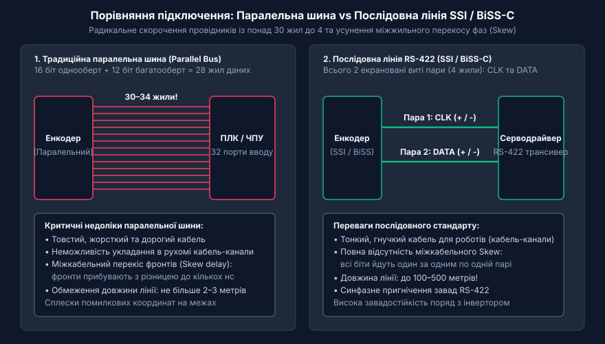
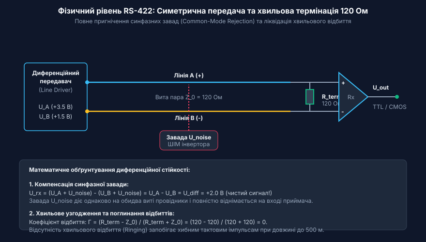
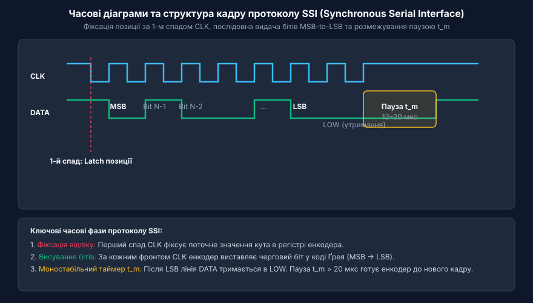
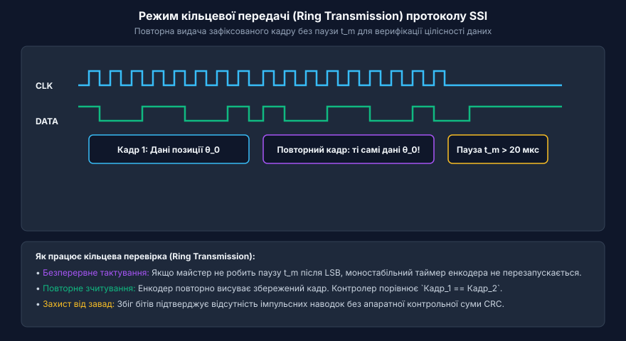
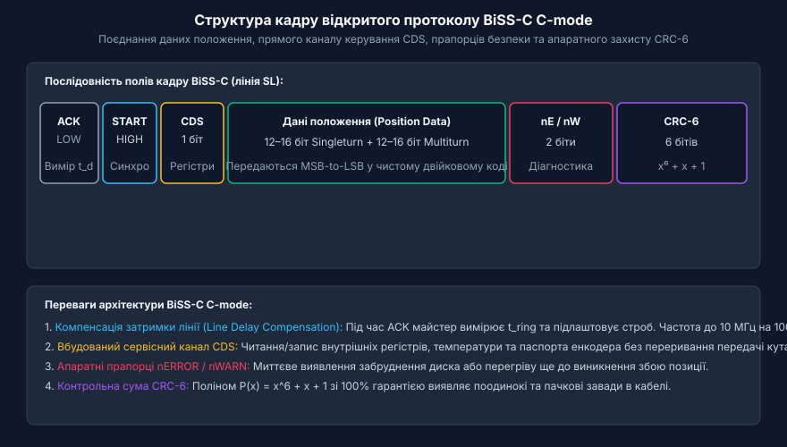

# Цифрові послідовні інтерфейси енкодерів SSI та BiSS-C

<preknowlist>
- [Енкодери кутового та лінійного переміщення](root:cat-hw-sensors/optical-and-magnetic-encoders) — базові відмінності між інкрементальними й абсолютними енкодерами та принципи первинного оцифрування механічного руху
- [Код Ґрея в енкодерах та цифрових кутомірах](root:cat-hw-sensors/gray-code) — будова однобітного зміщення кодових комбінацій та його роль у запобіганні помилкам зчитування абсолютного кута
</preknowlist>

## Проблема передачі абсолютного положення впродовж лінії

У системах промислової автоматизації, робототехніці та верстатах із числовим програмним керуванням надійне визначення просторового положення є фундаментальною вимогою. Традиційні інкрементальні енкодери, які формують квадратурні імпульси A/B, мають істотну ваду: будь-яка короткочасна завада в лінії додає або втрачає імпульс, спричиняючи незворотну накопичувальну помилку позиціонування аж до наступного повернення у нульову референтну мітку (англ. @@en|homing@@). Крім того, при зникненні електроживлення поточні координати втрачаються повністю.

Абсолютні енкодери усувають цю проблему, оскільки кожна точка переміщення має унікальний цифровий код, доступний миттєво після ввімкнення живлення. Проте ранні конструкції абсолютних датчиків застосовували паралельні інтерфейси, де кожному розряду кута відповідав окремий провідник у кабелі. Для 24–32 розрядних енкодерів джгут кабелю налічував понад 30 жил, що робило його надзвичайно товстим, жорстким, дорогим і непридатним для гнучких кабелеукладачів промислових роботів.

Крім механічних труднощів, довгі паралельні лінії зазнають впливу часового перекосу сигналів (англ. @@en|skew@@): через технологічні розбіжності між жилами фронти бітів приходять до приймача з різними затримками. Якщо кодовий стан змінюється одночасно в багатьох розрядах, приймач фіксує фальшиві проміжні значення.


*Порівняння підключення абсолютного енкодера: паралельна багатожильна лінія проти послідовної диференційної пари RS-422. Перехід до послідовної передачі усуває перекіс фаз і кардинально зменшує масу кабелю.*

Перехід до послідовних інтерфейсів «точка-до-точки» дозволив упакувати паралельний код у зсувний регістр і передавати його через дві виті пари: одна пара для тактового сигналу контролера, друга — для послідовного потоку даних від датчика.

## Фізичний рівень RS-422 та диференційна завадостійкість

Промислове середовище насичене потужними електромагнітними завадами від частотних приводів, реле та електродвигунів. Однополярні цифрові лінії (рівні TTL 0–5 В) не можуть гарантувати надійне передавання на довгих дистанціях через різницю потенціалів між заземленнями датчика та шафи керування (явище петлі заземлення).

Для усунення завад цифрові інтерфейси енкодерів використовують фізичний стандарт RS-422. Сигнал передається парою провідників (прямим A та інверсним B). Інформативним параметром є різниця напруг між цими провідниками:

```
U_diff = U_A - U_B
```

Під час передачі логічної одиниці потенціал провідника A вищий за потенціал провідника B (наприклад, +2 В), а під час передачі логічного нуля — нижчий (-2 В). Будь-яка зовнішня завада наводиться на обидва провідники однаково (синфазна завада) і взаємно віднімається на диференційному вході приймача:

```
U_rx = (U_A + U_noise) - (U_B + U_noise) = U_A - U_B = U_diff
```


*Фізичний рівень RS-422: симетричні виті пари та узгоджувальний опір 120 Ом на кінці лінії пригнічують наведені електромагнітні завади та запобігають відбиттю фронтів імпульсів.*

Для запобігання відбиттю хвиль на кінцях лінії між провідниками пари встановлюють термінуючий резистор 120 Ом, що строго відповідає хвильовому імпедансу витої пари. Використання екранованого кабелю з круговим 360-градусним заземленням екрана забезпечує стабільну передачу сигналів на частотах до кількох мегагерців.

## Однонаправлений протокол SSI та моностабільна синхронізація

Інтерфейс SSI (англ. @@en|Synchronous Serial Interface@@) — це класичний промисловий протокол типу «ведучий-ведений» (Master-Slave). Контролер генерує серію тактових імпульсів на лінії CLK, а енкодер у відповідь висуває розряди кутового положення по лінії DATA, починаючи з найстаршого біта (MSB).

У пасивному стані обидві лінії перебувають у високому рівні HIGH. Перший спадний фронт сигналу CLK слугує внутрішнім тригером: енкодер фіксує поточний стан оптичного чи магнітного диска в паралельному регістрі. Кожен наступний наростаючий фронт CLK висуває черговий біт положення на лінію DATA. Дані здебільшого передаються в коді Грея, що виключає грубі помилки дискретизації на стиках секторів.

Після передачі наймолодшого біта (LSB) енкодер утримує лінію DATA в низькому рівні за допомогою моностабільного таймера на час t_m (зазвичай 12–20 мкс). Якщо після цього контролер утримує лінію CLK у високому стані довше за t_m, датчик розпізнає паузу тайм-ауту та готується до зчитування нового положення.


*Часова діаграма SSI: фіксація положення за першим спадом тактового сигналу CLK, висування бітів даних та розмежування циклів паузою моностабільного таймера t_m.*

Якщо ж контролер не робить паузу t_m, а продовжує надсилати тактові імпульси, енкодер переходить у режим кільцевої передачі (англ. @@en|ring transmission@@). Він починає повторно видавати той самий зафіксований раніше кадр, що дає змогу контролеру перевірити ідентичність повторних зчитувань та виявити поодинокі завади в кабелі.


*Режим кільцевої передачі SSI: повторення раніше зафіксованого кадру без паузи t_m для підтвердження достовірності виміряного значення.*

Головними обмеженнями класичного SSI є відсутність апаратної контрольної суми CRC та однонаправленість каналу зв'язку.

## Двонаправлений відкритий стандарт BiSS-C C-mode

Для подолання обмежень SSI було розроблено відкритий стандарт BiSS-C (англ. @@en|Bidirectional Synchronous Serial C-mode@@). Режим неперервної передачі (Continuous mode) забезпечує одночасне передавання високошвидкісних даних кута та низькошвидкісний двонаправлений обмін з внутрішніми регістрами енкодера.

Топологія інтерфейсу використовує дві диференційні лінії: тактову лінію MA (від майстра) та лінію даних SL (від веденого датчика). Цикл опитування містить такі структурні елементи:

1. **Фаза підтвердження (ACK) та старт (ST):** Майстер починає тактування MA. Енкодер притискає SL до нуля (ACK), а коли готовий видавати дані — переводить SL в одиницю (Start bit).
2. **Сервісний біт CDS:** Вкраплений біт каналу керування (Control Data Slave), послідовність яких утворює потік налаштування регістрів і читання паспорта датчика.
3. **Дані положення:** Багатооборотне та однооборотне значення кута, висунуті розряд за розрядом.
4. **Прапорці статусу:** Активні низьким рівнем біти nERROR (апаратна несправність або обрив сенсора) та nWARN (попередження про перегрів чи забруднення диска).
5. **Контрольна сума CRC-6:** 6-бітний поліноміальний код P(x) = x^6 + x + 1, що надійно захищає кадр від спотворень.


*Структура кадру BiSS-C C-mode: поєднання даних положення, вбудованого каналу налаштування CDS, прапорців nERROR/nWARN та апаратного захисту кодом CRC-6.*

BiSS-C також підтримує апаратну компенсацію затримки лінії (англ. @@en|line delay compensation@@). За тривалістю фази ACK майстер автоматично визначає подвійний час проходження сигналу по кабелю t_ring та підлаштовує момент стробування бітів, що дає змогу працювати на тактових частотах до 10 МГц навіть при довжині кабелю 100 метрів.

## Системне порівняння та критерії вибору інтерфейсу

Обидва інтерфейси — SSI та BiSS-C — побудовані на базі фізичного стандарту RS-422, проте мають суттєві відмінності у функціональних можливостях:

| Характеристика | Інтерфейс SSI | Стандарт BiSS-C (C-mode) |
| :--- | :--- | :--- |
| **Напрямок передачі** | Однонаправлений (тільки від датчика) | Повноцінний двонаправлений (дані + параметри) |
| **Максимальна частота** | До 1–2 МГц (до 100 кГц на 100 м) | До 10 МГц із компенсацією затримки лінії |
| **Контроль цілісності** | Відсутній (або простий біт парності) | Апаратний циклічний код CRC-6 |
| **Діагностика датчика** | Немає прямого моніторингу стану | Апаратні прапорці nERROR та nWARN у кожному кадрі |
| **Доступ до регістрів** | Неможливий (потрібні окремі лінії) | Вбудований сервісний канал керування CDS |
| **Складність приймача** | Низька (будь-який стандартний SPI або MCU) | Висока (потрібні FPGA, спеціалізовані ASIC або DSP) |

Вибір між протоколами визначається технічними вимогами:
- **SSI** є раціональним вибором для простих промислових установок, загальнопромислових конвеєрів та модернізації існуючих ліній, де використовується стандартний контролер і немає вимог до високих швидкостей оновлення координат.
- **BiSS-C** є обов'язковим стандартом для високодинамічних прецизійних сервоприводів, верстатів з ЧПК та робототехніки, де критично важливі максимальна швидкість зворотного зв'язку, захист від спотворень кодом CRC та безперервний діагностичний моніторинг стану датчика.
