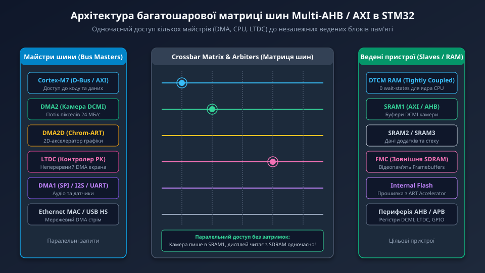
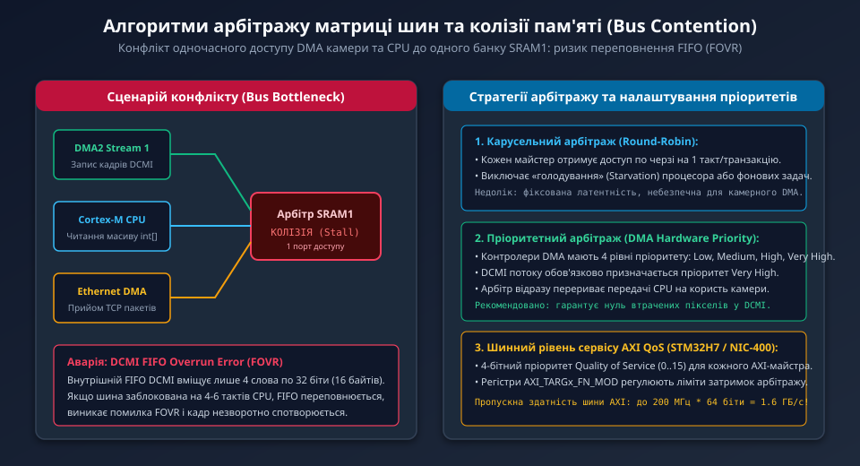
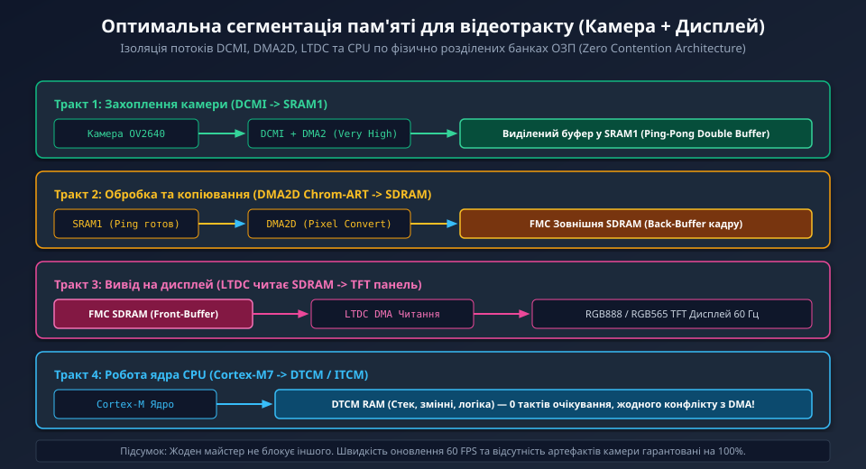

---
preknowlist:
  - "Архітектура процесорних ядер ARM Cortex-M4/M7 (шини I-Code, D-Code та системна шина)"
  - "Принципи прямого доступу до пам'яті (DMA) та функціонування FIFO буферів периферії"
  - "Організація пам'яті мікроконтролерів: Flash, SRAM1, SRAM2, DTCM та зовнішня SDRAM"
---

# Арбітраж матриці шин мікроконтролерів STM32 (Bus Matrix Arbitration)

У високопродуктивних мікроконтролерах STM32 серій F4, F7 та H7 одночасно функціонують кілька високошвидкісних автономних модулів: цифровий інтерфейс камери (DCMI), графічний контролер TFT-дисплеїв (LTDC), апаратний 2D-прискорювач копіювання зображень (DMA2D Chrom-ART), контролери DMA1/DMA2, мережевий стек Ethernet, USB HS та процесорне ядро Cortex-M.

Коли камера веде захоплення відеопотоку 30 кадрів/с, контролер LTDC неперервно оновлює екран із частотою 60 Гц, а процесор одночасно виконує алгоритми обробки даних, усі ці майстри змагаються за спільну внутрішню пам'ять ОЗП (SRAM) та зовнішній контролер SDRAM (FMC). Керування цими потоками даних здійснює критично важливий апаратний комутатор — **матриця шин (Bus Matrix)**.



---

## 1. Архітектура багатошарової матриці Multi-AHB Crossbar

На відміну від найпростіших мікроконтролерів із єдиною спільною шиною даних, де одночасно передавати байти може лише один пристрій, у процесорах STM32 реалізована **багатошарова матриця шин (Multi-AHB Bus Matrix)** або багатоканальний інтерконект **AXI (Advanced eXtensible Interface / NIC-400)**:

- **Майстри шини (Masters):** активні ініціатори транзакцій читання або запису (ядро Cortex-M через шини інструкцій та даних, потоки DMA1/DMA2, DMA2D, LTDC, контролери Ethernet та USB OTG HS).
- **Ведені пристрої (Slaves):** фізичні блоки пам'яті та інтерфейси периферії (внутрішня пам'ять Flash, незалежні блоки SRAM1/SRAM2/SRAM3, пам'ять тісного зв'язку DTCM/ITCM, інтерфейс зовнішньої пам'яті FMC та периферійні мости AHB/APB).

Головний принцип матриці Crossbar полягає в тому, що **кілька майстрів можуть здійснювати обмін даними одночасно на максимальній швидкості**, за умови, що вони звертаються до **різних ведених пристроїв**.

```text
Паралельний доступ без колізій (Full Bandwidth):
  * DCMI DMA пише потік пікселів камери  ========>  у блок SRAM1
  * Контролер LTDC читає кадри дисплея   ========>  із зовнішньої пам'яті FMC SDRAM
  * Ядро Cortex-M виконує код та стек    ========>  у внутрішній пам'яті DTCM
Результат: 0 тактів простою (Stall), всі пристрої працюють на 100% продуктивності.
```

---

## 2. Колізії пам'яті (Bus Contention) та аварія DCMI FIFO Overrun

Проблема виникає в той момент, коли два або більше майстрів шини намагаються отримати доступ до одного й того самого веденого порту пам'яті.



Типовий катастрофічний сценарій у відеотракті:
1. Контролер камери DCMI веде безперервний запис пікселів у масив, розташований у блоці `SRAM1`.
2. У цей самий час ядро мікроконтролера починає інтенсивне читання великого буфера в `SRAM1`, або інший потік DMA (наприклад, Ethernet) починає перекачувати мережевий пакет у той самий блок пам'яті.
3. Оскільки фізичний порт `SRAM1` здатен виконати лише одне 32-бітне читання або запис за один такт шини, виникає **конфлікт доступу (Bus Contention)**. Один із майстрів змушений зупинитися і чекати (Insert Wait States).

### Чому це фатально для камери?

Периферійний модуль DCMI містить мініатюрний внутрішній апаратний буфер FIFO обсягом лише **4 слова по 32 біти (16 байтів)**. Якщо піксельний тактовий сигнал камери PCLK становить 24 МГц, ці 16 байтів заповнюються всього за 660 наносекунд (близько 10–15 тактів ядра мікроконтролера).

Якщо матриця шин затримує потік DMA2 навіть на кілька тактів через колізію з ядром або Ethernet, виникає апаратна помилка **DCMI Overrun (FOVR)**:
- Внутрішній буфер переповнюється, і нові байти пікселів втрачаються.
- Лінійні лічильники рядків камери збиваються.
- Увесь наступний кадр або серія кадрів отримує косий діагональний зсув, перетворюючись на непридатні для розпізнавання смуги або зависає взагалі.

---

## 3. Алгоритми арбітражу: Round-Robin, Fixed Priority та AXI QoS

Кожен ведений порт матриці шин оснащений власним апаратним арбітром, який вирішує, кому надати доступ у момент одночасного запиту:

1. **Карусельний арбітраж (Round-Robin):**
   - Усі майстри мають рівні права. Якщо майстер A та майстер B змагаються за порт, доступ надається по черзі: `A -> B -> A -> B`.
   - Запобігає «голодуванню» (Starvation) процесора, проте є небезпечним для жорстких систем реального часу з малими FIFO, таких як камера.
2. **Апаратний пріоритет DMA (Fixed / Dynamic Priority):**
   - Кожному потоку DMA (DMA Stream) у регістрі конфігурації `DMA_SxCR` призначається один із 4 рівнів пріоритету: `Low`, `Medium`, `High`, `Very High`.
   - Потоку захоплення камери (DCMI -> DMA2) обов'язково встановлюється пріоритет **Very High**. Арбітр матриці миттєво віддає шину потоку камери, зупиняючи ядро процесора на 1 такт.
3. **Шинний пріоритет якості обслуговування AXI QoS (STM32H7):**
   - В архітектурі Cortex-M7 матриця AXI Interconnect (NIC-400) використовує 4-бітний тег якості обслуговування QoS (від 0 до 15).
   - Майстрам відеотракту призначається найвищий QoS, що дає змогу на апаратному рівні обмежувати максимальну латентність шини фіксованою кількістю наносекунд.

---

## 4. Стратегія оптимальної сегментації пам'яті у відеотракті

Єдиним надійним інженерним способом гарантувати стабільну роботу відеотракту без перевантаження шини є фізична **сегментація пам'яті (Memory Partitioning)**:



1. **Камерний потік (DCMI -> SRAM1):**
   - DMA2 спрямовується у виділену ділянку внутрішнього ОЗП `SRAM1` (Ping-Pong Buffer).
   - Жоден інший периферійний модуль та ядро процесора під час активного прийому кадру не повинні звертатися до цього банку.
2. **Графічний потік (DMA2D -> Зовнішня SDRAM):**
   - Апаратний конвертер форматів DMA2D зчитує готовий кадр із `SRAM1` і переносить його у фоновий буфер (Back-Buffer) зовнішньої пам'яті SDRAM через контролер FMC.
3. **Дисплейний потік (LTDC -> Дисплей):**
   - Контролер екрана LTDC читає готовий передній буфер (Front-Buffer) із сусіднього банку зовнішньої SDRAM, не заважаючи камері.
4. **Процесорні задачі (Cortex-M -> DTCM/ITCM):**
   - Стек переривань, локальні змінні та критичний код розміщуються в пам'яті тісного зв'язку (Tightly Coupled Memory, DTCM/ITCM). Ядро звертається до DTCM через окрему пряму шину за 0 тактів очікування, повністю оминаючи матрицю шин AHB.

---

## 5. Програмне налаштування пріоритетів шини у прошивці

Конфігурація арбітражу матриці шин виконується під час ініціалізації контролера DMA камери:

```c
/* Налаштування потоку DMA2 для безперебійного прийому кадру камери */
DMA_HandleTypeDef hdma_dcmi;

hdma_dcmi.Instance = DMA2_Stream1;
hdma_dcmi.Init.Channel = DMA_CHANNEL_1;
hdma_dcmi.Init.Direction = DMA_PERIPH_TO_MEMORY;
hdma_dcmi.Init.PeriphInc = DMA_PINC_DISABLE;
hdma_dcmi.Init.MemInc = DMA_MINC_ENABLE;
hdma_dcmi.Init.PeriphDataAlignment = DMA_PDATAALIGN_WORD; /* 32 біти */
hdma_dcmi.Init.MemDataAlignment = DMA_MDATAALIGN_WORD;
hdma_dcmi.Init.Mode = DMA_CIRCULAR;                       /* Кільцевий буфер */

/* КРИТИЧНО: Найвищий пріоритет арбітражу шини для уникнення FOVR */
hdma_dcmi.Init.Priority = DMA_PRIORITY_VERY_HIGH;

/* Увімкнення пакетної передачі (Burst) для оптимізації пропускної здатності шини */
hdma_dcmi.Init.FIFOMode = DMA_FIFOMODE_ENABLE;
hdma_dcmi.Init.FIFOThreshold = DMA_FIFO_THRESHOLD_FULL;
hdma_dcmi.Init.MemBurst = DMA_MBURST_INC4;                /* Інкрементний Burst 4x32 біти */
hdma_dcmi.Init.PeriphBurst = DMA_PBURST_SINGLE;

HAL_DMA_Init(&hdma_dcmi);
```

Завдяки правильному вирівнюванню пам'яті за 32-бітними межами та використанню 4-слівного пакетного режиму (Burst Transfer), потік DMA захоплює шину на мінімально можливий час, передаючи 16 байтів за одну транзакцію, що на 60–70% знижує навантаження на арбітр матриці шин.

У наступному поглибленому розділі ми детально розберемо часові діаграми AXI/AHB транзакцій, конфігурацію регістрів арбітражу шин STM32 та розрахунок балансу пропускної здатності для відеопотоків 60 FPS.
