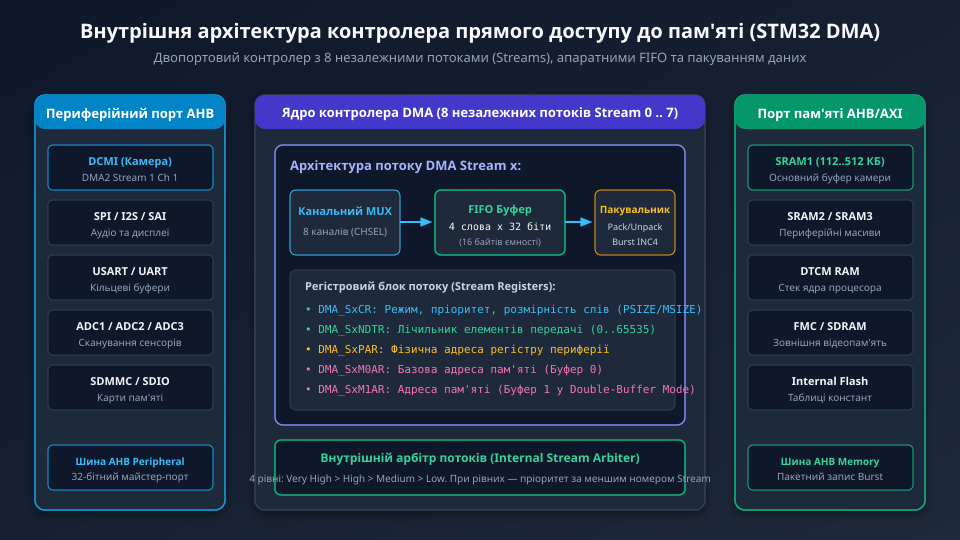
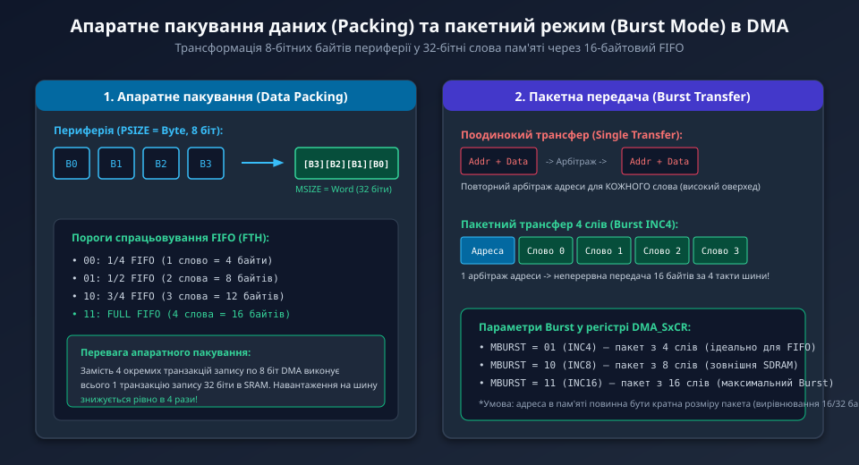
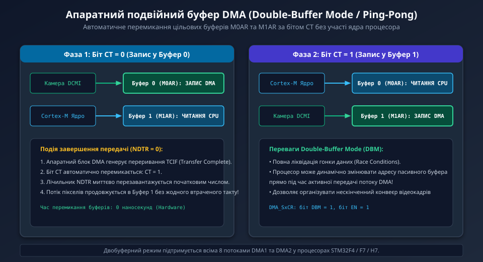

---
preknowlist:
  - "Принципи роботи шин мікроконтролера (AHB, APB, AXI) та системної пам'яті"
  - "Організація переривань Cortex-M: прапорці подій Transfer Complete (TCIF) та Half-Transfer (HTIF)"
  - "Формати представлення даних: Byte (8 біт), Half-Word (16 біт) та Word (32 біти)"
---

# Архітектура контролерів прямого доступу до пам'яті STM32 (DMA)

У вбудованих системах високої продуктивності пересилання масивів даних між швидкісною периферією (інтерфейс камери DCMI, аудіошини I2S/SAI, мережеві адаптери Ethernet, SPI-дисплеї) та оперативною пам'яттю за допомогою класичних програмних циклів мікроконтролера (`LDR`/`STR` процесорного ядра) призводить до повної утилізації обчислювальних ресурсів процесора. При частоті надходження пікселів камери у 20–30 МБ/с ядро взагалі не встигатиме виконувати код програми.

Для апаратного розвантаження ядра в мікроконтролерах STM32 інтегровано потужні автономні **контролери прямого доступу до пам'яті (Direct Memory Access, DMA)**, які самостійно виконують циклічні транзакції пересилання даних на рівні шинних інтерфейсів.



---

## 1. Еволюція та різновиди контролерів DMA у сімействі STM32

Залежно від серії (STM32F4, F7 або флагманської H7) кристали містять кілька спеціалізованих контролерів прямого доступу до пам'яті:

1. **Контролер DMA1:**
   - Підключений до периферійної шини APB1/AHB1 та пам'яті SRAM.
   - Обслуговує загальну низько- та середньошвидкісну периферію: таймери, стандартні USART, SPI, I2C та ЦАП (DAC).
   - Не підтримує режим прямого копіювання «пам'ять-пам'ять» (Memory-to-Memory).
2. **Контролер DMA2:**
   - Має прямий доступ до високошвидкісних периферійних модулів шини AHB2: інтерфейсу камери **DCMI**, апаратних криптографічних блоків, інтерфейсів SDMMC/SDIO та АЦП (ADC).
   - Підтримує швидкісний режим передачі «пам'ять-пам'ять» (Memory-to-Memory) між різними ділянками внутрішнього Flash, SRAM1, SRAM2 та зовнішньої SDRAM.
3. **Master DMA (MDMA) та Basic DMA (BDMA) в STM32H7:**
   - **BDMA:** обслуговує енергоефективний домен D3 (SmartRun Domain) та порти низького споживання (LPUART, LPTIM, SPI6).
   - **MDMA:** флагманський 64-бітний мастер-контролер шини AXI. Підтримує зв'язані списки дескрипторів (Linked Lists), блокові двовимірні переміщення (2D Block Stride), та здатний автоматично перезапускати потоки DMA1/DMA2 при виникненні апаратних запитів.

---

## 2. Потоки (Streams), канали (Channels) та арбітраж пріоритетів

Кожен контролер DMA1 та DMA2 містить **8 незалежних апаратних потоків (Streams, від Stream 0 до Stream 7)**. Кожен такий потік є повноцінним автономним процесором пересилання з власним набором конфігураційних регістрів, лічильником байтів та буфером FIFO:

- **Канальний мультиплексор (Channel Selection):** До кожного потоку підведено до 8 апаратних сигналів запиту (Request Channels) від різної периферії. Вибір конкретного джерела виконується 3-бітним полем `CHSEL[2:0]` у регістрі `DMA_SxCR`. Наприклад, для камери DCMI у контролері DMA2 використовується канал 1 на потоці 1 (`DMA2_Stream1_Channel1`).
- **Внутрішній арбітр пріоритетів:** Одночасно передавати байти по шині може лише один потік DMA. Якщо запити виникають одночасно, арбітр обирає потік за чотирма рівнями програмного пріоритету:
  1. `Very High` (дуже високий — обов'язковий для камери DCMI);
  2. `High` (високий);
  3. `Medium` (середній);
  4. `Low` (низький).
  Якщо два потоки мають однаковий програмний пріоритет, перевага надається потоку з меншим номером (Stream 0 має вищий пріоритет над Stream 1).

---

## 3. Апаратний буфер FIFO та пакування даних (Data Packing)

Кожен потік оснащений виділеним внутрішнім буфером **FIFO обсягом 4 слова по 32 біти (16 байтів)**. Наявність FIFO дозволяє розв'язати швидкість периферії та пам'яті, а також виконувати унікальну функцію — **апаратне пакування та розпакування даних (Data Packing / Unpacking)**.



Контролер підтримує незалежне налаштування ширини даних для сторони периферії (`PSIZE`) та сторони пам'яті (`MSIZE`):

```text
Приклад для камери DCMI:
  - Шина камери D[7:0]: PSIZE = Byte (8 біт)
  - Внутрішня пам'ять SRAM1: MSIZE = Word (32 біти)
```

1. Модуль DCMI подає байти один за одним. Контролер DMA складає їх усередину свого 16-байтового FIFO.
2. Щойно всередині накопичується 4 байти, логіка пакування збирає їх в одне 32-бітне машинне слово `[B3, B2, B1, B0]`.
3. Контролер виконує **всього одну 32-бітну транзакцію запису в оперативну пам'ять** замість 4 окремих 8-бітних звернень!
4. Це зменшує кількість звернень до системної шини AHB/AXI рівно в 4 рази, вивільняючи смугу пропускання для ядра процесора та дисплейного контролера LTDC.

---

## 4. Пакетні передачі (Burst Transfers)

Для подальшої оптимізації шини контролер підтримує пакетний режим **Burst Mode**:
- **Поодинока передача (Single Transfer):** кожне слово вимагає повної процедури арбітражу адреси та фази даних.
- **Пакетний трансфер (Burst):** арбітр шини один раз фіксує початкову адресу, після чого передає серію слів за фіксовану кількість послідовних тактів без пауз:
  - `INC4`: пакет із 4 слів (16 байтів — ідеально узгоджується з повним обсягом FIFO);
  - `INC8`: пакет із 8 слів (32 байти);
  - `INC16`: пакет із 16 слів (64 байти — оптимально для зовнішньої пам'яті SDRAM).

Використання комбінації `FIFO Threshold = FULL` та `MemBurst = INC4` гарантує, що DMA звертається до шини лише тоді, коли FIFO повністю заповнений, і вивантажує весь його вміст за один неподільний 4-тактний пакет.

---

## 5. Двобуферний режим (Double-Buffer Mode / Ping-Pong)

Для неперервних потоків даних реального часу (потокове аудіо I2S або кадрова розгортка камери) класичний режим одиночного буфера не підходить, оскільки процесор ризикує прочитати буфер у той самий момент, коли DMA його частково перезаписує (стан гонки даних — Race Condition).

Для вирішення цієї проблеми контролер DMA підтримує апаратний **двобуферний режим (Double-Buffer Mode, DBM)**:



- Прошивка виділяє в пам'яті два однакових масиви: Буфер 0 (адреса в регістрі `DMA_SxM0AR`) та Буфер 1 (адреса в регістрі `DMA_SxM1AR`).
- Стан контролера визначається бітом **Current Target (`CT`)** у регістрі `DMA_SxCR`:
  - Коли `CT = 0`: DMA автоматично пише потік у Буфер 0. Ядро процесора або 2D-прискорювач DMA2D у цей час повністю монопольно обробляє Буфер 1.
  - У момент завершення заповнення Буфера 0 (`NDTR = 0`) апаратна логіка DMA **миттєво за 0 наносекунд перемикає біт `CT = 1`**, перезавантажує лічильник `NDTR` і продовжує запис у Буфер 1, генеруючи переривання `Transfer Complete (TCIF)`.
  - У процесі роботи програма може вільно підміняти адресу пасивного буфера, організовуючи безперервний потік кадрів без жодного ризику переповнення або блокування шини.

У наступному поглибленому розділі ми детально розглянемо стан внутрішнього автомата FIFO, математичний розрахунок конфігурації Burst для вирівняної пам'яті, конфігурацію Master DMA (MDMA) в STM32H7 та низькорівневий C-драйвер керування подвійним буфером камери.
