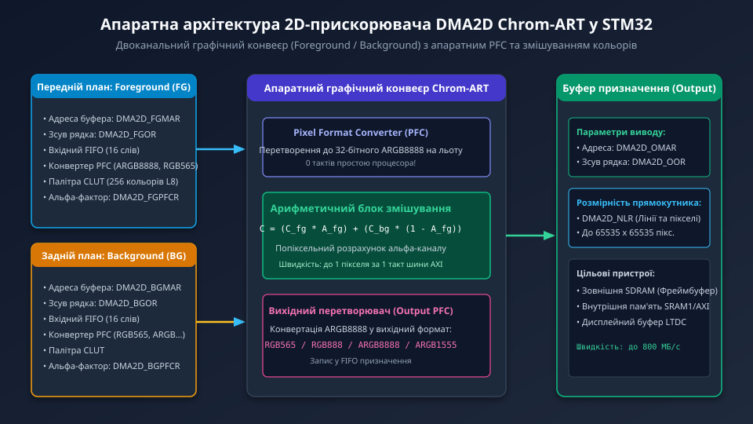
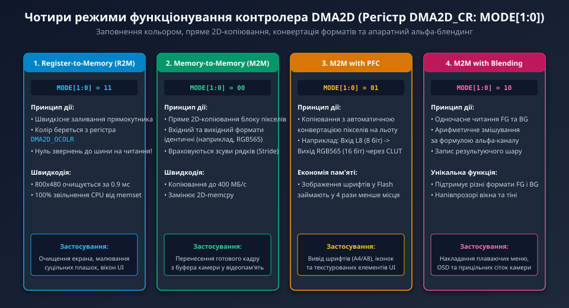
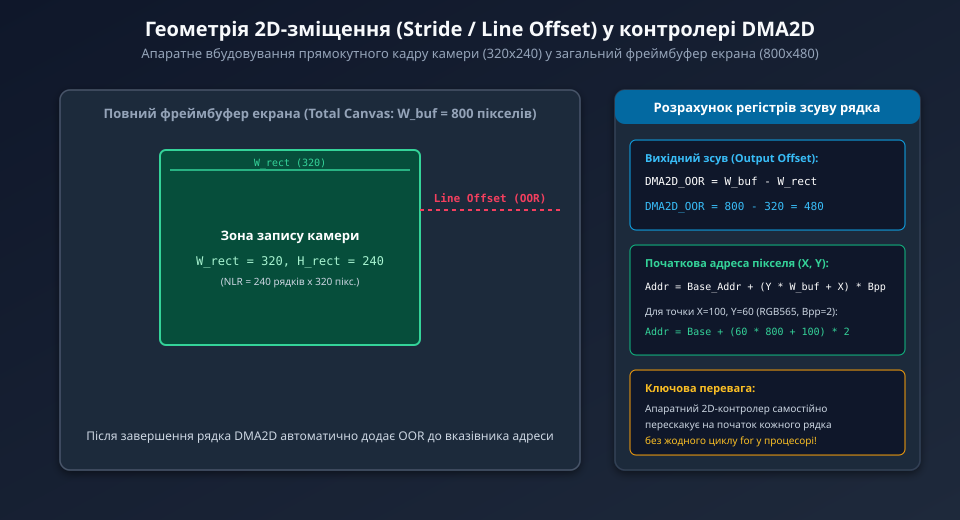

---
preknowlist:
  - "Принципи роботи графічних фреймбуферів та формати кодування кольору (RGB565, ARGB8888)"
  - "Прямий доступ до пам'яті (DMA) та функціонування контролера зовнішньої пам'яті SDRAM"
  - "Математика альфа-змішування шарів зображення та побудова графічних інтерфейсів (GUI)"
---

# Апаратний 2D-прискорювач DMA2D Chrom-ART у STM32

При побудові графічних інтерфейсів користувача (TouchGFX, Embedded Wizard, LVGL) та систем відеонагляду на базі мікроконтролерів STM32 (серій F429/F469, F7 та H7) виконання операцій копіювання прямокутних фрагментів зображень (Blitting), очищення екрана, накладання напівпрозорих іконок та конвертації форматів пікселів за допомогою процесорного ядра Cortex-M призводить до критичного перевантаження CPU (до 85–95% утилізації).

Для повного апаратного звільнення центрального процесора від рутинних двовимірних графічних операцій компанія STMicroelectronics інтегрувала в кристали спеціалізований апаратний 2D-графічний процесор — **DMA2D Chrom-ART Accelerator**.



---

## 1. Апаратна архітектура: конвеєри Foreground, Background та вихідний каскад

Контролер DMA2D є повністю автономним майстром шини (Master AXI/AHB), який містить три фізичні блоки:

1. **Конвеєр переднього плану (Foreground, FG):**
   - Зчитує зображення переднього плану (наприклад, шар іконки, кнопки або вікна камери).
   - Оснащений власним 16-слівним FIFO буфером та блоком апаратного перетворення форматів пікселів (PFC).
   - Підтримує таблицю кольорів CLUT (Color Look-Up Table) на 256 елементів для палітрових форматів (L8, AL44, AL88).
2. **Конвеєр заднього плану (Background, BG):**
   - Зчитує фонове зображення (наприклад, ділянку фреймбуфера, куди накладається новий графічний елемент).
   - Також оснащений вхідним FIFO, блоком PFC та палітрою CLUT.
3. **Блок арифметичного змішування та вихідний каскад (Output Stage):**
   - Обчислює результуючий колір пікселів з урахуванням альфа-каналу в режимі реального часу.
   - Виконує зворотне пакування у вихідний формат (Output PFC) та записує готовий блок пікселів у пам'ять (внутрішній SRAM або зовнішню SDRAM).

Швидкість обробки досягає **одного вихідного пікселя за один такт системної шини**, що забезпечує пропускну здатність пересилання графічних даних до 400–800 МБ/с.

---

## 2. Чотири режими функціонування контролера DMA2D

Режим роботи вибирається 2-бітним полем `MODE[1:0]` у головному регістрі керування `DMA2D_CR`:



1. **Register-to-Memory (R2M, `MODE = 11`):**
   - Режим апаратного заповнення суцільним кольором.
   - Значення кольору береться з регістра `DMA2D_OCOLR` і транслюється у заданий прямокутник пам'яті.
   - Оскільки операції читання з шини повністю відсутні, екран 800x480 очищується всього за 0.9 мс! Це у 10 разів швидше за стандартний виклик `memset()`.
2. **Memory-to-Memory (M2M, `MODE = 00`):**
   - Пряме швидкісне 2D-копіювання прямокутного масиву пікселів без зміни колірного формату.
   - Використовується для миттєвого перенесення готового кадру камери з вхідного буфера SRAM у фоновий буфер відображення.
3. **Memory-to-Memory з перетворенням формату (M2M with PFC, `MODE = 01`):**
   - Копіювання з апаратною конвертацією на льоту. Наприклад, вхідний шар у форматі L8 (8 біт) перетворюється у 16-бітний RGB565 або 32-бітний ARGB8888.
   - Дозволяє зберігати графічні ресурси (шрифти, піктограми) у Flash-пам'яті у стисненому 8-бітному вигляді, заощаджуючи до 75% обсягу постійної пам'яті.
4. **Memory-to-Memory з перетворенням та змішуванням (M2M with Blending, `MODE = 10`):**
   - Повноцінне апаратне накладання шару FG поверх шару BG з обчисленням альфа-прозорості.
   - Використовується для малювання вікон з напівпрозорими тінями, анімованих меню та прицільних сіток поверх відеопотоку.

---

## 3. Геометрія 2D-зміщення (Stride / Line Offset)

У комп'ютерній графіці прямокутне зображення рідко займає всю фізичну пам'ять — зазвичай потрібно скопіювати менший фрагмент (наприклад, вікно камери розміром `320x240`) всередину великого кадрового буфера екрана (`800x480`).



Для вирішення цього завдання контролер DMA2D підтримує апаратний механізм **зсуву рядка (Line Offset / Stride)** через регістри `DMA2D_FGOR`, `DMA2D_BGOR` та `DMA2D_OOR`:

```text
DMA2D_OOR = W_canvas - W_rect
де:
  W_canvas — повна ширина екрана/полотна (наприклад, 800 пікселів),
  W_rect — ширина прямокутника, що копіюється (наприклад, 320 пікселів).
```

Для вбудовування вікна 320x240 в екран 800x480:
```text
DMA2D_OOR = 800 - 320 = 480 пікселів
```

Після передачі кожного рядка довжиною 320 точок контролер DMA2D самостійно додає число 480 (помножене на кількість байтів на піксель) до вказівника адреси, миттєво переходячи на початок наступного рядка. Це дозволяє вбудовувати будь-які плаваючі вікна без жодного вкладеного циклу `for` у процесорі!

---

## 4. Порівняння продуктивності: CPU проти Chrom-ART

Практичні вимірювання на мікроконтролері STM32F429 при тактовій частоті 180 МГц демонструють колосальну перевагу апаратного прискорювача:

```text
Операція (Дисплей 800x480 RGB565) |  Час CPU (Cortex-M4)  |  Час DMA2D Chrom-ART  |  Прискорення
----------------------------------+-----------------------+-----------------------+---------------
Очищення екрана (Solid Fill)      |  9.8 мс (memset)      |  0.9 мс               |  у 11 разів!
Копіювання блоку 320x240 (Blit)   |  4.2 мс (програмно)   |  0.35 мс              |  у 12 разів!
Альфа-змішування (Alpha Blend)    |  38.5 мс (з плаваючою)|  1.4 мс (апаратно)    |  у 27 разів!
Утилізація процесора під час GUI  |  85 .. 95 %           |  менше 4 %            |  Звільнення CPU
```

---

## 5. Програмне використання у прошивці мікроконтролера

Приклад функції швидкісного заливання прямокутника за допомогою апаратного режиму R2M:

```c
void dma2d_fill_rect(uint32_t *dst_buffer, uint16_t x, uint16_t y, 
                     uint16_t width, uint16_t height, uint32_t color_rgb565, uint16_t canvas_width) {
    /* 1. Розрахунок початкової адреси верхнього лівого кута прямокутника */
    uint32_t start_addr = (uint32_t)dst_buffer + ((y * canvas_width + x) * 2);

    /* 2. Конфігурація режиму Register-to-Memory (MODE = 11) */
    DMA2D->CR = (3 << DMA2D_CR_MODE_Pos);

    /* 3. Формат виводу: RGB565 (код 010) */
    DMA2D->OPFCR = 0x02;

    /* 4. Колір заливки у вихідний регістр */
    DMA2D->OCOLR = color_rgb565;

    /* 5. Початкова адреса та вихідний зсув рядка (Stride) */
    DMA2D->OMAR = start_addr;
    DMA2D->OOR  = canvas_width - width;

    /* 6. Розміри прямокутника: лінії (height) та пікселі на рядок (width) */
    DMA2D->NLR = (width << DMA2D_NLR_PL_Pos) | (height << DMA2D_NLR_NL_Pos);

    /* 7. Старт передачі */
    DMA2D->CR |= DMA2D_CR_START;

    /* 8. Очікування завершення (або робота за перериванням TCIF) */
    while (DMA2D->CR & DMA2D_CR_START);
}
```

У наступному поглибленому розділі ми детально розберемо конфігурацію бітових полів регістрів DMA2D, математику альфа-змішування та виробничий C-драйвер блендингу живого кадру камери з інтерфейсом користувача.
