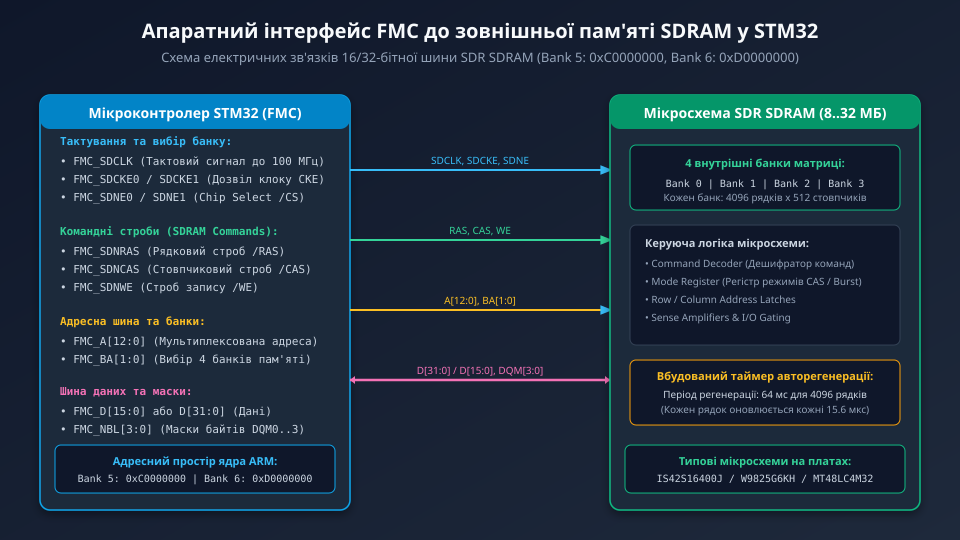
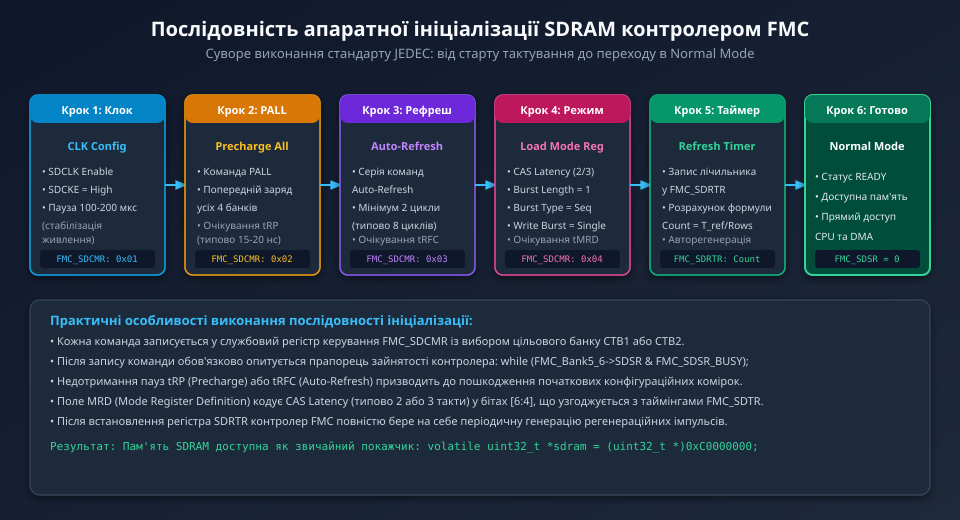
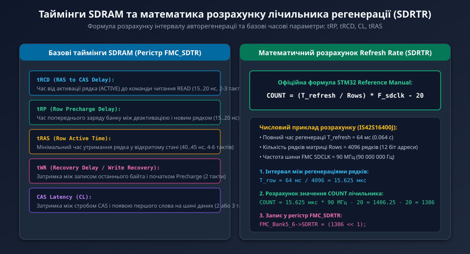

---
preknowlist:
  - "Принципи функціонування динамічної пам'яті DRAM (регенерація конденсаторів, рядки та стовпчики)"
  - "Організація пам'яті мікроконтролерів STM32 та контролера гнучкої пам'яті FMC/FSMC"
  - "Шинні інтерфейси: мультиплексування шини адреси та даних, сигнали RAS, CAS, WE"
---

# Інтерфейс зовнішньої пам'яті SDRAM через контролер FMC у STM32

Під час побудови систем машинного зору, обробки відеопотоків із камер високої роздільної здатності (OV2640, OV5640) та виводу графічного інтерфейсу на кольорові TFT-дисплеї обсяг внутрішньої оперативної пам'яті мікроконтролера (навіть 512 КБ або 1 МБ у STM32H7) стає головним апаратним «вузьким місцем». Подвійний відеокадровий буфер формату SVGA (800x600 пікселів) із 32-бітною колірною глибиною ARGB8888 вимагає `800 * 600 * 4 * 2 = 3.84 МБ` неперервного адресного простору, що у рази перевищує обсяг всього кристала ОЗП.

Для підключення великих масивів високошвидкісної синхронної динамічної пам'яті (SDR SDRAM місткістю від 8 до 64 МБ) процесори STM32 серій F429/F439, F469, F7 та H7 оснащені спеціалізованим контролером — **Flexible Memory Controller (FMC)**.



---

## 1. Апаратна топологія шини FMC: тактування, адреса та дані

Контролер FMC надає прямий інтерфейс до мікросхем SDR SDRAM (наприклад, **IS42S16400J**, **W9825G6KH**, **MT48LC4M32B2**). Зовнішня пам'ять підключається паралельною шиною:

1. **Тактові та керуючі сигнали:**
   - `FMC_SDCLK`: Вихідний тактовий сигнал пам'яті (до 90–100 МГц у STM32F4/F7 та до 120–133 МГц у STM32H7). Формується поділом системної частоти шини HCLK на 2 або 3.
   - `FMC_SDCKE0 / SDCKE1`: Дозвіл тактування (Clock Enable) для Банку 1 або Банку 2.
   - `FMC_SDNE0 / SDNE1`: Вибір кристала (Chip Select /CS).
2. **Командні строби (JEDEC Command Interface):**
   - `FMC_SDNRAS`: Строб адреси рядка (Row Address Strobe /RAS).
   - `FMC_SDNCAS`: Строб адреси стовпчика (Column Address Strobe /CAS).
   - `FMC_SDNWE`: Дозвіл запису (Write Enable /WE).
3. **Адресні лінії та банки:**
   - `FMC_A[12:0]`: Мультиплексована шина адреси. Під час сигналу RAS передається адреса рядка, під час CAS — адреса стовпчика.
   - `FMC_BA[1:0]`: Вибір одного з 4 внутрішніх незалежних банків матриці SDRAM.
4. **Шина даних та маски байтів:**
   - `FMC_D[15:0]` (16-бітний режим) або `FMC_D[31:0]` (32-бітний режим з подвоєною пропускною здатністю до 400 МБ/с).
   - `FMC_NBL[3:0]`: Лінії байтових масок (DQM0..3) для побайтового запису без модифікації всього слова.

Усі пристрої SDRAM апаратно відображаються у фіксовані вікна глобального адресного простору процесора ARM:
- **SDRAM Bank 1 (FMC Bank 5):** починається з адреси `0xC0000000`.
- **SDRAM Bank 2 (FMC Bank 6):** починається з адреси `0xD0000000`.

---

## 2. Сувора послідовність ініціалізації SDRAM (JEDEC Standard)

На відміну від статичної пам'яті SRAM, мікросхема SDRAM після подачі живлення перебуває у неініціалізованому хаотичному стані та вимагає виконання суворо регламентованого протоколу переходу в робочий режим:



1. **Крок 1: Подача тактового сигналу та пауза стабілізації:**
   - Подача команди увімкнення клоку: лінія `SDCKE` переводиться у високий рівень.
   - Обов'язкова затримка тривалістю **100–200 мікросекунд** для стабілізації внутрішнього генератора зміщення підкладки пам'яті.
2. **Крок 2: Попередній заряд усіх банків (Precharge All, PALL):**
   - Контролер FMC виставляє команду PALL (активує одночасно RAS і WE при низькому CAS та високому A10).
   - Усі 4 внутрішні банки матриці повертаються у вихідний закритий стан. Очікується час релаксації `tRP` (15–20 нс).
3. **Крок 3: Цикли автоматичної регенерації (Auto-Refresh):**
   - Контролер надсилає мінімум дві (рекомендовано 8) послідовні команди авторегенерації `Auto-Refresh`. Це приводить внутрішні лічильники рядків матриці у синхронізований стан.
4. **Крок 4: Програмування регістру режимів (Load Mode Register, LMR):**
   - Запис спеціального конфігураційного слова в Mode Register SDRAM:
     - **CAS Latency (CL):** затримка читання (зазвичай 2 або 3 такти SDCLK);
     - **Burst Length:** довжина пакета встановлюється строго в 1 (одиночний трансфер, оскільки пакетним керуванням займається сам контролер FMC);
     - **Burst Type:** послідовний (Sequential);
     - **Write Mode:** одиночний запис (Single Location).
5. **Крок 5: Запуск таймера авторегенерації (Refresh Timer):**
   - Запис розрахованого значення лічильника у службовий регістр `FMC_SDRTR`.
6. **Крок 6: Перехід у робочий стан (Normal Mode):**
   - Прапорець `FMC_SDSR_BUSY` скидається в 0. Пам'ять готова до операцій читання/запису.

---

## 3. Математичний розрахунок таймера авторегенерації (SDRTR)

Конденсатори комірок пам'яті DRAM втрачають електричний заряд через мікроструми витоку напівпровідникових переходів. Щоб інформація не зникла, кожен рядок матриці повинен перезаряджатися щонайменше один раз за регламентований виробником період (зазвичай `T_refresh = 64 мс` для 4096 або 8192 рядків).



Контролер FMC оснащений 13-бітним таймером зі зворотним відліком, який періодично генерує команду регенерації. Формула розрахунку значення лічильника наведена в документації STMicroelectronics:

```text
COUNT = (T_refresh / Number_of_Rows) * F_sdclk - 20
```

### Практичний розрахунок для чіпа IS42S16400J:
- Повний період регенерації матриці: `T_refresh = 64 мс = 0.064 с`.
- Кількість рядків матриці: `Number_of_Rows = 4096`.
- Частота шини FMC SDCLK: `F_sdclk = 90 МГц = 90 000 000 Гц`.

1. Інтервал між оновленням сусідніх рядків:
```text
T_row = 64 мс / 4096 = 15.625 мкс
```
2. Розрахунок лічильника:
```text
COUNT = 15.625 мкс * 90 МГц - 20 = 1406.25 - 20 = 1386
```

Значення `1386` записується в бітове поле `COUNT` регістра `FMC_SDRTR`. Віднімання числа 20 є обов'язковим захисним запасом (Guard Band), передбаченим розробниками архітектури для компенсації черги команд арбітра.

---

## 4. Базові часові параметри затримки (SDRAM Timing Register)

Правильна робота SDRAM гарантується лише за умови, що таймінги у регістрі `FMC_SDTR` відповідають параметрам мікросхеми, вказаним у даташиті:

- **tRCD (Row to Column Delay):** затримка між відкриттям рядка (ACTIVE) та подачею стовпчика (READ/WRITE) — типово 15–20 нс (2–3 такти).
- **tRP (Row Precharge Delay):** затримка закриття рядка — типово 15–20 нс (2–3 такти).
- **tWR (Recovery Delay):** затримка між завершенням запису та новим закриттям рядка — 2 такти.
- **tRAS (Row Active Time):** мінімальний час життя відкритого рядка — 42 нс (4–6 тактів).
- **tRC / tRFC (Row Cycle Time / Auto-Refresh):** повний цикл регенерації — 60–70 нс (6–8 тактів).

---

## 5. Програмний доступ до зовнішньої SDRAM

Після успішного завершення послідовності ініціалізації контролер FMC підтримує прозору трансляцію адрес. Програміст може звертатися до зовнішньої пам'яті обсягом десятки мегабайтів як до звичайного вбудованого масиву:

```c
#define SDRAM_BANK_ADDR   ((uint32_t)0xC0000000)
#define SDRAM_SIZE_BYTES  (16 * 1024 * 1024) /* 16 Мегабайтів */

/* Тест пам'яті прямим доступом */
bool sdram_self_test(void) {
    volatile uint32_t *sdram_ptr = (volatile uint32_t *)SDRAM_BANK_ADDR;
    
    /* Запис тестового патерну */
    for (uint32_t i = 0; i < 1000; i++) {
        sdram_ptr[i] = 0xAA55AA55 ^ i;
    }
    
    /* Читання та верифікація */
    for (uint32_t i = 0; i < 1000; i++) {
        if (sdram_ptr[i] != (0xAA55AA55 ^ i)) {
            return false; /* Апаратний збій шини даних або таймінгів */
        }
    }
    return true;
}
```

У наступному поглибленому розділі ми детально розберемо структуру бітових полів регістрів FMC, конфігурацію MPU для кешування SDRAM ядрами Cortex-M7 та повний виробничий драйвер ініціалізації на мові C.
