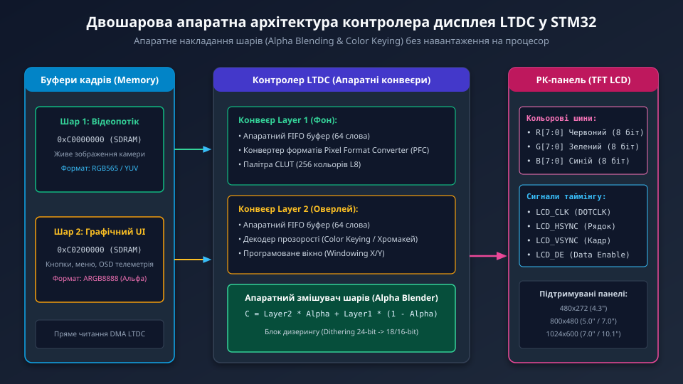
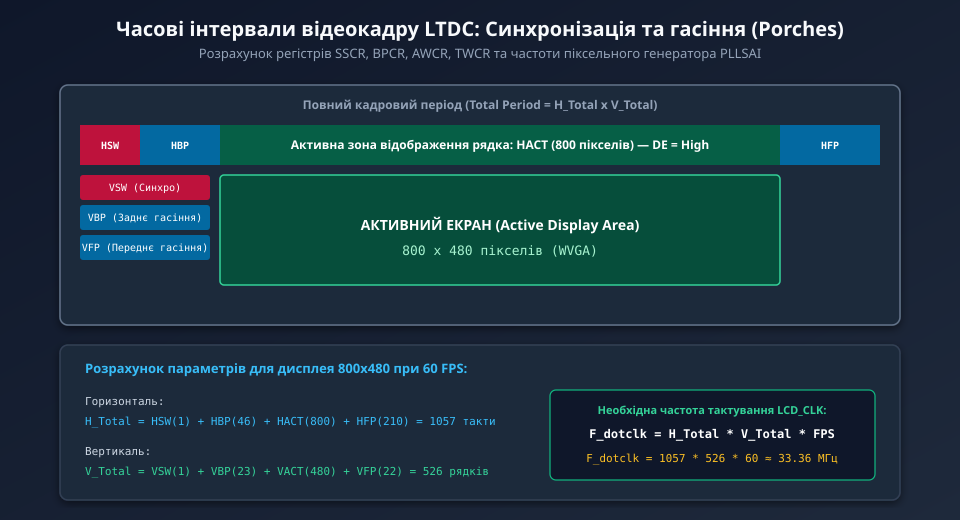
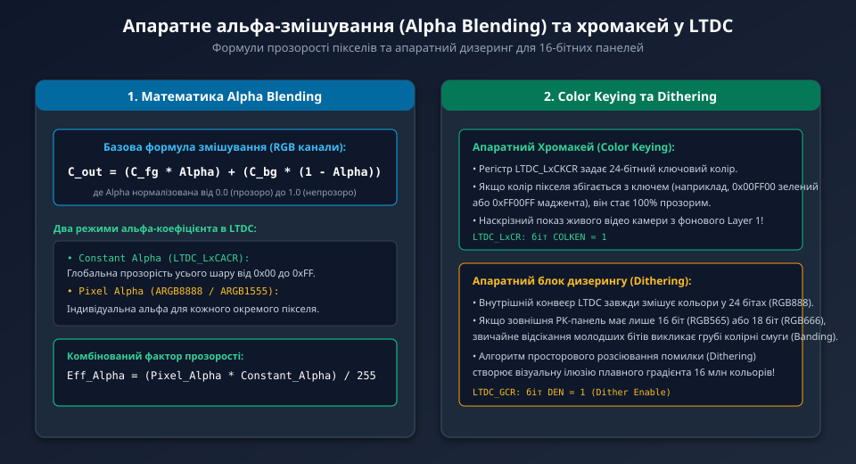

---
preknowlist:
  - "Принципи формування зображення на кольорових РК-матрицях TFT (пікселі, субпікселі RGB)"
  - "Паралельні інтерфейси цифрового відео (сигнали HSYNC, VSYNC, тактування PCLK/DOTCLK)"
  - "Організація оперативної пам'яті мікроконтролера та розміщення графічних фреймбуферів у SDRAM"
---

# Контролер дисплея LTDC у мікроконтролерах STM32

При побудові графічних інтерфейсів користувача (HMI) та систем відеоспостереження на базі мікроконтролерів STM32 (серій F429, F469, F7 та H7) вивід зображення на кольорові РК-панелі (TFT LCD) покладається на виділений апаратний блок — **контролер LCD-TFT (LTDC)**.

LTDC є повноцінним автономним майстром шини, який самостійно зчитує масиви пікселів безпосередньо з внутрішньої пам'яті SRAM або зовнішньої SDRAM, генерує необхідні часові строби синхронізації та в режимі реального часу передає 16-, 18- або 24-бітний паралельний потік кольору на скло дисплея з частотою оновлення 60 кадрів/с без найменшого залучення процесорного ядра.



---

## 1. Цифрові інтерфейсні сигнали паралельної шини RGB TFT

Контролер LTDC формує цифровий паралельний інтерфейс стандарту DPI (Display Pixel Interface):

1. **Кольорові лінії шини даних:**
   - `R[7:0]`: 8 ліній червоного каналу;
   - `G[7:0]`: 8 ліній зеленого каналу;
   - `B[7:0]`: 8 ліній синього каналу.
   - Залежно від типу матриці використовуються режими: **RGB888** (повноколірний TrueColor 24 біти, 16.7 млн кольорів), **RGB666** (18 бітів) або **RGB565** (16 бітів, найпоширеніший для вбудованих дисплеїв 4.3" та 7.0").
2. **Синхронізаційні строби:**
   - `LCD_CLK` (DOTCLK): Піксельний тактовий сигнал. Кожен такт передає один піксель.
   - `LCD_HSYNC`: Рядковий імпульс горизонтальної синхронізації. Позначає завершення одного рядка пікселів.
   - `LCD_VSYNC`: Кадровий імпульс вертикальної синхронізації. Позначає початок формування нового кадру.
   - `LCD_DE` (Data Enable): Сигнал дозволу даних. Знаходиться у високому рівні виключно тоді, коли шини RGB несуть значущі кольорові точки активної видимої області екрана.

---

## 2. Часові інтервали відеокадру: активні зони та інтервали гасіння (Porches)

Робота РК-панелі ґрунтується на періодичному розгортанні пікселів зліва направо і зверху вниз. Повний період кадру складається з активної області та обов'язкових інтервалів гасіння (Blanking Intervals):



- **Параметри по горизонталі (у тактах LCD_CLK):**
  - `HSW` (Horizontal Sync Width): тривалість імпульсу HSYNC.
  - `HBP` (Horizontal Back Porch): заднє гасіння рядка перед початком активних пікселів.
  - `HACT` (Active Width): кількість активних пікселів по горизонталі (наприклад, 800 для WVGA).
  - `HFP` (Horizontal Front Porch): переднє гасіння після завершення рядка.
  ```text
  H_Total = HSW + HBP + HACT + HFP
  ```

- **Параметри по вертикалі (у кількості рядків):**
  - `VSW` (Vertical Sync Width): тривалість імпульсу VSYNC.
  - `VBP` (Vertical Back Porch): заднє кадрове гасіння перед першим рядком.
  - `VACT` (Active Height): кількість видимих рядків (наприклад, 480 рядків).
  - `VFP` (Vertical Front Porch): переднє кадрове гасіння після останнього рядка.
  ```text
  V_Total = VSW + VBP + VACT + VFP
  ```

### Розрахунок частоти піксельного генератора (Pixel Clock)

Для отримання плавної картинки без мерехтіння з частотою оновлення `FPS = 60 Гц` тактова частота піксельного генератора (налаштовується через PLLSAI) розраховується за формулою:

```text
F_dotclk = H_Total * V_Total * FPS
```

Для дисплея 800x480:
```text
H_Total = 1 + 46 + 800 + 210 = 1057 тактів
V_Total = 1 + 23 + 480 + 22 = 526 рядків
F_dotclk = 1057 * 526 * 60 = 33 358 920 Гц ≈ 33.36 МГц
```

---

## 3. Двошарова архітектура: змішування (Alpha Blending) та хромакей

Головною перевагою контролера LTDC є наявність **двох повністю незалежних апаратних графічних шарів (Layer 1 та Layer 2)**:



Кожен шар має власну початкову адресу буфера в пам'яті, власне вікно відображення (Windowing), індивідуальний формат пікселів (ARGB8888, RGB565, L8 тощо) та апаратний буфер FIFO.

### Апаратне альфа-змішування (Alpha Blending)
Під час виводу кожного пікселя блок змішування на льоту обчислює результуючий колір:
```text
C_out = C_layer2 * Alpha + C_layer1 * (1 - Alpha)
```
- **Constant Alpha:** константна напівпрозорість усього шару (наприклад, меню з коефіцієнтом 70%).
- **Pixel Alpha:** індивідуальна прозорість кожної точки (підтримує плавні тіні та згладжування шрифтів Anti-Aliasing у форматі ARGB8888).

### Апаратний хромакей (Color Keying)
Для шару Layer 2 можна призначити ключовий колір (наприклад, чистий чорний `0x000000` або маджента `0xFF00FF`). Будь-який піксель верхнього шару з цим кольором стає 100% прозорим, пропускаючи живе відео з нижнього шару Layer 1. Це дозволяє легко створювати прицільні рамки, елементи доповненої реальності та телеметрію поверх відеопотоку камери.

---

## 4. Апаратний дизеринг (Dithering)

Внутрішній тракт контролера LTDC виконує всі математичні операції альфа-змішування у високоякісному 24-бітному просторі RGB888. Проте більшість недорогих РК-панелей мають лише 16 фізичних ліній (RGB565) або 18 ліній (RGB666).

Якщо просто відкинути молодші біти (наприклад, 3 молодших біти для синього та червоного каналів), плавні колірні переходи (градієнти неба або тіней) перетворюються на грубі східчасті смуги (ефект пастеризації або Colour Banding).

Для усунення цього артефакту контролер LTDC оснащений **блоком просторового дизерингу (Dithering Unit)**:
- Алгоритм додає високочастотну псевдовипадкову просторову сітку (Error Diffusion).
- Людське око оптично усереднює сусідні пікселі, сприймаючи плавний 24-бітний градієнт навіть на 16-бітній панелі.
- Вмикається встановленням одного біта: `LTDC->GCR |= LTDC_GCR_DEN;`.

---

## 5. Захист від спустошення буфера (FIFO Underrun)

Для забезпечення безперебійного виводу пікселів кожен шар LTDC має внутрішній буфер FIFO обсягом 64 слова (256 байтів).

Якщо системна шина або зовнішня SDRAM тимчасово перевантажені іншими майстрами (наприклад, інтенсивним записом камери DCMI) і FIFO спорожнюється, виникає критична помилка **FIFO Underrun (TERR / FUIF)**:
- На екрані в цей момент проскакує горизонтальна смуга зі спотвореними кольорами або чорна лінія.
- Щоб виключити цю аварію, контролеру LTDC завжди призначається підвищений пріоритет арбітражу шини (AXI QoS = 14), а його FIFO налаштовується на випереджальне завантаження.

У наступному поглибленому розділі ми детально розберемо конфігурацію регістрової карти LTDC, налаштування фазових полярностей стробів та низькорівневий C-драйвер запуску панелі 800x480.
