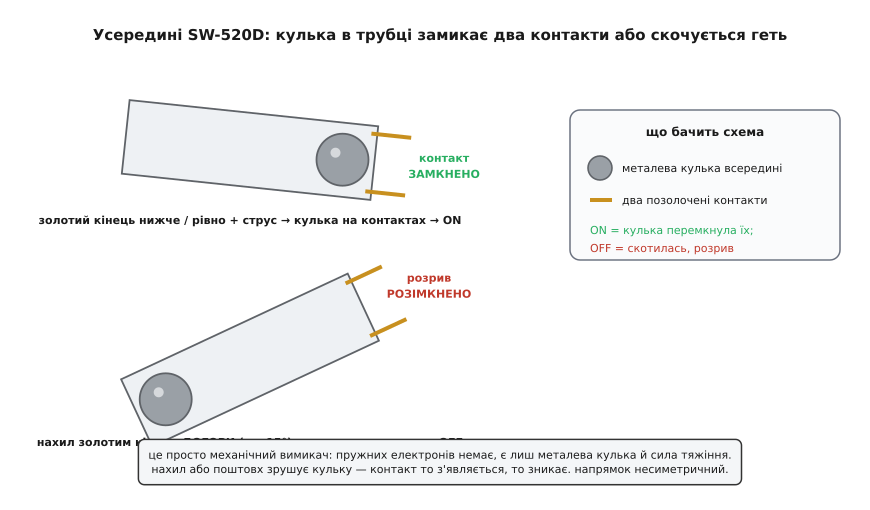
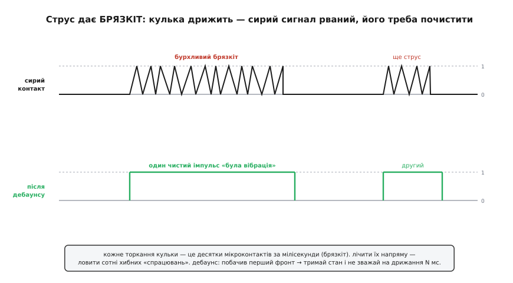
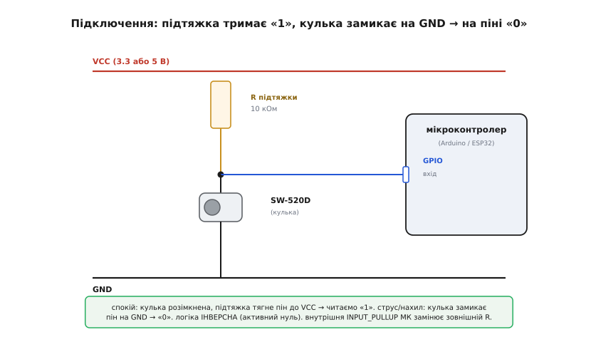

# SW-520D — давач нахилу/вібрації

## Проблема виявлення руху та SW-520D

Для багатьох пристроїв не потрібно обчислювати точний вектор прискорення чи кут нахилу в просторі — достатньо лише дізнатися, що корпус перевернули або струснули. Використовувати для цього повноцінний цифровий @@en|акселерометр@@ (лат. *acceleratio* — прискорення, грец. *метрон* — вимірювання) недоцільно через високу ціну та складність опитування. Для таких завдань використовують [простіший давач нахилу](root:cat-hw-sensors/ky-020-tilt) механічного типу, яскравим представником якого є @@en|SW-520D@@.

Давач @@en|SW-520D@@ є герметичним металевим циліндром, усередині якого вільно переміщуються дві струмопровідні кульки. На одному з торців циліндра розташовано два ізольовані контакти. Під дією сили тяжіння кульки скочуються донизу. Якщо давач нахилений контактами донизу, кульки лягають на обидва електроди й замикають електричне коло. При зміні кута кульки відкочуються в протилежний кінець, і коло розмикається.

*Будова SW-520D: металеві кульки всередині герметичного циліндра замикають контакти під дією сили тяжіння.*

Давач не вимірює кути чи швидкість руху. Він працює як звичайний механічний вимикач, що змінює свій стан залежно від орієнтації у просторі.

## Несиметрія контактів та орієнтація плати

Оскільки контакти розташовані лише з одного кінця трубки @@en|SW-520D@@, давач має односпрямовану чутливість. Кульки замикають коло тільки тоді, коли вектор сили тяжіння або інерції спрямовує їх саме до контактної групи. Нахил у протилежний бік або поздовжнє зміщення кульок вздовж гладкого корпусу залишають контакти розімкненими.

Через це орієнтація @@en|SW-520D@@ на друкованій платі повністю визначає його початковий стан у спокої. Встановлення давача контактами донизу утримує коло замкненим за замовчуванням, а контактами догори — розімкненим.

За вихідним сигналом кулькового вимикача неможливо розрізнити повільний нахил корпусу від різкого струсу. В обох випадках кульки переміщуються всередині циліндра й змінюють стан контактів. Для виявлення виключно ударних навантажень краще застосовувати [спеціалізований давач вібрації](root:cat-hw-sensors/ky-002-vibration), тоді як @@en|SW-520D@@ реагує на будь-який рух, що змушує кульки зміститися.

## Придушення брязкоту та електричні межі

Під час зміщення або удару металеві кульки не одразу зафіксовуються на контактах, а кілька разів відскакують від них. Це явище викликає @@en|брязкіт контактів@@ (англ. *contact bounce*, від *bounce* — відскок), утворюючи серію швидких хаотичних замкнень і розімкнень. Мікроконтролер сприймає ці мікросекундні сплески як десятки окремих подій нахилу.

*Брязкіт контактів: механічні відскоки кульки створюють серію сплесків напруги до остаточного замикання кола.*

Для отримання одного чистого сигналу застосовують @@en|дебаунс@@. Програмний метод полягає у витримці паузи (наприклад, 10–20 ms) після першого перепаду рівня для стабілізації стану. Апаратне згладжування реалізують підключенням паралельного конденсатора.

Електрично @@en|SW-520D@@ має суворі обмеження: максимальна напруга становить 12 V, а струм — не більше 20 mA. Давач слугує виключно джерелом сигналу для керуючих схем і не призначений для прямого комутування силового навантаження.

## Підключення до GPIO та інверсна логіка

Для зчитування стану @@en|SW-520D@@ мікроконтролером його підключають до цифрового входу @@en|GPIO@@. Оскільки давач є простою кнопкою, виводу потрібна підтяжка @@en|PULL-UP@@ (англ. *pull-up*, від *pull* — тягнути та *up* — вгору) до лінії живлення — внутрішня або зовнішня. Один контакт давача з'єднують із виводом @@en|GPIO@@, а другий — із землею GND.

*Схема підключення SW-520D до GPIO: підтяжка до живлення формує логічну одиницю в спокої та активний нуль при замиканні.*

Таке підключення формує @@en|інверсна логіка@@ з @@en|активний нуль@@. Коли давач розімкнений, резистор @@en|PULL-UP@@ утримує на вході високий рівень (логічну одиницю). При нахилі кульки замикають контакти на землю, підтягуючи вхід до низького рівня (логічного нуля).

Голий давач @@en|SW-520D@@ потребує зовнішнього резистора або налаштування вбудованого @@en|PULL-UP@@ у прошивці. Готові плати-модулі містять резисторну обв'язку та @@en|компаратор@@ (лат. *comparator*, від *comparare* — порівнювати) @@en|LM393@@, який видає вже сформований цифровий сигнал DO для зручного підключення.
